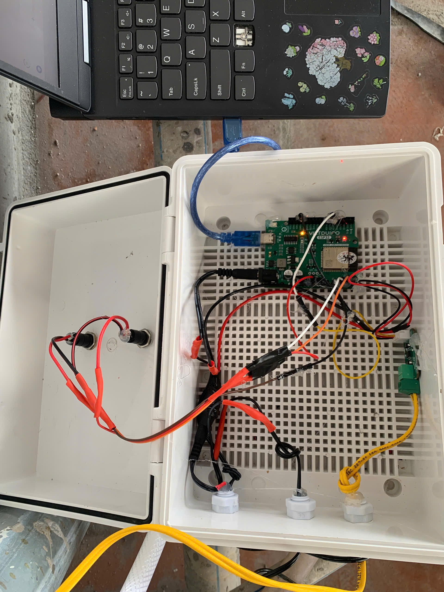
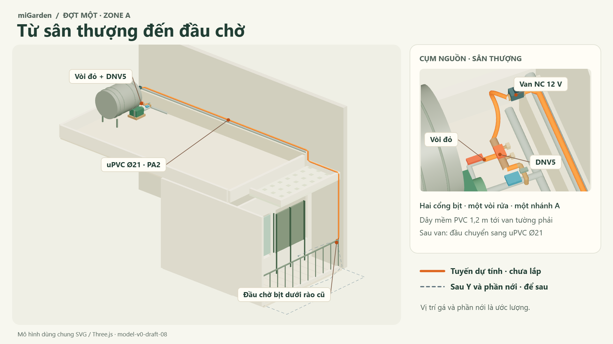
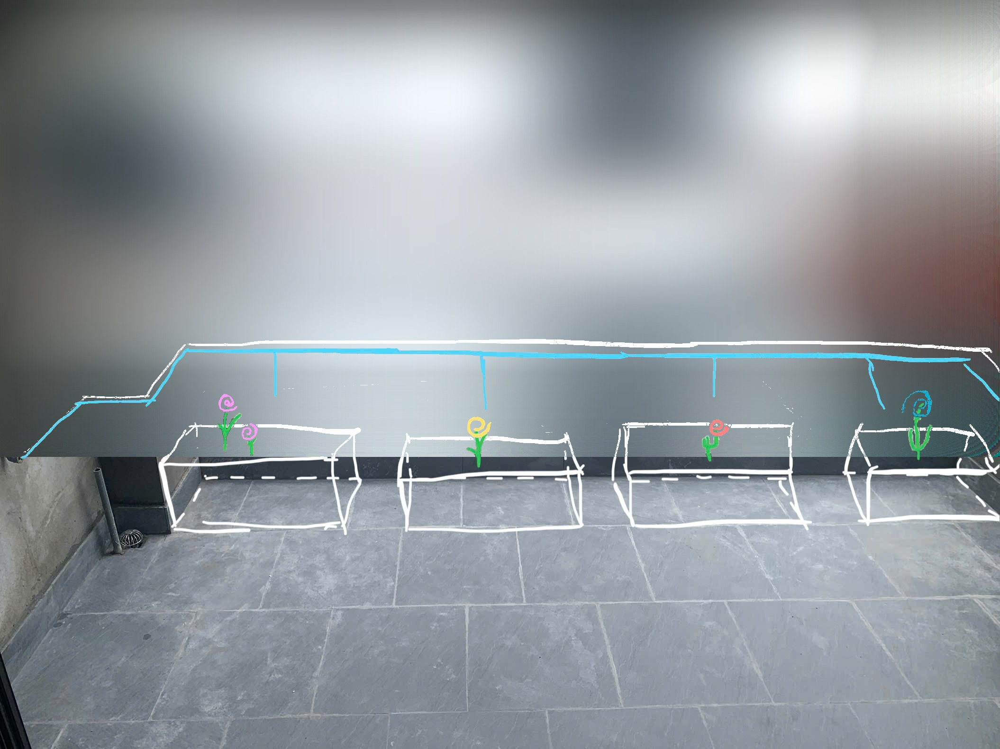

# miGarden

miGarden là hệ tưới cây mình làm cho ban công. Mình đặt lịch, xem lịch sử và bật hoặc dừng tưới từ microSched. Cạnh tủ có hai nút để điều khiển tại chỗ.

Phần IoT của Khu A đã hoàn thành. Nhà mình đang sửa, nên việc còn lại là đi ống nước dọc lan can tới các chậu.

## Xem Khu A hoạt động

- [Tưới trực tiếp từ app điện thoại](https://youtube.com/shorts/I9efHbQY3Gw)
- [Giới thiệu tổng quan hệ thống đã lắp](https://youtube.com/shorts/FNwqNWv7YZo)



Tủ điều khiển Khu A trong lúc kiểm tra.

Mô hình bên dưới cho thấy đường nước từ vòi sân thượng qua van tới đầu chờ ở ban công. Phần đi ống tới các chậu nằm trong [thiết kế đợt lắp tiếp theo](docs/design/09-device-and-component-integration.vi.md#installation-graph).

[](docs/design/09-device-and-component-integration.vi.md#installation-graph)



Mình vẽ thử đường ống dọc lan can và vị trí các chậu.

## Hệ thống chạy thế nào?

microSched là chỗ mình xem lịch, tình trạng thiết bị và lịch sử tưới. ESP32 nhận lệnh từ web, đọc hai nút tại chỗ và chạy lịch đã áp dụng. Ba nguồn đi qua cùng bộ phân xử điều khiển van, với lệnh Dừng được ưu tiên.

- [Firmware ESP32, build và host simulator](code/controller/README.vi.md)
- [Giao thức giữa miGarden và microSched](contracts/zone-a/v1/README.md)
- [Sơ đồ lắp đặt và danh mục linh kiện](docs/design/09-device-and-component-integration.vi.md)
- [Thiết kế 01–10](docs/design/README.md) · [Ví dụ dữ liệu mở offline](docs/design/walkthrough/index.html)

## Chạy thử trên máy

Trên Windows, mở `start-miGarden.cmd` ở gốc repo để chạy viewer. Có thể chạy từ terminal với Node.js 22.8+.

```sh
cd viewer
npm ci --ignore-scripts
npm start
```

[Mở viewer local](http://127.0.0.1:4179/?layout=space) để xoay mô hình và xem tuyến ống. Viewer dùng chung một mô hình cho SVG và Three.js. Nếu muốn chạy mô phỏng controller, xem [hướng dẫn host simulator](code/controller/README.vi.md).

## Tài liệu và phát hành

| Bạn muốn xem | Tài liệu |
|---|---|
| Phần đã chạy và các bước còn lại | [Trạng thái dự án](docs/project-state.md) |
| Hướng dẫn vận hành và bằng chứng cần ghi | [Operations](docs/operations.md) |
| Cách ghi nguồn và công bố hình ảnh | [Representation](docs/representation.md) · [Provenance](docs/provenance.md) |
| Mã nguồn tương thích và phạm vi đã kiểm | [Biên nhận v1.0.0](docs/releases/v1.0.0.vi.md) · [GitHub Releases](https://github.com/NguyenHaiHung0510/miGarden/releases) |

Góp ý về một tình huống vận hành có thể ghi cùng hành vi mong muốn và điều kiện thử. Agent bắt đầu ở [AGENTS.md](AGENTS.md). Xem [notices](THIRD_PARTY_NOTICES.md) cho các thành phần có license riêng và [quy tắc công bố asset](docs/representation.md#public-content-and-private-sources).
