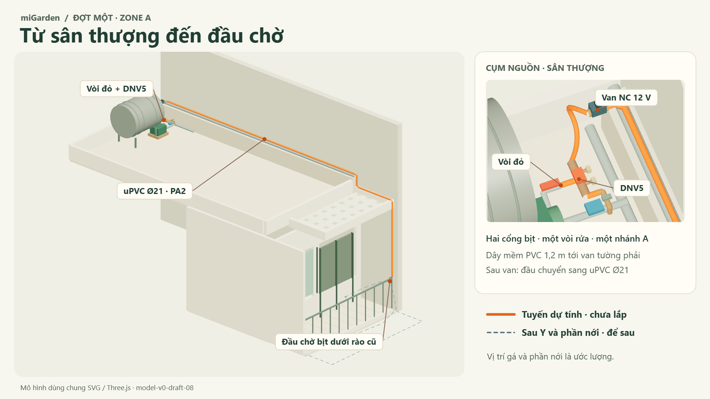

# miGarden

**Từ vòi nước trên sân thượng xuống vườn ban công.** miGarden thiết kế hệ tưới cho vườn hoa và cây cảnh, quản lý lịch và xem kết quả qua microSched.

[](docs/design/09-device-and-component-integration.vi.md#installation-graph)

Đường cam là tuyến dự tính của đợt đầu: vòi đỏ → bộ chia → van trên tường phải → ống cứng → đầu chờ dưới đỉnh rào cũ. Nét xám đứt chỉ hai hướng tưới để sau và phần ban công nới ước lượng. [Xem cách lắp từng cụm](docs/design/09-device-and-component-integration.vi.md#installation-graph) · [Xoay mô hình 3D trên máy](viewer/README.md).

## Đọc thiết kế

Nếu muốn hiểu hệ thống ngay, mở **[09 · Đồ thị lắp đặt và tích hợp](docs/design/09-device-and-component-integration.vi.md)**. Tài liệu đi từ ổ điện, vòi và web tới van, nút và đầu chờ; có [danh mục linh kiện](docs/design/components-zone-a.vi.md) kèm quy cách và link sản phẩm.

| Bước | Tài liệu |
|---|---|
| 01 | [Mục đích và yêu cầu](docs/design/01-purpose-and-requirements.vi.md) |
| 02 | [Quy trình và năm tình huống sử dụng](docs/design/02-process-specification.vi.md) |
| 03 | [Mô hình nghiệp vụ](docs/design/03-domain-model.vi.md) |
| 04 | [Mô hình thông tin](docs/design/04-information-model.vi.md) |
| 05 | [Tám dịch vụ](docs/design/05-service-specification.vi.md) |
| 06 | [Bố trí thiết bị, server và browser](docs/design/06-iot-level-specification.vi.md) |
| 07 | [Chức năng và phối hợp](docs/design/07-functional-view-specification.vi.md) |
| 08 | [Vận hành, giới hạn và phục hồi](docs/design/08-operational-view-specification.vi.md) |
| 09 | [Tích hợp thiết bị, đồ thị lắp đặt và kiểm chứng](docs/design/09-device-and-component-integration.vi.md) |

[Chỉ mục thiết kế](docs/design/README.md) ghi trạng thái từng bước. Có prototype SVG/3D và [bảy ví dụ dữ liệu mẫu mở offline](docs/design/walkthrough/index.html). Firmware tưới, simulator điều khiển, tích hợp microSched và nghiệm thu tại vườn chưa hoàn tất; xem [trạng thái dự án](docs/project-state.md).

## Xem và sửa mô hình

Với Node.js22.8+ và browser có WebGL:

**Windows:** bấm đúp **`start-miGarden.cmd`** ở gốc repo hoặc chạy `./start-miGarden.cmd`. Launcher tự chuẩn bị dependency khi thiếu và mở viewer; dùng lại miGarden đang chạy hoặc chọn cổng trống, không cần nhớ cổng. Giữ cửa sổ server mở; Ctrl+C để dừng.

Hoặc chạy thủ công:

```sh
cd viewer
npm ci --ignore-scripts
npm start
```

Mở [viewer local](http://127.0.0.1:4179/?layout=space). Xoay/bay tự do, focus theo luồng nước, bật/tắt nhãn, toàn màn hình, so tuyến và lưu feedback. Clone public không cần ảnh gốc; raw captures và feedback không nằm trong repo. [Hướng dẫn](viewer/README.md) · [baseline và giới hạn](docs/model-v0.md). Chạy `npm test` trong `viewer/` để kiểm dữ liệu và local server; viewer không điều khiển nước thật.

## Thiết kế hiện tại

- **Area nhóm Zone; điều khiển/lịch/history theo Zone.** Ban đầu triển khai A. Mô hình cho phép B/C/D trong khả năng thực tế chưa xác minh của một ESP32 nhiều Actuator, phương án một van nhánh/Zone, tối đa một lịch logic đang hoạt động local/Zone. Không quản lý chậu/placement hoặc danh sách chậu bị tác động. Chín chậu trong khảo sát là hiện trường của prototype.
- **Lịch local, nút tại nguồn và lệnh từ xa qua cùng bộ phân xử trên ESP32.** STOP ưu tiên; không chạy bù, mở lại intent cũ hoặc khôi phục OPEN sau reboot. Lắp đầu tiên một van NC 12 V và hai nút NO; thời lượng tối đa và hạn mức tích lũy [còn mở ở 08](docs/design/08-operational-view-specification.vi.md#budget-d186). Khóa tay vẫn độc lập.
- **SVG và Three.js dùng chung `viewer/model.json`.** [Mô hình hiện trường](docs/site-model.md) giữ số đo và phần ước lượng; ảnh mô hình minh họa tuyến, không chứng minh đã lắp hoặc đã kiểm nước.
- **Soil/Zigbee HOLD.** Không tự kế thừa notification lifecycle, inventory CRUD hoặc tưới nhóm vào baseline; nhóm chỉ là mở rộng tương lai.
- **miGarden giữ system source; microSched giữ human web/API/storage adapter.** Contract/revision của hai bên phải được gắn khi tích hợp; chưa chọn API/schema/transport bằng việc công bố thiết kế này.

## Đọc theo nhu cầu

| Bạn muốn tìm hiểu | Tài liệu |
|---|---|
| Ví dụ desired/applied, lịch sử bất biến, unknown/time | [Walkthrough offline](docs/design/walkthrough/index.html), [hướng dẫn](docs/design/walkthrough/README.vi.md) |
| Đã có gì, còn thiếu gì | [Project state](docs/project-state.md) |
| Mô hình thực địa, tên gọi và số đo | [Site model](docs/site-model.md), [site baseline](docs/site-baseline.md) |
| Nguồn chung SVG/Three.js và content policy | [Representation](docs/representation.md) |
| Bring-up, evidence và recovery tương lai | [Operations](docs/operations.md) |
| Skill kỹ thuật và license | [Skills](docs/skills.md), [notices](THIRD_PARTY_NOTICES.md) |
| Nguồn thiết kế và vai trò lịch sử | [Provenance](docs/provenance.md) |
| Thiết kế cũ, chỉ reference-only | [Specification](docs/specification.md), [architecture](docs/architecture.md), [design inputs](docs/design-inputs.md) |

## Đóng góp

Ở giai đoạn này, góp ý hữu ích nhất là chỉ ra requirement mâu thuẫn, failure path còn thiếu, assumption chưa có evidence hoặc cách thể hiện site dễ kiểm tra hơn. Issue/PR nên nêu section liên quan, tình huống cụ thể, hành vi mong muốn và nguồn/bằng chứng nếu có. Đề xuất số đo hoặc linh kiện cần nói rõ điều kiện áp dụng; thông số quảng cáo chưa là kết quả kiểm chứng.

Agent hỗ trợ phát triển bắt đầu từ [AGENTS.md](AGENTS.md), rồi chỉ đọc tài liệu và skill phù hợp với nhiệm vụ. Đóng góp asset tuân theo [quy tắc dữ liệu công khai](docs/representation.md#public-content-and-private-sources). MIT notices trong các skill chỉ áp dụng cho nội dung được nêu trong notices; repository chưa công bố license chung cho phần miGarden.
