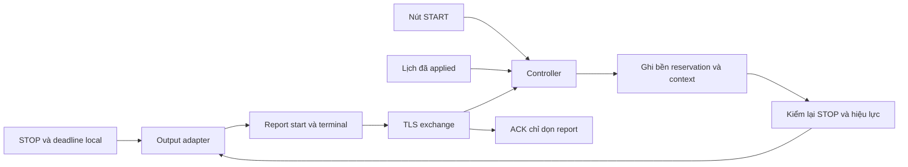

# MiGardenController · Zone A v1

N03/N04 bổ sung transport thương lượng `quiet-health-v1` và health tùy chọn;
[wire](../../contracts/zone-a/v1/README.md#negotiated-quiet-and-optional-health-n03n04)
giữ đầy đủ handshake, wait, retry hữu hạn và rollback. Peer cũ vẫn dùng v1 cũ.
Nhịp mới là 5 giây hỏi Fly khi nhàn, hint 2 giây khi foreground/active; wait
không phải báo cáo xác thực hay ACK. Health chỉ đi kèm exchange, không đổi
arbiter/journal/partition/pin/limits. Build app-only chưa phải nghiệm thu bo.

Đây là firmware Zone A và simulator chạy cùng lõi C++17. LAB dùng output **ảo** để kiểm logic/network trên bo USB. Release dùng GPIO27 active HIGH, START IO33 và STOP IO32 active LOW theo [Step 09](../../docs/design/09-device-and-component-integration.vi.md#buttons). Cả hai dùng [wire v1](../../contracts/zone-a/v1/README.md). Việc build hoặc chạy LAB chưa chứng minh mạch, van hay dòng nước. [Ma trận QA](QA.vi.md) chỉ rõ phần đã kiểm ở host và phần còn phải chạy.

Nếu nút, lịch và web cùng muốn bắt đầu, chúng dùng cùng phiên duy nhất và cùng sổ giới hạn. STOP đi trước; START đến lúc bận hoặc có mặt cùng STOP bị từ chối. Nút mặc định 900 giây, một lượt tối đa 1.800 giây, tổng tối đa 7.200 giây trong bất kỳ 10.800 giây nào. Ba giá trị đầu có thể chỉnh trong một bundle; cửa sổ giữ nguyên. Trước bundle đầu tiên, thiết bị luôn đóng. Không kèm lịch bật sẵn.



Một request web chỉ được mở sau khi đã lưu receipt và nhận grant có cùng nội dung, boot, epoch và config. Việc kiểm hạn 45 giây lặp lại **sau** khi ghi reservation; mốc hết hạn được ràng với cả thời gian trôi từ khi nhận candidate. STOP làm mất hiệu lực epoch cũ, không tạm dừng lịch cho tương lai. Sau khi đã mở hợp lệ, mất Wi‑Fi hoặc hết TTL không chỉnh deadline của phiên. Một STOP có thể ghi `stop_processed` khi không có phiên; giá trị đó không xác nhận nước đã ngừng.

Sau review F1/F3: accounting qua reboot neo ở `accountingFloor` bền và chỉ cộng uptime boot mới, không tin wall downtime. Đã dùng15/120 phút vẫn còn105 nếu các gate khác đủ; không khóa toàn bộ3h. STOP remote khi queue full giữ tối đa16 receipt bền riêng, promote khi ACK mở chỗ; retry không tăng epoch/đóng lặp nếu receipt đã có. Boot/time/outcome của lần xử lý gốc được giữ. STOP dedup dùng exact RAM index dựng trước đường control, không scan storage trước CLOSE. Rollback cần kiểm toàn journal: extension ở frame lịch sử và24KiB cap vẫn có thể làm ea140ed fail closed dù deferred hiện0; compatibility/device rollback UNVERIFIED, không reset journal.

Lịch xét ranh giới phút theo UTC+7, xử lý once/daily/weekly/interval, hiệu lực [from, until). Một mốc phút Zone A có cùng identity xuyên `config_ref`. Đổi bản cấu hình khi active sẽ chờ lần exchange idle sau; firmware không giữ bản nháp để tự apply lúc rảnh. Apply chỉ tác động kỳ sau phiên/ranh giới cutover; kỳ ngay phút apply nếu chưa chứng minh được an toàn sẽ bỏ qua. Khi mới boot, mất time hoặc nhảy qua ranh giới, firmware không lặp các kỳ đã lỡ. Có clock SNTP, thời gian tiếp tục chạy từ đồng hồ của bo khi offline (holdover); clock mất căn cứ sau reboot thì cấm START. Bộ đếm deadline/accounting dựa vào elapsed time ổn định cùng boot, nên chỉnh giờ không mua thêm hạn mức. Cần SNTP tin cậy lại sau mất điện; firmware không dùng `server_time` của response làm đồng hồ.

### Journal và khả năng phục hồi

Partition bảng **default 4 MiB**: app0 `0x10000`/ `0x140000`, app1 `0x150000`/ `0x140000`; data `spiffs` `0x290000`/ `0x160000`. Dùng LittleFS trên đúng vùng data này, không format/grow khi mount. LAB dùng `lab-v1.journal`, release dùng `release-v1.journal`; ứng dụng không tạo ledger mới khi thiếu/hỏng. Build bọc lệnh erase cả NVS của Arduino khi init lỗi; không đụng user profile hoặc xóa NVS. GC theo trang của NVS và cập nhật file LittleFS vẫn diễn ra trong các write hợp lệ.

- Mỗi transaction có length/CRC, là một frame append rồi fsync/close. Reservation ghi bền và đọc kiểm lại trước OPEN. `armed` chỉ giữ chỗ; `running` mới có evidence đã điều khiển output. Sau CLOSE, frame giải quyết reservation thành interval thực tế và report terminal; dữ liệu UTC thiếu không được điền bằng planned time. Sổ dùng ms, wire `output_duration_seconds` là số giây nguyên đã trôi.
- Log có trần 448 KiB; compact khi idle tạo file mới đã sync rồi đổi tên nguyên tử. Hai file tối đa 896 KiB trước filesystem overhead, trong vùng 1.375 MiB. Queue tối đa 512 records; gửi tối đa 16/lần. Admission giữ trước 6 slot report và 5 frame × 24 KiB cho ghi reservation/start/terminal, STOP và ACK. Không thu hồi report chưa ACK. Snapshot không dùng queue. Khi không còn ô cho audit tùy tình huống, ghi evidence gap, tiếp tục giữ STOP và không cho START khi thiếu chỗ. Các số này là bounds của code; power-loss, thời gian ghi và wear trên bo cần đo riêng. LittleFS [atomicity](https://github.com/littlefs-project/littlefs) là nền thiết kế, không là kết quả đo bo.
- Accounting giữ tối đa 768 khoảng đang còn liên quan trong 3 giờ, gộp khoảng liền nhau. Admission kiểm điểm cực đại trong **suốt** interval dự kiến. Vì chỉ một output, khi phiên mới đi vào cửa sổ thì tối đa một khoảng cũ đi ra với cùng tốc độ; tổng tăng hoặc đứng yên đến cuối phiên dự kiến. Nếu gần trần, phần cũ rời cửa sổ đúng lúc vẫn được trừ. Đủ dữ liệu terminal thì dùng interval đã quyết toán; ACK không tác động accounting.
- Reboot không khôi phục OPEN. Nếu mất xác nhận terminal sau possible execution, giữ reservation và trạng thái unknown chung, không tự xóa khi TTL hết, có STOP/ACK hoặc qua 3 giờ. Không cung cấp reset/bypass qua UART/web; cần quy trình recovery đã có bằng chứng và quyền riêng nếu lỗi xảy ra. Nếu ổ lưu hỏng, trạng thái đủ an toàn để OPEN không chứng minh được; CLOSE vẫn được ưu tiên và `DIAG`/snapshot có thể báo lỗi dù không lưu nổi một record.
- Các trần còn lại: 256 ref cấu hình đã dùng (qua reboot); 4.096 START ID và 128 STOP ID hợp lệ mỗi boot. Chạm trần ref không thay bundle hiện dùng; thiết bị từ chối START remote mới nếu hết bộ nhớ dedup START. Khi không giữ được STOP ID mới, vẫn CLOSE và khóa START đến boot mới đã phục hồi sổ an toàn. Không nới trần bằng xóa sổ/đổi identity tùy ý. Thời lượng outage xử lý được tùy số record và write load, không chỉ dung lượng app slot.

Output adapter có task kiểm mỗi 5 ms, đọc STOP thô và giữ khóa đến khi nhả ổn định 35 ms. START chỉ nhận cạnh nhấn sau mức nhả ổn định, không lặp vì giữ. Output dừng theo deadline hoặc lease của control task mất 2 giây; task control có watchdog trong release. HTTPS dùng task khác. Flash stall/RTOS/reset và mức S khi bo mất điện/sự cố driver chưa được đo, vì vậy các con số này chưa là giới hạn phản ứng ở tủ. Giữ van khóa tay độc lập theo [operations](../../docs/operations.md).

PM disposition F2: task có thể đóng trễ deadline danh nghĩa. Sổ giữ elapsed thực
(host kiểm delay7ms và reboot), không ép bằng planned duration hoặc tự giảm
1800/7200 bằng headroom mới. Không cam kết hard real-time0ms; task/deadline/lease
timing bound tại thiết bị và tủ vẫn UNVERIFIED.

### Build và test host

Dùng PowerShell, Arduino CLI 1.6.0, Arduino-ESP32 3.3.12, GNU g++17 trở lên (đã test g++ 15.1), Python với `jsonschema` cho kiểm shape. Dependency [ArduinoJson 7.4.3](https://github.com/bblanchon/ArduinoJson/releases/tag/v7.4.3) lấy từ tag, script xác nhận commit `77771d3c07668e01d8f52acb03910c1110bb373f`.

```powershell
git clone --depth 1 --branch v7.4.3 https://github.com/bblanchon/ArduinoJson.git .local/n01/deps/ArduinoJson
& .\code\controller\test-host.ps1
python -B code/controller/tests/verify-wire.py .local/n01/host-builds/HOST_OUTPUT/sim.exe
& .\code\controller\build-esp32.ps1 -Profile lab -CliConfig .local/arduino-cli.yaml
& .\code\controller\build-esp32.ps1 -Profile release -CliConfig .local/arduino-cli.yaml
```

Build từ commit sạch và config Arduino CLI do operator chỉ định; có thể truyền `-Cli` nếu tool không ở PATH hoặc vị trí Arduino IDE chuẩn. Build không upload. Mỗi artifact có build ID mới và manifest private dưới `.local/n01/build/` với command/revision, hash source/partition, app-only BIN, ELF, MAP; script kiểm slot, profile/marker và link guard NVS. Khi đưa cho USB v1 chỉ chọn file `MiGardenController.ino.bin` có đúng digest trong manifest LAB đã review; không chọn file merged/bootloader/partition hay release. Firmware không chứa pass, token, private host hoặc CA mẫu. Chẩn đoán mạng dùng mã đã lọc; build chặn panic dump của runtime để tránh lưu stack chứa thông tin provision, giữ nguyên partition dump hiện hữu.

Host script in `HOST_OUTPUT` trỏ thư mục mới mỗi lần; dùng đúng đường đó cho
wire/QA, giữ nguyên các BIN/manifest cũ. [Current commissioner/CLI](CURRENT-COMMISSIONING.vi.md)
có temporary image không GPIO/network/control, capture private backup và plan
LAB journal-only hoặc release new-namespace-only. Actual execution cần grant
riêng; preparation/dry-run không mở COM. Existing target journal/namespace là
conflict, không overwrite hoặc reset. Build bằng `-Profile commissioner`;
normal LAB/release không link injection. [Portable CI](ci-host.sh) kiểm core/wire,
không chứng minh hardware hay actual commissioning.

Nếu thiết bị thiếu LittleFS/correct journal, bước phần mềm tiếp theo là tạo **file offline**, ví dụ:
```powershell
& .\code\controller\make-genesis.ps1 -Profile lab -Simulator .local/n01/host-builds/HOST_OUTPUT/sim.exe
```
Script tạo ảnh 1.441.792 bytes chứa đúng journal rỗng, dùng block 4.096/page 256, đóng gói rồi unpack đối chiếu. `-Profile both` chỉ thích hợp cho lần khởi tạo hoàn toàn mới được phê duyệt với cả hai namespace rỗng. Ảnh này **không phải payload v1 updater**. Ghi vùng data sẽ thay cả partition `0x290000..0x3EFFFF`; cần parent xác định backup/blank/layout và có quyền riêng trước khi làm. Nếu vùng đã là LittleFS tương thích, chỉ cần cung cấp file genesis đúng profile vào vùng đã biết an toàn cho lần cấp mới; không thay ledger đã tồn tại bằng file rỗng. Không đụng NVS hoặc đổi partition để giúp mount.

LAB `STORAGE` đọc và phân loại: `BLANK_FF` nếu tất cả bytes là `0xff`, `UNMOUNTABLE_HAS_DATA` nếu có dữ liệu chưa nhận diện, hoặc `LITTLEFS_JOURNAL_PRESENT/MISSING` nếu mount được. PRESENT chỉ là file tồn tại; DIAG mới cho biết journal usable. `LAYOUT_UNVERIFIED` và `READ_ERROR` giữ nguyên. Khi thiếu journal, có thể kiểm TLS/exchange với snapshot `STORAGE_FAULT`, không OPEN. [Commissioner](CURRENT-COMMISSIONING.vi.md) có thể tạo LittleFS và một journal LAB theo đúng layout/blank/preimage đã được Owner duyệt; không format vùng đã có dữ liệu để hoàn thành bench.

### LAB: USB v1 và provision riêng

Giữ `PING`, `INFO`, `BEGIN <length> <sha256>`, ACK từng 1.024 bytes, `REBOOT`, heartbeat/RESYNC của USB bootstrap v1. Update và provision bắt đầu được khi **idle + OFF**; vào maintenance vô hiệu pending START và cắt reply mạng cũ. Trong lúc nhận binary chưa có active session và không có đường START. LAB không biên dịch adapter chân IO27/32/33 trong core điều khiển. `DIAG` trả profile/build, gate, time quality, kích thước queue/log, evidence gaps, kết nối và heap; không echo giá trị provision. Output LAB `virtual_on` là mô phỏng của software; UART là kênh giao tiếp bench.

LAB `DIAG` có thêm `wifi_status` (numeric SDK WiFi.status) và
`disconnect_reason` (numeric reason từ event disconnect gần nhất, 0 nếu chưa
có event). Hai số giúp phân biệt chưa thấy AP, auth và link timeout; chúng không
chứng minh nguyên nhân cuối. Không SSID/password/token/BSSID/IP trong DIAG.
`wifi_slot` là 1 (preferred), 2 (fallback) hoặc 0 (đang backoff/chưa thử);
`wifi_phase` là READY/TRYING/CONNECTED/BACKOFF. Release cũng chỉ in slot/phase,
không in mạng hoặc credential.

Lệnh LAB `NETINFO` trả duy nhất `NETINFO <IPv4>` hoặc `NETINFO LINK_PENDING`, chỉ khi parent yêu cầu; giữ kết quả ở receipt riêng. Parent có thể chuẩn bị relay/firewall với luật mặc định đóng, lấy IP từ UART sau DHCP rồi chỉ mở cho địa chỉ đó. Firmware tự thử kết nối khi clock sẵn sàng, kể cả khi relay vẫn đóng.

Firmware ghi đúng slot inactive đã xác minh, kiểm SHA input và SHA toàn bộ bytes đọc lại từ flash, rồi kiểm image bằng ESP-IDF trước khi chọn boot. Có marker N01 cho adapter tương thích; nguồn tin cho build ID/digest vẫn là manifest đã review ở host. Từ chối flash encryption/secure boot hoặc app đang pending verify; không đổi các cờ đó. Hai giây đầu có thể chưa hiện target trong INFO; app trì hoãn xác nhận rollback mặc định và chỉ xác nhận khi đã vào vòng điều khiển an toàn, serial đã hoạt động. Đây không xác nhận TLS, config, journal hoặc output vật lý; bootloader đang cài và rollback khi bootloop vẫn chưa test. Cần giữ ROM recovery đã được parent kiểm trước khi dùng unattended. Lỗi/lost receipt gần activation là unknown: ngừng writer, chờ thụ động marker, đối chiếu boot/slot/build/digest với giao dịch đã lưu trước khi bất kỳ retry. Sau timeout quiet/resync v1 giảm nhầm đuôi binary, không chứng minh chống được tail vô hạn; chỉ dùng sender stop-and-wait và không thêm writer khác.

Provision cho parent giữ file JSON riêng: các trường `device_id`, `wifi_ssid`, `wifi_password`, `base_url`, `device_token`, `ca_pem`; có thể thêm đúng một cặp `wifi_fallback_ssid`, `wifi_fallback_password`. Mạng trong hai trường cũ là preferred; cặp optional là secondary. `base_url` là origin HTTPS DNS/IPv4 (có thể có port, không thêm path); CA PEM là trust root dùng cho origin, không có private key. Dùng UTF‑8 không BOM. Gửi cổng parent đã lease ở 115200:

1. Gửi ASCII `PROVISION <số-byte>\n` (1..8.192), đợi đúng `PROVISION_READY`.
2. Gửi đúng các byte file, không newline thêm/mix lệnh và không in file hoặc payload. Nếu lỗi/timeout, dừng writer, quan sát thụ động `RESYNC READY` khi có raw frame đang dở.
3. `PROVISION_OK reboot_required=1` nghĩa blob đã commit và đọc kiểm trong NVS namespace LAB `mg-lab-v1`, key `profile-v1`. Sau đó lệnh `REBOOT` riêng. Fail trả mã chung. Chỉ đổi Wi‑Fi/password/token của đúng identity/origin/CA; không chuyển safety state sang server khác bằng provision.

Release đọc blob riêng ở `mg-rel-v1/profile-v1` (NVS key `profile-v1`); không nhận file qua UART. Production trust root và thiết lập `fixture_verified:true` cần quy trình Owner đã kiểm mạch/fixture; ảnh release chưa có profile nào. Không tự provision production. TLS kiểm chain/name của API; riêng LAB IPAddress SAN được [Mbed TLS 3.6.6 hỗ trợ](https://github.com/Mbed-TLS/mbedtls/blob/v3.6.6/library/x509_crt.c#L2697-L2714). Device phải có clock qua SNTP trước TLS. HTTP không follow redirect; thực hiện retry 5/15/30/60 giây cộng jitter và Retry-After; lỗi xác thực/cấu hình dừng retry đến khi có can thiệp. Số đo TLS đúng/sai CA, SAN/IP, latency, heap và flash runtime chờ bench.

### Hai mạng Wi-Fi được lưu sẵn

Lúc offline, thử preferred tối đa15 giây rồi secondary tối đa15 giây nếu
đã provision. Nếu vẫn offline, ngắt attempt và đợi5/10/20/40/60 giây (trần60),
rồi bắt đầu vòng mới từ preferred. Profile cũ không có cặp optional vẫn dùng
được; chỉ thử một mạng rồi backoff. Thời gian là elapsed monotonic trong task
network; scheduler, START/STOP và output deadline tiếp tục ở task riêng.
Không có vòng đợi kết nối hoặc quét AP trong control task.

Mạng preferred là đường bình thường. Không có hotspot secondary thì không
phát cảnh báo hoặc tìm nó khi preferred đang nối tốt. Khi đã nối secondary,
giữ link đó cho tới khi mất link; không ép chuyển khi preferred xuất hiện lại.
Lần reconnect sau mất link quay về preferred. Backoff reset sau kết nối tốt.
Đây là thứ tự thử kết nối, không là chọn theo RSSI hoặc tự roaming.

SSID 1..32 và passphrase đều là ASCII printable (space được phép,
control/DEL/non-ASCII bị từ chối). Password rỗng giữ ý nghĩa open network
của profile cũ; nếu có password thì 8..63 ký tự hoặc đúng64 ký tự hex.
Cặp secondary phải đủ cả hai key và có SSID khác preferred theo exact bytes
(có phân biệt case); null/empty SSID hoặc quá một secondary bị từ chối ở
commissioning validator. Credential nằm trong blob private ban đầu, không
hardcode, không lưu mỗi lần retry và không đổi journal/id/token/CA/wire.
General USB profile replacement được hoãn; việc hỗ trợ hai mạng không cho
phép commissioner ghi đè namespace hoặc LAB profile đang có.

[wifi_tests.cpp](tests/wifi_tests.cpp) dùng đúng parser/policy của firmware và
fake elapsed clock; [test_wifi_profile.py](tests/test_wifi_profile.py) kiểm
validator offline cùng refusal→restore. Các test này không chứng minh AP thật,
radio/DHCP hoặc device timing; Parent giữ lane thử hotspot thật.

### Phục hồi phiên bị ngắt do reboot

Boot vẫn đóng đầu ra và không replay START/lịch cũ. Một phiên đã ghi running
hoặc armed khi reboot có cause bền riêng; nó chặn START cho đến một STOP mới.
Local STOP đang giữ lúc boot chỉ CLOSE; nhả rồi bấm lại để settle. Remote STOP
phải khớp boot hiện tại. Lỗi storage/output hoặc unknown không có proof không
được xóa bằng STOP. Không cần UTC mới để ghi nhận STOP local; clock/gate bình
thường vẫn phải đạt trước START tiếp theo.

Một commit ghi cùng lúc: khoản dự phòng đủ **thời lượng dự kiến**, đã settle
phiên, và report `recovered` cho đúng ID của phiên gốc. Report terminal unknown
và duration null giữ nguyên. Khoản này cộng riêng vào kiểm rolling, không giả
thành interval đo được, không cho timeline nhảy tới tương lai. Nó hết hạn sau
180 phút uptime có căn cứ tính từ settle; nếu settle thêm trong cửa sổ, giữ
cả hai khoản tới mốc conservatively mới hơn. Các lượt đã đo vẫn tính theo
interval gốc. Nếu còn budget, START mới có thể chạy sau STOP; duplicate
STOP/reboot/ACK không charge lại.

Journal legacy chỉ nhập cause nếu tìm thấy chuỗi frame CRC hợp lệ khớp
started/running → reboot terminal unknown của đúng phiên, không có fault
mâu thuẫn sau đó. ACK không tự xóa frame, nhưng compaction có thể đã xóa proof.
Nếu không tìm được proof thì giữ khóa, báo operator, không format/reset sổ.
Tool host read-only `sim recovery-check <private-journal-copy>` trả kết quả
bool và khoản charge, không in ID hay dữ liệu riêng. Đây là kiểm chứng nguồn
journal đã được operator tin cậy, không xác thực chữ ký/đọc thiết bị.
Đưa app nhận và kiểm marker lên trước firmware mới để tránh ACK của reader cũ.
Xem [wire recovery](../../contracts/zone-a/v1/README.md#reboot-recovery-and-foreground-hint).

### Simulator không thiết bị

`\.local\n01\host\sim.exe --help` (dùng `.` trước đường dẫn tương đối trong PowerShell). Mỗi process giữ một journal trong RAM, clock mặc định 2026‑11‑18T00:00:00Z và boot synthetic. Không cần socket, serial hoặc credential. Default device ID `qa-controller-a`, có thể truyền `--device-id` cho fixture dùng disposable backend. Mỗi dòng input trả đúng một object JSON (trừ `quit`).

| Lệnh | Kết quả |
|---|---|
| `snapshot` | Request exchange v1, gồm reports chưa ACK. |
| `exchange <response-json>` | Nhận một response device, chạy arbiter và trả request v1 mới. |
| `advance <ms>` / `gap <ms>` | Cho clock chạy đều với scheduler / nhảy tiến do mất vòng tick. |
| `jump <UTC>` / `clock unknown\|synced\|holdover` | Đổi civil time / chất lượng timestamp. |
| `start` / `stop` / `release` | Cạnh START ảo / bấm STOP ảo / nhả STOP. |
| `reboot` / `diag` / `quit` | Boot mới giữ journal, mất đồng bộ clock / xem gates, queue, số lần OPEN / thoát. |

Ví dụ không cần cài config: `'snapshot','start','stop','snapshot','quit' | & ./.local/n01/host/sim.exe`. Ca có apply → candidate/receipt → grant → dừng sau 17 giây → ACK/reboot nằm trong [verify-wire.py](tests/verify-wire.py). Dùng seed/test bên simulator và LAB riêng; artifact release không link test hoặc lệnh synthetic. Không đổi board, nạp hoặc gửi lệnh ở tủ từ các lệnh host trên.
