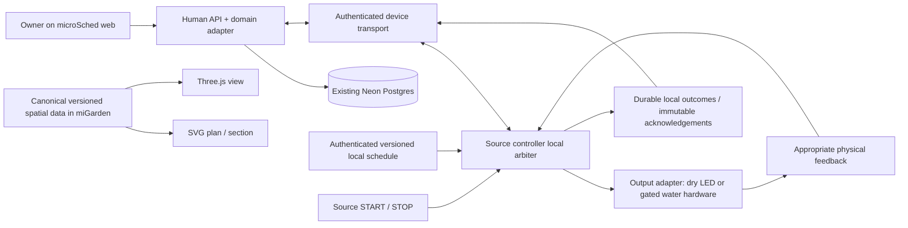

# System architecture and trust boundaries

Current topology after MG-H1 approval, 2026-10-22; implementation remains unbuilt/unverified. This public derivative reconciles the old all-in-microSched repository clause while retaining its web/API/DB boundaries.

The arrows show logical responsibility, not chosen transport, wiring or measured geometry. Field mains/pump operation and manual water shutoff require separate physical design and evidence.

| Boundary | Ownership / retained contract |
|---|---|
| miGarden system | Firmware/local arbiter, simulator, hardware lifecycle/recovery, canonical spatial source, integration contracts and physical evidence. No implemented build tree is promised by this migration. |
| microSched adapter | Existing FastAPI modular monolith + SPA same origin; one Neon/Postgres database, SQLModel/Alembic, UUIDv7, `timestamptz`, TEXT+CHECK enums and audit. Human session auth distinct from device credential. No new database or standalone web backend by default. |
| Shared contract | Explicit schema/command/config/policy/scene versions. Producer and consumer pin exact refs; compatibility tests/receipt before release. Cross-repo changes are no longer atomic. Do not keep competing canonical scene copies. |
| Device API | Derive target from authenticated credential; human session is not a device identity. Device payload cannot retarget a command. TLS validation precedes credential/body transfer. |
| Remote command | Atomic lease, received acknowledgement and execution grant before possible action; no redelivery after grant. Lost terminal evidence becomes OUTCOME_UNKNOWN. |
| Local schedule/input | Local authenticated/versioned/time-valid schedule and button create their own events and enter the same arbiter. They do not need an online cloud lease for each local occurrence. No bypass of interlock/unknown/budget/feedback/manual shutoff. |
| Physical feedback | LED/GPIO/received ack cannot prove delivered water or valve position. Valve/flow/leak feedback and local cutoff must match actual harm and operating envelope. |
| Untrusted inputs | UI/device/config/update/ack/time/replay all need explicit validation/identity/freshness. A local or single-owner network does not make every input trusted. |

Firmware/system and web adapter releases have their own build evidence and shared compatibility manifest. Keep microSched required checks in its repository; add actual system checks only when the build exists. Cached develop survey is a source snapshot, not deployed SHA/readiness evidence. Refresh relevant code at actual implementation time rather than importing old app-specific harness controls into this project.

Open architecture details: transport, time recovery, durable dedup/cumulative ledger, priority/debounce/input semantics, local policy representation, provisioning mechanism, toolchain/partition, physical feedback/cutoff and safe device update/recovery. No key scheme, broker, RTC, permanent server, OTA or new host has been selected here.
