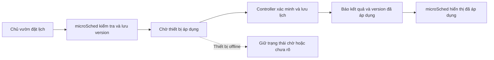
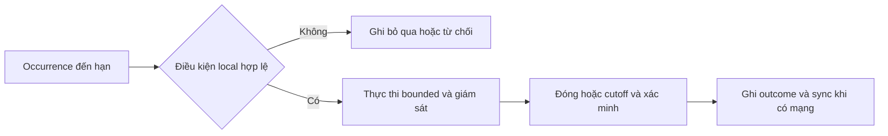
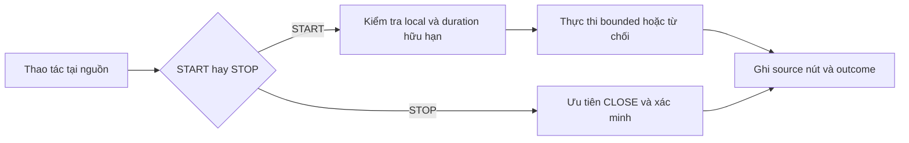
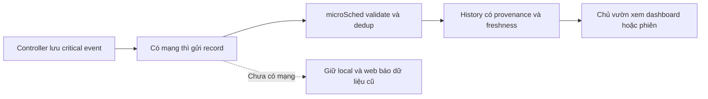

# miGarden — Bước 2: Process Specification

**Baseline công khai · 2026-11-03 · Asia/Saigon.** Năm use case (UC) mô tả lát cắt tưới core theo [01](01-purpose-and-requirements.vi.md), đã đồng bộ với [03](03-domain-model.vi.md)/[04](04-information-model.vi.md). Đây là hành vi thiết kế, chưa là API/DB/firmware hoặc device/water acceptance.

## Mục đích và quy ước chung

UC ghi bên tham gia, trigger, input, preconditions, luồng, output/feedback và nhánh lỗi. Khi coi microSched + Controller là hệ thống, chủ vườn là actor ngoài; clock/scheduler là thành phần/sự kiện nội bộ, không phải người dùng.

- Zone là đích điều khiển, lịch và lịch sử; Area nhóm Zone. Ban đầu A, sau đó B/C/D trong capacity chưa xác minh của cùng một ESP32; phương án một van nhánh/Zone. Preview/history theo Zone, không danh sách chậu hoặc inventory/assignment CRUD.
- Mỗi Zone tối đa một lịch logic hoạt động tại local. Desired đã lưu khác last-known applied; applied không bằng enabled/readiness/physical state. Nội dung được dùng cho lịch sử phải còn resolve được khi cấu hình hiện tại đổi.
- Giờ Hà Nội UTC+7 cố định; once/daily/weekly/interval với ngày hiệu lực/cửa sổ/anchor phù hợp. Start/interval chia 1 phút, duration chia 15 giây; không phải clock accuracy hoặc water defaults.
- Schedule/local_button/remote cùng qua local arbiter, all-source cumulative limits/interlock và time/config/policy/accounting/target đáng tin. Lịch/nút không cần cloud grant từng lần; remote cần quyền/đích/identity/hiệu lực/confirmation và handoff hợp lệ, chưa chọn transport/protocol.
- STOP ưu tiên CLOSE và ngăn pending START cũ tự mở sau STOP; không cần OPEN gates. START bận bị từ chối, không queue muộn. STOP không tự pause lịch tương lai chưa thành intent.
- Possible execution chưa rõ kết quả giữ unknown, chặn OPEN mọi nguồn; nguồn/accounting chung chưa chứng minh độc lập thì chặn mọi Zone. TTL/cooldown hết không xóa unknown/fault. Không catch-up/no-double/restore OPEN do reconnect/reboot/sync.
- Boot fail-closed, giữ cumulative accounting; storage lỗi giữa phiên cần safe stop/cutoff/degraded, có thể có evidence gap. Van khóa tay độc lập và hardware feedback/cutoff vẫn cần; output/CLOSE/receipt không chứng minh flow.
- Giao quyền, phản hồi thực thi và report là các mức khác nhau. Đổi context remote có ý nghĩa cần preview/confirm mới; mọi history giữ ref nội dung/binding bất biến, không lấy latest config thay quá khứ.

## Danh mục năm UC

| ID | Mục tiêu | Truy vết chính |
|---|---|---|
| S2-UC01 | Quản lý lịch và xác nhận áp dụng | FR01, NFR04 |
| S2-UC02 | Thực thi một occurrence lịch local | FR02/04/05, NFR01–04, SAFE01–11 |
| S2-UC03 | START/STOP vật lý tại nguồn | FR03/04/05, safety local |
| S2-UC04 | Tưới/dừng từ microSched | FR06, confirmation/outcome |
| S2-UC05 | Xem dashboard/lịch sử và đồng bộ | FR04/05/07, freshness |

UC không phải danh sách màn hình. Notification lifecycle, inventory và group orchestration không tự trở thành nghĩa vụ; status/error/freshness hiện tại vẫn giữ.

## S2-UC01 — Quản lý lịch và xác nhận áp dụng

**Mục tiêu người dùng:** một lịch hợp lệ được lưu và người dùng biết rõ thiết bị đã áp dụng chưa. Lưu trên website và áp dụng trên thiết bị là hai kết quả khác nhau.

| Thành phần | Nội dung |
|---|---|
| Actor khởi xướng | Chủ vườn có quyền quản lý |
| Bên tham gia | Người dùng, microSched, controller miGarden |
| Trigger | Tạo/sửa lịch, tạm dừng hoặc bật lại lịch |
| Input | Ngày/giờ Hà Nội UTC+7 cố định, quy tắc lặp/chu kỳ và hiệu lực, thời lượng theo độ chia 15 giây, target Zone, trạng thái bật/tạm dừng, version hiện hành khi sửa |
| Preconditions của luồng cơ sở | Người dùng hợp lệ; phạm vi/policy đã có; dữ liệu đầu vào hợp lệ; lịch chưa đến hạn, không có xung đột đang xử lý; controller kết nối và sẵn sàng xác minh/áp dụng |
| Output | Bản lịch/version được lưu, receipt trạng thái thiết bị và trạng thái hiển thị trung thực |
| Feedback cho người dùng | Đã lưu/chờ thiết bị/đã áp dụng/từ chối/chưa xác định; có lý do và freshness khi cần |

### Luồng bình thường

1. Chủ vườn nhập hoặc sửa ngày, giờ, quy tắc lặp và thời lượng rồi lưu trên microSched.
2. microSched kiểm tra quyền, tính hợp lệ và các ràng buộc cấu hình; tạo bản lịch/version để gửi tới thiết bị. Trạng thái lúc này là đã lưu/chờ áp dụng.
3. Controller nhận bản lịch, xác minh nguồn/version/hiệu lực và điều kiện áp dụng; lưu và xác nhận bản lịch dùng cho các occurrence tiếp theo. Chuyển version theo LC02 để cơ hội đã xử lý ở version cũ không thành lần tưới mới chỉ vì ID/version khác.
4. Controller báo về version và kết quả áp dụng. microSched đối chiếu receipt với bản lịch đã gửi.
5. Website hiển thị đã áp dụng trên thiết bị. Lần dự kiến tiếp theo chỉ được tính/hiển thị đúng ngữ cảnh bản lịch đó; không gọi đây là lần tưới đã thực thi.

**Postcondition:** biết bản lịch nào đã được áp dụng. Quy trình này tự nó không mở nước ngay; sự kiện tới giờ và kiểm tra thực thi thuộc UC02. Lịch quá hạn/lỡ và trường hợp áp dụng trong phiên đang chạy cần nhánh riêng, không tự catch-up hoặc thay đổi phiên đang chạy bằng suy đoán.

### Nhánh thay thế/lỗi

| ID | Trường hợp | Hành vi mong muốn |
|---|---|---|
| UC01-A01 | Dữ liệu/target/hiệu lực/duration không hợp lệ | Từ chối và nêu lý do; không âm thầm sửa thành lựa chọn khác rồi áp dụng |
| UC01-A02 | Controller offline | Giữ chờ/chưa áp dụng; bản local cũ chỉ dùng khi còn hợp lệ. Không cam kết thay đổi/pause từ web đã có hiệu lực ở thiết bị |
| UC01-A03 | Version cũ, sửa đồng thời hoặc receipt không khớp | Không áp dụng version lùi/ghi đè lặng lẽ; hiển thị xung đột và đối chiếu bản hiện hành |
| UC01-A04 | Controller có thể đã áp dụng nhưng mất receipt | Giữ chưa xác định đến khi đối chiếu version; không suy thất bại hoặc mở nước để thử |
| UC01-A05 | Tạm dừng/bật lại lịch | Tạo thay đổi version và chờ áp dụng; pause đã áp dụng ngăn occurrence mới. Theo P01: dừng phiên đang chạy dùng STOP riêng, không sửa lịch sử phiên cũ |
| UC01-A06 | Lưu config local lỗi/hỏng/đầy | Không dùng bản ghi dở; báo degraded. Bản cũ chỉ dùng nếu còn hợp lệ và chứng minh được trạng thái |
| UC01-A07 | Đổi version cận giờ, khi phiên đang chạy hoặc sau khi occurrence cũ đã xử lý | Theo LC02/P01: không sửa/khởi động lại phiên cũ, không chạy bù hoặc mở lần hai cùng cơ hội. Web mất receipt chỉ đối soát applied version; không tự tạo occurrence thay thế |
| UC01-A08 | Clock/điều kiện local chưa đáng tin | Không báo sẵn sàng tưới; phân biệt đã lưu cấu hình với được phép kích hoạt |

Các UC và bảng truy vết cuối tài liệu cùng bao phủ SAFE01–11; riêng UC01 không phải toàn bộ safety analysis.

## S2-UC02 — Thực thi một occurrence lịch tại local

**Mục tiêu:** lịch hợp lệ được thực hiện có giới hạn tại controller, kể cả khi chỉ mất Internet; mỗi occurrence có kết quả/lịch sử riêng.

| Thành phần | Đặc tả |
|---|---|
| Bên tham gia | Controller, local scheduler, output/feedback; microSched khi sync. Không cần người bấm tại lúc chạy |
| Trigger | Đến thời điểm occurrence thuộc version lịch đã áp dụng |
| Input | Lịch/version, thời điểm dự kiến, Zone và binding Controller/Actuator đã resolve, duration, policy/budget và trạng thái local/time/config/ledger/feedback |
| Preconditions | Còn điện và điều kiện nguồn nước/phần cứng phù hợp; lịch/thời gian/config/ledger đáng tin, target xác minh được, không active/unknown chưa xử lý, đủ giới hạn an toàn. Không đòi cloud online |
| Output | Record occurrence: source schedule, version/target, planned và reported execution, outcome/reason/feedback |
| Feedback | Chỉ báo local theo thiết kế; web nhận khi sync, kèm freshness/clock quality |

### Luồng bình thường

1. Scheduler phát hiện occurrence đến hạn theo giờ Hà Nội, xác định ID theo contract và đối chiếu lịch sử chuyển version/LC02. ID khác nhau vì version không tự chứng minh đây là cơ hội tưới mới.
2. Kiểm tra occurrence chưa thực thi/còn hiệu lực; xác minh Zone, mapping và nội dung hiệu lực thực dùng.
3. Local arbiter kiểm tra điều kiện OPEN, giới hạn từng phiên/tích lũy/cooldown, interlock/feedback và kết quả chưa rõ; bảo đảm critical intent/outcome và budget có thể ghi nhận đáng tin trước tác động.
4. Khi hợp lệ, yêu cầu mở output trong duration bị giới hạn; ghi sự kiện bắt đầu ở đúng mức bằng chứng. Occurrence local không cần xin cloud grant.
5. Giám sát deadline, STOP và điều kiện/feedback an toàn; mất mạng không làm mất giới hạn local.
6. Đến điểm dừng hoặc có STOP/lỗi, yêu cầu đóng/cutoff và xác minh an toàn theo thiết kế physical feedback.
7. Ghi kết quả theo evidence: hoàn tất, dừng sớm/lỗi/từ chối hoặc chưa rõ; giờ/duration thực thi được báo cáo khi xác định được. Không gọi thành công vật lý chỉ từ GPIO/log.
8. Lưu critical record cùng ref nội dung/binding bất biến; sync qua UC05 khi có mạng. Đồng bộ không tạo lần tưới mới.

### Nhánh thay thế/lỗi

| ID | Tình huống | Hành vi mong muốn |
|---|---|---|
| UC02-A01 | Trigger lặp hoặc version cũ/mới cùng liên quan một cơ hội | Dùng ledger/cutover theo LC02, không mở lần hai chỉ vì ID/version khác; nếu không chứng minh được trạng thái thì không OPEN |
| UC02-A02 | Mất Internet hoặc microSched giữa phiên | Giữ kiểm soát/dừng local của phiên hợp lệ; lưu record để sync sau |
| UC02-A03 | Clock/config/lịch/ledger không hợp lệ hoặc budget không chứng minh được | Không OPEN; ghi từ chối/bỏ qua/degraded, không tự catch-up sau phục hồi |
| UC02-A04 | Remote/local START tới cùng lúc hoặc đã có phiên | Chung arbiter ngăn mở trùng/song song và vượt budget; P02: từ chối START bận thay vì tự queue. Nếu có STOP thì phải xử lý pending OPEN theo LC01 |
| UC02-A05 | STOP tại nguồn hoặc remote hợp lệ | Ưu tiên CLOSE và LC01 để pending OPEN cũ không tự mở lại; ghi lý do dừng. Không mặc nhiên xóa/pause lịch tương lai chưa tạo intent |
| UC02-A06 | Nguồn nước/áp bất thường, tắc/rò rỉ, van/driver kẹt, thiếu feedback hoặc sau CLOSE còn flow | Phản ứng/cutoff phù hợp, giữ lỗi/unknown theo evidence; chặn OPEN mới khi chưa xác minh an toàn. CLOSE không tự là nước đã ngừng |
| UC02-A07 | Treo/reboot/mất nguồn | Fail-safe phù hợp; không restore OPEN hoặc replay lần lỡ. Kết quả cũ chưa rõ cần recovery/xác minh trước OPEN mới |
| UC02-A08 | Critical storage đầy/hỏng hoặc không ghi được ledger/outcome | Không START thiếu kiểm soát; nếu đang chạy xử lý dừng/cutoff an toàn và degraded. Telemetry thường không lấn critical record |
| UC02-A09 | Zone/mapping/nội dung hiệu lực đổi hoặc không đối chiếu được | Không mở nếu target/policy chưa xác minh; không rewrite history từ cấu hình hiện tại. Ranh giới nội dung/binding theo P03 còn mở |
| UC02-A10 | Clock quality đổi hoặc thiếu mốc start/end | Bảo vệ deadline local theo thiết kế; ghi uncertainty, không lấy planned duration làm thực tế |

**Postconditions:** mỗi occurrence tối đa một action được phép theo contract; khi ghi nhận được thì có outcome/evidence rõ. Nếu critical storage hỏng, thể hiện degraded/evidence gap và chặn OPEN mới khi chưa an toàn, không hứa luôn có record đã lưu dù không thể ghi. Không cam kết mọi occurrence được tưới khi preconditions không đạt.

**Điểm cần hiểu:** tự chủ local có điều kiện và giới hạn; safety ở tại chỗ, lịch sử có thể lên web muộn.

## S2-UC03 — START/STOP vật lý tại nguồn

**Mục tiêu:** người tại nguồn yêu cầu tưới/dừng local, không cần đăng nhập web hoặc Internet.

| Thành phần | Đặc tả |
|---|---|
| Actor | Người thao tác tại nguồn, không tự gán Owner nếu không xác thực danh tính |
| Bên tham gia | Người thao tác, input local, controller, output/feedback; microSched khi sync |
| Trigger | Intent START hoặc STOP từ thao tác vật lý hợp lệ |
| Input | Loại thao tác, manual duration/policy, Zone, binding Controller/Actuator và nội dung hiệu lực được resolve trước OPEN và trạng thái local |
| Preconditions START | Controller/điện hoạt động, duration hữu hạn hợp lệ, đủ điều kiện local/time/config/ledger/safety; không cần cloud |
| Preconditions STOP | Có đường input/điều khiển còn hoạt động để yêu cầu CLOSE; không đòi preconditions của OPEN hoặc một phiên đã xác minh được |
| Output | Phiên local_button hoặc record dừng/từ chối/chưa rõ, cùng feedback |
| Feedback | Chỉ báo chấp nhận/từ chối/đang xử lý/dừng theo thiết kế; web chỉ biết sau receipt/sync |

### Luồng START bình thường

1. Người tại nguồn thực hiện START theo quy ước input sẽ thiết kế.
2. Controller nhận intent local_button, không vòng lên cloud xin phép hoặc tự suy người bấm.
3. Lấy target/manual duration hữu hạn từ config/policy, không lấy ví dụ30giây/5phút/10phút làm default hoặc kế thừa một duration bất kỳ.
4. Resolve/giữ ref bất biến của Zone, mapping và nội dung hiệu lực tại thực thi theo LC03; chưa xác minh được thì từ chối START. Sau đó qua cùng arbiter/limits/critical logging như UC02, hợp lệ mới chạy phiên có deadline.
5. Đến hạn/STOP/lỗi thì yêu cầu đóng/cutoff và xác minh theo evidence.
6. Lưu outcome source local_button; sync UC05 khi có mạng.

### Luồng STOP

1. Nhận intent STOP tại nguồn.
2. Ưu tiên CLOSE cho phạm vi tương ứng theo LC01, không đợi cloud hoặc điều kiện cho OPEN. Pending OPEN cũ cùng target phải bị hủy/từ chối/chặn, không chỉ đóng xong rồi cho chúng tự mở lại.
3. Xác minh dừng; cập nhật phiên nếu xác định được, hoặc giữ unknown/lỗi khi chưa chứng minh nước an toàn.
4. Ghi record/feedback cùng source/Zone/binding/time-quality khi xác định được. STOP không tự xóa/pause lịch tương lai chưa tạo intent; nếu offline thì đối soát pending remote sau reconnect, không mở lại intent cũ trước khi đối soát an toàn.

### Nhánh thay thế/lỗi

| ID | Tình huống | Hành vi mong muốn |
|---|---|---|
| UC03-A01 | Mất Internet/microSched | START hợp lệ và STOP xử lý local; web giữ dữ liệu cũ đến sync |
| UC03-A02 | Duration/config/clock/ledger/safety không hợp lệ | Từ chối START, nêu trạng thái; STOP vẫn yêu cầu CLOSE |
| UC03-A03 | Bấm lặp/bounce hoặc START đang có phiên | Không nhân/kéo dài phiên vượt giới hạn. P02: từ chối START bận; gesture/debounce và số nút chưa chọn |
| UC03-A04 | Không biết người bấm | Ghi local physical operator/source nút, không ghi giả Owner/người nhà cụ thể |
| UC03-A05 | Treo/mất điện khiến STOP điện tử không chạy | Không báo đã dừng chỉ từ nút; fail-safe/cutoff và van khóa tay độc lập là bảo vệ phải thiết kế/kiểm chứng |
| UC03-A06 | Van/feedback bất thường hoặc kết quả trước chưa rõ | CLOSE/cutoff, giữ lỗi/unknown, chặn OPEN đến khi xác minh an toàn |
| UC03-A07 | Ghi critical record/budget lỗi | START bị chặn/degraded; reset/cloud absence không xóa accounting; STOP theo đường an toàn |
| UC03-A08 | Không xác minh Zone/binding/nội dung hiệu lực hoặc context thay đổi | Không START khi không chứng minh được context; giữ ref bất biến của phiên đã bắt đầu và ghi thay đổi/uncertainty, không thay history bằng cấu hình hiện tại |

**Postconditions:** START không bypass safety hoặc mở vô hạn; STOP là yêu cầu có evidence trung thực, không thay van khóa tay.

**Điểm cần hiểu:** local input độc lập cloud nhưng cùng kiểm soát an toàn; nút gần thiết bị không là quyền bỏ qua giới hạn.

## S2-UC04 — Tưới/dừng từ microSched

**Mục tiêu:** chủ vườn gửi intent tưới/dừng từ xa và biết trạng thái nhận, được phép thực thi, bắt đầu và kết quả mà hệ thống chứng minh được.

| Thành phần | Đặc tả |
|---|---|
| Actor | Chủ vườn có quyền điều khiển từ xa |
| Bên tham gia | Chủ vườn, microSched, đường giao lệnh, controller/arbiter, output/feedback |
| Trigger | Tưới ngay và xác nhận, hoặc yêu cầu Dừng |
| Input OPEN | Target Zone, bounded duration độ chia 15 giây, preview/confirm context, command identity/effectivity, required config/policy |
| Preconditions OPEN | Quyền/gate hợp lệ; Zone/binding/context đúng; fresh safe-confirmed cùng boot và không active/unknown theo contract; còn hiệu lực và điều kiện local tại lúc thực thi |
| Preconditions STOP | Quyền/đích và command identity/effectivity hợp lệ; không đòi safe-confirmed của OPEN. Kết nối/thiết bị cần hoạt động để chuyển/thực thi CLOSE |
| Output | Record command/execution/outcome và receipt/evidence từng bước |
| Feedback | Chờ, đã nhận/được giao quyền, đang thực thi, kết thúc, từ chối/hết hạn/chưa rõ; không đồng nhất các mức |

### Luồng Tưới ngay bình thường

1. Chủ vườn chọn Zone và duration; microSched preview Zone, binding, duration, cấu hình liên quan và điều kiện đang biết.
2. Người dùng explicit confirm. microSched kiểm tra lại quyền/version/effectivity/điều kiện remote OPEN, lưu một command có ID và thời hạn.
3. Đường giao lệnh chuyển đúng controller; website chỉ báo trạng thái được chứng minh.
4. Controller nhận/lưu candidate và báo received. Với remote path, microSched xác minh và giao quyền thực thi theo contract trước khi controller tác động; received không là đã tưới.
5. Controller đối chiếu Zone/binding/nội dung hiệu lực tại thực thi với preview/confirmation theo LC03, rồi kiểm tra local qua cùng arbiter/limits/unknown/interlock. Hợp lệ mới bắt đầu bounded và báo started; mismatch không tự thay context đã confirm.
6. Giám sát deadline/STOP/lỗi, đóng/cutoff, xác minh và lưu outcome/feedback.
7. microSched đối chiếu receipt và hiển thị kết quả, chuyển vào UC05. Chỉ ghi success ở mức evidence đạt; không suy nước từng chậu từ duration của Zone.

### Luồng Dừng từ xa

1. Chủ vườn yêu cầu Dừng đúng target/phạm vi.
2. microSched xử lý pending OPEN cùng target theo LC01 rồi gửi CLOSE hợp lệ, không yêu cầu safe-confirmed dùng cho OPEN.
3. Controller nhận thì ưu tiên CLOSE, xử lý intent OPEN cũ chưa chạy theo LC01 và xác minh, trả feedback/outcome. Đã/có thể grant không được coi đã hủy chỉ từ thao tác STOP.
4. Website chỉ báo đã xác minh dừng khi có evidence. Đang gửi/chưa nhận không là nước đã đóng; STOP từ xa mất kết nối không bảo đảm dừng tức thì, local protection vẫn cần có.

### Nhánh thay thế/lỗi

| ID | Tình huống | Hành vi mong muốn |
|---|---|---|
| UC04-A01 | Thiếu quyền/gate/safe-confirmed cho OPEN | Không confirm/thi hành OPEN, nêu lý do. STOP/status đúng contract không bị chặn bởi điều kiện OPEN |
| UC04-A02 | Device offline trước OPEN hoặc mạng mất sau khi command đã hợp lệ | Thiếu safe-confirmed thì không confirm OPEN. Command đã hợp lệ chỉ chờ trong TTL; không chạy lệnh hết hạn sau reconnect |
| UC04-A03 | Lệnh trùng/trễ/sai đích/version hoặc delivery đồng thời | Validate/dedup/effectivity; tối đa một action được phép, payload không đổi target đã bind |
| UC04-A04 | Mất terminal receipt/timeout sau khi có thể đã tác động | OUTCOME_UNKNOWN, chặn OPEN mới mọi nguồn tới khi recovery/safe-confirmed mới. Không retry action chỉ vì UI thiếu kết quả |
| UC04-A05 | Lịch/local START đang chạy, đồng thời hoặc OPEN đang chờ khi STOP | Chung arbiter/limits, LC01 xử lý pending/possibly-granted; STOP không đồng nghĩa canceled hay closed nếu thiếu evidence. P02 đã chọn từ chối START bận; priority còn lại chưa chọn |
| UC04-A06 | Hủy command đang chờ | Chỉ báo hủy khi xác minh chưa giao quyền thực thi; đã/có thể giao thì không gán CANCELED như chưa tác động, xử lý dừng/recovery theo evidence |
| UC04-A07 | Treo/reboot/mất nguồn, lỗi van/flow/feedback hoặc critical storage | Giữ fail-safe/unknown/cutoff local, không restore OPEN hay redeliver action sau grant |
| UC04-A08 | Zone/binding/context đổi sau preview hoặc receipt khác boot/config | LC03 chặn remote OPEN với context cũ; yêu cầu preview+confirm mới khi context đổi. Record context đã preview/confirm và execution riêng, không rewrite history |
| UC04-A09 | STOP không đến hoặc chưa xác minh đóng | Hiển thị chưa xác nhận/lỗi; remote STOP không thay local limits/manual shutoff |

**Postconditions:** command có audit/outcome rõ hoặc giữ unknown; không biến server nhận request thành đã tưới/đóng. Remote không bypass local arbiter, local không bị buộc xin cloud grant.

**Điểm cần hiểu:** điều khiển xa là quá trình bất đồng bộ có thể chưa rõ kết quả, không là nút luôn thành công tức thì.

## S2-UC05 — Xem dashboard/lịch sử và đồng bộ

**Mục tiêu:** biết hệ thống đã làm gì, đang biết gì, dữ liệu cũ tới đâu và phần chưa rõ; hợp nhất history local mà không tạo tưới mới.

| Thành phần | Đặc tả |
|---|---|
| Actor/bên tham gia | Chủ vườn xem; controller và microSched đồng bộ nền |
| Trigger | Mở/refresh dashboard, truy vấn lịch sử hoặc nhận record khi online/reconnect |
| Input | Device/config/schedule status, execution/critical events, source/outcome/feedback, timestamps/clock quality/ref nội dung và binding và điều kiện lọc |
| Preconditions xem | Người xem có quyền, microSched truy cập được, dữ liệu có provenance/identity. Không đòi controller online để xem lịch sử cũ |
| Preconditions đồng bộ nền | Controller/service được xác thực, có kết nối và khả năng nhận/lưu hợp lệ theo contract. Không cần người dùng đăng nhập hoặc mở dashboard để sync |
| Output | Dashboard/history theo record/freshness; nhận/đối chiếu record không mất/nhân đôi tác động |
| Feedback | Online/offline/stale/unknown/partial/error, tuổi dữ liệu và thời điểm nhận; planned/reported/verified được phân biệt |

### Luồng xem thông tin bình thường

1. Chủ vườn mở dashboard; microSched đọc dữ liệu đã nhận kèm thời điểm cập nhật/nguồn.
2. Hiển thị controller/kết nối, desired/applied schedule version, phiên đang được báo cáo, lần gần nhất và lần dự kiến tiếp theo khi xác định được.
3. Người dùng xem/lọc lịch sử theo ngày/phiên/nguồn/kết quả. Giờ Hà Nội; clock quality thiếu phải rõ, không gán mốc planned thành thực tế.
4. Mỗi record mọi nguồn có start/end/duration khi xác định được, source schedule/local_button/remote, Zone/binding/nội dung hiệu lực thực dùng, outcome/reason và physical feedback thực có; thiếu dữ liệu phải thể hiện thiếu.
5. Khi dữ liệu tới, cập nhật/đối chiếu theo ID/version; history quá khứ không rewrite vì cấu hình/mapping hiện tại đổi.

### Luồng đồng bộ nền

1. UC02/03/04 lưu critical event/outcome và ledger local cần thiết, tách khỏi telemetry thường theo policy.
2. Có kết nối thì gửi record chưa được xác nhận đã nhận, giữ ID/source/timestamps/clock quality/ref nội dung và binding gốc.
3. microSched validate nguồn/đích/schema/ID và đối chiếu; duplicate hợp lệ không thêm phiên giả. Cùng ID khác payload phải lỗi/đối soát, không overwrite lặng lẽ.
4. microSched xác nhận record theo contract; controller chỉ xử lý retention theo policy sau receipt phù hợp. Không tự chọn capacity hoặc xóa critical history ở bước2.
5. Website thể hiện phần đã nhận/thiếu/chưa rõ. Backlog ingest không OPEN, chạy bù hoặc làm dữ liệu cũ thành realtime.

### Nhánh thay thế/lỗi

| ID | Tình huống | Hành vi mong muốn |
|---|---|---|
| UC05-A01 | Controller offline | Xem dữ liệu cũ kèm stale/last-seen, không suy không tưới/đã tưới khi chưa có evidence |
| UC05-A02 | microSched down | Không bảo đảm xem xa tại lúc đó; local giữ limits/critical records trong năng lực thiết kế |
| UC05-A03 | Backlog trễ/out-of-order hoặc clock không đáng tin | Giữ provenance/clock quality/observed-vs-received context; receipt muộn không là action vừa xảy ra |
| UC05-A04 | Duplicate/mâu thuẫn record hoặc mismatch version/source/target | Dedup/đối soát/quarantine theo contract, không nhân phiên hay tự chỉnh outcome thành success |
| UC05-A05 | Mất receipt upload | Retry cùng record idempotently, không thực thi watering intent lại hoặc suy server chắc chắn chưa nhận |
| UC05-A06 | Critical queue/ledger đầy/hỏng | Báo degraded/evidence gap; chặn OPEN khi không chứng minh logging/budget an toàn. Telemetry thường không lấn critical record |
| UC05-A07 | Log output kết thúc nhưng thiếu physical evidence | Hiển thị đúng mức reported/chưa xác minh nước; không suy volume từng chậu hoặc cam kết đủ nước |
| UC05-A08 | Zone/mapping/config hiện tại khác quá khứ | Resolve ref nội dung/binding bất biến của event, không lookup cấu hình hiện tại thay quá khứ |
| UC05-A09 | Empty/loading/error/partial hoặc thiếu dữ liệu tính lần tới | Hiển thị trạng thái/lý do, không chế số đo, phiên hay timestamp |

**Postconditions:** thông tin/freshness/độ chắc chắn đúng evidence; sync không tạo action tưới. Thiếu evidence vẫn giữ thiếu/chưa rõ để các UC điều khiển không dựa vào success giả.

**Điểm cần hiểu:** history là evidence theo nguồn/thời điểm, khác lịch dự kiến; đồng bộ dữ liệu khác replay hành động.

## Quy tắc liên UC đã được Owner duyệt ở mức hành vi

LC01–03 là hành vi đã chọn, cùng P01–03 bên dưới. Thuật toán/schema, con số và policy kỹ thuật chưa được chọn chỉ vì quy tắc hành vi đã rõ. Interlock/unknown/no-replay vẫn bắt buộc.

### LC01 — STOP với OPEN đang chờ hoặc có thể đã được grant

1. STOP cùng target phải xử lý phiên hiện tại và các OPEN đã tồn tại đang chờ, không chỉ cho CLOSE chạy trước rồi để OPEN cũ tự mở lại.
2. Với pending remote OPEN chứng minh được chưa grant, microSched hủy/từ chối hoặc giữ chặn các OPEN đó khi xử lý STOP; không giao grant sau STOP cho intent cũ. Chỉ báo canceled khi có bằng chứng đủ.
3. Với OPEN đã/có thể grant hoặc đang thực thi, không coi STOP là hủy thành công. Yêu cầu CLOSE và đối soát; nếu chưa xác minh được kết quả thì giữ unknown, không retry action. Trước OPEN mới phải có recovery/trạng thái an toàn mới đúng contract.
4. Khi controller nhận STOP local hoặc remote, nó phải ngăn pending intent OPEN cũ cùng target tự tác động sau STOP. Nếu cloud chưa biết STOP local do offline, controller giữ ngăn/chưa rõ an toàn và đối soát sau reconnect; không dùng OPEN cũ làm ý định mới. Cách nhận diện/thứ tự/identity cần thiết kế ở information/operational/integration, không chỉ dựa clock tường chưa đáng tin.
5. Website phản ánh phạm vi đã xử lý và phần chưa xác nhận. Nếu remote STOP chưa tới được thiết bị, không tuyên bố toàn hệ thống đã dừng hoặc pending intent trên thiết bị đã bị hủy; local limits/cutoff vẫn là bảo vệ.
6. Một occurrence tương lai chưa trở thành intent cũ không mặc nhiên bị xóa vì STOP một phiên. Muốn ngừng lịch tương lai dùng UC01 pause và chờ applied. Hành vi intent/STOP này thuộc P02 đã chọn; priority còn lại/cooldown và cách xác định ranh giới không được điền bằng suy đoán.

### LC02 — Chuyển version không biến cùng cơ hội thành hai lần tưới

1. Chỉ một version đã áp dụng của cùng lịch logic được dùng sinh occurrence tại một ranh giới hiệu lực. Version cũ còn hợp lệ có thể chạy khi bản mới chỉ đang desired/offline; không lấy cloud saved làm applied.
2. Khi bản mới được áp dụng trước một occurrence chưa xử lý, xử lý cutover để version cũ/mới không cùng mở cho cơ hội đó. Nếu không chứng minh được trạng thái/ranh giới thì không OPEN thay vì thử cả hai.
3. Nếu cơ hội đã bắt đầu/kết thúc/từ chối/bỏ qua ở bản cũ, đổi version, retry receipt hoặc bật lại lịch không tự tạo lần tưới thay thế của cùng cơ hội. Giữ ledger/budget và provenance của bản cũ; ID theo version có thể khác nên không đủ để tự chứng minh không trùng.
4. Áp dụng bản mới sau giờ đã lỡ không chạy bù. Phiên đã bắt đầu giữ nội dung/binding lịch sử của nó; sửa/pause tác động occurrence tương lai theo P01, không restart/viết lại phiên đang chạy.
5. Các ví dụ review cần đi qua là apply trước hạn, apply khi đang chạy, apply sau hoàn tất, pause/resume quanh hạn và mất receipt. Định nghĩa chính xác cơ hội/cutover/ID và thời gian biên phải được hoàn thiện ở bước 04/08–09 trước implementation; chưa chọn thuật toán hoặc ép mọi lịch mới bỏ qua mọi occurrence.

### LC03 — Context đúng đích và lịch sử bất biến xuyên ba nguồn

1. Trước OPEN, schedule/local_button/remote đều resolve đúng Zone, binding Controller/Actuator và cấu hình hiệu lực. Không xác minh được thì từ chối/chặn OPEN; không cần managed Pot, assignment hoặc outlet/circuit registry.
2. Remote giữ context đã preview/confirm. Nếu binding/duration/cấu hình có ý nghĩa đổi, chặn intent cũ và yêu cầu preview/confirm mới; không âm thầm thay context rồi OPEN.
3. Lịch và nút dùng context local hợp lệ tại thực thi, không bị ép preview web từng lần. Giữ ref nội dung/binding bất biến khi còn được lịch sử tham chiếu.
4. Mọi nguồn giữ start/end/duration/source/outcome/reason/time quality khi biết. Session resolve từ START và nội dung lịch lịch sử, không lookup latest config; không cần copy config/ref trùng lặp vào mỗi Session. Đổi context trong phiên phải ghi nhận uncertainty/phản ứng an toàn phù hợp, không rewrite quá khứ. P03 còn cần thiết kế chi tiết về thay đổi đang chạy.

## Bảng truy vết độ phủ

### Chức năng

| Requirement | UC chính | Nội dung được thể hiện |
|---|---|---|
| FR01 quản lý lịch/applied | UC01; UC05 hiển thị | Ngày/giờ Hà Nội, lặp, duration15 giây, version/pause/resume/receipt |
| FR02 lịch local | UC02 | Occurrence, validity/limits và không cần Internet mỗi lần |
| FR03 nguồn vật lý | UC03 | START/STOP, bounded duration và actor vật lý, không cloud roundtrip |
| FR04 lịch sử | UC02/03/04 tạo; UC05 đọc | Planned/reported/outcome/source/feedback/context bất biến |
| FR05 lưu/sync/freshness | UC02/03/04 và UC05 | Critical record, offline/reconnect/dedup/last-sync |
| FR06 remote | UC04 | Preview/confirm/grant/local arbiter/outcome/STOP |
| FR07 dashboard | UC05 | Device/schedule/history/lần dự kiến và freshness/partial states |

### Chất lượng và tình huống lỗi

| Nhóm yêu cầu | Nhánh/UC thể hiện |
|---|---|
| NFR01 tin cậy | UC02-A01/A04/A07; UC04-A03/A04/A06; UC05-A04/A05; LC01/LC02 |
| NFR02 tự chủ | UC02-A02/A03; UC03-A01/A02; UC01-A02 không giả pause đã áp dụng |
| NFR03 an toàn | Quy ước chung; UC02/03/04 preconditions/STOP/cutoff/unknown |
| NFR04 trung thực | UC01 receipt/applied; UC02-A10; UC04-A04/A09; UC05-A01/A03/A07/A09 |
| SAFE01 mất Internet | UC02-A02; UC03-A01; UC04-A02/A09; UC05-A01 |
| SAFE02 microSched down | UC02-A02; UC03-A01; UC05-A02 |
| SAFE03 treo | UC02-A07; UC03-A05; UC04-A07 |
| SAFE04 mất nguồn/reboot | UC02-A07; UC03-A05; UC04-A07; không restore/replay |
| SAFE05 clock/config/ledger | UC01-A06/A08; UC02-A03/A10; UC03-A02 |
| SAFE06 lệnh không hợp lệ/trùng/trễ | UC01-A03; UC02-A01; UC03-A03; UC04-A01/A02/A03 |
| SAFE07 xung đột/budget | UC02-A04/A05; UC03-A03; UC04-A05; LC01 và P02 đã chọn |
| SAFE08 unknown | UC02-A06/A07; UC03-A06; UC04-A04; UC05-A07 |
| SAFE09 nước/van/feedback | UC02-A06; UC03-A05/A06; UC04-A07; physical design còn mở |
| SAFE10 persistence/freshness | UC01-A06; UC02-A08; UC03-A07; UC05-A03/A04/A05/A06 |
| SAFE11 target/context | UC02 bước 2/A09; UC03 bước 4/A08; UC04 preview/A08; UC05-A08; LC03 và P03 còn mở |

**Kết luận phạm vi:** năm UC tổ chức các mục tiêu của FR01–07 trong lát cắt tưới hiện tại. NFR/faults có nhánh yêu cầu/process, không có nghĩa hardware/algorithms/cutoff đã được chứng minh. Review độc lập phải kiểm tra nội dung, không lấy số5 hoặc số nhánh làm proof completeness.

## Quyết định hành vi và điểm mở

| ID | Nội dung | Trạng thái / nơi giải quyết |
|---|---|---|
| P01 | Sửa/pause lịch khi phiên đang chạy | Đã chọn: chỉ ảnh hưởng occurrence tương lai sau applied; STOP riêng để dừng phiên; không đổi duration/context đã bind. Cutover/identity chi tiết ở thiết kế vận hành/tích hợp |
| P02 | START đồng thời, priority và pending intent | Đã chọn: START bận bị từ chối, không queue muộn; LC01 xử lý pending/possibly-authorized START khi STOP. Priority còn lại, thứ tự và cooldown còn mở |
| P03 | Context thay đổi | LC03 đã chọn: đúng Zone/binding/nội dung; remote đổi context cần confirm mới; lịch sử bất biến. Xử lý đổi mapping/cấu hình trong phiên còn mở |
| P04 | Clock recovery và critical storage | Safety outcomes đã rõ; clock source/tolerance/drift/persistence, retention/capacity và evidence ở bước 08–09 |
| P05 | Van/driver/feedback/cutoff và numeric envelope | Cần thiết kế/evidence trước enable nước; 15 giây chỉ là độ chia cấu hình. SAF-P01 ở chỉ mục là candidate chưa chọn, decision home bước 08 |
| P06 | Gesture/manual duration/chỉ báo local | Chưa chọn số nút, debounce, default duration, vị trí hoặc outdoor design |
| P07 | Notification lifecycle/Web Push | Ngoài baseline hiện tại; không tự kế thừa nghĩa vụ từ thiết kế cũ. UC05 vẫn có status/error/freshness; muốn mở notification cần yêu cầu mới |
| P08 | Inventory cây/chậu/placement, CRUD bản đồ | Không thuộc nghiệp vụ hiện tại. Các hình/chậu trong prototype là biểu diễn hiện trường, không tạo requirements CRUD hoặc affected-pot list |
| P09 | Provisioning/credentials/firmware/maintenance | Các preconditions hoặc thiết kế tương lai; không tuyên bố đã hoàn tất lifecycle |

Điểm mở không được dùng để bỏ interlock/unknown/accounting hoặc gọi field-ready. [Bước 04](04-information-model.vi.md) làm rõ immutable refs và time/report; bước 05–10 chưa được thiết kế, không tự lấy API/lease/transport/schema cũ làm đáp án.

## Kết quả và giới hạn

Năm UC chuyển FR01–07/NFR01–04/SAFE01–11 thành input, preconditions, luồng, outcome, nhánh lỗi và feedback. Đây là nguồn xây acceptance scenarios tương lai, không là các test đã chạy hoặc exhaustive physical safety analysis. Xem [domain](03-domain-model.vi.md), [information](04-information-model.vi.md) và [walkthrough](walkthrough/index.html).

Phương pháp: IoT Design and Development, Chapter 4, Process Specification (slide 16–17). Nguồn yêu cầu hiện hành là [01](01-purpose-and-requirements.vi.md) và [phạm vi chung](README.md); legacy chỉ reference-only, không tự thêm nghĩa vụ.
