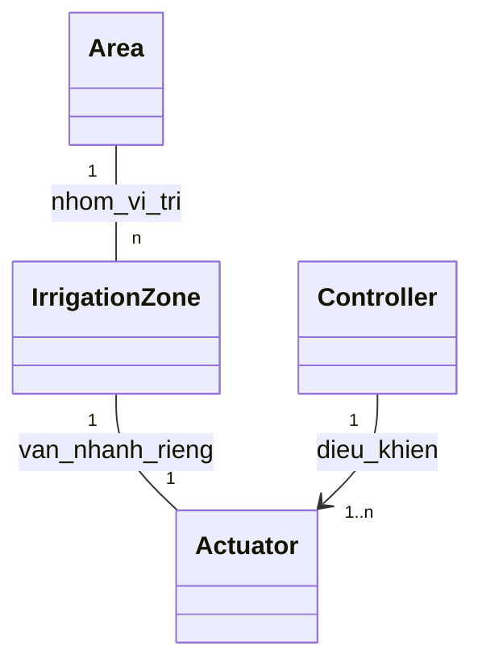
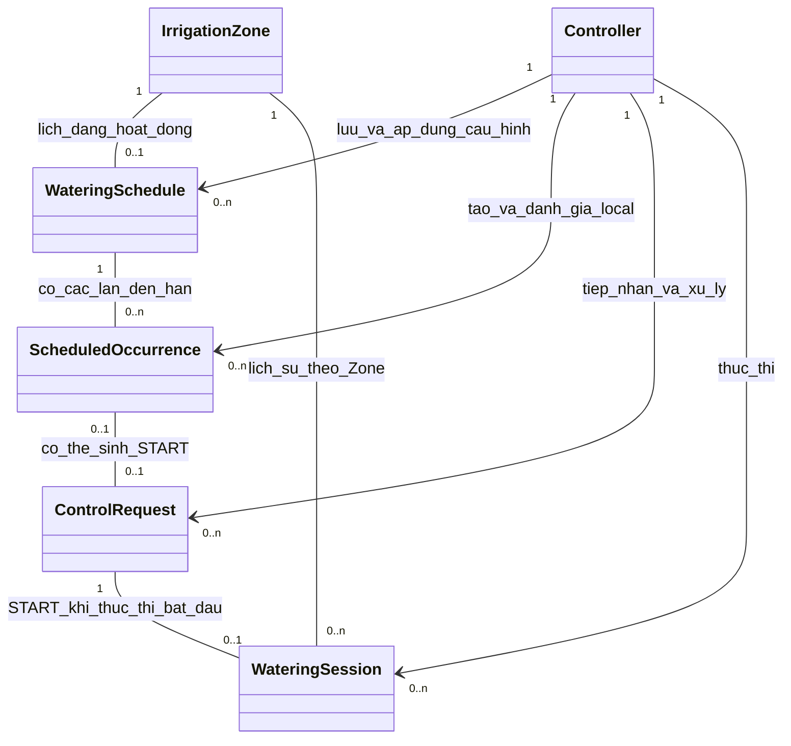

# miGarden — Bước 3: Domain Model Specification

**Baseline công khai · 2026-11-03 · Asia/Saigon.** Tám concept và quan hệ phục vụ [01](01-purpose-and-requirements.vi.md)/[02](02-process-specification.vi.md). [04](04-information-model.vi.md) làm rõ cách biểu diễn thông tin; các concept không tự là bảng DB, endpoint hoặc màn hình CRUD. Chưa có firmware/device/water acceptance.

## 1. Câu chuyện của mô hình

miGarden tưới theo **Zone**: mỗi Zone có đường nước/van điều khiển riêng, lịch và START/STOP riêng; preview/history theo Zone, không danh sách/ID chậu. **Area** nhóm và xác định vị trí các Zone; một Area có nhiều Zone, mỗi Zone thuộc một Area. Area chưa cần CRUD hoặc lệnh tưới riêng.

Toàn hệ thống hiện dùng **một Controller ESP32**. Khi mở Zone B/C/D vẫn ưu tiên Controller này điều khiển nhiều Actuator trong khả năng thực tế của board, driver và nguồn điện; chưa thiết kế nhiều Controller hay quản lý inventory thiết bị. Số Zone tối đa chưa được xác minh bằng phần cứng.

Mỗi Zone có **tối đa một lịch đang hoạt động** ở bản đầu. Đường xử lý chính là **Schedule → Occurrence → ControlRequest → WateringSession**. Occurrence có thể bỏ qua, request có thể bị từ chối, còn session chỉ có khi thực thi đã bắt đầu. Nút/web có thể tạo request trực tiếp, không cần occurrence.

Lịch trên web đã lưu và lịch ESP32 đã báo áp dụng có thể khác nhau. Version, trạng thái áp dụng và context thực thi là **thông tin hỗ trợ**, không là những đối tượng nghiệp vụ có CRUD riêng. Giữ chúng để hiểu offline/đổi lịch và lịch sử, không tăng số model chỉ vì thêm thuật ngữ.

Nguồn cấp chung là bối cảnh, không Source registry; vòi sinh hoạt van tay ngoài phạm vi điều khiển. Tưới/ngắt tất cả là **mở rộng tương lai**, chưa phục vụ đường Zone A hiện tại và không có GroupWateringRun/GroupStep trong core model. Tương lai có thể điều phối tuần tự qua đường tưới từng Zone và ghi kết quả bình thường từng Zone.

## 2. Phạm vi và căn cứ

Năm UC cần đích Zone, lịch đã lưu/đã áp dụng, cơ hội đến hạn, intent và thực thi; không cần biến mọi thuật ngữ thành managed entity. Các bảng/sơ đồ dưới giữ đúng [phạm vi chung](README.md): Area nhóm Zone, một Controller nhiều van theo capacity chưa xác minh, 0..1 active Schedule/Zone, nhóm chỉ tương lai. 01/02 đã đồng bộ cùng phạm vi này.

Giữ lịch local, source START/STOP, remote, history/report/sync/freshness và các safety outcomes. Không Pot/placement/assignment hoặc affected-pot list; không Source/Area/Controller inventory CRUD, ScheduleRevision/Application management, GroupRun/Step hoặc multi-Controller. Chậu trong khảo sát vẫn là site facts. Soil/Zigbee HOLD; notification lifecycle chưa thuộc baseline.

Phương pháp: IoT Design and Development, Chapter 4, Domain Model (slide 18–19), entities/relationships độc lập nền tảng. Nguồn phương pháp và tài liệu legacy không tự bổ sung requirement.

## 3. Từ điển model chính và lý do tồn tại

Mã DM chỉ giúp đọc/truy vết, không phải format ID trong code. Physical entity hoặc conceptual model không mặc nhiên là một bảng dữ liệu hay màn hình quản lý.

### DM01 — Khu vực / Area

Khu vực có ý nghĩa với chủ vườn, ví dụ ban công hoặc sân thượng. **Có để nhóm Zone theo vị trí**, để nhóm các Zone theo vị trí; nhiều đường tưới trong cùng khu vực không buộc tạo nhiều Area giả.

Một Area có nhiều Zone, mỗi Zone thuộc đúng một Area. Lịch/START/STOP/session thuộc Zone, không gắn Area như đích tưới. Hiện Area chỉ cần thông tin nhóm/vị trí trong cấu hình và hiển thị; không CRUD, geometry hoặc workflow khởi tạo Area rỗng được thêm tự động.

### DM02 — Vùng tưới / IrrigationZone, gọi ngắn là Zone

Đơn vị tưới có đường nước và điều khiển riêng; một lần tưới tác động chung Zone. **Có vì UC01–05 cần đích tưới độc lập theo Zone**, không phải chỉ là tên vị trí hoặc một chậu.

Zone thuộc một Area; có tối đa một lịch đang hoạt động, nhiều occurrence/request/session qua thời gian và một van nhánh trong phương án đơn giản đang xét. Preview/history giữ Zone, ngày/giờ, duration, source, outcome và context liên quan, không danh sách/ID chậu. Thêm Zone qua cấu hình không tự commission/mua thiết bị.

### DM03 — Bộ điều khiển / Controller

**Một bộ thực thi vật lý duy nhất trong phạm vi hiện tại**, hiện là ESP32 của Owner. Giữ model này vì lịch có thể lưu trên web mà local chưa áp dụng, và Controller vẫn có thể vận hành khi web/mạng ngừng — UC01–05, NFR02/04. Đây không phải nghiệp vụ quản lý danh sách Controller.

Controller nhận/áp dụng cấu hình lịch, tạo hoặc đánh giá occurrence local, tiếp nhận/xử lý ControlRequest, thực thi Session qua Actuator và báo status/outcome. Một Controller điều khiển nhiều van, kể cả hướng mở B/C/D nếu phần cứng đáp ứng. Không thêm distributed coordinator, cấp phát Zone giữa nhiều board hoặc dự phòng/failover. Mã board/module, chân, driver, power và số kênh tối đa chưa xác minh; một node trong domain không chứng minh năng lực thiết bị.

### DM04 — Cơ cấu chấp hành / Actuator, hiện hướng tới van điều khiển

Thành phần vật lý đóng/mở nước cho Zone. **Có vì Controller phát lệnh không chứng minh van đã chuyển hoặc nước thực sự tới nơi**; SAFE03/04/09 cần giải thích được lỗi driver/van/điện, các Zone mở rộng cần các nhánh điều khiển riêng.

Phương án đơn giản: mỗi Zone một van nhánh, Controller duy nhất điều khiển các van đó. Đây là mapping khái niệm, chưa chọn mã van/pin/driver hay tạo hardware registry. Nguồn chung/vòi sinh hoạt không tự thành Actuator do miGarden quản lý. Van khóa tay độc lập vẫn là bảo vệ ngoài đường điện tử.

### DM05 — Lịch tưới / WateringSchedule

Mong muốn tưới một Zone theo ngày/giờ/quy tắc lặp, hiệu lực, duration và trạng thái. **Có vì Owner quản lý lịch ở microSched và Controller cần nhận cấu hình để chạy local** — FR01/02, UC01/02.

Một lịch nhắm một Zone. **mỗi Zone tối đa một lịch logic đang bật/áp dụng tại local để xử lý cơ hội đến hạn**. Zero là chưa có lịch hoạt động, không loại tưới thủ công. Quan hệ active này không ấn định số bản ghi lịch sử/inactive phải lưu.

Desired version mới và applied version cũ của cùng lịch không phải hai lịch đang hoạt động. Sửa/pause trên web chưa áp dụng thì không được báo local đã đổi; khi chuyển phiên bản hoặc thay lịch hoạt động phải giữ at-most-one/no-double/no-catch-up, không làm hai lịch cùng tác động cho một cơ hội. Cách cutover cụ thể để bước 04/08–09. Chưa tự thêm nhiều quy tắc phức tạp, nhiều lịch độc lập hoặc lịch Area/nhóm.

Sau khi applied, sửa/pause chỉ chi phối các occurrence tương lai; không restart, rút/kéo duration hay thay context đã bind của phiên đang chạy theo bản lịch mới. Muốn yêu cầu dừng phiên dùng STOP riêng; STOP/cutoff/giám sát an toàn vẫn có hiệu lực độc lập, không phải giữ phiên chạy bất chấp lỗi.

### DM06 — Lần đến hạn / ScheduledOccurrence

Một cơ hội tưới dự kiến theo lịch, có planned time và context/version được dùng khi đánh giá. **Có vì một lịch lặp có nhiều cơ hội; một cơ hội có thể bỏ qua/từ chối mà không có session** — UC02, LC02.

Occurrence thuộc một lịch logic và do Controller tạo/đánh giá từ cấu hình local đã áp dụng. Nó có thể sinh một START và tối đa một session. Cơ hội đã bắt đầu/hoàn tất/bỏ qua/từ chối không trở thành lần mới vì đổi version/ID, reconnect hoặc pause/resume. Identity/cutover/thời gian biên để bước 04/08–09; khác ID theo version chưa đủ chứng minh khác cơ hội.

### DM07 — Yêu cầu điều khiển / ControlRequest

Ý định START hoặc STOP có nguồn, đích Zone và hiệu lực rõ. **Có vì nhận yêu cầu khác đã thực thi**, request có thể bị từ chối/hết hiệu lực/chưa rõ; STOP vẫn có nghĩa khi chưa có session nhưng còn START chờ — UC02–04, LC01.

START từ schedule/local_button/remote; web/nút có thể tạo trực tiếp, không cần occurrence. Controller tiếp nhận/kiểm tra/xử lý request. START chỉ có tối đa một Session khi thực thi đã bắt đầu; hợp lệ/chấp nhận chưa đủ để tạo session. STOP không tạo session, xử lý phiên/pending START cũ trong phạm vi điều khiển đã xác định; không cần OPEN preconditions. Retry/receipt không tạo ý định mới. Người bấm local không bị gán giả danh tính Owner; deadline/cutoff là nguyên nhân dừng, không giả một thao tác người dùng.

Trong core hiện tại, thao tác người dùng theo Zone. Các kiểm soát an toàn/interlock của Controller không bị thu hẹp chỉ vì chưa có tính năng tưới nhóm hay nút tổng multi-Zone.

### DM08 — Phiên tưới / WateringSession

Thực thi đã bắt đầu cho **đúng một Zone**, có duration hữu hạn, source, context và outcome theo evidence xác định được. **Có vì request bị từ chối không phải lần đã tưới**, và lịch sử cần biết thiết bị báo đã làm gì — FR04, UC02–05.

Session truy về đúng một START gốc và Controller thực thi; nguồn lịch truy được occurrence và context lịch đã dùng, nguồn web/nút không bị ép có occurrence. Giữ mapping Actuator, nội dung cấu hình/version liên quan tại thực thi, không suy lại từ cấu hình hiện tại. Đang chạy bình thường chưa có terminal không tự là unknown; possible execution nhưng cần kết luận mà không xác định được kết quả mới giữ unknown phù hợp. Planned duration/GPIO không chứng minh nước thực nhận.

## 4. Thông tin hỗ trợ và record — không thêm model quản lý độc lập

Actor chủ vườn dùng quyền trong microSched hiện có; người bấm nút có thể không xác thực danh tính. microSched là thành phần web/API/storage tích hợp, không entity nghiệp vụ như Zone. Controller duy nhất là physical executor, không Controller inventory.

| Thông tin | Cần để trả lời gì, thuộc về đâu? | Giới hạn biểu diễn |
|---|---|---|
| IF01 — Nội dung/version lịch | Cùng lịch đang nói tới bản nội dung nào? Thuộc Schedule; giữ/đối chiếu được nội dung của bản desired và bản applied cuối được biết, kể cả chưa phát sinh occurrence/session; context đánh giá/thực thi giữ nội dung/version liên quan | Không cần model/CRUD ScheduleRevision riêng. Chỉ số version mà không còn nội dung tương ứng không đủ giải thích applied state hoặc history; thiếu nội dung phải ghi thiếu/unknown, không giả bản mới là bản local |
| IF02 — Trạng thái áp dụng lịch | Controller đã báo áp dụng bản nội dung/version nào, kết quả và thời điểm/provenance/freshness của báo cáo? Là thông tin trên quan hệ Controller–Schedule/status; không phụ thuộc đã có occurrence hay chưa | Desired pending khác applied cuối được biết; receipt mất là chưa xác nhận, không suy đã hoặc chưa áp dụng. Nội dung applied cần truy xuất/đối chiếu được với IF01; không cần ScheduleApplication entity hoặc xem report cũ là realtime vô hạn |
| IF03 — Context preview/xác nhận | Remote START đã được người dùng xác nhận Zone/duration/cấu hình liên quan nào? Thuộc request/context giá trị | Không Pot IDs/registry; không ép lịch/nút phải preview web. Context đổi có ý nghĩa thì không tự thay rồi OPEN |
| IF04 — Context đánh giá/thực thi | Occurrence/request/session dùng target, mapping, cấu hình hiệu lực/version và giới hạn nào? Giữ cả khi từ chối/chưa tạo session nếu biết | Khác context preview; lịch sử giữ thông tin lúc đó, không lookup bản Schedule mới rồi thay nội dung cũ |
| IF05 — ExecutionRecord | UC02–05 cần lưu nhận/từ chối/bỏ qua/bắt đầu/dừng/kết quả, reason/Zone/source/time-quality/evidence; liên quan occurrence/request/session khi có | Có record không session. Identity/provenance, dedup/conflict và quan hệ record cần giữ; format/retention/keys để bước 04/08–09 |
| IF06 — DeviceStatusReport | UC05 cần Controller/kết nối/applied schedule/session được báo và freshness; Controller phát báo cáo | Không đồng nhất report với physical realtime state. Lần thực thi gần nhất suy từ session/record có evidence; lần kế tiếp từ applied schedule/occurrence khi xác định được |
| IF07 — Evidence và chất lượng thời gian | Phân biệt planned, thiết bị báo và physical feedback thực có; thời điểm xảy ra khác nhận/upload record | Không thêm sensor/measurement entity hoặc suy đủ nước từ output. Storage hỏng có thể tạo evidence gap; không hứa luôn ghi đủ |

IF01/02 giữ ý nghĩa version/application cần thiết của UC01 mà không bắt buộc hai loại đối tượng được quản lý riêng. Đồng bộ record không replay tưới; trùng hợp lệ không nhân phiên, cùng identity nhưng nội dung mâu thuẫn không overwrite để che lỗi. Nguồn bằng chứng thực có phải rõ, không coi mọi ghi nhận là xác minh nước.

Không có managed Pot/placement/membership, WaterSource registry, HydraulicCircuit/IrrigationOutlet trùng vai trò hoặc GroupWateringRun/GroupStep trong core. Nguồn cấp A/B/vòi sinh hoạt là context. Không nhập nguyên grant/lease/RemoteCommand, LocalExecutionLedger, SafetyPolicyVersion, boot/safety-context registry thành core entities; các kết quả safety/accounting/remote handoff/critical persistence đã duyệt vẫn cần thiết kế ở bước sau.

## 5. Sơ đồ và ý nghĩa quan hệ

### 5.1 Một Controller, nhiều van, Area nhóm Zone

Toàn hệ thống trong phạm vi này có **đúng một Controller**, không phải một board mỗi Zone. `n` nghĩa nhiều trong giới hạn hardware chưa xác minh, không là số kênh vô hạn hoặc một cam kết hiện có đủ chân. Mỗi Actuator do Controller này điều khiển; Zone–Actuator 1:1 là phương án van nhánh đang xét. Area 1–n / mỗi Zone 1 Area mô tả nhóm/vị trí, chưa quyết workflow Area rỗng.

Cùng Area không là một Zone. A/B dùng chung nguồn không tự buộc chúng thuộc cùng Area; sơ đồ generic không tự gán Area thực tế hoặc thêm Source ID.

### 5.2 Đường lịch → yêu cầu → phiên và trách nhiệm Controller

Đường Schedule→Occurrence→Request→Session là action path; các mũi tên Controller giải thích ai áp dụng lịch, đánh giá và thực thi. Version/applied là thông tin của lịch/quan hệ được giải thích ở phần 4, không thêm hộp ScheduleRevision/Application. Actor web/nút có thể tạo request trực tiếp, không cần đi qua Schedule/Occurrence.

| Quan hệ | Ràng buộc cần đọc cùng hình |
|---|---|
| Zone → active Schedule |0..1 lịch hoạt động/Zone. Đây là quan hệ active, không quyết số bản ghi quá khứ/inactive; desired/applied của cùng lịch không tính là hai lịch |
| Controller → Schedule | Một Controller có thể giữ lịch của nhiều Zone, mỗi Zone vẫn tuân thủ0..1 active. Bản desired chưa được local áp dụng không là một lịch local thứ hai; cutover không được mở trùng |
| Schedule → Occurrence | Mỗi occurrence thuộc một lịch, nhiều cơ hội qua thời gian; đánh giá theo nội dung/version đã áp dụng và giữ context đó |
| Occurrence → Request | Có thể0 nếu bỏ qua trước khi tạo START; START lịch có đúng một occurrence. Request web/nút không cần occurrence |
| Request → Session | START có0..1session; request chưa chạy/bị từ chối/hết hiệu lực không tạo session giả. STOP không tạo session |
| Session → Zone/START/Controller | Đúng một Zone, START gốc và Controller; nếu source schedule thì thêm occurrence/context lịch. Mapping Actuator đã dùng thuộc execution context |
| Record → Occurrence/Request/Session | Gắn các đối tượng thực sự liên quan; có thể record bỏ qua/STOP không session. Receipt không tự tạo session hoặc quyền replay |

Sơ đồ là conceptual model, không chọn foreign keys/inheritance/ID format. Các lần gửi lại và các bản ghi trạng thái không tự nhân đối tượng nghiệp vụ hoặc cơ hội tưới.

## 6. Quy tắc miền giữ hành vi đã chốt

| ID | Quy tắc | Căn cứ |
|---|---|---|
| DR01 | Zone độc lập, thuộc một Area; preview/history không list/ID chậu | UC01–05, phạm vi Zone |
| DR02 | Web saved khác local applied; áp dụng lịch không tự OPEN hay bỏ qua safety hiện tại | UC01/02/05 |
| DR03 | Occurrence/request/session khác nhau; không trùng cùng cơ hội qua version/retry/reboot, không catch-up hoặc restore OPEN | LC02, NFR01/03 |
| DR04 | START lịch/nút/web đi qua cùng safety arbiter local, cùng interlock và các hạn mức áp dụng. Mỗi phiên có duration hữu hạn; hạn mức tích lũy phải thực sự kiểm tra/áp dụng xuyên các nguồn và các lần liên quan, không chỉ kiểm ledger đọc được hay giới hạn từng phiên. Lịch/nút không cần cloud grant mỗi lần; remote giữ quyền/confirmation/kiểm soát giao thực thi | UC02–04, SAFE07; chưa chọn con số, phạm vi accounting chi tiết hoặc thuật toán |
| DR05 | STOP ưu tiên yêu cầu CLOSE và xử lý pending START cũ khi có tranh chấp; không cần OPEN preconditions hay session đã biết, không để START cũ trong phạm vi tự mở sau STOP. Chưa tới thiết bị không báo đã dừng | LC01, UC03/04; thứ tự ưu tiên khác chưa chọn |
| DR06 | Sửa/pause chỉ chi phối occurrence tương lai sau applied; không restart/thay duration hay context đã bind của phiên đang chạy theo lịch mới. Muốn yêu cầu dừng phiên dùng STOP riêng; safety/cutoff vẫn hoạt động độc lập. STOP không tự pause/xóa cơ hội tương lai chưa thành intent cũ | P01/LC01/LC02 |
| DR07 | Mọi nguồn đúng Zone/cấu hình hiệu lực; remote preview/confirm riêng, context đổi có ý nghĩa cần context/confirm hợp lệ mới. History không rewrite từ cấu hình hiện tại | LC03, phạm vi Zone |
| DR08 | Planned/reported/physical evidence khác nhau; thiếu thời gian/clock-quality phải rõ; received/grant/GPIO không chứng minh đủ nước | NFR04, UC04/05, SAFE08/09 |
| DR09 | Sau possible execution mà chưa kết luận được, chặn OPEN mới từ mọi nguồn lịch/nút/web đến recovery/xác minh an toàn. Với nguồn/accounting chung chưa chứng minh độc lập, chặn mọi Zone, không suy chỉ Zone gốc bị khóa hoặc mở đường bypass. Reset không xóa accounting/trạng thái để mở lại | SAFE03–08, UC02–04; không cấp ngoại lệ cô lập Zone |
| DR10 | Critical record/budget đủ đáng tin trước START; storage lỗi giữa phiên cần safe stop/cutoff và degraded, không chỉ chặn lần sau; không hứa record luôn lưu được | SAFE05/07/10, UC02/05 |
| DR11 | Sync không replay action; duplicate không nhân phiên, conflict không overwrite lặng lẽ; records/status giữ source/time-quality/freshness. Backlog không realtime | UC05, NFR01/04 |
| DR12 | Tối đa một lịch logic đang hoạt động tại local mỗi Zone; nhiều version hoặc trạng thái đồng bộ không phải nhiều lịch hoạt động. Thay nội dung/đổi lịch không vi phạm no-double/no-catch-up | UC01/LC02; không chọn thuật toán cutover |
| DR13 | Nút/remote/watchdog không thay van tay và bằng chứng fail-safe. Van/driver/feedback/cutoff và numeric envelope phải thiết kế/kiểm chứng trước enable nước | SAFE03/04/09; chưa chọn hardware |
| DR14 | Không OPEN từ bất kỳ nguồn nào nếu thời gian/config/policy/accounting-ledger/target cần thiết không đủ tin cậy/không xác minh được. Time-quality label không thay permission. STOP/CLOSE vẫn theo đường còn hoạt động, không đòi OPEN gates | SAFE05, UC02–04; recovery cụ thể để sau |
| DR15 | START riêng đang bận trong phạm vi kiểm soát tương ứng bị từ chối thay vì tự queue chạy muộn; occurrence không chạy bù | P02, LC01/02; arbitration/cooldown chi tiết để sau |

Controller chỉ có một không làm mất các khác biệt cloud/local, report/physical hoặc request/session. Session đang executing bình thường chưa terminal không tự unknown; timeout sau possible execution cũng không chứng minh chưa chạy. Accounting và safety là yêu cầu, không buộc có một entity riêng cho từng cơ chế kỹ thuật.

## 7. Truy vết model về requirements/process

| Đầu vào | Model/thông tin phục vụ | Điều cần giữ |
|---|---|---|
| UC01 quản lý lịch/applied | Zone/Schedule, Controller, IF01/02 | Saved khác applied; nội dung applied cuối được biết còn đối chiếu trước occurrence đầu;0..1 active/Zone. Sửa/pause không đổi phiên đang chạy theo P01; ngày/giờ/duration/version không là lượng nước |
| UC02 lịch local | Schedule/Occurrence, START request, Session, Controller/Actuator, context/record | Local có điều kiện, không trùng/bù, không cần cloud mỗi lần |
| UC03 nút Zone | Actor tại nguồn, START/STOP, Zone, Session khi có, record | Bounded/safety; STOP không cần session; không giả danh người bấm |
| UC04 web Zone | Owner actor, request/preview-confirm/context, Controller/Session/record | Remote handoff; STOP không qua OPEN gate; receipt khác thực thi |
| UC05 dashboard/history/sync | Schedule/applied status, record/device status, session/request/occurrence khi liên quan | Zone-only; gần nhất từ session/record có evidence/time-quality; kế tiếp từ applied schedule/occurrence khi biết. Planned khác reported/verified; thiếu thì unknown/stale |
| Phạm vi đã chọn | Một Controller nhiều Actuator, active schedule cap, IF01/02 và quan hệ Controller rõ | Không thêm inventory/distributed control, revision/application management hoặc group domain hiện tại |

| Nhóm đầu vào | Chỗ thể hiện / giới hạn |
|---|---|
| FR01/02 | DM05/06, IF01/02/04, DR02–04/12 |
| FR03/06 | DM07/08, actor/IF03/04, DR04/05/07 |
| FR04/05 | DM08, IF04–07, DR08/10/11 |
| FR07 | Device/status/applied schedule/current session; last execution từ record/session; next planned từ applied schedule/occurrence; freshness/unknown, không thêm entity LastRun/NextRun |
| NFR01/02 | Occurrence/request khác session, desired/applied, local Controller và DR02–06/11/12 |
| NFR03/04 | Controller khác Actuator, context/evidence và DR04–15; không riêng một safety entity |
| SAFE01 Internet / SAFE02 microSched down | Local schedule/request/session, record/freshness; DR02/04/10/11 |
| SAFE03 treo / SAFE04 mất nguồn | Actuator/fail-state context, outcome; DR03/09/13. Chưa chứng minh physical fail-safe |
| SAFE05 time/config/accounting | Version/applied/context/time quality; DR02/03/07/09/10/14. Không tin cậy thì không OPEN, không chỉ gắn nhãn record |
| SAFE06 invalid/duplicate | Request identity/source/target/effectivity, records; DR03–05/07/11 |
| SAFE07 conflict/budget | Cùng safety arbiter local cho mọi nguồn, thực thi interlock/hạn mức tích lũy và ưu tiên STOP/CLOSE khi tranh chấp; request/session và DR04/05/10/15. Busy rejection đã duyệt; chưa chọn con số/algorithm hay group-admission scope |
| SAFE08 unknown | Request khác session, evidence/outcome/freshness, DR08/09: không tự cô lập Zone trên nguồn/accounting chung |
| SAFE09 nước/van/feedback | Actuator, nguồn chung bối cảnh, evidence; DR08/09/13. Chưa chọn sensor/van |
| SAFE10 persistence/freshness | Record/status và DR10/11; storage lỗi có thể có evidence gap, không giả luôn lưu đủ |
| SAFE11 đúng target/context | Zone/config, IF03/04, DR01/07/08; đúng binding và lịch sử Zone-level |

Traceability là kết quả thiết kế, không là tỷ lệ lỗi đã thử hoặc proof completeness toàn sản phẩm. 01–04 cùng dùng phạm vi hiện hành ở chỉ mục.

## 8. Walkthrough để hiểu và kiểm tra

**A — Sửa lịch khi ESP32 offline:** lịch S của Zone A đang áp dụng version 1 lúc 07:00. Owner sửa S thành 08:00 trên web, có desired version 2; đây là ví dụ cấu hình, không khuyến nghị giờ tưới. ESP32 chưa báo áp dụng thì local vẫn có thể dùng version 1 còn hợp lệ. Giữ được nội dung v1 cùng bản báo applied/provenance/freshness kể cả chưa từng có occurrence; chỉ lưu applied=1 nhưng ghi đè nội dung bằng v2 là thiếu nghĩa. Hai version của S không là hai lịch hoạt động. Receipt v2 mất cần đối soát, không suy đã/chưa applied hoặc tưới để thử. History giữ bản thực dùng; cutover không chạy bù/trùng và sửa/pause không thay phiên đang chạy, dừng phiên qua STOP/safety riêng.

**B — Không có lịch hoạt động:** Zone chưa có lịch đang bật vẫn có thể nhận START từ web/nút hợp lệ. Request tồn tại rồi có thể bị từ chối; chỉ khi Controller thực sự bắt đầu mới có session. Không tạo occurrence giả cho thao tác thủ công.

**C — Mở rộng A sang B:** cùng một ESP32 thêm kênh điều khiển van B nếu pin/driver/power đáp ứng, mỗi Zone có tối đa một lịch hoạt động và history riêng. A/B có thể cùng hoặc khác Area theo cấu hình; cùng vòi không suy cùng Area. Không tự tạo board mới, group entity hoặc cam kết có đủ kênh trước khi kiểm hardware.

**D — Remote có thể đã chạy nhưng mất kết quả cuối:** received/grant không chứng minh chưa tác động hoặc hoàn tất. Giữ unknown đúng mức, chặn OPEN mọi nguồn và không cho Zone khác trên nguồn/accounting chung đi vòng khi chưa xác minh an toàn. Không gửi lại intent như một lần mới; sync muộn chỉ đối soát record.

**E — Đến hạn nhưng local không đáng tin/đang bận:** không OPEN khi clock/config/policy/accounting/target cần thiết chưa xác minh. Ghi bỏ qua/từ chối khi có khả năng, không session thành công giả; START riêng bận bị từ chối theo P02. Reboot/version mới không tạo cơ hội thay thế; STOP không bị bắt thỏa OPEN gates.

**F — Cấu hình đổi sau preview:** remote đã confirm Zone/context cũ thì không âm thầm chuyển mapping/duration/cấu hình có ý nghĩa rồi OPEN. Cần context/confirm hợp lệ mới; session quá khứ giữ nội dung/version/mapping đã dùng. Không cần PotPlacement hoặc entity revision độc lập để giữ nguyên tắc này.

## 9. Mở rộng tương lai và các bước tiếp theo

### 9.1 Tưới/ngắt tất cả — không thuộc core model hiện tại

Điều khiển tổng trên web và nút vật lý, tưới tuần tự là hướng mở rộng tương lai, chưa cần cho Zone A hiện tại. Hướng đơn giản là code điều phối gọi đường tưới từng Zone, mỗi request/session/history được ghi như bình thường. Có thể cần trạng thái runtime tạm thời về bước đang chạy/chờ, không vì thế bắt buộc có GroupWateringRun/GroupStep, ID lượt, group history hoặc CRUD nhóm.

Trước khi triển khai phải đặc tả tập Zone/duration/thứ tự, chuyển bước khi đủ evidence dừng an toàn, STOP đối với phần chờ, chồng lịch/bấm lặp/retry và phản ứng unknown. Không coi vòng lặp gửi lệnh/sleep là đã giải quyết điều phối; không tự queue mọi START riêng hoặc thêm khả năng resume sau reboot. Các hành vi này chưa được Owner chọn chỉ từ việc chọn hướng tuần tự. Chỉ xem lại group entity khi có nhu cầu thực sự quản lý tiến độ/lịch sử lượt, không vì code có vòng lặp.

### 9.2 Việc phân bổ cho bước sau

| Nội dung | Đã rõ ở 03 | Cần hoàn thiện đúng bước |
|---|---|---|
| Information |8 concepts và quan hệ, supporting version/applied/context/record | [Bước 04](04-information-model.vi.md) đã làm rõ thông tin/ref bất biến/report/time; thuật toán identity/cutover vẫn cần thiết kế bước 08–09 |
| Services/architecture | Controller duy nhất áp dụng lịch, đánh giá occurrence, xử lý request, thực thi session/report | Bước 05–08: ownership/arbitration, remote handoff/expiry, local safety/recovery; chưa có distributed coordinator |
| Operational/hardware | Một ESP32 nhiều Actuator theo khả năng thực tế; nguồn chung constraint | Bước 08–09: exact board/pin/driver/valve/power/feedback/cutoff/clock/storage và numeric envelope, kiểm chứng trước enable |
| Application | Zone là đích tưới,0..1 active schedule/Zone, Area nhóm vị trí, history/freshness/unknown | Bước 10: flows dựa data/service contracts; không Area/Source/Controller CRUD hoặc revision/group-management UI tự động |
| Expansion | Multi-Zone qua cấu hình, rollout A rồi B, tiếp C/D trong giới hạn một Controller | Nếu phát sinh yêu cầu thật vượt khả năng/phân bố hiện tại thì phân tích delta; không đang thiết kế nhiều board hoặc mọi topology tương lai |

**Outcome bước 3:** có từ điển miền với lý do/căn cứ và quan hệ, hai sơ đồ, cardinality active rõ, supporting information thay vì thêm nghiệp vụ, quy tắc safety/evidence và truy vết/ví dụ. Conceptual model là baseline hiện tại; fields/meaning được làm rõ ở 04, algorithms/hardware phân bổ cho bước sau. Không gọi DB/API/code hoặc water safety đã hoàn tất.

## 10. Đọc cùng ví dụ

[Information model](04-information-model.vi.md) dùng content_ref/binding_ref và report envelope để giữ ý nghĩa miền. [Walkthrough W00–W06](walkthrough/index.html) minh họa tám concept, desired/applied, 45 planned/17 reported, unknown không fake Session và pause không đổi phiên đã bind. Đây là synthetic data, không là runtime/field evidence.
