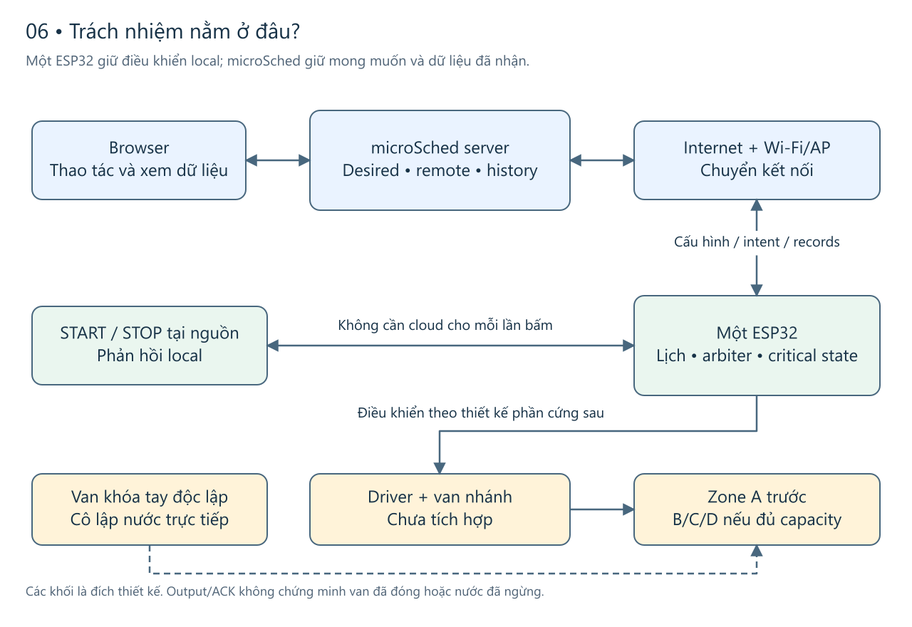
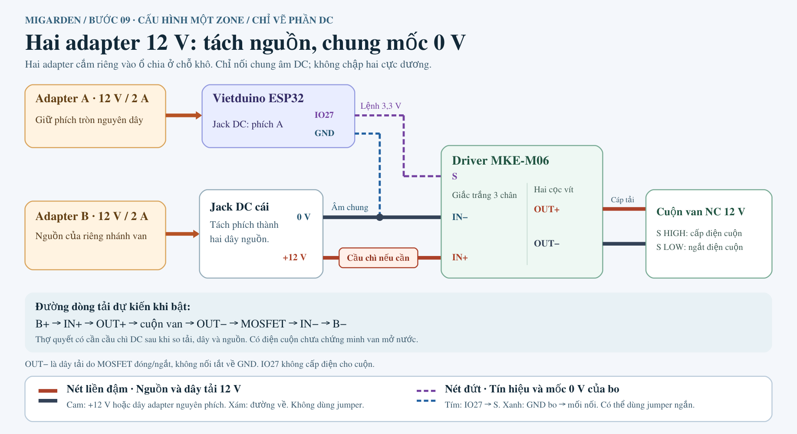

# miGarden — Bước 06: IoT Level Specification

**Bố trí đã chọn:** một ESP32 tự chủ local, microSched server và browser. Tài liệu chỉ ra nơi chạy, ranh giới quyền điều khiển và điều kiện tài nguyên. Các quyết định vận hành ở [08](08-operational-view-specification.vi.md); cấu hình vật lý đợt đầu ở [09](09-device-and-component-integration.vi.md).

**Căn cứ S01 · 2026-11-08:** Số đo board và giả định kết nối đã được đồng bộ từ diagnostic/khảo sát LAN. Chưa có acceptance firmware sản phẩm hoặc vận hành nước từ S01.

USB-C là đường thử và bảo trì. Khi lắp cố định, dùng jack DC với adapter 12 V riêng cho bo như [sơ đồ 09](09-device-and-component-integration.vi.md#power-path).

Để nắm quyết định chính, đọc [bố trí hệ thống](#2-sơ-đồ-triển-khai-và-ranh-giới-sở-hữu), [một ví dụ thực thi](#thuat-ngu-thuc-thi) và [nguồn điện](#7-chiến-lược-nguồn-liên-tục-và-ranh-giới-an-toàn-điện). Các bảng storage, fallback và tài nguyên giữ chi tiết để đối chiếu. [Phần 10](#10-phần-đã-mô-tả-và-phụ-thuộc-còn-mở) gom những lựa chọn còn mở ở 08–10; [07](07-functional-view-specification.vi.md) giải thích phối hợp và toàn bộ catalogue tình huống.

## 1. Bước này quyết định điều gì?

Bước 05 trả lời hệ thống cung cấp những thao tác nào. Bước 06 đặt các thao tác đó vào những nơi chạy thực tế: thiết bị ở vườn, server và browser. Câu hỏi quan trọng là: khi đường mạng mất, phần nào còn đủ thông tin và quyền để hoàn tất công việc an toàn?

Với miGarden, **ESP32 giữ lịch đã áp dụng, quyết định thực thi và bảo vệ local; microSched giữ nội dung mong muốn, phối hợp điều khiển xa và lưu/đọc dữ liệu đã nhận; browser là nơi người dùng thao tác và xem thông tin**. Không thêm application gateway ở nhà. Một router/AP chuyển kết nối không có vai trò cấp phép tưới hoặc lưu hộ trạng thái an toàn.

Đây là mô tả deployment pattern, chưa gán một số “IoT Level” theo bảng phân loại nào. Số level chỉ có ý nghĩa khi đối chiếu đủ định nghĩa của đúng taxonomy; sơ đồ triển khai và lý do chọn có ích hơn việc đoán số từ số lượng thiết bị.

## 2. Sơ đồ triển khai và ranh giới sở hữu

[Bản SVG](figures/06-system/topology.svg) · [Nguồn Excalidraw chỉnh sửa được](figures/06-system/topology.excalidraw).

**Cách đọc:** browser gửi mong muốn tới microSched; ESP32 tại vườn giữ quyền quyết định tác động local. START/STOP tại nguồn đi thẳng vào cùng bộ phân xử an toàn (arbiter), không đi vòng qua Internet. Driver/van và bảo vệ vật lý còn phải tích hợp; Zone B/C/D chỉ mở khi chứng minh được capacity của chính ESP32 này. Van khóa tay độc lập với phần mềm và mạng.

Các đường hai chiều chỉ thể hiện trao đổi trách nhiệm, chưa chọn giao thức, kết nối thường trực, SDK hoặc cách polling/push. Van khóa tay không phải thiết bị mạng. Mũi tên ESP32–driver không phải sơ đồ đấu dây và không khẳng định đã có feedback vật lý.

| Nơi đặt | Trách nhiệm và thông tin phải có | Quyền hạn/giới hạn cần giữ |
|---|---|---|
| ESP32 duy nhất tại vườn | Áp dụng lịch hợp lệ, xét cơ hội đến hạn và nhận START/STOP từ ba nguồn qua cùng bộ phân xử. Chốt thời lượng/mốc dừng, kiểm mức dùng tích lũy và khóa liên động; giữ trạng thái an toàn bền qua mất nguồn, báo cáo và phục hồi. [Ví dụ ở phần 4.1](#thuat-ngu-thuc-thi) giải thích năm thuật ngữ tương ứng | Lịch/nút không xin cloud grant từng lần. Remote vẫn cần đường giao quyền riêng và final local gate. Không cho mở khi trạng thái cần thiết chưa đáng tin |
| Driver/Actuator và bảo vệ vật lý | Đóng/mở nhánh theo cấu hình đã xác minh; fail-state, cutoff và feedback cần thiết để đạt safety outcomes | Một van nhánh/Zone là phương án khái niệm; 09 đã chọn van và driver cho Zone A; capacity nhiều kênh và bằng chứng cutoff/feedback vẫn chưa xác minh. GPIO/CLOSE không chứng minh nước ngừng |
| microSched server | Web/API/quyền hiện có; nội dung desired; preview/explicit confirm và phối hợp remote; ingest/dedup/receipts; history và read projections có provenance | Server không thay arbiter hoặc ledger local. Desired saved, authorization và record received đều không tự chứng minh đã thực thi |
| Browser | Nhập lịch, xem trước và gửi yêu cầu START từ xa sau khi người dùng xác nhận; gửi STOP; xem dashboard và lịch sử tự cập nhật khi đang mở | Đóng browser không làm dừng bảo vệ/lịch local hay background sync. Mở browser không là precondition upload |
| Router/AP và đường Internet | Chuyển kết nối giữa ESP32 và microSched | Không phải application gateway; không giữ schedule/accounting hoặc cấp phép mỗi occurrence |

**miGarden sở hữu firmware/local arbiter, simulator tương lai, spatial source và integration contracts. microSched sở hữu phần web/API/storage adapter trong repository của microSched.** Khi tích hợp phải gắn revision hai bên với version contract và kiểm compatibility. Việc mô tả adapter ở đây không cấp quyền sửa microSched hoặc chọn lại authentication, protocol, SDK, DB vendor hay hosting.

Theo [project state](../project-state.md), hiện có prototype biểu diễn SVG/Three.js và walkthrough synthetic. **Firmware, simulator điều khiển và tích hợp microSched chưa được triển khai.** Các hộp trên là đích thiết kế, không phải sơ đồ các dịch vụ đang chạy. Geometry tiếp tục có nguồn riêng hiện hành ở `viewer/model.json`, không tạo nguồn tọa độ thứ hai trong sơ đồ điều khiển.

## 3. Một Controller có nghĩa gì khi mở rộng?

Rollout bắt đầu ở Zone A. Area chỉ nhóm các Zone; mỗi Zone thuộc một Area và là đơn vị lịch, điều khiển, lịch sử. Mỗi Zone có **0..1 lịch logic hoạt động tại local**. Một desired mới và một applied cũ của cùng lịch không phải hai lịch đang hoạt động.

Mở B/C/D có nghĩa thêm các nhánh/Actuator trong khả năng đã kiểm của cùng ESP32, không có nghĩa mỗi Zone một board. Số chân sử dụng an toàn, driver, công suất, thời gian xử lý và capacity lưu trữ chưa được chứng minh; không suy bốn Zone khả thi chỉ từ tên A/B/C/D hoặc số chân quảng cáo. Điều khiển riêng từng van cũng không chứng minh độc lập nguồn nước hoặc accounting: unknown sau possible execution phải chặn OPEN của mọi nguồn và mọi Zone trên ranh giới chung, trừ khi có bằng chứng độc lập.

Không thêm Pot/placement/affected-pot list, Source registry, group orchestration, multi-Controller, sensor soil/Zigbee hay notification lifecycle. Chậu trong viewer là sự thật biểu diễn hiện trường. Các ví dụ sensing/analytics/device management trên slide phương pháp không làm phát sinh các chức năng đó.

## 4. Local, remote và storage phối hợp như thế nào?

### 4.1 Ba đường vào, một nơi quyết định tác động

Trước khi đọc các điều kiện dưới đây, hãy theo một ví dụ xuyên suốt: **lịch SC-A-v1 của Zone A đã được áp dụng từ trước, đến hạn lúc 07:00 và dự kiến tưới 45 giây. Người tại nguồn yêu cầu STOP sau 17 giây kể từ khi bắt đầu.** Đây là số liệu synthetic dùng để giải thích, không phải duration tưới, budget hay thời gian phản ứng được chọn cho vườn.

| Thuật ngữ | Nghĩa trong ví dụ và lý do cần giữ |
|---|---|
| **Bind duration/deadline — chốt thời lượng và mốc phải dừng** | Trước tác động, ESP32 lấy đúng nội dung v1, chốt duration 45 giây và deadline bằng thời gian trôi tại local (elapsed time). Giờ dân dụng (civil time) 07:00 dùng để nhận biết lịch đến hạn; deadline không phải mỗi tick lại hỏi đồng hồ web hoặc lịch mới. Nếu web đổi sang 60 giây hay pause, phiên đã bắt đầu vẫn giữ ràng buộc cũ; STOP/lỗi/cutoff có thể kết thúc sớm. Chưa biết đủ mốc thì không bịa duration thực tế |
| **Cumulative accounting — ghi nhận và kiểm tra mức dùng tích lũy** | Phiên này không được xét riêng khỏi các phiên trước: lượt từ lịch, nút và remote đều đi vào cùng việc kiểm hạn mức local. Khi có evidence phù hợp, phần thực thi được báo 17 giây được ghi nhận theo policy accounting sẽ chọn; với phần chưa rõ phải giữ uncertainty đủ để chặn hành động thiếu kiểm soát. Không lấy 45 giây planned làm 17 giây actual, không tự chọn cách tính phần unknown; reboot/đổi nguồn thao tác không làm budget về 0 |
| **Interlock — điều kiện khóa không cho mở khi chưa an toàn** | Nếu một phiên khác đang chiếm phạm vi điều khiển hoặc còn kết quả local chưa rõ, START mới bị chặn; nút gần board hay một Zone khác trên ranh giới chung không được đi vòng. START bận bị từ chối, không xếp hàng để tưới muộn. Interlock không cấm yêu cầu STOP/CLOSE |
| **Critical persistence — lưu bền trạng thái cần cho an toàn** | ESP32 phải giữ đủ intent, cơ hội đã xử lý, accounting và căn cứ phục hồi trước khi được tác động. Sau mất nguồn, nó còn phải biết cơ hội nào không được lặp và mức dùng nào chưa được phép quên. Lưu trong RAM hoặc chờ có mạng mới ghi không đáp ứng điều đó. Nếu lỗi lưu bền giữa phiên thì phải safe stop/cutoff và degraded, có thể thiếu record; không hứa luôn ghi được kết quả |
| **Reports — thông tin thiết bị báo về** | Khi ghi nhận được, thiết bị báo nguồn schedule, ref v1, planned 45 giây và reported output 17 giây cùng kết quả/chất lượng thời gian. Server có thể nhận trễ hoặc mất receipt. Report kể điều thiết bị có bằng chứng để báo; không tự chứng minh van đã đóng, lưu lượng hay cây đủ nước. Nhận report cũng không cho phép mở lại |

Như vậy, **giờ đến hạn, thời lượng dự kiến, thời lượng output được báo và bằng chứng nước là bốn ý khác nhau**. Các thuật ngữ trên mô tả nghĩa vụ hành vi; thuật toán accounting, timebase, lưu bền, interlock và recovery cụ thể vẫn cần thiết kế ở 08–09. [07, hai chuỗi phối hợp](07-functional-view-specification.vi.md#6-hai-chuỗi-phối-hợp-và-các-tình-huống-cần-review) cho thấy ai thực hiện từng phần.

Schedule local và START/STOP vật lý đi trực tiếp đến ESP32; mọi START qua cùng arbiter và all-source cumulative limits/interlock. Remote START đi từ preview/explicit confirm trên microSched, kiểm quyền/đích/identity/hiệu lực hữu hạn, fresh safe-confirmed cùng boot và không active/unknown, rồi qua received/authorization theo contract trước possible execution. ESP32 vẫn kiểm context đã confirm và admission local tại thời điểm tác động, gồm remote START chưa hết hạn và authorization còn hợp lệ; không chỉ dựa lần kiểm ở server. Candidate hết hạn trong lúc chờ/handoff hoặc reconnect thì không được bắt đầu tưới; thiếu căn cứ xác minh hiệu lực cũng không OPEN. Hết hạn sau possible execution không chứng minh chưa chạy và không xóa unknown. Context đổi có ý nghĩa cần preview/confirm mới. Ngưỡng freshness, giá trị TTL, clock và cơ chế handoff chưa được chọn.

STOP dùng đường yêu cầu CLOSE ưu tiên, không phải thỏa OPEN gates hoặc biết trước Session. Remote STOP vẫn cần quyền/đích/identity/hiệu lực và đường truyền còn hoạt động. Khi microSched chứng minh START còn pending chưa grant, phải hủy/từ chối/giữ chặn intent cũ; START đã/có thể grant cần CLOSE và đối soát, không được gán “đã hủy” chỉ vì người dùng bấm Dừng. Controller nhận STOP phải ngăn START cũ tự mở lại, kể cả STOP local khi offline; reconnect phải đối soát trước khi intent cũ có thể gây tác động. STOP không tự pause các occurrence tương lai chưa thành intent.

START bận bị từ chối, không queue để chạy muộn. Received, authorized, accepted, started và terminal result là các mức khác nhau. Timeout sau possible execution giữ unknown; hết TTL/cooldown không xóa unknown và không cấp phép retry action. Retry giao record không phải retry tưới.

### 4.2 Không gom mọi dữ liệu thành “log”

| Dữ liệu | Nơi chịu trách nhiệm gốc | Cần giữ để làm gì? | Điều kiện giải phóng/chuyển quyền còn cần thiết kế |
|---|---|---|---|
| Nội dung desired bất biến và desired ref | microSched storage adapter | Lưu khi Controller offline; thay nội dung tạo content_ref mới, cùng ref luôn resolve cùng nội dung | Trong phạm vi history còn giữ, các ref cần thiết phải resolve đúng; không bắt giữ mọi thứ vô hạn |
| Nội dung applied, mapping hợp lệ và report áp dụng | ESP32 giữ nội dung thực dùng; microSched giữ last-known report/nội dung tham chiếu | Có thể đánh giá occurrence trước khi web nhận receipt; không đọc desired như applied | Không dùng bản local ghi dở. Receipt mất phải đối soát; report nguồn cũ đến trễ không kéo confirmation lùi |
| Critical intent, disposition cơ hội, accounting, unknown và thông tin cần phục hồi | Local durable state của ESP32 | Chống lặp qua cutover/reboot/retry, kiểm giới hạn và biết có được OPEN không | Receipt upload không làm state này hết vai trò safety. Không xóa như history chỉ vì server đã nhận; compaction/recovery phải chứng minh bảo toàn ý nghĩa |
| Critical event/outcome và nội dung/binding còn được tham chiếu | ESP32 trước sync; microSched lưu phần đã validate/nhận | Giải thích skipped/rejected/request/session, planned và reported, source/reason/time quality | Receipt phù hợp là điều kiện cần cho retention local tương ứng; chưa đủ để xóa mọi critical state. Policy retention, full-queue, tính toàn vẹn refs còn mở |
| Status/read projections và history hiển thị | microSched từ dữ liệu có nguồn; browser trình bày | Last-known applied/output, lần gần nhất/next planned khi xác định được, freshness/partial/unknown | Projection không được ghi đè fact gốc; tuổi dữ liệu không trẻ lại chỉ vì UI refresh |
| Debug/telemetry thường | Thành phần phát, trong tài nguyên được phân bổ | Chẩn đoán cần thiết, không mặc định mỗi tick thành business history | Có thể bị hạn chế theo policy sau; không lấn critical records/accounting |

Nhu cầu storage trên server là có: lưu desired và lịch sử đã nhận để xem lại khi thiết bị offline. Điều đó **không bắt chọn một cloud storage provider hoặc một dịch vụ database riêng**. Trong mô hình này storage là phần trách nhiệm của microSched server; địa điểm hosting và công nghệ còn để thiết kế sau. Storage remote không thay durable state local khi mất mạng.

Sync nền giữ origin identity, payload, immutable refs, event time và chất lượng thời gian; microSched ghi riêng lần nhận đầu. Cùng identity/payload dedup; cùng identity khác payload phải conflict/đối soát, không overwrite. Thiếu civil timestamp để null/unknown, không điền planned hoặc receive time thay thế. Dữ liệu tới muộn không trở thành action vừa xảy ra, và ingest không có quyền OPEN.

Dashboard và history tự cập nhật khi đang xem, giữ ý nghĩa bộ lọc đang dùng. Upload từ thiết bị và refresh UI là hai đường khác nhau; chưa chọn nhịp, polling/push, backoff hay cam kết realtime. History có thể xem phần đã nhận khi Controller offline; dữ liệu thiếu vẫn là partial/unknown.

## 5. Fallback phải giữ kết quả nào?

| Tình huống | Phần còn có thể làm, có điều kiện | Phần không được suy ra |
|---|---|---|
| Mất Wi-Fi/AP, mất Internet khi AP vẫn hoạt động hoặc microSched down, ESP32 vẫn có điện | Lịch applied và nút local dùng được khi time/config/target/policy/accounting/safety đáng tin; phiên hợp lệ giữ deadline và CLOSE local; critical records giữ trong capacity thiết kế | Không tự dừng ngay mọi phiên chỉ vì mất mạng; AP còn nối không chứng minh cloud dùng được; không hứa tự chủ vô hạn hoặc web biết realtime |
| Browser đóng | Local control và background device–server sync không phụ thuộc browser; server giữ desired/history | Không cần chạy lịch sử UI như job luôn bật; không biến tab mở thành safety component |
| Mạng về | Đối soát desired/applied, pending remote và records đúng identity; hiển thị freshness | Không catch-up occurrence lỡ, replay START, restore OPEN hoặc coi reconnect là đã clear fault/unknown |
| Clock/config/accounting không đáng tin hoặc critical storage đầy/hỏng | Không OPEN; nếu lỗi critical storage giữa phiên phải safe stop/cutoff và degraded; STOP theo đường còn hoạt động | Không hứa luôn lưu được outcome khi storage hỏng, không reset budget để “phục hồi” |
| ESP32 treo, mất nguồn hoặc reboot | Cần fail-safe/cutoff phù hợp; boot fail-closed, giữ/khôi phục đủ critical state trước xét OPEN | Watchdog reset không chứng minh nước ngừng; không restore OPEN/chạy bù/xóa accounting. Mất điện không được coi là offline vẫn chạy |
| Possible execution nhưng thiếu kết quả cần thiết để xác minh an toàn | Góc nhìn chưa kết luận giữ unknown; local unresolved unknown phải yêu cầu CLOSE/đối soát và recovery, chặn mọi nguồn/Zone cùng ranh giới chưa chứng minh độc lập | Report closed cũ, timeout hoặc hết TTL không chứng minh lần vừa rồi chưa chạy/đã dừng; riêng việc cloud thiếu receipt không chứng minh state local cũng unknown |
| Van/driver/nước bất thường hoặc STOP điện tử không dùng được | Đường fail-safe/cutoff và van khóa tay độc lập phải được thiết kế/kiểm chứng | Output/CLOSE/receipt không chứng minh valve position, flow hoặc đủ nước cho cây |

**Đầu vào kết nối từ S01:** tại vùng đặt hộp chỉ xác nhận được **một AP của nhà**, coi vị trí AP cố định. Ở điểm dự kiến, đo được 54/60 lượt JSON echo đúng hạn và 6/6 lần nối lại chủ động. Đây là ESP32 qua AP tới laptop LAN, 4 KiB mỗi chiều, giới hạn 3 giây, không retry tầng ứng dụng; timeout chưa tách được lỗi radio/AP/máy nhận. Số đo chưa bao phủ vỏ hộp cuối cùng hoặc đường tới backend. Đường device–microSched sẽ được kiểm riêng khi tích hợp.

Civil time dùng cho lịch/hiệu lực; elapsed time dùng cho duration/deadline đang chạy. Clock chỉ usable khi có nguồn khởi tạo/khôi phục được chấp nhận, bất thường/reset/đổi giờ đã đối soát và căn cứ drift/offline còn trong tolerance sẽ chọn. Boolean trong report không đủ proof. Sửa/pause/applied mới hoặc chỉnh giờ không được âm thầm retime/restart phiên đã bind; cơ chế clock/cutover/recovery phải chứng minh các kết quả đó ở 08–09.

**Hai nơi có thể biết khác nhau:** web mất terminal report sau remote START phải hiện chưa xác định kết quả và không retry action. ESP32 có thể vẫn giữ đầy đủ evidence local về phiên và trạng thái an toàn; nó không tự mất evidence chỉ vì upload/ACK lỗi. Điều đó cũng không miễn SAFE08: nếu kết quả local unresolved sau possible execution thì tất cả nguồn/Zone trên ranh giới chung bị chặn đến recovery/xác minh an toàn mới. Chỉ khi có đủ trạng thái bắt buộc và bằng chứng phục hồi tương ứng theo baseline mới được xét OPEN tiếp; report cũ hoặc cờ “closed” không đủ. Tiêu chí chứng minh và đối soát chính xác còn ở 08, không có cơ chế tự clear ở đây.

## 6. Tài nguyên ESP32: biết gì và chưa biết gì?

Thông tin dưới tách **thông số danh định** của nhà sản xuất với số đọc từ đúng bo trong diagnostic S01 ngày 08/11/2026. Các giá trị đo chỉ gắn với diagnostic, chưa phải benchmark firmware sản phẩm; dữ liệu thô của máy và mạng không thuộc tài liệu thiết kế.

| Tài nguyên | Baseline đang biết | Không được dùng để kết luận |
|---|---|---|
| Board/module | Vietduino ESP32 HS2250V / ESP-WROOM-32E theo MakerEdu; S01 đọc chip **ESP32-D0WD-V3, revision 3.0** của đúng board | Không suy exact pinout hoặc khả năng tải từ chip ID; không dùng spec ESP32-S3/N16R8 của board so sánh |
| CPU | Hai core Xtensa LX6 nominal; S01 đọc **2 core, 240 MHz** | Không cộng thành “480 MHz dành cho ứng dụng”; tải hệ thống, blocking và deadline sản phẩm chưa đo |
| SRAM / heap diagnostic | 520 KB SRAM nominal; S01 idle trước Wi-Fi: **254 028 byte free heap (~248 KiB)**, min free 233 592 byte, largest block 110 580 byte | Không phải 520 KB free heap; số idle không là RAM còn lại dưới TLS/reconnect/storage/execution hoặc bằng chứng đủ capacity |
| ROM / RTC SRAM | 448 KB ROM, 16 KB RTC SRAM nominal | Không là quota history hoặc bằng chứng durable accounting qua mất nguồn; chưa chọn vai trò runtime |
| Flash | S01 xác minh flash vật lý **16 777 216 byte = 16 MiB**; build và partition layout diagnostic hiện dùng **4 MiB** | Flash tổng không phải dung lượng log hoặc phần được layout hiện tại dùng; boot/app/data/update nếu chọn cần phần riêng. Chưa chọn hoặc đổi partition sản phẩm |
| PSRAM / GPIO an toàn | PSRAM build S01 bị tắt, giá trị báo null; PSRAM vật lý và safe GPIO capacity **chưa xác minh** | Không suy null là không có PSRAM; không dự toán dựa vào PSRAM hoặc toàn bộ pin header; chân boot/flash/input-only và tải mạch cần kiểm trên exact board |
| Giao tiếp nguồn/USB | CH340; MakerEdu nêu **USB-C 5 V DC** hoặc **DC jack/VIN 6–24 V DC** là hai đường vào khác nhau. S01 đã kiểm nạp/boot/serial qua USB | S01 không kiểm đường DC, current headroom, mạch chuyển nguồn, cách cấp van hoặc pinout/output safety; xem giải thích nguồn ở phần 7 |
| Điện áp module | Họ ESP32-WROOM-32E: supply 3.0–3.6 V, logic khoảng 3.3 V | 5 V USB là đầu vào board, không phải logic GPIO hoặc điện áp van |

Nguồn công khai: [MakerEdu — VIETDUINO-ESP32](https://github.com/makereduvn/VIETDUINO-ESP32), [Espressif — ESP32-WROOM-32E/32UE datasheet](https://documentation.espressif.com/esp32-wroom-32e_esp32-wroom-32ue_datasheet_en.html). [Tài liệu partition của Espressif](https://docs.espressif.com/projects/esp-idf/en/stable/esp32/api-guides/partition-tables.html) giải thích vì sao flash chia app/data; dẫn nguồn này không chọn ESP-IDF, OTA hoặc default partition.

### 6.1 Feasibility cần một budget hữu hạn

06 xác định các loại tài nguyên và điểm có thể làm topology không khả thi; [07, phần budget](07-functional-view-specification.vi.md#7-budget-tài-nguyên-và-nghĩa-vụ-đo) phân bổ theo chức năng. Không điền quota tùy ý để làm bảng có vẻ hoàn chỉnh.

| Ràng buộc sơ bộ | Biến chưa biết / evidence cần có | Bước chịu trách nhiệm tiếp |
|---|---|---|
| `F_boot + F_app + F_data + F_update_if_selected + F_margin <= F_unit` | S01 đã xác minh `F_unit = 16 MiB`; image/build/partition sản phẩm và update strategy nếu chọn còn mở. Layout diagnostic 4 MiB không cấp toàn bộ flash cho log | 08 chọn vận hành/update và storage nhu cầu; 09 xác minh build/partition sản phẩm dựa exact unit đã đọc |
| `M_base + M_functions_peak + M_buffers_peak + M_margin <= M_usable_measured` | Available memory thực, heap/stack high-water, largest free block và các pha reconnect/sync cùng execution | 07 phân nhóm; 09 đo với build/config/workload xác định |
| `B_offline_required <= B_history_allocated`, đồng thời còn đủ `B_safety_required` | Offline envelope, số/size event và ref, backlog, receipt/retention, compaction và accounting window. Tách phần safety với phần history có thể giải phóng | 08 chọn policy; 09 chứng minh capacity và hành vi full/corrupt |
| `L_STOP/CLOSE <= L_allowed`; CPU/I/O không làm mất deadline | Bound latency được chọn từ safety envelope; worst credible workload, storage/network blocking, timer/driver/cutoff latency | 08 định nghĩa bound; 09 đo/fault-test; chưa có benchmark |
| Các rail nguồn và driver đáp ứng peak/startup, môi trường dùng | Dòng/công suất đo và spec theo exact cấu hình, converter losses, cấp van, fail-state, enclosure | 08 yêu cầu vận hành; 09 chọn/tích hợp/kiểm chứng |

Feasibility hiện là **có hướng triển khai với các điều kiện chưa được chứng minh**, không phải “đủ RAM/flash cho bốn Zone”. Nếu budget sau không đạt, cần báo phần thiếu và lựa chọn delta có bằng chứng, trước hết xem workload/encoding/buffering trong phạm vi đã chọn; không tự thêm gateway, board hay bỏ safety state để làm vừa.

## 7. Chiến lược nguồn liên tục và ranh giới an toàn điện

### 7.1 Vì sao đang nói 5 V khi board còn ghi 6–24 V?

**USB-C nhận 5 V DC; jack DC/VIN nhận 6–24 V DC.** Đây là hai đầu vào khác nhau của Vietduino ESP32. Mạch điều áp trên bo đưa điện áp về mức cần cho module. [MakerEdu — thông số nguồn vào](https://github.com/makereduvn/VIETDUINO-ESP32#th%C3%B4ng-s%E1%BB%91-k%E1%BB%B9-thu%E1%BA%ADt).

USB đã dùng cho diagnostic S01. Lắp cố định chọn một adapter 12 V vào jack bo, adapter 12 V thứ hai cho nhánh van, theo [cấu hình 09](09-device-and-component-integration.vi.md#power-path). Hai đường vào bo là lựa chọn cho hai cách sử dụng; khi bảo trì USB, ngắt các nguồn ngoài trước.

[SVG nguồn](figures/device-integration/09-power-path.svg) · [Jack, giắc và đường dây chi tiết](09-device-and-component-integration.vi.md#power-path). Sơ đồ không xác định chuỗi IC điều áp bên trong bo.

### 7.2 Rail là gì và module nhận điện ở đâu?

**Rail nguồn** là đường hoặc nhóm điểm cấp điện được duy trì quanh một điện áp so với điểm tham chiếu của nó. “Rail 3,3 V cấp module” nghĩa là đường cấp nguồn cho module ESP32 ở khoảng 3,3 V; không phải mua thêm một thanh rail, thêm cổng đầu vào hoặc một tín hiệu GPIO.

Cả đường USB-C và DC jack/VIN hợp lệ đều cần điều áp trên board để cấp module ở mức phù hợp. Espressif nêu supply của ESP32-WROOM-32E/32UE là **3,0–3,6 V**, thường dùng 3,3 V; 5 V USB hay 6–24 V DC là điện áp vào development board, không phải điện áp cấp trực tiếp module/GPIO. Sơ đồ ở đây chỉ mô tả đường chức năng; chưa xác minh schematic/IC ổn áp chính xác của board. [Espressif — datasheet module, Operating Conditions](https://documentation.espressif.com/esp32-wroom-32e_esp32-wroom-32ue_datasheet_en.html).

MakerEdu còn công bố output danh định 5 V tối đa 1 500 mA và 3,3 V tối đa 700 mA. Các con số hãng công bố **không phải dòng dư bảo đảm cho tải ngoài**: còn phải tính board đang dùng gì, đầu vào, hiệu suất, đỉnh tải và điều kiện nhiệt/vỏ thực tế. Hãng mô tả tự cách ly nguồn USB khi dùng VIN/DC jack, nhưng S01 không đo chuyển nguồn/backfeed hoặc fail-state. Bản này không suy ra cách cấp đồng thời hay khả năng nuôi van từ các thông số đó. [MakerEdu — mô tả mạch nguồn và thông số](https://github.com/makereduvn/VIETDUINO-ESP32).

### 7.3 So A và B cho cách lắp thực tế

| Phương án | Lý do có thể dùng | Điều cần quyết định/kiểm trước khi chọn cấu hình thật |
|---|---|---|
| USB-C 5 V cho thử và bảo trì | Dễ cấp riêng board; đã dùng đường USB cho S01. Có thể dùng khi lắp nếu dây ngắn, chắc và cấu hình đủ tải | Adapter cách ly, dòng/cáp/đầu nối, bảo vệ, đỉnh tải và điều kiện trong hộp |
| DC jack/VIN 6–24 V, chọn 12 V cho lắp cố định | Có thể bố trí dây và đầu nối cố định, phối hợp với nguồn van/driver theo cấu hình thật | Kiểm độ chắc/cực tính, sụt áp, dòng đỉnh, nhiệt và nhiễu khi van chuyển mạch. Cấu hình chọn ở 09 dùng hai Dahua 12 V/2 A; vẫn phải kiểm bo, nguồn và tải thật |

Hai đường có mục đích khác nhau. Không suy USB luôn tốt hơn hoặc DC cao hơn tất yếu quá nhiệt; hiệu suất/nhiệt phụ thuộc tải và điều kiện trong hộp. [Bước 09](09-device-and-component-integration.vi.md#power-path) mô tả mạch được chọn.

### 7.4 Budget và an toàn vẫn phải chứng minh

Không giả van dùng 5 V, không cấp van trực tiếp từ GPIO và không coi nguồn USB của board tự đủ cấp mọi tải. Quan hệ nguồn driver với adapter chung/riêng, tham chiếu tín hiệu, bảo vệ, nhiễu và fail-state cần được thiết kế trước khi đấu nối. Công thức budget công suất tổng cần tính từng rail và hiệu suất chuyển đổi; cộng dòng ở 3.3 V với dòng ở 5 V hoặc rail van khác để chọn adapter là sai.

`P_input_required >= P_board_peak / eta_board + P_driver_and_valves_peak / eta_load + P_other + P_margin`, chỉ áp dụng với cấu trúc nguồn/rail thực sự được chọn. Nếu tải dùng nguồn riêng thì lập budget riêng; mọi `P`, `eta`, startup/inrush và margin đều chưa được xác định. Dòng đỉnh và nhiệt thực chưa đo; dùng cấu hình đã chọn ở 09 khi lập budget từng nguồn.

Nguồn điện lưới thường trực giúp cấp điện khi có lưới; **không tạo khả năng chạy khi mất điện**. Chưa chọn battery/UPS hoặc thời gian duy trì. Mất nguồn và cấp lại vẫn phải fail-safe/boot fail-closed, không restore OPEN; cần kiểm trạng thái driver/van, residual flow và đường khóa tay. Khả năng ngoài trời, ẩm/nước, cách ly và enclosure là các phụ thuộc tích hợp, không suy từ cổng USB-C.

## 8. Lý do chọn và các phương án đã cân nhắc

| Phương án | Ưu điểm | Trade-off / kết luận trong phạm vi này |
|---|---|---|
| Một ESP32 local + microSched server + browser | Ít node ứng dụng; giữ điều khiển/deadline/accounting tại nơi tác động; server phù hợp quản lý và history | Chọn về khái niệm. ESP32 phải xử lý time/persistence/recovery/resource bounds nghiêm túc; cần chứng minh trước enable |
| Mỗi lần đến giờ do cloud gửi START | Logic lịch tập trung trên server | Không đáp ứng lịch local khi chỉ mất Internet; không dùng làm đường thực thi chính |
| Thêm application gateway ở nhà | Có thể hữu ích nếu sau này có nhu cầu bridge, dịch vụ local hoặc workload không phù hợp ESP32 được chứng minh | Chưa có nhu cầu đó trong core. Thêm node kéo theo nguồn/storage/update/failure boundary; chưa chọn |
| Giữ toàn bộ dữ liệu chỉ local, bỏ server storage | Ít trách nhiệm ingest phía server | Không phù hợp nhu cầu microSched desired/history xem lại khi board offline. Local critical storage vẫn bắt buộc dù có server |

Không phải chọn “cloud hoặc local” cho toàn hệ thống: local chịu tác động và safety; remote chịu mong muốn và dữ liệu đã nhận. Trade-off chính là phải đối soát hai góc nhìn trung thực thay vì dùng một cờ “đã lưu/đang online” cho tất cả.

## 9. Walkthrough: sửa lịch khi mất mạng

Ví dụ kế thừa [information model](04-information-model.vi.md), không khuyến nghị giờ hay lượng tưới thực tế:

1. Zone A có lịch S đã applied nội dung SC-A-v1, daily 07:00, duration 45 giây. Web lưu SC-A-v2, 08:00/60 giây khi ESP32 offline. Server có desired mới; last-known applied vẫn v1 và có tuổi dữ liệu. Cùng ref v1 không được sửa thành nội dung v2.
2. Nếu v1 còn hiệu lực và local time/config/accounting/safety đủ tin cậy, ESP32 đánh giá cơ hội của v1 lúc 07:00. Nếu không đủ thì skip/reject khi ghi được, không chạy bù sau. Một occurrence có thể kết thúc trước START; Request accepted cũng chưa tạo Session.
3. START hợp lệ đi cùng arbiter, giữ critical state và bind duration/deadline trước tác động. Session chỉ có khi đã bắt đầu theo evidence. Người tại nguồn STOP ở giây 17 thì CLOSE ưu tiên, ngăn intent cũ mở lại; người tại chỗ có thể quan sát nước/tiếng bơm; chưa có đèn riêng và web chỉ biết sau đồng bộ.
4. Khi record xác định được, history giữ planned 45 giây và reported 17 giây, source/context/ref v1. Đây là output Controller báo, chưa là lượng nước. Nếu storage/terminal evidence lỗi thì degraded/unknown, không tự điền 45 hoặc 17 như kết quả chắc chắn.
5. Reconnect chuyển records đúng identity; event time không đổi thành giờ upload. v2 được áp dụng theo cutover hợp lệ cho tương lai, không tạo cơ hội thay thế của v1. Nếu pause mới được applied khi phiên đang chạy, pause không thay duration hoặc STOP phiên đó.
6. Server ingest độc lập browser. Nếu chủ vườn đang mở history, browser tự cập nhật phần dữ liệu liên quan đúng bộ lọc; refresh nhanh hơn không làm dữ liệu nguồn fresh hơn. Nếu STOP đã xảy ra offline và còn remote intent cũ, phải đối soát/ngăn intent ấy trước mọi possible execution.

## 10. Phần đã mô tả và phụ thuộc còn mở

06 đã chốt bố trí thiết bị, local/remote, storage/fallback và căn cứ tài nguyên/nguồn ở mức thiết kế. [07](07-functional-view-specification.vi.md) đặt các trách nhiệm vào nhóm chức năng, interface, service và UC. Việc duyệt thiết kế local chưa là acceptance vận hành.

| Bước tiếp | Cần quyết định hoặc chứng minh | Kết quả phải bảo toàn |
|---|---|---|
| [08 · Vận hành](08-operational-view-specification.vi.md) | Clock source/tolerance/drift/offline/recovery; opportunity identity/cutover; remote handoff/freshness/TTL; arbitration/accounting scope/numeric limits; cadence/retry/backoff, quota/retention/full-queue; yêu cầu về nguồn, lỗi và bảo trì | Giữ STOP priority, all-source limits, unknown block, no-double/no-catch-up/no-replay. SAF-P01 và gợi ý retry 30 giây đều chưa được chọn làm mặc định |
| [09 · Tích hợp](09-device-and-component-integration.vi.md) | Dùng chip/flash đã đọc ở S01; xác minh pin/driver/valve/power/enclosure và feedback/cutoff; build/config/partition sản phẩm; RAM/CPU/I/O/power/storage-fault/clock evidence theo kế hoạch ở 07 | Mocks/simulator, dry LED, contained-water và field evidence phân biệt; output/ack không thay water proof |
| 10 Application | microSched web/API/storage theo contract tương thích hai revision; immutable refs/concurrent writes; preview/confirm và UI tự cập nhật có freshness/filter | Không biến receipt thành success, không giữ UI job vô hạn hoặc phát START từ ingest/read |

Nguồn phương pháp là Chapter 4, slide 23: chọn architecture/deployment, device count, gateway, local/remote, cloud storage và safe fallback. Nội dung áp dụng được suy từ [01](01-purpose-and-requirements.vi.md), [02](02-process-specification.vi.md), [03](03-domain-model.vi.md), [04](04-information-model.vi.md) và [packet 05 với làm rõ live-history/immutability/timing](05-service-specification.vi.md). Nguồn tài nguyên là manufacturer/module specifications dẫn ở phần 6; không kế thừa authority thiết kế legacy.

Các hình minh họa mô tả thiết kế và ranh giới trách nhiệm. Kiểm tra tài liệu không chứng minh firmware sản phẩm, CI, an toàn nguồn điện hoặc nước; diagnostic đúng board đã có theo S01 nhưng chưa là acceptance vận hành.
