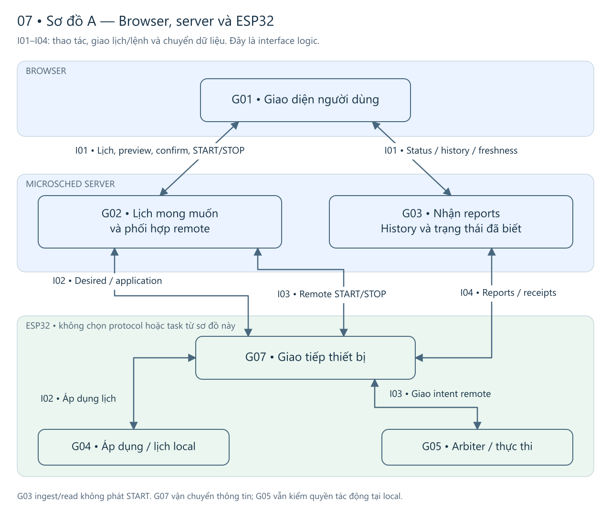
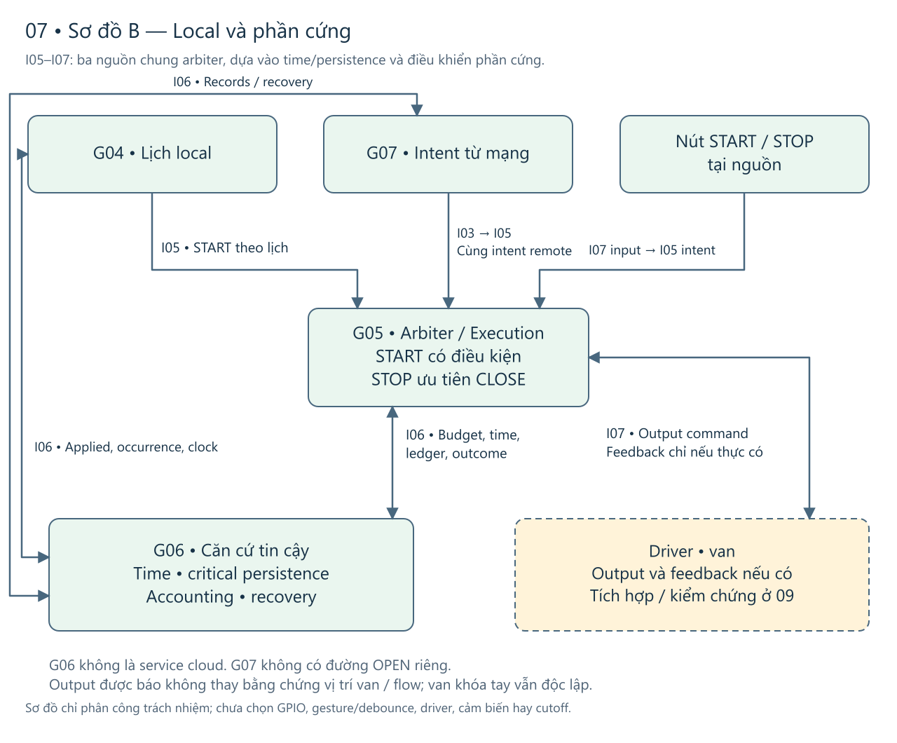
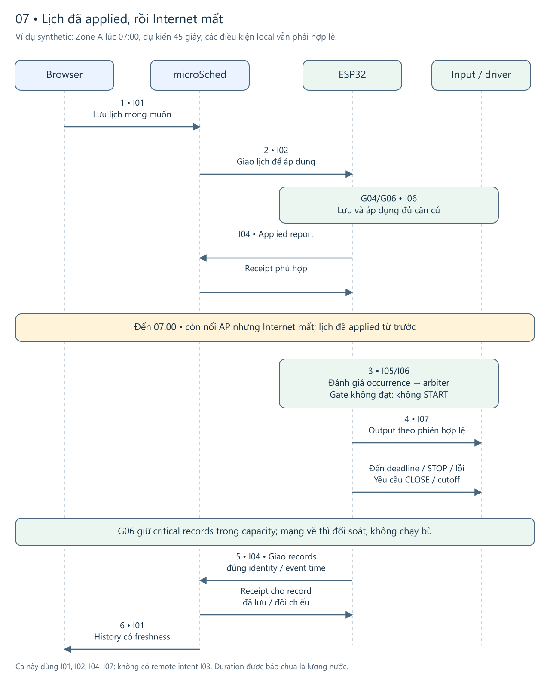
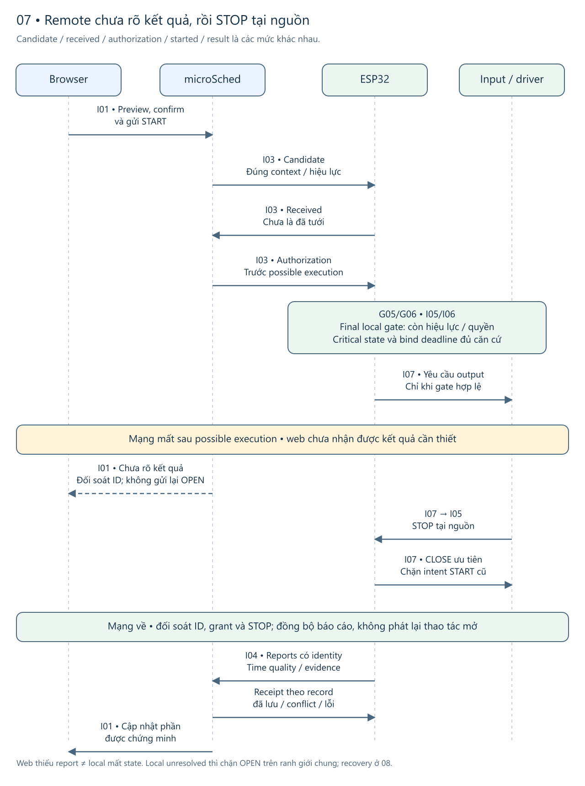
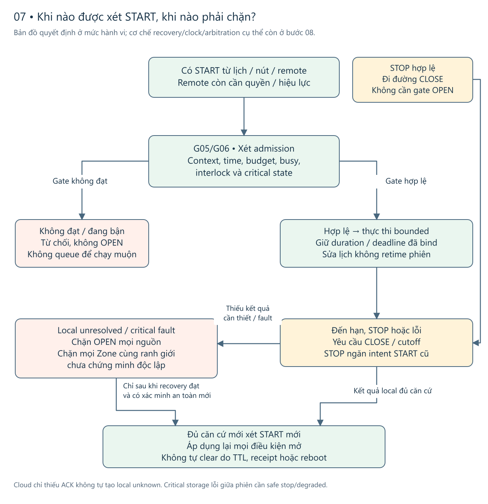

# miGarden — Bước 07: Functional View Specification

**Phạm vi lắp đợt một:** cả hai nút local là thường hở (NO), bấm LOW. Hở dây STOP làm nút đó mất tác dụng, không chặn lịch hoặc remote. Giữ STOP ưu tiên đóng; nhả không chạy lại intent cũ. Đèn riêng để sau. Xem [hai nút và mạch đấu ở 09](09-device-and-component-integration.vi.md#buttons).

Đọc sau [06 — bố trí và tài nguyên](06-iot-level-specification.vi.md). Bước 07 chốt nhóm chức năng, trách nhiệm, interface logic và các tình huống. Firmware, simulator điều khiển và tích hợp microSched **chưa triển khai**.

**Căn cứ S01 · 2026-11-08:** Đồng bộ tài nguyên và giả định kết nối với 06. Số đo diagnostic/LAN chưa chứng minh firmware sản phẩm, driver/van hoặc cloud hoạt động.

Hai sơ đồ interface, hai chuỗi phối hợp và catalogue nối trách nhiệm với từng tình huống. Mặc định nhận candidate rồi mới cấp quyền; đối soát theo ID khi thiếu kết quả. [08](08-operational-view-specification.vi.md) so phương án gộp và ghi các tham số còn mở.

Đọc [hai sơ đồ A/B ở phần 3](#3-các-interface-logic-cần-giữ-ý-nghĩa) để hiểu phần nào thuộc browser/server và phần nào ở ESP32, rồi theo [hai ví dụ ở phần 6](#6-hai-chuỗi-phối-hợp-và-các-tình-huống-cần-review). [Catalogue tình huống](#catalogue) dẫn tới năm luồng bình thường, 44 nhánh A, LC01–03 và hai ca mất kết nối. Bảng service/trace, thông tin bất biến và budget nằm ở phần 3–5, 7–9 để đọc sâu; 08–10 còn phải quyết định cơ chế và chứng minh cấu hình thật.

## 1. Functional View giúp triển khai điều gì?

Bước 06 trả lời “chạy ở đâu”; bước 07 trả lời “ai làm gì, trao đổi gì và ai chịu trách nhiệm khi lỗi”. Một thao tác như START có phần xác nhận/quyền ở server, kiểm tra và tác động ở thiết bị, rồi hiển thị kết quả ở browser. Vì vậy service không phải một process, còn domain không phải một module firmware.

Phân nhóm dưới đây theo ranh giới trách nhiệm: tương tác người dùng, mong muốn/remote, dữ liệu đã nhận, lịch local, tác động local, nền tảng tin cậy và giao tiếp thiết bị. Mỗi nhóm có thể triển khai bằng nhiều module nhỏ hoặc cùng một executable. Không bắt tạo bảy services triển khai riêng, bảy tasks hoặc một core CPU cho một nhóm.

## 2. Bản đồ chức năng và nơi chịu trách nhiệm

Hệ thống có ba nơi chịu trách nhiệm: **G01 ở browser; G02/G03 ở microSched; G04–G07 cùng ở đúng một ESP32**. G04 xét lịch, G05 quyết định tác động, G06 cung cấp trạng thái/thời gian đáng tin, G07 trao đổi qua mạng. [Sơ đồ A/B ở phần 3](#3-các-interface-logic-cần-giữ-ý-nghĩa) tách hai góc nhìn để thấy rõ đường remote nối vào local.

G06 là nền local, không là một service mạng mà mỗi START phải chờ. G07 vận chuyển thông tin nhưng không có đường OPEN riêng. G03 đọc/ingest không phát lệnh tưới. Ranh giới miGarden–microSched là ranh giới integration contract; không chuyển quyền safety local sang server.

### 2.1 Trách nhiệm từng nhóm

| Nhóm | Trách nhiệm chính và output | Ranh giới phải giữ |
|---|---|---|
| G01 — Browser | Nhập/đọc desired; trình bày desired/last-known applied; preview và **sau explicit confirm mới gửi yêu cầu START remote tới G02**; gửi STOP; dashboard/history initial load và tự cập nhật khi còn xem, giữ bộ lọc/freshness | Không quyết định local readiness hoặc giữ deadline. Đóng tab không ảnh hưởng local/sync. Received/authorized không hiển thị thành đã tưới |
| G02 — microSched desired/remote adapter | Xác thực/phân quyền theo cơ chế microSched; validate Zone/config; ghi nội dung mới/content_ref mới và desired ref; kiểm sửa đồng thời. Remote giữ identity/context/hiệu lực, fresh safe-confirmed cùng boot và không active/unknown theo contract, phối hợp nhận/giao quyền/STOP/pending reconciliation | Không sửa nội dung cũ, không suy saved=applied. Không grant START cũ sau STOP. Không coi timeout/expiry là canceled nếu có thể đã giao quyền; local schedule/buttons không đi qua G02 mỗi lần |
| G03 — microSched data adapter | Xác minh nguồn/target/schema/identity; cất immutable content/binding và records; dedup/conflict; trả receipt phù hợp; tạo status/history projections và API đọc theo quyền | Không overwrite conflict hoặc lấy current config thế history. Upload/receipt không replay action; last-known report không là physical realtime. Lưu trữ server/constraints cụ thể thuộc microSched |
| G04 — Local configuration/occurrence | Xác minh nguồn/target/nội dung được giao; lưu/apply lịch an toàn; tối đa một lịch active/Zone; phát report. Dùng civil time có căn cứ để đánh giá occurrence, cutover/no-double/no-catch-up, tạo START hoặc disposition không intent | Không OPEN trực tiếp, không đổi duration/context phiên đang chạy khi sửa/pause. Desired chưa applied không sinh lịch local thứ hai; ID mới theo content không đủ proof khác cơ hội |
| G05 — Local arbiter/execution | Nhận schedule/local_button/remote; resolve context và validate tại tác động, gồm remote START chưa hết hạn và authorization vẫn hợp lệ tại final local gate. Chung cumulative budget/interlock/admission; từ chối START bận; bind duration/deadline; ưu tiên STOP/CLOSE, chặn intent cũ; theo dõi output/feedback/fault theo bằng chứng có được | Không bypass G06 để mở khi critical state chưa tin cậy; không cần OPEN gates cho STOP. Remote cần authorization trước possible execution nhưng vẫn final gate local; quá hạn hoặc chưa xác minh hiệu lực trước tác động thì không OPEN. Unknown chặn mọi nguồn và Zone cùng ranh giới chưa chứng minh độc lập |
| G06 — Local trust foundation | Giữ applied/ref/ledger cơ hội/intent/outcome/accounting/unknown đủ phục hồi; timebase civil/elapsed và chất lượng; boot fail-closed, phục hồi trạng thái đáng tin; cung cấp persistence kết quả rõ ràng và evidence gap khi lỗi | Không coi RAM hoặc RTC SRAM nominal là durable qua mất nguồn. Không reset budget/restore OPEN; receipt server không xóa safety state. Critical storage lỗi giữa phiên phải báo để G05 safe stop/cutoff/degraded |
| G07 — Device communication | Nhận desired/remote đúng nguồn/đích/contract, chuyển đến G04/G05; lưu/giao reports từ critical state và đối soát receipts; retry record/cấu hình đúng identity trong policy; ưu tiên tài nguyên để mạng/backlog không lấn safety | Không tự retry action sau possible execution; không OPEN vì nhận gói tin. Sync độc lập browser; retry/backoff/cadence/retention chưa chọn. Phải phân biệt transport failure với kết quả execution |

Time và persistence nằm chung G06 vì cùng cung cấp căn cứ tin cậy cho admission/recovery, không phải vì phải dùng cùng class hay cùng task. Các lỗi đồng thời giữa G05/G06/G07 cần thiết kế atomicity/failure boundaries ở 08–09; việc tách tên không giải quyết tính nguyên tử.

### 2.2 Các chức năng xuyên nhóm

Security/access control hiện ở G02/G03 tại server và kiểm nguồn/đích/contract ở G07/G04/G05 tại thiết bị. Browser validation giúp phản hồi, không thay server authorization hoặc final local gate. Chưa chọn credential scheme, provisioning, transport security hoặc thay quyền microSched; đây là các precondition/dependency phải thiết kế trước tích hợp.

“Rules” hiện là recurrence, validity, admission và safety đã có yêu cầu. Không thêm analytics/AI, sensing/calibration soil hay notification lifecycle chỉ để khớp ví dụ slide 24. “Device management” trong phạm vi này là nhận cấu hình, report trạng thái và recovery cần thiết; không tạo Controller/Area/Source CRUD, OTA hoặc inventory/provisioning hoàn chỉnh. Chỉ báo lỗi/local feedback không phải một notification domain.

## 3. Các interface logic cần giữ ý nghĩa

Tên I01–I07 là nhãn giải thích, chưa là URL/topic/SDK/function signature. Contract triển khai phải gắn version ngữ nghĩa, revision miGarden và revision microSched; mismatch/không thể resolve phải có lỗi/unknown rõ, không âm thầm đoán. Format, transport và cơ chế version negotiation còn mở.

### Sơ đồ A — Browser, server và đường vào thiết bị

[Bản SVG](figures/07-functional/01-external-interfaces.svg) · [Nguồn Excalidraw chỉnh sửa được](figures/07-functional/01-external-interfaces.excalidraw).

**Cách đọc:** I01 nhận thao tác người dùng và trả thông tin. Lưu lịch đi I02 tới G04; điều khiển xa đi I03 tới G05 qua G07. G01 gửi START sau preview/explicit confirm, G02 kiểm lại quyền/context và phối hợp giao quyền trước possible execution; G05 vẫn quyết định tại thiết bị. Reports/receipts đi I04 với G03; dữ liệu đã nhận giúp G02 đối soát nhưng không tạo một đường OPEN từ history.

### Sơ đồ B — Cùng một đường tác động local và phần cứng

[Bản SVG](figures/07-functional/02-local-interfaces.svg) · [Nguồn Excalidraw chỉnh sửa được](figures/07-functional/02-local-interfaces.excalidraw).

**Cách nối A với B:** remote I03 ở A đưa **chính intent đó** qua G07 vào I05/G05 ở B; không có START thứ hai do bước chuyển hình. I05 còn nhận intent lịch từ G04 và nút local. G05 dựa G06 qua I06 để kiểm thời gian, trạng thái lưu bền và accounting rồi mới tác động I07. Input START/STOP, tín hiệu điều khiển output và bằng chứng vật lý là các ý khác nhau trên I07. Feedback/cutoff chỉ là nghĩa vụ cần thiết kế, không khẳng định đang có sensor đo vị trí van hay flow.

Cả hai hình là sơ đồ trách nhiệm/interface, không ấn định số process/task, network hop, GPIO hoặc protocol. Một intent không trở thành Session chỉ vì đã đi qua các mũi tên; cần evidence execution-start. Bảng dưới giữ hợp đồng chi tiết cho từng interface.

| Interface | Bên phối hợp và dữ liệu chính | Kết quả/refusal phải phân biệt |
|---|---|---|
| I01 — Human interaction | G01 với G02/G03: Zone/lịch, nội dung/ref khi sửa, quyền hiện có; preview/confirmed context và intent; query filter; status/history/freshness | Saved/pending/applied/rejected/unknown; received/authorized/started/result; loading/empty/partial/error. Server kiểm lại quyền/đích, không tin trạng thái UI |
| I02 — Desired/application | G02 ↔ G07 ↔ G04, dựa G06: schedule/content_ref/nội dung bất biến, target và provenance/thứ tự/hiệu lực cần thiết; applied/reject report qua I04 | Không dùng bản dở/version lùi; không double/catch-up khi cutover. Report mất là chưa xác nhận; report nguồn cũ đến muộn không kéo applied lùi. Không chọn sequence/boot protocol ở đây |
| I03 — Remote execution coordination | G02 ↔ G07 ↔ G05: identity START/STOP, binding/duration/context, hiệu lực hữu hạn cho START, căn cứ fresh safe-confirmed cùng boot và không active/unknown cho remote OPEN, candidate/received/authorization và đối soát STOP | G05 phải kiểm START còn hiệu lực/authorization hợp lệ ngay trước tác động; hết hạn trong lúc chờ/handoff/reconnect không được bắt đầu. Chưa grant, đã/có thể grant, started và outcome khác nhau; expiry sau possible execution không xóa unknown. Context đổi có ý nghĩa phải confirm lại. STOP đúng quyền/đích/hiệu lực không đòi OPEN readiness; đường mạng lỗi không là đã dừng |
| I04 — Reports/receipts | G06/G07 ↔ G03: record_id/origin, subject/ref, payload, event time/quality và content/binding cần resolve; G03 giữ first received_at_web riêng | New/duplicate hợp lệ/conflict/failed/unknown receipt. Cùng identity khác payload không overwrite. Receipt chỉ đủ nghĩa khi record đã validate/lưu/đối chiếu theo contract, không chỉ transport nhận bytes |
| I05 — Local intent/admission | G04 → G05; input vật lý → G05; G07 → G05 cho remote: source/identity/target, occurrence/content cho lịch hoặc finite duration manual, confirmation khi remote | Occurrence skip trước intent khác request reject; accepted khác started. Không tạo occurrence giả cho nút/web hoặc Session cho STOP. START bận bị từ chối, không late queue |
| I06 — Trust/persistence/time | G04/G05/G07 ↔ G06: applied/ref, disposition, intent/accounting/outcome/unknown, thời gian và chất lượng, thao tác đọc/ghi/phục hồi | Trạng thái đã bền/chưa rõ/thất bại phải đủ cho admission và boot recovery. Nếu không chứng minh critical state đáng tin thì không OPEN; lỗi trong phiên báo safe stop/degraded. Không hứa mọi lỗi vẫn ghi được record |
| I07 — Physical interaction | Local START/STOP ↔ G05; G05 với driver/van/feedback/cutoff | [09](09-device-and-component-integration.vi.md#buttons) chọn hai nút NO và hoãn đèn; debounce/manual duration còn mở. Output command khác output reported, valve position/flow; driver, fail-state và khóa tay cần kiểm thực |

I03 giữ hai giai đoạn logic: nhận candidate, rồi mới cấp quyền trước khi có thể thực thi. Số gói, giao thức và định dạng chưa chốt. Local scheduling/nút không phụ thuộc lượt giao quyền ấy. I06 yêu cầu admission đủ bền và fail-safe, chưa chọn transaction journal, storage engine hay thuật toán.

### 3.1 Chủ sở hữu thông tin và nơi phát sinh sự thật

| Thông tin | Nơi ghi fact gốc / nơi đọc | Quy tắc nhất quán |
|---|---|---|
| Schedule desired + immutable content | G02 qua storage microSched; G03 đọc/resolve | Thay nội dung tạo ref mới, cùng ref không thay nội dung. Giữ ref cần cho history trong retention được chọn; kiểm đồng thời/lỗi khi ghi ở bước 10 |
| Applied local + report | G04/G06; G03 giữ last-known được xác nhận | Applied khác enabled/readiness/physical state; report time không tự là actual apply time. Report provenance/source order khác arrival order |
| Occurrence/disposition | G04 qua G06; G03 nhận history | Có thể skipped/rejected trước START; disposition đã xử lý phải phục vụ no-double qua đổi content/reboot, không chỉ ID-per-version |
| ControlRequest | G02 tạo intent remote; G05 tiếp nhận/đối soát; local intents do đường local tạo | Target/source/duration đã bind không sửa; remote giữ confirmed context. Request accepted chưa là Session; STOP không tạo Session |
| WateringSession/output facts | G05/G06 khi execution-start có evidence; G03 nhận | Session có đúng một START cha. Zone/source/planned resolve qua START và content/binding bất biến, không copy config lặp hoặc lookup latest |
| Critical accounting/unknown/boot state | G05/G06 tại local, G03 chỉ nhận phần report cần thiết | Reset/reconnect/upload receipt không reset state; accounting là điều kiện safety, không phải optional telemetry |
| Event/report và views | Origin giữ identity/time/quality; G03 ghi first receive và dựng projection; G01 hiển thị | Origin time không bị sửa bởi duplicate; conflict giữ rõ; missing time/actual không được điền từ planned/receive. History thiếu ref là thiếu/unknown, không lấy bản mới thay |

Không sinh thêm domain revision/application/ledger/actor/Source từ các hàng thông tin hỗ trợ. Area nhóm Zone, mỗi Zone một Area; tất cả preview/control/history theo Zone, không affected-pot list. Nguồn/budget chung là ranh giới safety, không cần một Source registry để thực hiện chặn chung.

## 4. Service → function → interface → yêu cầu

Catalog tám thao tác trong [packet 05](05-service-specification.vi.md) vẫn giữ nguyên ý nghĩa. Một hàng có thể đi qua nhiều nhóm; đó là hợp tác, không phải đề xuất tám microservices.

| Thao tác 05 | Nhóm chịu trách nhiệm và hợp tác | Interface / kết quả cần giữ | UC / FR |
|---|---|---|---|
| S5-SV01 — Desired schedule | G01 tương tác; G02 validate/ghi qua storage microSched; G03 resolve đọc | I01, nối I02 khi cần apply; content_ref mới, saved khác applied, pause chưa là STOP | UC01, UC05; FR01 |
| S5-SV02 — Apply/confirm | G02/G07 giao/đối soát; G04/G06 validate/lưu/cutover; G03 nhận report | I02/I04/I06; 0..1 active/Zone, lost receipt unknown, old report không rollback, đang chạy không bị retime | UC01; FR01, FR02 |
| S5-SV03 — Occurrence evaluation | G04 dựa G06; chỉ gọi G05 nếu sinh START | I05/I06; disposition có thể không Request, không catch-up/double, schedule local không xin cloud grant | UC02; FR02 |
| S5-SV04 — Bounded START | G05/G06 final gate/deadline/output; G04 hoặc nút hoặc G07 đưa intent. Remote có G01/G02 preview/confirm/authorization | I03/I05/I06/I07; ba nguồn chung budget/interlock; received/accepted/started khác nhau; report cho thao tác nút; đèn riêng để sau | UC02–04; FR02, FR03, FR06; FR04, FR05 cho records |
| S5-SV05 — STOP/CLOSE | G05 đường local; G02 xử lý pending remote và giao qua G07; G06 giữ kết quả/ngăn intent cũ | I03/I05/I06/I07; không OPEN gates/không cần Session, pending chưa grant khác possible grant, không tự pause lịch | UC02–04/LC01; FR03, FR06, FR04, FR05 |
| S5-SV06 — Sync/ingest | G06 giữ records; G07 giao nền; G03 validate/lưu/dedup/receipt; G02 nhận căn cứ remote đối soát | I04/I06; không cần browser, record retry khác action retry, receipt không xóa accounting, conflict không overwrite | UC01–05; FR04, FR05 |
| S5-SV07 — Status read | G03 dựng projection; G02 cung cấp desired/remote facts; G01 initial read và tự cập nhật khi xem | I01/I04; last-known/freshness/unknown, next planned khi xác định được; không refresh giả nguồn mới | UC05; FR07; FR01, FR05 liên quan |
| S5-SV08 — Zone history read | G03 query/resolve immutable refs; G01 giữ filter và tự cập nhật kết quả liên quan khi xem | I01/I04; skipped/rejected không Session giả, time/actual thiếu giữ thiếu, không hứa history vô hạn | UC05; FR04, FR05, FR07 theo làm rõ live-history |

### 4.1 Năm UC được nối thành đường dùng cụ thể

| Use case | Đường phối hợp chính | Điều người dùng cần nhận ra |
|---|---|---|
| S2-UC01 — Quản lý/applied lịch | G01 → G02 → I02/G07 → G04/G06; report I04 → G03 → G01; SV01/02/06/07 | Đã lưu khác đã applied; offline không hứa pause có hiệu lực. Cutover không tạo action thứ hai, pause/sửa không dừng phiên đang chạy |
| S2-UC02 — Occurrence local | G04/G06 → I05/G05 → I07; G06/G07 → G03 → G01 khi có dữ liệu; SV03/04/06/07/08 | Cơ hội có thể skip trước START; phiên có giới hạn khi local hợp lệ dù mất Internet; không chạy bù |
| S2-UC03 — Nút tại nguồn | Input I07 → G05/G06 → output I07 và report; background I04; SV04 hoặc SV05 rồi SV06/08 | Không cần cloud round trip; không giả danh người bấm. START vẫn safety gates, STOP không cần OPEN gates và không thay van tay |
| S2-UC04 — Remote | G01/G02 preview/confirm và remote gates → I03/G07/G05/G06 → I07; reports I04 → G03/G02/G01; SV04 hoặc SV05 và SV06/07/08 | Đúng context/boot/rights/identity/TTL, final local gate; các mức received/grant/start/result riêng. STOP chưa tới không là đã dừng |
| S2-UC05 — Status/history và sync | G06/G07 ↔ G03 nền; G01 đọc G03 theo quyền và filter; SV06/07/08 | Xem last-known khi device offline; tự cập nhật khi xem, vẫn freshness/partial/unknown; sync không phát action |

FR01–07 đều có nơi thực hiện trong hai bảng. Trace này kiểm tính nhất quán thiết kế, không chứng minh các UC đã chạy hoặc mọi failure đã bao phủ bằng test.

## 5. Hợp tác khi tác động, dừng và phục hồi

### 5.1 START có điều kiện, thời gian và critical state

G04 dùng once/daily/weekly/interval, Hà Nội UTC+7 cố định; start/anchor/interval chia cấu hình 1 phút, duration là bội 15 giây. Đây không phải clock accuracy, manual default hay giới hạn nước an toàn. Cửa sổ lịch `[effective_from, effective_until)` và nội dung applied quyết định cơ hội hợp lệ; phiên đã bắt đầu giữ duration/deadline đã bind, biên cuối lịch không tự STOP phiên.

G06 phải cung cấp căn cứ về clock khởi tạo/khôi phục từ nguồn được chấp nhận, bất thường/reset/đổi giờ đã đối soát và drift/offline còn trong tolerance của tác vụ sẽ chọn. Civil time lập lịch/hiệu lực khác elapsed time bảo vệ duration/deadline; thiếu căn cứ cần thiết thì G05 không OPEN từ bất kỳ nguồn nào. Boolean clock usable hoặc fresh web timestamp không thay các căn cứ này. Nguồn clock, tolerance, offline envelope và recovery cụ thể còn mở ở 08–09.

G05 kiểm identity/target/config/policy/accounting/critical storage, cumulative limits xuyên schedule/local_button/remote, busy/interlock/unknown và context tại thực thi. Remote còn cần căn cứ authorization đúng context sau explicit confirm trước possible execution. Ngay tại final local gate, G05 phải xác minh START chưa hết hạn và authorization còn hợp lệ tại thời điểm tác động dự kiến; lần kiểm TTL ở server không thay được việc này. Nếu candidate/grant chờ quá hạn, reconnect mang intent quá hạn tới hoặc không xác minh được hiệu lực thì không OPEN. Nếu đã có possible execution mà thiếu kết quả, expiry không biến thành “chưa chạy” hay xóa unknown. G06 phải giữ critical intent/accounting và thông tin phục hồi đủ tin cậy trước tác động; chưa chứng minh được thì không OPEN. Đây là yêu cầu atomicity/safety, chưa chọn TTL số, cơ chế clock/handoff, thứ tự ghi journal hay công nghệ storage.

Occurrence đã skipped/rejected/started/completed hoặc unresolved unknown không được trở thành cơ hội thay thế do đổi content/ref/ID, pause/resume, reboot hay reconnect. G04/G06 phải phối hợp cutover, không chỉ dùng dedup theo content_ref. Request bị từ chối không tạo Session; Session đang chạy bình thường chưa terminal cũng không tự là unknown. Chỉ khẳng định Session start/end/reported duration khi có evidence tương ứng.

### 5.2 STOP và pending START phải được xử lý cùng nhau

| Trạng thái lúc STOP | G02/G07 phía remote | G05/G06 tại local | Cách báo kết quả |
|---|---|---|---|
| START pending, chứng minh chưa grant | Hủy/từ chối/giữ chặn intent cũ, không grant sau STOP; chỉ báo canceled nếu đủ evidence | Khi nhận STOP ngăn pending START cũ cùng phạm vi tự mở lại | Pending bị xử lý khác nước đã đóng; cần evidence riêng |
| START đã/có thể grant hoặc đang thực thi | Chuyển CLOSE/đối soát, không giả hủy trước tác động; không retry action | CLOSE ưu tiên, ngăn intent cũ; theo dõi/cutoff phù hợp, giữ unknown khi chưa kết luận | Received/granted/closed-requested/verified result riêng; thiếu kết quả giữ unknown |
| STOP local khi offline | Chưa thể biết ngay; reconnect phải đối soát pending/granted theo căn cứ local | Không chờ cloud biết STOP; giữ ngăn intent cũ/uncertainty cần thiết, không replay sau reconnect | Web vẫn stale/unknown tới khi có dữ liệu phù hợp |
| Remote STOP chưa tới thiết bị | Phản ánh chưa tới/chưa xác nhận và phần pending server xử lý được | Không được suy Controller đã nhận hoặc đã xóa pending local | Không tuyên bố toàn hệ thống dừng; local limits/cutoff/manual shutoff vẫn cần |

STOP không yêu cầu budget còn lại, clock usable cho OPEN hoặc Session đã biết; remote vẫn kiểm quyền/đích/identity/hiệu lực. START bận bị từ chối thay vì queue muộn. STOP một phiên không tự pause các occurrence tương lai chưa thành intent cũ. Muốn ngừng lịch cần SV01/SV02 và xác nhận applied; muốn dừng phiên dùng STOP riêng. Thứ tự arbitration ngoài ưu tiên STOP và cơ chế ranh giới intent cũ chưa chọn.

### 5.3 Unknown, lỗi storage, treo và mất nguồn

**Cần phân biệt nơi thiếu kết quả.** Nếu web không nhận terminal report sau possible execution, G02/G03 giữ outcome chưa xác định cho góc nhìn đó, không retry action và không cho remote OPEN mới dựa vào trạng thái cũ. ESP32 có thể vẫn kiểm soát phiên và giữ evidence local đầy đủ; thiếu cloud ACK tự nó không biến phiên đang chạy bình thường thành local unknown. Local chỉ được xét công việc tiếp khi trạng thái bắt buộc và căn cứ recovery/an toàn theo baseline đã đủ; chưa chọn tiêu chí cụ thể ở 08, không thêm ngoại lệ chỉ dựa cờ “closed”.

Nếu **G05/G06 cũng không xác định được kết quả local cần thiết sau possible execution**, SAFE08 bắt buộc giữ unknown, yêu cầu CLOSE/đối soát và chặn OPEN mọi nguồn. Nếu các Zone dùng chung nguồn/accounting mà chưa chứng minh độc lập, chặn mọi Zone trên ranh giới đó, không cho nút hoặc Zone B đi vòng. Hết TTL/cooldown, report closed cũ, đồng bộ thành công hoặc reboot không clear unknown/fault. Cần recovery/bằng chứng an toàn mới theo contract sẽ hoàn thiện; không thêm service “reset unknown/budget”.

Critical storage/ledger đầy, hỏng hoặc chưa chắc ghi bền khiến admission không được kiểm soát thì không START. Nếu lỗi xuất hiện giữa phiên, G06 phải báo G05 để safe stop/cutoff và degraded; không chỉ chặn phiên tiếp theo. Khi không ghi được, phải thừa nhận evidence gap, không hứa outcome luôn lưu. G07/debug không được chiếm hết tài nguyên dành cho critical state.

Mất Internet không lấy đi deadline/limits local của phiên hợp lệ. Treo/mất nguồn phải có fail-safe/cutoff đáp ứng safety envelope sau; boot fail-closed, không restore OPEN/catch-up/replay và không reset cumulative accounting. Nếu state phục hồi chưa đáng tin thì giữ chặn OPEN. Watchdog/reset software chưa chứng minh driver/van đã an toàn; manual shutoff độc lập, residual flow, áp lực/rò/tắc/siphon và feedback cần được thiết kế/kiểm chứng trước enable nước. Reported output duration không là lượng nước hoặc sức khỏe cây.

### 5.4 Sync, đọc dữ liệu và vòng đời cập nhật

G07 sync nền với G03 khi điều kiện kết nối cho phép, không cần browser hoặc người dùng đang đăng nhập. Có thể giao lại **cùng record**; không tự giao lại watering action sau grant. G03 validate rồi lưu/đối chiếu/dedup, cùng identity khác payload phải conflict. Receipt mất có thể dẫn đến giao lại record idempotently, không chứng minh server chưa nhận. Retention local chỉ theo policy sau receipt phù hợp và vẫn giữ safety state/ref còn cần.

G03 bảo toàn event time/quality, first received_at_web, source và immutable refs. Dữ liệu 07:00 đến 07:10 vẫn là sự kiện nguồn báo lúc 07:00, không phải vừa tưới lúc 07:10. Thiếu civil time giữ null/unknown; thiếu actual duration không thay bằng planned. Report applied/status có reported_at không tự cho actual apply time; out-of-order upload không định thứ tự nguồn đáng tin.

G01 lấy status/history ban đầu khi mở hoặc đổi filter; khi còn xem thì tự cập nhật dữ liệu liên quan, giữ bộ lọc và làm rõ freshness/loading/empty/partial/error. G03 cung cấp dữ liệu đã nhận/đối soát, không giả đủ backlog. G01/G03 chịu vòng đời đọc; G07/G03 chịu upload. Polling/push, refresh/upload cadence, hidden-tab behavior, retry/backoff và latency chưa chọn; không hứa realtime hoặc job history luôn chạy sau khi đóng màn hình.

## 6. Hai chuỗi phối hợp và các tình huống cần review

Hai ví dụ sau dùng Zone A, lịch 07:00/45 giây và STOP ở giây 17 để nối với [06, các thuật ngữ thực thi](06-iot-level-specification.vi.md#thuat-ngu-thuc-thi). Tất cả thời điểm/duration là synthetic, không là water policy/default. Chúng giúp đọc hai đường khác nhau; catalogue bên dưới mới liệt kê đầy đủ các tình huống đã định nghĩa trong phạm vi hiện tại.

### 6.1 Lịch đã applied, sau đó mất kết nối

[Bản SVG](figures/07-functional/03-offline-sequence.svg) · [Nguồn Excalidraw chỉnh sửa được](figures/07-functional/03-offline-sequence.excalidraw).

1. Người dùng lưu lịch SC-A-v1 cho Zone A. G01/G02 báo **đã lưu/chờ thiết bị**; I02/G07 đưa đúng nội dung/ref tới G04. G04/G06 xác minh, lưu/apply và gửi report qua I04. Chỉ report phù hợp mới cho web báo đã applied.
2. Sau khi applied, Wi-Fi hoặc đường Internet mất. ESP32 vẫn có điện và nội dung v1. Đến 07:00, G04 dùng civil time đủ tin cậy để đánh giá cơ hội; G06 giúp kiểm không trùng cơ hội qua cutover/reboot. Nếu time/config/accounting/safety không đủ thì không OPEN và không chạy bù khi mạng về.
3. Khi mọi điều kiện đạt, **G04 → I05 → G05** tạo/xử lý START lịch. G05/G06 giữ critical state, kiểm chung budget/interlock và chốt 45 giây/deadline elapsed trước tác động I07. Đây là occurrence local: **không đi I03 và không xin cloud grant**. Nếu có evidence bắt đầu mới có Session.
4. ESP32 giữ deadline/limits local. Đến hạn thì CLOSE; nếu người tại nguồn STOP ở giây 17 thì ưu tiên CLOSE và chặn intent cũ. Khi có đủ evidence, record giữ planned 45 giây và reported output 17 giây; không suy lượng nước. Storage lỗi giữa phiên chuyển safe stop/cutoff/degraded, có thể thiếu record.
5. Khi mạng về, G07 giao records đúng identity và ref qua I04; G03 validate/lưu/dedup rồi trả receipt. Record sự kiện 07:00 nhận lúc 07:10 không thành hành động vừa xảy ra lúc 07:10. Receipt không xóa accounting, disposition hoặc unknown còn cần cho safety; sync không catch-up/replay.
6. G01 đang xem thì cập nhật đúng bộ lọc; khi còn thiếu dữ liệu vẫn hiện freshness/partial/unknown. Đóng browser không dừng lịch local hoặc sync nền. Nếu web có desired mới trong lúc offline, chỉ applied hợp lệ cho tương lai mới đổi lịch; pause không STOP phiên đã chạy.

**Điều người dùng thấy:** mất mạng làm web chậm biết kết quả, không tự làm mất deadline ở thiết bị. Khi local không còn đủ điều kiện an toàn, nó phải từ chối/dừng phù hợp; không hứa tự chủ hoặc giữ backlog vô hạn. Hai kiểu mất Wi-Fi/AP và mất WAN phải kiểm riêng ở NET01/02.

### 6.2 Remote START chưa rõ trên web, rồi STOP tại nguồn

[Bản SVG](figures/07-functional/04-remote-sequence.svg) · [Nguồn Excalidraw chỉnh sửa được](figures/07-functional/04-remote-sequence.excalidraw).

1. Người dùng chọn Zone A và duration hữu hạn. G01 hiển thị preview Zone/binding/duration/context; **sau explicit confirm, G01 gửi yêu cầu START tới G02 qua I01**. G02 kiểm lại quyền, identity/hiệu lực và fresh safe-confirmed cùng boot, không active/unknown theo contract.
2. **Mặc định giữ hai giai đoạn:** G02 chuyển candidate qua I03/G07 tới G05; Controller báo received, rồi G02 mới xác minh và cấp quyền thực thi cho đúng intent. Trong khoảng đã nhận nhưng chứng minh chưa cấp quyền, microSched còn có thể hủy/chặn candidate theo LC01. Phiên đăng nhập xác thực Owner; danh tính thiết bị tách riêng. Quyền thực thi của từng START khác credential dùng để xác thực. 08 sẽ so phương án gộp quyền vào cùng gói, chưa đổi mặc định hay chọn cơ chế credential, protocol hoặc TTL số.
3. I03 nối vào cùng intent/admission I05 ở thiết bị. Ngay trước tác động, G05/G06 kiểm lại context đã confirm, START chưa hết hạn, authorization còn hợp lệ và mọi local gate, giữ critical state và chốt deadline. Mismatch phải preview/confirm lại; hết hạn trước tác động hoặc không xác minh được hiệu lực thì không OPEN. Chỉ evidence execution-start mới tạo Session.
4. Kết nối mất sau possible execution, web báo **chưa xác định**. **Đối soát lệnh cũ theo ID; không phát lại thao tác mở khi chưa rõ kết quả.** Có thể hỏi trạng thái hoặc đồng bộ lại báo cáo cùng ID. Trùng gói phải được xử lý an toàn qua reboot và STOP: không mở lần nữa, không dời deadline. Không cấp lại quyền hay tạo START khác chỉ để dò kết quả. ESP32 vẫn có thể giữ deadline và state local đáng tin; riêng lỗi ACK cloud không chứng minh local unknown. Nếu kết quả local cũng unresolved thì SAFE08 chặn mọi nguồn/Zone trên ranh giới chung đến recovery/xác minh an toàn mới.
5. Người tại nguồn STOP. G05 ưu tiên CLOSE, ngăn START cũ tự mở lại và phản hồi đúng mức bằng chứng; không cần cloud, budget còn lại hay OPEN gates. Cloud chưa biết STOP không cho phép intent cũ quay lại tác động sau reconnect. Nếu người dùng gửi STOP từ web qua I03 mà chưa tới thiết bị, web chỉ báo đang gửi/chưa xác nhận; không nói nước đã đóng.
6. Mạng về chỉ để đối soát intent/STOP và giao records qua I04. Pending chứng minh chưa grant có thể hủy/từ chối/chặn; đã/có thể grant phải CLOSE/đối soát, không gán canceled như chưa tác động. History giữ source/context/ref và event time; G01 cập nhật phần đã được chứng minh, phần thiếu vẫn unknown. Receipt về sau không chứng minh valve position/flow hoặc tự clear fault.

**Điều người dùng cần quyết định từ kết quả:** “đã nhận”, “được giao quyền”, “thiết bị báo bắt đầu/kết thúc” và “nước đã được xác minh an toàn” có căn cứ khác nhau. Remote STOP không thay bảo vệ local hoặc van khóa tay. STOP không tự pause một occurrence tương lai chưa thành intent; occurrence ấy chỉ được xét sau khi mọi gate/recovery cần thiết đã đạt.

### 6.3 START, STOP và phục hồi ở mức hành vi đã chọn

[Bản SVG](figures/07-functional/05-control-states.svg) · [Nguồn Excalidraw chỉnh sửa được](figures/07-functional/05-control-states.excalidraw).

Hình là góc nhìn hành vi để review, không định nghĩa enum hay thuật toán 08. **Sẵn sàng xét START** vẫn cần kiểm đúng intent/context, clock/config/accounting/budget/interlock/lưu bền tại tác động; remote thêm authorization/hiệu lực. Khi active, deadline/STOP/fault dẫn tới đường đóng/cutoff và xác minh; START bận bị từ chối, không có hàng chờ chạy muộn. STOP có thể tới khi chưa có Session và vẫn phải xử lý intent cũ.

**Kỳ tưới tiếp theo.** Nếu web mất báo cáo nhưng local vẫn đủ căn cứ, Controller có thể xét kỳ mới theo lịch đã áp dụng. Nếu local thật sự chưa rõ, cần bằng chứng an toàn mới phù hợp với lỗi, vô hiệu được START cũ và tin được clock, cấu hình, accounting trước khi xét lại. Tự phục hồi khi có đủ căn cứ theo policy; nếu thiếu thì giữ chặn và báo Owner kiểm tra. Phục hồi sau thời điểm của kỳ đã lỡ không chạy bù. Tiêu chí cụ thể và bằng chứng vật lý được thiết kế/kiểm ở 08–09.

Local unresolved unknown hoặc degraded làm mất căn cứ an toàn thì giữ chặn OPEN theo phạm vi chung. Chỉ bằng chứng recovery/trạng thái an toàn mới phù hợp mới cho phép **xét lại**, không tự mở nước. Boot, mạng về, receipt, TTL/cooldown hết đều không phải cạnh tự clear. Boot fail-closed, không restore OPEN và không reset budget; storage lỗi lúc active phải safe stop/cutoff/degraded. Tiêu chí recovery, atomicity và thứ tự chi tiết còn ở 08–09.

### 6.4 Catalogue đầy đủ để review hành vi

Catalogue này dẫn từ tình huống cụ thể tới hành vi local, điều người dùng thấy và nguồn của hành vi. **Đây là thiết kế cần kiểm chứng, không phải ca test đã PASS.** Giờ/duration trong các ví dụ đều synthetic. Preconditions chung vẫn là đúng quyền/đích, cấu hình và trạng thái cần thiết đáng tin; các nhánh chỉ thay điều kiện được nêu, không miễn các safety gate còn lại. Khi ghi critical record không được, phải thể hiện degraded/evidence gap thay vì hứa vẫn có đủ history.

| Phần đọc | Luồng bình thường | Nhánh A | Nguồn |
|---|---:|---:|---|
| [UC01 — Lịch và applied](#catalogue-uc01) | 1 | 8 | [02 UC01][src-uc01] |
| [UC02 — Occurrence local](#catalogue-uc02) | 1 | 10 | [02 UC02][src-uc02] |
| [UC03 — START/STOP tại nguồn](#catalogue-uc03) | 1 | 8 | [02 UC03][src-uc03] |
| [UC04 — Remote](#catalogue-uc04) | 1 | 9 | [02 UC04][src-uc04] |
| [UC05 — Status/history/sync](#catalogue-uc05) | 1 | 9 | [02 UC05][src-uc05] |
| [Quy tắc liên UC và mất kết nối](#catalogue-lc-net) | LC01–03 | NET01–02 | [02 LC][src-lc], [02 ca mạng][src-net] |

Tổng cộng **5 luồng bình thường + 44 nhánh A + 3 quy tắc LC + 2 ca NET = 54 mục**. Các biến thể quan trọng nằm riêng từng hàng; ví dụ ở 6.1/6.2 không thay thế các hàng còn lại. Mỗi ID A giữ đúng số và ý nghĩa của baseline 02. Cột cuối nối tiếp về G/I trong phần 2–3 và service trong phần 4, để có thể đọc chi tiết khi cần.

#### UC01 — Quản lý lịch và biết bản nào đã áp dụng

| Mục | Tình huống cụ thể / điều kiện đầu | Hành vi local và điều người dùng thấy | Nguồn / đường phối hợp |
|---|---|---|---|
| **S2-UC01 — bình thường** | Chủ vườn có quyền lưu lịch Zone A 07:00/45 giây trước hạn; Controller kết nối, đủ điều kiện apply | G02 lưu nội dung/ref mới và báo chờ. G04/G06 xác minh/lưu/apply; I04 đưa report phù hợp về thì web mới báo applied. Việc lưu/apply không mở nước; occurrence sau đi UC02 | [02 UC01][src-uc01]; SV01/02/06/07, I01/02/04/06 |
| **UC01-A01** | Nhập duration sai độ chia hoặc target/hiệu lực không hợp lệ | Từ chối, web nêu lý do để sửa; không âm thầm đổi Zone/duration rồi áp dụng. Không có action tưới từ việc thử lưu | [02 UC01-A01][src-uc01]; G01/G02, SV01 |
| **UC01-A02** | Web lưu 08:00/60 giây hoặc pause khi ESP32 offline, local đang giữ v1 | Web báo đã lưu/chờ/chưa applied. Local chỉ dùng bản cũ khi còn hợp lệ và mọi gate đạt; người dùng không được hiểu pause đã có hiệu lực. Khi mạng về đối soát/apply cho tương lai, không chạy bù | [02 UC01-A02][src-uc01]; G02/G04/G07, I02 |
| **UC01-A03** | Hai lần sửa cùng dựa v1, hoặc report cũ tới sau report mới | Không ghi đè mù hoặc apply version lùi. Web thấy conflict/chưa rõ và bản hiện hành cần đối chiếu; arrival order không tự là source order | [02 UC01-A03][src-uc01]; G02/G03/G04, I02/04 |
| **UC01-A04** | Board có thể đã apply v2 nhưng report/receipt về web mất | Web giữ chưa xác nhận tới khi resolve đúng applied/ref/provenance. Không suy apply thất bại và không mở nước để thử; local dùng nội dung đã apply đáng tin, không dựa thiếu ACK web | [02 UC01-A04][src-uc01]; SV02/06, I02/04 |
| **UC01-A05** | Người dùng pause/bật lại khi có phiên đang chạy | Thay nội dung và chờ applied; pause đã applied ngăn occurrence tương lai. Phiên hiện tại giữ duration/deadline cũ; muốn dừng dùng STOP riêng. Web không viết lại lịch sử phiên | [02 UC01-A05][src-uc01]; P01, SV01/02/05 |
| **UC01-A06** | Ghi config mới vào local bị đầy/hỏng/ghi dở | G04/G06 không dùng bản dở; báo degraded khi báo được. Bản cũ chỉ được dùng nếu còn hợp lệ và state chứng minh được; web không báo bản mới đã apply thành công | [02 UC01-A06][src-uc01]; G04/G06, I02/06 |
| **UC01-A07** | Apply bản mới sát 07:00, khi phiên đang chạy hoặc sau cơ hội v1 đã xử lý | Cutover theo LC02 không tạo lần thứ hai, không restart/retime phiên cũ và không chạy bù. Web mất receipt chỉ đối soát applied, không tạo occurrence thay thế; history giữ nội dung thực dùng | [02 UC01-A07][src-uc01]; LC02/P01, G04/G05/G06 |
| **UC01-A08** | Config đã lưu/apply nhưng clock chưa có căn cứ usable | Có thể phân biệt lưu/apply cấu hình với readiness; không OPEN khi clock/điều kiện cần thiết chưa đáng tin. Web không báo sẵn sàng tưới chỉ từ applied; recovery phải có căn cứ sẽ thiết kế | [02 UC01-A08][src-uc01]; SAFE05, G04/G05/G06 |

#### UC02 — Một cơ hội lịch local có thể chạy, bỏ qua hoặc chưa rõ

| Mục | Tình huống cụ thể / điều kiện đầu | Hành vi local và điều người dùng thấy | Nguồn / đường phối hợp |
|---|---|---|---|
| **S2-UC02 — bình thường** | V1 đã applied, đến 07:00, còn điện/nguồn phù hợp; clock/config/ledger/budget/safety hợp lệ, không active/unknown | G04 đánh giá cơ hội; I05/G05/G06 kiểm chung và chốt 45 giây/deadline, có start evidence mới tạo Session. Đến hạn đóng/xác minh, giữ records/ref rồi sync khi được. Web chỉ biết phần đã nhận; không cần I03/cloud grant cho occurrence | [02 UC02][src-uc02]; SV03/04/06/07/08, I05/06/07 |
| **UC02-A01** | Scheduler đánh giá lặp, hoặc ID v1/v2 cùng trỏ một cơ hội 07:00 | Ledger/cutover ngăn action lần hai, kể cả cơ hội đã skip/reject. Không chứng minh được trạng thái thì không OPEN; history có disposition khi ghi được, không có Session mới giả | [02 UC02-A01][src-uc02]; LC02, G04/G06 |
| **UC02-A02** | Mất Wi-Fi/AP, WAN khi AP còn nối, hoặc microSched down giữa phiên hợp lệ | Local vẫn giữ deadline/limits và đóng phù hợp; giữ critical record trong capacity để sync sau. Web stale/partial khi chưa nhận; không tự dừng ngay chỉ vì mất mạng hoặc hứa offline vô hạn | [02 UC02-A02][src-uc02]; SAFE01/02, G05/G06/G07 |
| **UC02-A03** | Đến hạn nhưng clock/config/lịch/ledger hoặc budget không chứng minh được | Không OPEN; ghi skip/reject/degraded khi có khả năng và báo lý do. Phục hồi sau không tưới bù cơ hội đã lỡ; applied không tự là readiness | [02 UC02-A03][src-uc02]; SAFE05, G04/G05/G06 |
| **UC02-A04** | Nút hoặc remote START tới khi lịch đang chạy/đang tranh chấp | Cùng arbiter/budget/interlock; START bận bị từ chối, không queue muộn hay kéo dài phiên. Nếu có STOP xử lý intent cũ theo LC01. Web chỉ báo kết quả có bằng chứng; tại chỗ quan sát nước/tiếng bơm | [02 UC02-A04][src-uc02]; P02, G05/G06, I05 |
| **UC02-A05** | Người tại nguồn hoặc remote hợp lệ STOP ở giây 17 | Ưu tiên CLOSE, chặn START cũ; ghi lý do/17 giây reported khi có evidence. STOP không tự pause/xóa occurrence tương lai; web chưa nhận thì chưa xác nhận dừng | [02 UC02-A05][src-uc02]; LC01, SV05, I05/07 |
| **UC02-A06** | Van/driver kẹt, áp/nguồn nước bất thường, rò/tắc, thiếu feedback hoặc còn flow sau CLOSE | Phản ứng/cutoff theo thiết kế cần chứng minh; giữ fault/unknown và chặn OPEN khi an toàn chưa xác minh, dùng boundary chung khi chưa độc lập. Báo đúng mức lỗi/chưa rõ, không gọi CLOSE là nước đã ngừng; sensor cụ thể chưa chọn | [02 UC02-A06][src-uc02]; SAFE08/09, G05/G06, I07 |
| **UC02-A07** | Board treo/mất nguồn giữa phiên rồi boot lại | Fail-safe/cutoff phải đáp ứng envelope sẽ chọn, boot fail-closed; không restore OPEN/replay/reset budget. Phiên cũ chưa rõ cần recovery trước START mới; web không báo hoàn tất từ việc board online lại | [02 UC02-A07][src-uc02]; SAFE03/04/08, G05/G06 |
| **UC02-A08** | Critical storage đầy/hỏng trước START hoặc lỗi khi active | Trước tác động thì chặn START thiếu kiểm soát; đang chạy phải safe stop/cutoff/degraded. Có thể mất evidence; không hứa có terminal record hoặc cho debug lấn safety state | [02 UC02-A08][src-uc02]; SAFE10, G05/G06/G07, I06 |
| **UC02-A09** | Mapping/nội dung hiệu lực Zone A đổi hoặc không resolve được lúc xét OPEN | Không OPEN nếu target/policy chưa xác minh; không thay history cũ bằng mapping mới. Nếu đổi trong phiên, giữ uncertainty/phản ứng an toàn phù hợp; xử lý chi tiết P03 còn mở | [02 UC02-A09][src-uc02]; LC03/P03, G04/G05/G06 |
| **UC02-A10** | Clock quality đổi hoặc thiếu mốc start/end để tính duration | Bảo vệ deadline elapsed theo thiết kế, không retime phiên theo civil clock mới. History giữ quality/null/unknown đúng evidence, không thay actual bằng planned 45 giây; thiếu căn cứ safety vẫn theo SAFE05/08 | [02 UC02-A10][src-uc02]; G05/G06, I06/04 |

#### UC03 — Người tại nguồn START/STOP mà không cần cloud

| Mục | Tình huống cụ thể / điều kiện đầu | Hành vi local và điều người dùng thấy | Nguồn / đường phối hợp |
|---|---|---|---|
| **S2-UC03 — bình thường** | Người tại nguồn gửi input START hợp lệ; manual duration hữu hạn/target và local gates đã xác minh | I07/input → I05/G05, dùng G06 và cùng arbiter/budget như lịch. Có evidence mới tạo Session; deadline/STOP/lỗi dẫn đóng/xác minh. Chỉ báo local phản ánh nhận/từ chối/đang xử lý/kết quả; STOP không đòi OPEN gates/Session/cloud. Records source local_button sync sau | [02 UC03][src-uc03]; SV04/05/06/08, I05/06/07 |
| **UC03-A01** | Người tại nguồn thao tác trong lúc Internet/microSched mất | START chỉ chạy khi local hợp lệ, STOP vẫn theo đường local còn hoạt động. Người tại chỗ quan sát nước/tiếng bơm; web giữ dữ liệu cũ tới sync, không phải xin cloud grant | [02 UC03-A01][src-uc03]; SAFE01/02, G05/G06 |
| **UC03-A02** | Nhấn START nhưng manual duration/config/clock/ledger/safety không hợp lệ | Từ chối START và lưu lý do khi có thể để đồng bộ. STOP vẫn yêu cầu CLOSE, không bị ép qua điều kiện OPEN; duration mặc định chưa chọn | [02 UC03-A02][src-uc03]; SAFE05, G05/G06, I05/07 |
| **UC03-A03** | Nút bounce/bấm lặp hoặc START tới khi đã có phiên | Không nhân/kéo dài phiên; START bận bị từ chối, không queue. Ghi đúng kết quả khi có thể; hai nút nhấn nhả NO ở 09, debounce còn mở | [02 UC03-A03][src-uc03]; P02, G05, I07 |
| **UC03-A04** | Có START/STOP từ nút nhưng không xác thực được người bấm | History ghi source local_button/người thao tác vật lý chưa rõ danh tính; không gán Owner hoặc người nhà cụ thể. Không tạo actor/occurrence giả cho nút | [02 UC03-A04][src-uc03]; G05/G06/G03, I04 |
| **UC03-A05** | Board treo/mất điện nên nhấn STOP điện tử không được xử lý | Không báo đã dừng từ việc bấm nút. Fail-safe/cutoff và van khóa tay độc lập phải được thiết kế/kiểm chứng; boot lại không restore OPEN hoặc xóa budget. Chưa có proof nước ngừng thì giữ giới hạn evidence | [02 UC03-A05][src-uc03]; SAFE03/04/09, G05/G06, I07 |
| **UC03-A06** | Van/feedback bất thường hoặc kết quả trước tại local unresolved | Yêu cầu CLOSE/cutoff và giữ fault/unknown; chặn mọi nguồn/Zone cùng boundary chưa độc lập tới recovery/xác minh. Báo từ chối/chưa rõ theo record; nút không bypass ranh giới | [02 UC03-A06][src-uc03]; SAFE08/09, G05/G06 |
| **UC03-A07** | Ghi critical record hoặc giữ budget lỗi | Chặn START/degraded; STOP theo đường an toàn còn hoạt động, lỗi lúc active phải safe stop/cutoff. Reset hoặc vắng cloud không xóa accounting; ghi rõ evidence gap khi không lưu được | [02 UC03-A07][src-uc03]; SAFE10, G05/G06, I06 |
| **UC03-A08** | Chưa xác minh Zone/binding/nội dung hoặc context đổi | Không START với đích chưa chứng minh. Phiên đã bắt đầu giữ ref bất biến; ghi uncertainty/thay đổi và xử lý an toàn phù hợp, không sửa history sang config hiện tại. Chi tiết đổi trong phiên còn ở P03 | [02 UC03-A08][src-uc03]; LC03, G05/G06 |

#### UC04 — Tưới/dừng từ microSched và biết đúng mức kết quả

| Mục | Tình huống cụ thể / điều kiện đầu | Hành vi local và điều người dùng thấy | Nguồn / đường phối hợp |
|---|---|---|---|
| **S2-UC04 — bình thường** | Có quyền, đúng Zone A/context, fresh safe-confirmed cùng boot và không active/unknown; START còn hiệu lực, local gates đạt | G01 preview → explicit confirm → gửi START; G02 kiểm lại, I03 giao candidate/received/authorization trước possible execution; cùng intent qua I05/G05 final gate rồi bounded execution. I04 trả evidence từng mức, không coi grant là đã tưới. Remote STOP hợp lệ xử lý pending/CLOSE; chỉ xác nhận dừng khi có evidence | [02 UC04][src-uc04]; SV04/05/06/07/08, I01/03/04/05/06/07 |
| **UC04-A01** | Người dùng thiếu quyền hoặc report không đủ fresh safe-confirmed cho OPEN | Không xác nhận/thi hành OPEN, web nêu điều kiện chưa đạt. STOP/status theo quyền/đích/contract riêng không bị chặn bởi OPEN readiness | [02 UC04-A01][src-uc04]; G01/G02/G05, I01/03 |
| **UC04-A02** | Device offline trước OPEN, hoặc candidate hợp lệ đang chờ thì mạng mất | Thiếu safe-confirmed thì không confirm OPEN. Candidate chỉ chờ trong hiệu lực hữu hạn; G05 kiểm lại tại final gate, hết hạn/chưa xác minh được thì không OPEN sau reconnect. Nếu đã possible execution mà thiếu kết quả chuyển A04, không gọi là hết hạn chưa chạy | [02 UC04-A02][src-uc04]; G02/G07/G05, I03/05 |
| **UC04-A03** | Cùng lệnh giao hai lần, tới trễ/sai đích/version hoặc delivery đồng thời | Validate/dedup/hiệu lực/context để không nhân action hoặc đổi target đã bind; payload mâu thuẫn phải đối soát. Web chỉ phản ánh kết quả có căn cứ, không xem retry giao là một lần tưới mới | [02 UC04-A03][src-uc04]; SAFE06, G02/G07/G05/G06 |
| **UC04-A04** | Có thể đã tác động nhưng web mất terminal receipt/timeout | Web giữ OUTCOME_UNKNOWN, không retry action/remote OPEN mới từ state cũ. Nếu kết quả local cũng unresolved, SAFE08 chặn mọi nguồn và mọi Zone chung boundary tới recovery/an toàn mới. Thiếu ACK cloud không tự chứng minh local unknown; chỉ evidence local/recovery đủ theo baseline mới cho xét tiếp, không clear bằng TTL | [02 UC04-A04][src-uc04]; SAFE08, phần 5.3, G02/G05/G06 |
| **UC04-A05** | Lịch/nút đang chạy khi remote START tới, hoặc STOP gặp OPEN chờ | START bận bị từ chối, không queue. STOP ưu tiên CLOSE và xử lý intent cũ theo LC01; đã/có thể grant không báo canceled/closed nếu chưa có evidence. Web/local giữ rõ phần đã xử lý và chưa xác nhận | [02 UC04-A05][src-uc04]; P02/LC01, G02/G05/G06 |
| **UC04-A06** | Người dùng hủy command còn chờ, nhưng chưa rõ đã grant chưa | Chỉ báo canceled khi chứng minh chưa giao quyền; đã/có thể grant thì yêu cầu CLOSE/đối soát/recovery theo evidence, không giả chưa từng tác động hoặc retry START | [02 UC04-A06][src-uc04]; LC01, G02/G07/G05 |
| **UC04-A07** | Treo/reboot/mất nguồn, van/flow/feedback hoặc critical storage lỗi sau remote | Giữ fail-safe/cutoff/unknown đúng evidence, lỗi storage lúc active phải safe stop/degraded. Boot không restore OPEN/reset budget, không redeliver action sau grant; web chưa có kết quả không bịa thành công | [02 UC04-A07][src-uc04]; SAFE03/04/08/09/10, G05/G06 |
| **UC04-A08** | Sau preview, Zone/binding/duration/config có ý nghĩa đổi hoặc receipt thuộc boot/config khác | Chặn remote intent context cũ; cần preview/confirm mới khi context đổi. Không tự thay target rồi mở; history giữ context preview/confirm và execution riêng, receipt khác boot không cho readiness giả | [02 UC04-A08][src-uc04]; LC03, G02/G07/G05/G06 |
| **UC04-A09** | Người dùng bấm Dừng nhưng mạng đứt hoặc chưa có evidence đóng | Web báo đang gửi/chưa xác nhận/lỗi, không nói toàn hệ thống hay nước đã dừng. Chỉ xử lý được phần pending có bằng chứng; local limits/cutoff và van khóa tay vẫn cần, reconnect phải đối soát intent cũ | [02 UC04-A09][src-uc04]; LC01/SAFE09, G02/G07/G05 |

#### UC05 — Xem dữ liệu và đồng bộ không tạo tác động nước

| Mục | Tình huống cụ thể / điều kiện đầu | Hành vi local và điều người dùng thấy | Nguồn / đường phối hợp |
|---|---|---|---|
| **S2-UC05 — bình thường** | Người có quyền mở dashboard/history; service có provenance/dữ liệu. Khi có kết nối, thiết bị và server đủ điều kiện sync | G06/G07 gửi record/ref nền qua I04, G03 validate/lưu/dedup/receipt. G01 đọc dữ liệu, lọc Zone/ngày/nguồn/kết quả và tự cập nhật khi đang xem; giữ planned/reported/freshness. Không cần tab mở cho upload, không cần Controller online để xem phần history đã nhận; ingest không OPEN | [02 UC05][src-uc05], [05 SV07/08](05-service-specification.vi.md); SV06/07/08, I01/04/06 |
| **UC05-A01** | Controller offline, người dùng mở history đã nhận | G03 vẫn cho đọc phần đã có kèm stale/last-seen/partial. Không suy chưa tưới hoặc đã tưới trong khoảng thiếu record; local vẫn theo các điều kiện của nó | [02 UC05-A01][src-uc05]; G01/G03/G07, I01/04 |
| **UC05-A02** | microSched down trong khi local còn điện | Không bảo đảm xem/điều khiển xa lúc đó; local giữ limits/deadline và critical records trong capacity thiết kế. Khi service trở lại mới giao/đối soát, không replay action | [02 UC05-A02][src-uc05]; SAFE02, G05/G06/G07 |
| **UC05-A03** | Event 07:00 tới 07:10, tới sai thứ tự hoặc civil clock thiếu tin cậy | Giữ source/event time/quality và first received_at_web riêng; thiếu civil time để null/unknown. Web không gọi vừa tưới lúc 07:10; report cũ không kéo applied lùi hoặc trở thành freshness mới | [02 UC05-A03][src-uc05]; 04 thời gian, G03/G06/G07 |
| **UC05-A04** | Upload trùng hợp lệ, cùng identity khác payload hoặc mismatch version/source/target | G03 dedup hoặc báo conflict/đối soát/quarantine theo contract, không overwrite mâu thuẫn hoặc nhân Session. Web giữ phần chưa rõ; receipt phải đúng nghĩa validate/lưu, không chỉ đã nhận bytes | [02 UC05-A04][src-uc05]; G03/G07, I04 |
| **UC05-A05** | Server có thể đã lưu record nhưng receipt upload mất | G07 có thể giao lại cùng record/identity trong policy; không replay watering intent và không suy server chắc chắn chưa nhận. Dedup giữ event time/lần nhận đầu, receipt không xóa safety accounting | [02 UC05-A05][src-uc05]; SV06, G03/G06/G07, I04 |
| **UC05-A06** | Critical queue/ledger đầy/hỏng khi offline/backlog lớn | Báo degraded/evidence gap; không OPEN nếu không còn kiểm soát logging/budget an toàn. Nếu đang active phải safe stop/cutoff; telemetry không chiếm phần critical, không hứa mọi record vẫn tồn tại | [02 UC05-A06][src-uc05]; SAFE10, G05/G06/G07 |
| **UC05-A07** | Có log output kết thúc nhưng thiếu physical evidence | History chỉ báo Controller-reported output, phần nước chưa xác minh giữ rõ. Không suy flow/lượng nước từng chậu/đủ nước; nếu còn unresolved safety theo SAFE08/09 thì không cấp OPEN từ một dòng “completed” | [02 UC05-A07][src-uc05]; SAFE08/09, G01/G03/G05/G06 |
| **UC05-A08** | Applied hiện là v3 paused/60 giây nhưng Session cũ dùng v1/45 giây | Resolve START/occurrence và ref nội dung/binding bất biến nên history vẫn đúng v1/45; thiếu ref thì báo thiếu/unknown, không dùng config mới thay quá khứ. Không cần copy config vào mỗi Session | [02 UC05-A08][src-uc05]; LC03, information model 04, G03/G06 |
| **UC05-A09** | Chưa tải xong, không có record, query lỗi/partial hoặc chưa đủ căn cứ tính lần tới | G01 hiện loading/empty/error/partial và lý do phù hợp, giữ filter khi tự cập nhật. Không bịa next planned, phiên, timestamp hay metric; refresh không làm report nguồn mới hơn | [02 UC05-A09][src-uc05]; G01/G03, I01 |

#### LC01–03 và hai ca mất kết nối cần kiểm riêng

| Mục | Tình huống cụ thể / điều kiện đầu | Hành vi local và điều người dùng thấy | Nguồn / đường phối hợp |
|---|---|---|---|
| **LC01 — STOP và intent cũ** | STOP tới lúc START đang pending; có thể chưa grant hoặc đã/có thể grant, kể cả STOP local khi offline | Chứng minh chưa grant thì hủy/từ chối/chặn, không grant intent cũ sau STOP. Đã/có thể grant thì CLOSE/đối soát, thiếu kết quả giữ unknown/recovery. Controller ngăn START cũ tự tác động, reconnect không replay; web chưa tới thiết bị không gọi đã dừng. Occurrence tương lai chưa thành intent không tự bị pause | [02 LC01][src-lc01]; phần 5.2, G02/G05/G06/G07, SV05 |
| **LC02 — Cùng cơ hội qua đổi nội dung** | Apply trước hạn, đang chạy, sau hoàn tất; pause/resume quanh hạn hoặc mất receipt | Chỉ một applied active/Zone; ledger giữ cơ hội đã xử lý xuyên ref/version. Không double/catch-up/restart/retime; không chứng minh ranh giới thì không OPEN. Web đối soát applied/ref, không tạo cơ hội thay thế. Thuật toán identity/cutover còn ở 08–09 | [02 LC02][src-lc02]; G04/G05/G06, SV02/03/04 |
| **LC03 — Đúng context, giữ quá khứ** | Mapping/context đổi giữa chuẩn bị và OPEN; hoặc config hiện tại khác khi đọc history mọi nguồn | Trước OPEN cả ba nguồn resolve Zone/binding/nội dung đúng. Remote context đổi cần preview/confirm mới; lịch/nút không xin preview cloud. Giữ ref thực dùng khi còn history tham chiếu, không rewrite quá khứ; đổi trong phiên giữ uncertainty/phản ứng phù hợp, chi tiết P03 còn mở | [02 LC03][src-lc03]; phần 3.1, G02/G03/G04/G05/G06 |
| **S2-AT-NET01 — Mất Wi-Fi/AP** | Lịch đã applied, còn điện/nguồn phù hợp và time/config/policy/accounting/safety đáng tin. Ngắt kết nối Wi-Fi/AP trước cơ hội và trong phiên, kiểm hai thời điểm | Cơ hội hợp lệ vẫn qua local gate; phiên giữ deadline/limits/CLOSE; START/STOP vật lý không chờ cloud. Giữ critical records trong capacity. Web stale/partial; nối lại sync/dedup, không catch-up/replay/clear unknown. Đây là ca tích hợp **chưa chạy trong S01** | [02 NET01][src-net]; FR02/SAFE01, UC02/03/05, I05/06/07 rồi I04 |
| **S2-AT-NET02 — AP còn, Internet mất** | Cùng preconditions NET01 nhưng ESP32 vẫn nối AP, WAN không dùng được; kiểm trước cơ hội và giữa phiên | Giữ cùng kết quả local có điều kiện như NET01; AP-connected không chứng minh microSched nhận request/report hoặc remote đã chạy. Reconnect chỉ đối soát records/intent an toàn, không chạy bù. Không dùng microSched down thay ca WAN này; **chưa chạy trong S01** | [02 NET02][src-net]; FR02/SAFE01, UC02/03/04/05, G05/G06/G07 |

[src-uc01]: 02-process-specification.vi.md#s2-uc01--quản-lý-lịch-và-xác-nhận-áp-dụng
[src-uc02]: 02-process-specification.vi.md#s2-uc02--thực-thi-một-occurrence-lịch-tại-local
[src-uc03]: 02-process-specification.vi.md#s2-uc03--startstop-vật-lý-tại-nguồn
[src-uc04]: 02-process-specification.vi.md#s2-uc04--tướidừng-từ-microsched
[src-uc05]: 02-process-specification.vi.md#s2-uc05--xem-dashboardlịch-sử-và-đồng-bộ
[src-lc]: 02-process-specification.vi.md#quy-tắc-liên-uc-đã-được-owner-duyệt-ở-mức-hành-vi
[src-lc01]: 02-process-specification.vi.md#lc01--stop-với-open-đang-chờ-hoặc-có-thể-đã-được-grant
[src-lc02]: 02-process-specification.vi.md#lc02--chuyển-version-không-biến-cùng-cơ-hội-thành-hai-lần-tưới
[src-lc03]: 02-process-specification.vi.md#lc03--context-đúng-đích-và-lịch-sử-bất-biến-xuyên-ba-nguồn
[src-net]: 02-process-specification.vi.md#hai-ca-nghiệm-thu-mất-kết-nối

## 7. Budget tài nguyên và nghĩa vụ đo

### 7.1 Baseline và cách dùng budget

Theo [06, bảng tài nguyên](06-iot-level-specification.vi.md#6-tài-nguyên-esp32-biết-gì-và-chưa-biết-gì), S01 đã đọc đúng board **ESP32-D0WD-V3 revision 3.0, 2 core ở 240 MHz, flash vật lý 16 MiB**; build/partition diagnostic hiện dùng 4 MiB. SRAM 520 KB là nominal; free heap diagnostic idle trước Wi-Fi là **254 028 byte (~248 KiB)**, min free 233 592 byte, largest block 110 580 byte. Không dùng số idle làm capacity sản phẩm, không giả PSRAM hoặc safe GPIO capacity; PSRAM vật lý chưa xác minh vì build tắt. Không gộp ROM/RTC SRAM thành flash/history. Các công thức dùng biến có đơn vị, không là benchmark hay quota đã chọn.

**Giả định kết nối:** chỉ có một AP của nhà đã xác nhận tại vùng đặt hộp, AP cố định; không dựa vào AP khác/failover. S01 là ESP32–AP–laptop LAN: tại B13/B14 có 54/60 JSON echo đúng hạn và 6/6 reconnect chủ động, chưa xác định được nguyên nhân từng timeout. G07/G06 phải tính buffers/backlog và outage; AP đang nối không đồng nghĩa G02/G03 nhận được dữ liệu. Đây là đầu vào thiết kế, chưa là số đo giao nhận tới microSched hoặc kết quả retry sản phẩm; kiểm đường đó cùng tích hợp 09–10. Nhịp/backoff/caps vẫn để chọn ở 08.

Budget phải gắn build/config, số Zone thực được enable, dữ liệu và tình huống đồng thời: execution, STOP, nhận remote/config, reconnect/backlog và lỗi storage. Không chỉ đo idle. G05/G06 chịu phần safety tại local; G07 chịu buffers/retry; G02/G03 chịu data/API workload; microSched triển khai và đo adapter của mình theo contract chung.

### 7.2 Bảng budget theo trách nhiệm

| Tài nguyên / ràng buộc cần chứng minh | Thành phần và biến phải khai báo | Evidence còn thiếu và bước chịu trách nhiệm |
|---|---|---|
| Flash tổng: `F_boot + F_app + F_data + F_update_if_selected + F_margin <= F_unit` | G04–G07 góp image/data; S01 xác minh `F_unit = 16 MiB`, layout diagnostic 4 MiB. Update space chỉ có nếu chiến lược update được chọn; không mặc định OTA/default partition | 08 chọn lifecycle/storage nhu cầu; 09 xác minh build size và partition map sản phẩm, không coi toàn bộ flash vật lý là dung lượng data usable |
| Data local: `B_config_refs + B_safety_live + B_history_backlog + B_storage_overhead + B_reserve <= F_data` | G04 applied/content/binding; G05/G06 accounting, dispositions, unknown, terminal state; G07 backlog và receipt state. Các hạng tính không trùng nhau | 08 chọn accounting window/offline/retention/full-queue/compaction; 09 đo serialized size, write amplification, atomicity/corruption/power-loss |
| SRAM peak: `M_system + M_static + M_stacks + M_heap_peak + M_other + M_margin <= M_usable` | G04 schedule working set; G05/G06 active control/trust; G07 connection/upload buffers; storage/network library overhead phải tính đúng một lần. `M_usable` lấy từ memory map/runtime phù hợp, không là 520 KB free heap | 09 đo build map, free/minimum heap, largest block, stack high-water, allocation failure dưới workload; xác định accounting convention tránh đếm stack/heap hai lần |
| Bounded buffers/queue: `M_queues = sum(N_i_cap * S_i_in_memory) + M_queue_overhead` | G07/G06 khai báo cap và item size sau khi biết workload; critical records khác debug. `N_i_cap` chưa chọn; RAM queue không thay durable safety state | 08 chọn admission/full/retry policy, không queue START bận; 09 đo item/overhead và overflow/fault behavior |
| Offline history: `B_backlog_required(T) = sum(N_j(T) * S_j_encoded) + B_refs_needed(T) + B_delivery_overhead` | G06/G07: j gồm disposition/request/start/end/outcome/applied và trạng thái cần thiết theo policy. `N_j(T)` cần bound cả schedule và local/remote traffic, không chỉ số lần tưới thành công | 08 chọn offline envelope `T`, workload bounds/retention/telemetry policy; 09 đo sizes/rates và verify `B_backlog_required(T) <= B_history_allocated` cùng phần safety riêng |
| CPU/deadline: demand trong mọi cửa sổ liên quan `D_cpu(W) <= C_cpu_available(W)` và `L_STOP/CLOSE <= L_allowed` | G04 recurrence/cutover; G05 deadline/STOP; G06 storage/time/recovery; G07 network/backlog. Available CPU sau system load; hai core max 240 MHz không tự đảm bảo parallelism/deadline | 08 định nghĩa load/latency/failure envelope; 09 đo per-task/runtime/latency, storage stalls, reconnect peak và đường cutoff; average CPU thấp chưa đủ |
| Giao nhận: `backlog_next = backlog_now + produced - durably_receipted`, theo đơn vị record hoặc byte thống nhất | G06/G07/G03; retransmit không làm tăng số record logic, conflict/unknown receipt không coi đã giải phóng được; throughput hữu ích phải đo | 08 chọn cadence/backoff/caps và tải/cost envelope; 09–10 đo throughput/bandwidth/service/storage pressure và drain backlog dưới tải vẫn phát sinh |
| Power/driver/GPIO | G05 output path; hardware rail/current/driver/inrush/thermal và safe pins chưa có. Lập công suất theo từng rail/efficiency như 06, không cộng dòng khác điện áp | 08 đặt yêu cầu vận hành/power-failure; 09 exact board schematic, pin constraints, driver/valve/adapter/enclosure selection và evidence theo stage được phép |
| Server/history/read UI | G02/G03: `B_remote = B_retained_business_records + B_referenced_content + B_indexes_and_overhead`; tải query/upload/refresh liên quan nhưng không cùng cadence | 08 chọn retention/query/load expectations; 10 đo trên adapter/schema đã chọn, kiểm bounded result/buffering và ref integrity. Không mặc định DB vendor, số page hoặc lưu vô hạn |

Working set lịch cũng cần hữu hạn: `N_active_schedules <= N_Zones_in_use`, với tối đa một lịch active/Zone; `N_Zones_in_use` chỉ là số Zone đưa vào sử dụng và bị chặn bởi capacity thực đã chứng minh của một Controller, không là một cờ trạng thái domain mới. G04 không cần sinh trước vô hạn occurrence; cách tính cơ hội/giữ ledger hữu hạn phải do 08–09 chứng minh vẫn không double/catch-up/replay. Số nội dung lịch/binding cũ cần giữ phụ thuộc refs và retention, không bằng số lịch active.

Trong công thức backlog, không thể lấy một rate tùy ý nhân một ngày để tuyên bố đủ: phải có event mix, encoded sizes, burst envelope và thời gian offline được chọn. Local button/remote rejects có thể sinh critical records mà không có Session; dedup hoặc rate policy sau cũng không được bỏ record cần cho safety. Bound workload và phản ứng đầy phải cùng nhau có nghĩa: nếu không còn khả năng lưu/kiểm soát cần thiết thì không OPEN, đang chạy phải phản ứng an toàn.

Flash garbage collection cần tách ba câu hỏi: record server đã nhận chưa; ref còn được history giữ tham chiếu không; state còn cần cho accounting/no-double/recovery không. Receipt chỉ trả lời câu đầu theo contract. Compaction không được xóa unknown/disposition/accounting cần dùng, hoặc làm ref history còn giữ bị mồ côi. Các bounds retention/size không được điền bằng candidate SAF-P01; candidate này chưa phải numeric policy.

### 7.3 Budget thời gian phải nhìn cả đường STOP

Một cách phân tích cần hoàn thiện là `L_STOP/CLOSE = L_input + L_dispatch + L_blocking + L_output_path`. Đây là thời gian tới yêu cầu/output CLOSE theo mốc đo đã định nghĩa, **khác thời gian nước thực sự ngừng**, còn phụ thuộc van/cutoff/flow/residual và evidence. 08 cần chọn safety bound và định nghĩa mốc; 09 đo từng phần và physical behavior. Không có số latency hoặc current được giả định ở đây.

G07 upload/backlog và G06 storage không được khiến G05 mất deadline/STOP. Chưa chọn scheduler priorities, core affinity, timer API, watchdog hoặc hardware cutoff mechanism. Đó là lựa chọn triển khai cần chứng minh ràng buộc, không phải điều có thể kết luận từ hai core hoặc từ sơ đồ nhóm chức năng.

[06, phần 7](06-iot-level-specification.vi.md#7-chiến-lược-nguồn-liên-tục-và-ranh-giới-an-toàn-điện) phân biệt USB-C 5 V cho thử/bảo trì và jack DC/VIN 6–24 V. [09](09-device-and-component-integration.vi.md#power-path) chọn hai nguồn 12 V riêng cho bo và tải. Cần kiểm brownout, mất nguồn/cấp lại, mức OFF mặc định và không restore OPEN. Không mặc định battery/UPS hoặc cấp van bằng GPIO.

## 8. Kế hoạch bằng chứng cho 09 và integration ứng dụng

Các hàng là **kế hoạch kiểm chứng, chưa chạy**, không phải yêu cầu tự thực hiện device/water operations từ bản nháp này. Mỗi batch sau cần exact build/config, fixture/workload/oracle và stage được phép; simulator/dry LED không thay contained-water/field acceptance.

| Bằng chứng cần có | Cách kiểm ở bước phù hợp | Giới hạn và nơi xử lý |
|---|---|---|
| Exact unit/resource inventory | Kế thừa S01: nạp diagnostic qua USB, boot/serial, chip và flash đã đọc gắn với build/config S01. 09 xác minh phần còn thiếu: schematic/pin constraints, PSRAM nếu có và cấu hình sản phẩm | S01 có bằng chứng nạp/boot/serial trên đúng bo, không chứng minh firmware sản phẩm, driver/van, runtime recovery hay nước an toàn |
| RAM/flash/CPU hữu hạn | 09 build map/partition và instrumentation trên workload đã định nghĩa: execution + STOP + sync/reconnect/config; allocation/storage stall/overflow | Idle free heap hoặc average CPU không đủ; thiếu bound/size quay lại 08 chọn envelope, không tự điền quota |
| Lịch/cutover/time | Simulator trước, rồi 09: apply trước hạn/khi chạy/sau hoàn tất, pause/resume quanh hạn, lost receipt, reboot, repeated trigger; clock reset/jump/drift/offline và elapsed deadline | Chứng minh no-double/no-catch-up/no-retime và not-usable → no OPEN; simulator không chứng minh timebase/power behavior của board |
| Ba nguồn và STOP/unknown | Kiểm schedule/local/remote cùng limits; START busy reject; STOP trước/sau possible grant, STOP local offline rồi reconnect; unknown thử mọi nguồn/Zone chung boundary | Không thu hẹp unknown sang một Zone vì hình vẽ; không gọi canceled khi chưa chứng minh chưa grant; final water safety cần evidence vật lý |
| Remote expiry tại local admission | 09–10 contract test candidate/authorization hết hạn trong lúc chờ/handoff hoặc reconnect, tới final local gate thì từ chối không action; nếu chưa xác minh hiệu lực cũng không OPEN. Trường hợp expiry sau possible execution phải giữ unknown khi thiếu kết quả | Kiểm cả G02/G07/G05; dùng expiry fixtures theo policy sẽ chọn, chưa ấn định TTL/clock/protocol. Hết TTL không chứng minh chưa chạy, không cho retry action |
| Critical persistence/recovery | 09 fault injection theo quyền: full/corrupt/interrupted write/power-loss ở admission/active/terminal; boot fail-closed và accounting/refs/disposition/unknown phục hồi | Có thể evidence gap; outcome cần là safe stop/degraded/block, không ép test “luôn ghi đủ”. Receipt không xóa state safety |
| Reports/receipts/immutability | 09–10 contract test: duplicate/out-of-order/lost receipt/conflicting payload, old applied reports, missing content; sửa đồng thời và failure tại ghi desired/content/ref | Không replay action, không tạo Session giả, không sửa first event/receive time hoặc ref cũ. microSched chịu cơ chế lưu/quyền/constraints của adapter |
| UI status/history | 10 kiểm initial load, đổi filter, auto-update khi xem; event tới muộn/thiếu/ref unresolved; stale/loading/empty/error/partial và đóng tab | Không hứa realtime; upload vẫn nền khi tab đóng, refresh không làm nguồn mới hơn. Đây chưa là UI prototype hoặc browser QA |
| Power/output/physical shutdown | 09 thiết kế/kiểm theo các stage được phép: exact power rail/current/inrush, driver/valve/fail-state/cutoff/enclosure; treo/mất điện/cấp lại/STOP và residual flow/manual shutoff | Không thao tác điện lưới/van/nước từ tài liệu. GPIO/LED/ACK không proof valve position/flow; field readiness còn riêng |
| Hai repository tích hợp | Gắn revision miGarden, revision microSched, semantic contract version và dữ liệu fixture; kiểm refusal/mismatch và các đường trên | Chưa có firmware/adapter chạy. Contract test không thay end-to-end runtime/field acceptance |

## 9. Lý do phân nhóm, lựa chọn khác và phần còn mở

Giữ arbiter/execution trong một nhóm G05 giúp ba nguồn không có ba đường safety khác nhau. Tách G06 làm rõ critical persistence/time/recovery là nền bắt buộc, không phần “logging sau này”. Tách G03 với G02 giúp ingest/read không vô tình thành đường phát START và giúp desired khác dữ liệu Controller báo. G01 tách khỏi nền server–device để việc đóng browser không làm đổi hành vi an toàn.

Có thể gom các module microSched vào cùng backend và các nhóm local vào cùng firmware; đó là phương án triển khai phù hợp nếu vẫn kiểm được trách nhiệm/interface. Ngược lại, tách mỗi service/domain thành process riêng làm tăng giao tiếp/resource/failure boundaries mà chưa có lợi ích trong một board. Thêm gateway hoặc controller thứ hai chỉ được xét khi có nhu cầu/budget evidence và quyết định riêng, không là cách mặc định né việc đo.

| Nội dung đã rõ ở 07 | Phụ thuộc còn mở / bước tiếp |
|---|---|
| Nhóm chịu trách nhiệm, interface nghĩa, tám service và năm UC/FR01–07 được nối; ba nguồn dùng cùng arbiter, STOP/unknown/storage/boot outcomes được giữ | 08 đã chọn hướng vận hành và phục hồi; thuật toán, số giới hạn, clock/TTL, cadence/retry, quota/retention và cấu hình tích hợp cụ thể còn mở |
| Bounded-budget method và evidence owner, không nhận nominal spec là benchmark | 09: exact unit/build/partitions/pins/driver/power/valve/feedback/cutoff và đo/fault proof; không chọn framework/SDK/protocol ở 07 |
| microSched web/API/storage contract ownership và UI tự cập nhật có freshness/filter | 10: adapter/schema/constraints/giao dịch hoặc cơ chế tương đương để giữ immutability, routes/transport/query shape/refresh lifecycle, compatibility hai revisions và kiểm ứng dụng |
| Giữ các safety outcomes trong 01–04 | SAF-P01 và gợi ý retry 30 giây chỉ là candidate chưa chọn cho 08; không có số candidate nào thành active/default. Sau khi policy được chọn, đồng bộ behavior/reason/time/info về các bước liên quan qua một batch được duyệt |

Nguồn: [01 — FR/NFR/SAFE](01-purpose-and-requirements.vi.md), [02 — năm UC và LC01–03](02-process-specification.vi.md), [03 — domain/DR](03-domain-model.vi.md), [04 — immutable refs/report/time](04-information-model.vi.md), [05 — catalog và làm rõ live-history/immutability/timing](05-service-specification.vi.md), [project state](../project-state.md) và [06](06-iot-level-specification.vi.md). Chapter 4 slide 24 cung cấp phương pháp nhóm chức năng/giao trách nhiệm; các ví dụ sensing, management hoặc analytics không tự là yêu cầu miGarden. Primary resource sources dẫn trong 06, không lấy thiết kế legacy làm authority.

Các sơ đồ và catalogue mô tả trách nhiệm và hành vi thiết kế. Diagnostic/LAN S01 có phạm vi riêng như phần 7; chưa có firmware sản phẩm hoặc acceptance runtime/điện/nước từ tài liệu này. Xem [08](08-operational-view-specification.vi.md) cho lựa chọn vận hành và [09](09-device-and-component-integration.vi.md) cho cấu hình thiết bị.
