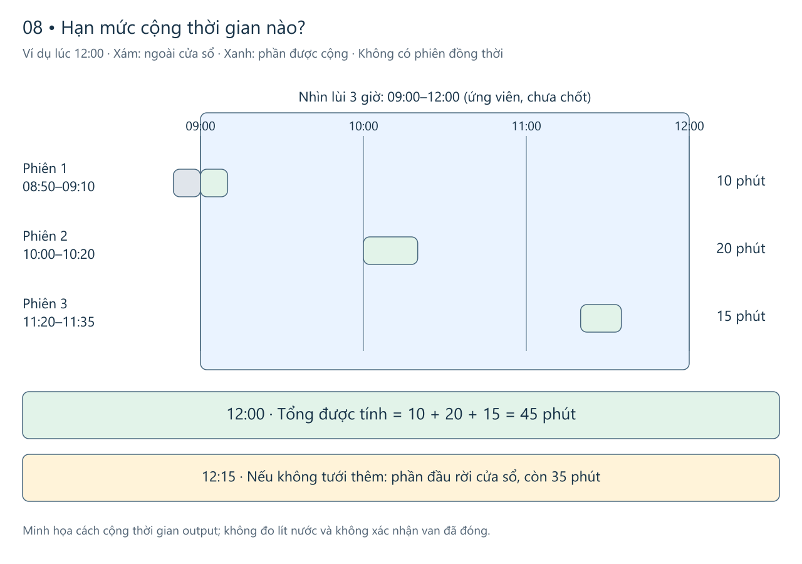

# miGarden — Bước 08: Quy tắc vận hành đề xuất

2026-11-12 · Asia/Saigon. **Đã chọn hướng vận hành và phục hồi.** Hạn mức và cách tính ở mục 1.1 vẫn là đề xuất. Các ngưỡng, giao thức và thông tin xác thực chưa chốt; [09](09-device-and-component-integration.vi.md) mô tả cấu hình thiết bị đã chọn để lắp và kiểm.

**Đề xuất cho Zone A:** Giữ lịch đã áp dụng trên ESP32. Thiết bị tự xét kỳ đến hạn, tự dừng theo giới hạn đã giữ tại chỗ, và nói rõ vì sao phải chờ. Web quản lý mong muốn, giao lệnh từ xa và hiển thị mức kết quả biết được. Mở rộng B/C/D và độc lập nguồn nước/hạn mức cần bằng chứng riêng. Bản này đi tiếp từ [06](06-iot-level-specification.vi.md) và [07](07-functional-view-specification.vi.md), giữ nguyên [01](01-purpose-and-requirements.vi.md), [02](02-process-specification.vi.md) và [04](04-information-model.vi.md).

Đọc theo điều cần quyết: [tưới hằng ngày](#1-kỳ-tưới-bình-thường), [hạn mức đang bàn](#budget-d186), [phục hồi sau lỗi](#2-khi-nào-được-xét-tưới-tiếp), [giao lệnh và đồng bộ](#3-giao-lệnh-và-đồng-bộ), [tham số còn mở](#4-tham-số-và-căn-cứ), [tiêu chí cho 09–10](#5-tiêu-chí-chuyển-sang-0910).

## 1. Kỳ tưới bình thường

1. **Lưu và áp dụng.** Bạn lưu lịch trên microSched; web chỉ báo *đã lưu* cho đến khi ESP32 xác nhận đúng version đã áp dụng. Thiết bị dùng một lịch logic đã applied cho Zone A. Đổi version/pause chỉ ảnh hưởng kỳ tương lai; phiên đang chạy giữ nội dung và thời lượng đã chốt. Nếu không chứng minh được ranh giới giữa hai version thì bỏ qua cơ hội không rõ, thay vì để cả hai mở.
2. **Xét START tại ESP32.** Lịch dùng giờ Hà Nội để nhận ra kỳ đến hạn. Lịch, nút vật lý tại nguồn và remote cùng đi qua **một bộ phân xử local**. Bộ này kiểm đúng đích/cấu hình, thời gian, trạng thái nước, phiên đang chạy, hạn mức chung và khả năng lưu dữ liệu an toàn; remote còn cần quyền và hiệu lực của đúng lệnh. Nếu bận hoặc không đạt, ghi lý do khi còn lưu được; không xếp hàng để mở muộn. Kỳ đã xử lý phải còn nhận diện được khi reboot/đổi lịch; ID chỉ dựa trên version chưa đủ.
3. **Trước khi mở, giữ căn cứ qua reboot.** Lưu bền dấu chấp nhận tại local, nội dung/đích, cơ hội lịch nếu có, phần hạn mức đã giữ chỗ và trạng thái cần phục hồi. Chỉ sau khi lưu thành công và kiểm lần cuối mới cho phép tác động; dấu chấp nhận chưa chứng minh đã mở. Dùng **thời gian đã trôi tại local** để giữ mốc dừng của phiên, tách khỏi giờ lịch có thể được chỉnh. Nếu bộ đo mốc dừng hoặc dữ liệu an toàn không còn đáng tin khi đang chạy, yêu cầu đóng/cutoff và báo suy giảm.
4. **Dừng và ghi kết quả.** Hết thời lượng, STOP hoặc lỗi cần dừng đều đi đường CLOSE; STOP được ưu tiên, không đòi qua các điều kiện của OPEN. Chỉ báo mức có bằng chứng: đã yêu cầu đóng, output đã báo, hay đã xác minh nước an toàn. Đường khóa tay tại nguồn vẫn độc lập. Sau khi có kết quả, đồng bộ theo ID; web giữ đúng nguồn, thời điểm biết và phần còn thiếu.

### 1.1 Hạn mức bản đầu — đề xuất, chưa chốt

**Đề xuất:** Bảo vệ phải vừa với vườn và mức thiệt hại có thể chấp nhận. Mình nghiêng về **cửa sổ trượt 3 giờ** để đánh giá, giữ **165 phút/180 phút là ứng viên**, và chọn riêng thời gian tối đa của một phiên. Chưa có căn cứ chọn 50/60 làm mặc định, cũng chưa có căn cứ khẳng định 165/180 là ngưỡng phù hợp. Giới hạn phiên là lớp chính chặn một lần mở kéo dài; tích lũy là lớp phụ chặn nhiều phiên ngắn nối nhau. Không tự thêm cảm biến hoặc một hệ thống bảo vệ phức tạp chỉ vì muốn có một con số đẹp.

| Lớp bảo vệ | Chặn lỗi gì? | Chọn dựa trên gì? |
|---|---|---|
| **Giới hạn mỗi phiên** | Một lần tưới không kết thúc đúng hạn. Mốc dừng giữ tại ESP32, không phụ thuộc Internet | Phiên hợp lệ dài nhất của cấu hình đầu tưới, lưu lượng và lượng xả có thể chấp nhận, độ trễ dừng/cutoff đã kiểm |
| **Tích lũy trong cửa sổ trượt** | Lịch/nút/web tạo nhiều lần mở liên tiếp; đổi nguồn lệnh hoặc reboot không được cấp lại ngân sách | Tổng nhu cầu hợp lệ trong một khoảng thời gian, khoảng nghỉ mong muốn và phần dư cho thao tác tay |
| **Khả năng dừng nước thật** | Ngõ ra đã tắt nhưng van kẹt, còn dòng chảy hoặc có đường nước ngoài điều khiển | Cấu hình van/driver/cutoff và khóa tay ở 09. Bộ đếm thời gian phần mềm không tự giải quyết lỗi cơ khí |

**So hai con số Owner nêu, giả sử chỉ xét hạn mức tích lũy, sổ ban đầu trống và chưa áp giới hạn phiên riêng:**

| Ví dụ chưa duyệt | Tỷ lệ thời gian tối đa trong cửa sổ | Một đợt liên tục có thể dài đến | Tối đa trong bất kỳ 3 giờ |
|---|---:|---:|---:|
| 50 phút / 60 phút | 83,3% | 50 phút | 150 phút |
| 165 phút / 180 phút | 91,7% | 165 phút | 165 phút |

Cửa sổ dài hơn tránh ép mọi giờ phải giống nhau. Tuy nhiên, 165/180 vẫn cho phép dùng nước gần như cả buổi, nên **không đồng nghĩa cho phép mỗi phiên chạy 165 phút**. Nếu lỗi cứ đóng rồi mở lại, giới hạn phiên riêng vẫn cần lớp tích lũy. Ngược lại, một hệ nhỏ giọt có nhu cầu dài hợp lệ không nên bị từ chối chỉ vì đã chạm một mức chọn tùy ý. 50/60 trong bảng là ví dụ so sánh; [SAF-P01 lịch sử](README.md#saf-p01--proposed-giới-hạn-tích-lũy-và-cooldown) là ứng viên 45/60, cũng chưa được chọn.

**Cách tính đề xuất:** luôn nhìn lùi từ thời điểm đang xét, cộng phần thời gian output thuộc cửa sổ đó từ **mọi nguồn START chung một sổ**; một phiên chỉ tính một lần theo ID. Không dùng các khối cố định 09–12 rồi reset lúc 12:00. Với Zone A hiện tại, START lúc bận bị từ chối nên không có hai phiên đồng thời. Mở thêm Zone không tự chứng minh ngân sách hay nguồn nước độc lập.

[Nguồn Excalidraw sửa được](figures/08-operations/cumulative-window.excalidraw) · [SVG](figures/08-operations/cumulative-window.svg). Đây là ví dụ giả lập, không là log hay thời lượng tưới mặc định.

Ví dụ trên: lúc 12:00, nhìn lại 09:00–12:00, phiên 08:50–09:10 chỉ góp **10 phút**; hai phiên sau góp 20 và 15 phút, tổng **45 phút**. Đến 12:15, nếu không có phiên mới, phần đầu đã rời cửa sổ nên còn 35 phút. Qua ngày không cấp lại toàn bộ ngân sách; dữ liệu cũ chỉ hết ảnh hưởng khi có căn cứ thời gian và kết thúc đáng tin.

**Nhận phiên và quyết toán:** trước OPEN, kiểm giới hạn phiên và mọi cửa sổ bị ảnh hưởng trong suốt thời lượng dự kiến, rồi ghi bền phần giữ chỗ cho cả khoảng dự kiến. *Giữ chỗ* bảo đảm không tiêu trùng, không có nghĩa tính ngay cả phiên như đã dùng ở giây đầu. Đủ chỗ mới nhận; thiếu thì nêu lý do, không âm thầm rút thời lượng. Nếu một phiên dự kiến 30 phút được STOP sau 12 phút và có bằng chứng kết thúc đáng tin, thay phần giữ chỗ bằng khoảng output 12 phút đã ghi nhận, không tính cả 30 phút mãi và không cộng cả hai. Điều kiện an toàn vật lý vẫn xét riêng trước lần OPEN tiếp theo.

Nếu local có thể đã thực thi nhưng chưa rõ kết quả, giữ phần có thể đã dùng và chặn OPEN theo mục 2. Reboot, STOP, qua ngày hoặc cửa sổ hết không tự xóa unknown. Thiếu report trên web không tự làm dữ liệu local thành unknown. Đồng hồ cho kỳ lịch khác bộ đo thời gian đã trôi của phiên; sau reboot cần phục hồi được căn cứ thời gian/sổ để tính tiếp, không coi sổ trống.

Công thức và lựa chọn đơn giản hơn để PM/T1 đối chiếu

Với cửa sổ dài `W`, mỗi khoảng output đã ghi nhận là `[sᵢ, eᵢ)`, phần tính của nó tại `t` là `max(0, min(eᵢ, t) − max(sᵢ, t − W))`. Tổng các phần này là thời gian đã dùng trong cửa sổ. Khi xét phiên mới, thêm khoảng dự kiến và kiểm tổng không vượt `C` ở các thời điểm bị ảnh hưởng; không chỉ kiểm số dư tại START. Chỗ giữ cho phiên ấy được thay bằng phần đã quyết toán, không cộng trùng. Phần chưa rõ không được tự đưa vào công thức như thể đã có mốc kết thúc chắc chắn.

Một phương án đơn giản hơn là yêu cầu `đã dùng hiện tại + toàn bộ phiên mới ≤ C`. Cách này bảo thủ, có thể từ chối oan: với 50/60, sau phiên phút 0–50, phiên phút 60–70 vẫn có thể giữ tổng đúng 50 vì phút cũ rời cửa sổ cùng tốc độ phút mới đi vào; trừ ngay cả 10 phút ở START lại từ chối. Đề xuất tính theo các khoảng thời gian để tránh bất tiện này. Đây là thay đổi đề xuất trong phần hạn mức còn mở, chưa là thuật toán đã duyệt hoặc đã triển khai.

**Căn cứ để chốt số:** ở 09, xác định nhu cầu tưới dài nhất của đầu ra đã chọn, lưu lượng bình thường và đường có thể xả nhiều hơn nếu tuột/rò, khả năng thoát nước, thời gian từ yêu cầu dừng đến ngừng nước. Ở cùng lưu lượng giả lập 1 lít/phút, 50 và 165 phút tương ứng 50 và 165 lít; đây không phải lưu lượng đã đo của vườn. [USU hướng dẫn đo lưu lượng từ thể tích và thời gian](https://extension.usu.edu/yardandgarden/research/the-do-it-yourself-guide-to-backyard-drip-irrigation); không nhất thiết lắp thêm cảm biến chỉ để có số đo thiết kế.

Ước tính thiệt hại chỉ vài trăm nghìn tiền nước là một giả định hợp lý để xem xét, chưa phải mức thiệt hại tối đa đã xác minh. [Hiện trường](../site-baseline.md#physical-and-operating-context) có sàn và đường thoát nước theo mô tả Owner, nhưng mới đủ cho tưới tay thường. [EPA phân biệt lãng phí nước với hư hại do rò nước](https://www.epa.gov/watersense/leak-detection-and-flow-monitoring-devices). Với miGarden, kiểm đúng đường xả/thoát trước khi chốt mức chịu lỗi; không suy một cảnh báo chung thành yêu cầu mua thêm thiết bị.

## 2. Khi nào được xét tưới tiếp?

Khi khởi động, ESP32 giữ ngõ ra ở trạng thái không cấp OPEN, không tiếp tục phiên dở. [Sơ đồ điều kiện mở của 07](07-functional-view-specification.vi.md#63-start-stop-và-phục-hồi-ở-mức-hành-vi-đã-chọn) cho biết đường STOP; bảng này thêm cách xét phục hồi.

| Tình trạng | Người dùng thấy gì | Khi nào xét START mới |
|---|---|---|
| Web thiếu báo cáo; local vẫn đủ căn cứ | Web báo chưa rõ hoặc dữ liệu cũ; kết quả có thể đến sau | Local có thể xét kỳ mới nếu các điều kiện đạt. Web chưa có căn cứ mới thì không mở từ xa dựa vào trạng thái cũ |
| Clock hoặc cấu hình tạm chưa tin cậy; không có lần mở chưa rõ | Giải thích đang chờ thời gian/cấu hình; kỳ lỡ được ghi khi có thể | Tự xét kỳ mới khi nguồn thời gian hợp lệ, sai số nằm trong giới hạn sẽ chọn, cấu hình và sổ còn nguyên. STOP không bị chặn |
| Có thể đã tác động nhưng local chưa rõ, kể cả sau reboot | Báo *chưa xác minh, đang chặn mở* cho mọi nguồn START và mọi Zone trên ranh giới chung chưa chứng minh độc lập | Chỉ khi có bằng chứng an toàn mới theo loại lỗi, lệnh cũ đã bị vô hiệu và thời gian, cấu hình, accounting đủ tin cậy. TTL, mạng về và qua ngày không tự gỡ chặn |
| Nghi van kẹt, không chứng minh được cutoff hoặc sổ an toàn hỏng | Yêu cầu CLOSE/cutoff; báo cần kiểm tra tại nguồn, giữ chặn nếu chưa xác minh | Theo quy trình kiểm tra/khôi phục sẽ thiết kế. Nếu chưa đủ bằng chứng sau kiểm tra, vẫn giữ chặn; không có nút xác nhận chung để bỏ qua |

Bằng chứng có thể là phản hồi thiết bị đã kiểm chứng hoặc quy trình xác minh phù hợp với cấu hình 09. Lệnh CLOSE, reset CPU và ACK web tự chúng không chứng minh nước đã ngừng. Có thể đủ căn cứ cho lần sau mà lịch sử lần trước vẫn ghi *chưa rõ*. Nếu phục hồi sau kỳ đã lỡ thì chờ kỳ tiếp theo, không chạy bù.

## 3. Giao lệnh và đồng bộ

**Mặc định giữ candidate → received → grant → kiểm lần cuối ở ESP32.** Candidate là yêu cầu chưa được cấp quyền; received chỉ xác nhận đã nhận. Việc cấp quyền gắn với cùng ID, nội dung đã xác nhận, đích và trạng thái thiết bị hiện hành. Khi microSched xử lý STOP, hủy hoặc giữ chặn START cũ cùng đích nếu chứng minh chưa cấp quyền, và không cấp quyền sau đó cho intent cũ. Nếu có thể đã cấp, yêu cầu dừng/đối soát và chỉ báo điều biết được; STOP chưa tới ESP32 thì web chưa được báo đã dừng. ESP32 kiểm thời hạn và quyền còn hợp lệ ngay trước tác động, kể cả đã kiểm ở server. Dùng danh tính Owner và thiết bị riêng theo 07; chưa chọn khóa hay cách cấp phát.

**Một ca đại diện cho lệnh cũ sau STOP.** Khi ESP32 xử lý STOP, làm mất hiệu lực các START đang chờ trong phạm vi đó. Một cách đơn giản để thử thiết kế: ràng ý định remote lúc Owner xác nhận với dấu trạng thái local còn mới mà web đã biết; STOP hoặc boot mới làm dấu cũ không hợp lệ. Cả candidate và grant phải giữ dấu đó. Không gán dấu mới chỉ vì một intent cũ đến muộn. Nếu dấu không khớp hoặc không chứng minh được lệnh là ý định mới, từ chối mở và báo lý do. Một kỳ lịch thật sự đến hạn về sau vẫn được xét qua các điều kiện thường; STOP một phiên không tự pause lịch. Kiểm **một** ca grant cũ còn hiệu lực danh nghĩa nhưng đến sau STOP tại nguồn. Reboot chung được kiểm riêng bằng ca mất điện; không nhân mọi tổ hợp thứ tự.

| Phương án | Điều được | Điều kiện giữ hoặc đổi |
|---|---|---|
| Hai giai đoạn hiện tại | Có khoảng đã nhận nhưng chưa cấp quyền để hủy | Giữ mặc định. Khi đã có thể cấp quyền, không suy thiếu ACK thành hủy thành công |
| Gộp START và grant | Bớt một lượt trao đổi | Có thể đã cấp quyền sớm hơn; phải giữ cùng điều kiện nhận biết kết quả, STOP và từ chối lệnh cũ. Chỉ so trên giấy bằng ca đại diện, chưa chọn |

**Đối soát theo ID, không gửi lại thao tác mở khi chưa rõ đã thực thi.** Báo cáo có thể gửi lại cùng ID; cùng ID khác nội dung phải báo xung đột. Không lấy thời gian nhận ở server làm thời gian tưới. Giữ dữ liệu cần cho boot, hạn mức, chống trùng và refs lịch sử đủ lâu cho mục đích của chúng. Tách hàng chờ báo cáo có giới hạn khỏi chỗ dành cho dữ liệu an toàn; giảm debug trước, nếu không còn đủ chỗ ghi dữ liệu an toàn thì từ chối mở. Lỗi sổ giữa phiên yêu cầu safe stop/cutoff và báo phần thiếu; không hứa mọi kết quả đều khôi phục được.

Với kết nối, đề xuất thử lại sớm khi lỗi thoáng qua, tăng khoảng chờ có trần và thử thưa hơn khi mất kéo dài. Dừng thử tự động với lỗi quyền/cấu hình cần xử lý. Khi mạng về, đối soát trước và gửi backlog có giới hạn; kết nối, thử lại và lưu báo cáo không chiếm đường STOP/deadline. Thời gian thử lại, thời hạn START và thời gian giữ báo cáo là ba tham số riêng. Chưa có phân bố thời gian mất kết nối của đường mạng tại nhà để chọn một con số tối ưu.

## 4. Tham số và căn cứ

| Cần chốt | Căn cứ trước khi kích hoạt |
|---|---|
| Nguồn clock, sai số, độ trôi, thời gian local còn dùng được; ranh giới kỳ | Xác minh clock sau đồng bộ/reset và khi mất mạng. Nếu sai số/ranh giới không xác định thì không OPEN; giữ mốc dừng bằng elapsed time đáng tin. Không dùng giờ mới nhảy tới để chạy bù |
| Giới hạn phiên, cửa sổ tích lũy và cooldown nếu chọn | Nhu cầu tưới của A, độ trễ dừng, nước còn chảy, phản ứng van/driver/cutoff và ranh giới nguồn nước. [SAF-P01](README.md#saf-p01--proposed-giới-hạn-tích-lũy-và-cooldown) chỉ là ứng viên; không kích hoạt theo tài liệu này |
| Hiệu lực START, tuổi trạng thái web, retry ngắn/dài và tải khi nối lại | Mục tiêu phản hồi người dùng, độ trễ quan sát đúng đường mạng, ngân sách tài nguyên và backlog. Trần 30 giây chỉ là ứng viên pha ngắn, không là nhịp mặc định cả đêm |
| Chỗ lưu bền, retention, nhiệt và nguồn hoạt động liên tục | Kích thước/rate bản ghi, dung lượng cần dành cho an toàn, độ bền ghi và margin của firmware/hộp/nguồn thật. S01 là dữ liệu diagnostic; chưa đủ để cam kết tuổi thọ hoặc sức chứa firmware sản phẩm |

Cách tính/hạn mức ở mục 1.1 đang mở. [09 · Tích hợp thiết bị](09-device-and-component-integration.vi.md#installation-and-checks) nhận phần đo/tương thích theo cấu hình; chưa có bằng chứng thì chưa cấp chế độ tưới thật.

## 5. Tiêu chí chuyển sang 09–10

Bảng này là thứ tự ưu tiên kiểm cho bước sau; **chưa chạy**. Kế thừa [kế hoạch bằng chứng 07 §8](07-functional-view-specification.vi.md#8-kế-hoạch-bằng-chứng-cho-09-và-integration-ứng-dụng) và [catalogue 07](07-functional-view-specification.vi.md#catalogue). Vẫn cần kiểm expiry ở lần kiểm local ngay trước tác động, giả lập lỗi ghi/mất sổ hạn mức và chứng minh local unknown chặn mọi nguồn START/Zone cùng ranh giới chưa chứng minh độc lập. Dùng cùng bằng chứng cho các hành vi có chung nguyên nhân; không tạo lại một bộ tổ hợp lỗi.

| Phạm vi | Bằng chứng cần thấy |
|---|---|
| Lưu/applied, kỳ bình thường và đổi lịch quanh kỳ | Hiện đúng version; một cơ hội chỉ chạy một lần, không đổi phiên đang chạy hoặc chạy bù |
| Mất Wi-Fi/AP; AP còn nhưng Internet mất; backend không tới được | Tách ca mất AP với mất Internet, giữ deadline/STOP và lịch local khi đủ điều kiện, web nói đúng phần chưa biết; nối lại để đối soát/đồng bộ, không phát lại thao tác mở hoặc chạy bù |
| Mất điện, lỗi sổ hoặc clock không tin cậy | Không restore OPEN, không mất hạn mức, không dùng kỳ cũ để dò. So trường hợp phục hồi trước/sau kỳ; lỗi sổ khi active cần đóng/cutoff |
| START cũ đến sau STOP, một ca đại diện | Có grant cũ rồi STOP tại nguồn, giao gói trễ: không OPEN lại. Nếu không xác minh được thứ tự thì fail-closed |
| Nguồn, driver, van, khóa tay và vận hành liên tục | 09 kiểm cấu hình thật, khi đóng cắt tải/mất-cấp điện và hỏng phù hợp. Tách giả lập, thử khô, nước có kiểm soát và hiện trường. USB-C dùng thử/bảo trì; lắp cố định dùng jack DC 12 V riêng cho bo theo 09. Khóa tay có tác dụng độc lập |
| Trạng thái và đối soát trên microSched | 10 kiểm *đã lưu/đã áp dụng*, *đã nhận/được cấp quyền*, kết quả báo/unknown, lý do từ chối và lần cập nhật. Không suy ra nước đã ngừng chỉ từ ACK |

**Trạng thái:** thiết kế hành vi và hướng phục hồi đã được duyệt. Hạn mức/cách tính mục 1.1, tham số cụ thể và kết quả tích hợp vẫn mở. Đây là thiết kế, chưa là bằng chứng lắp hay vận hành.
