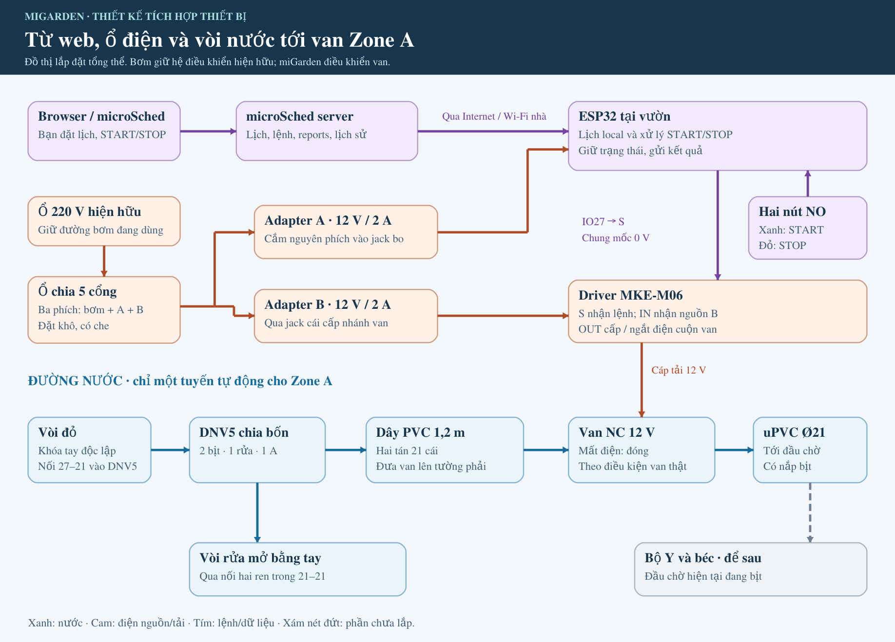
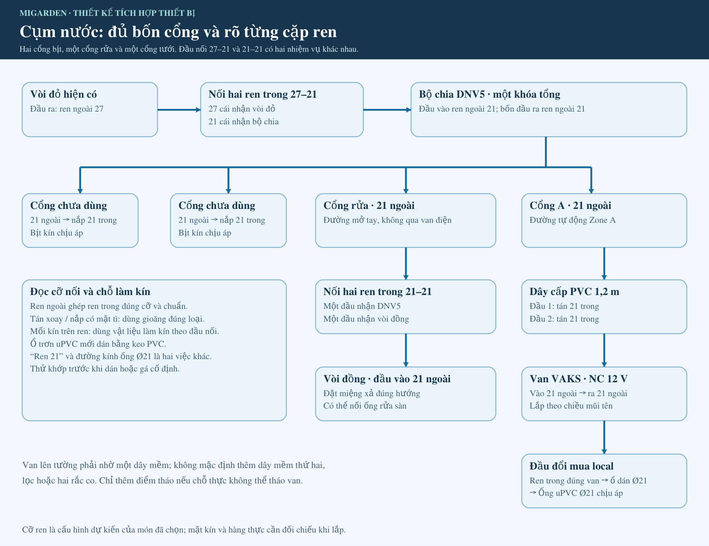
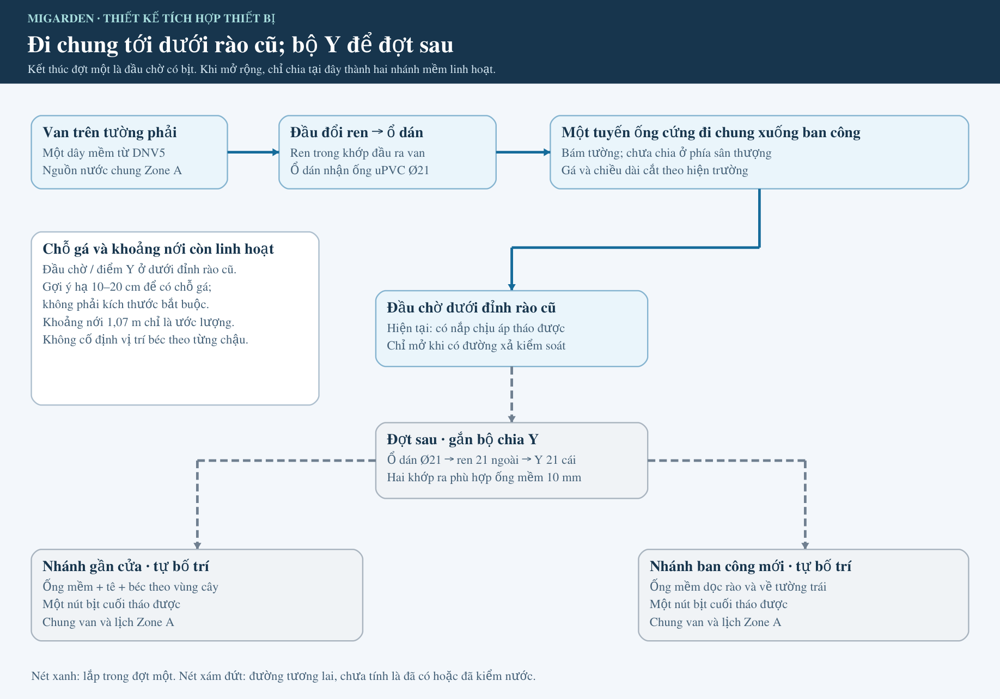
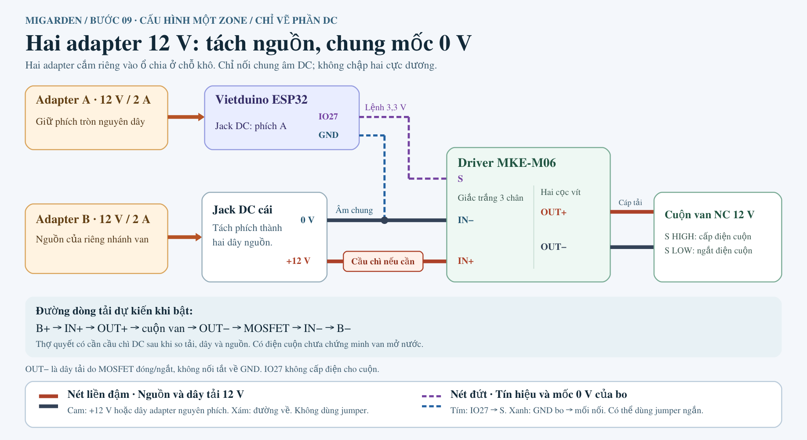
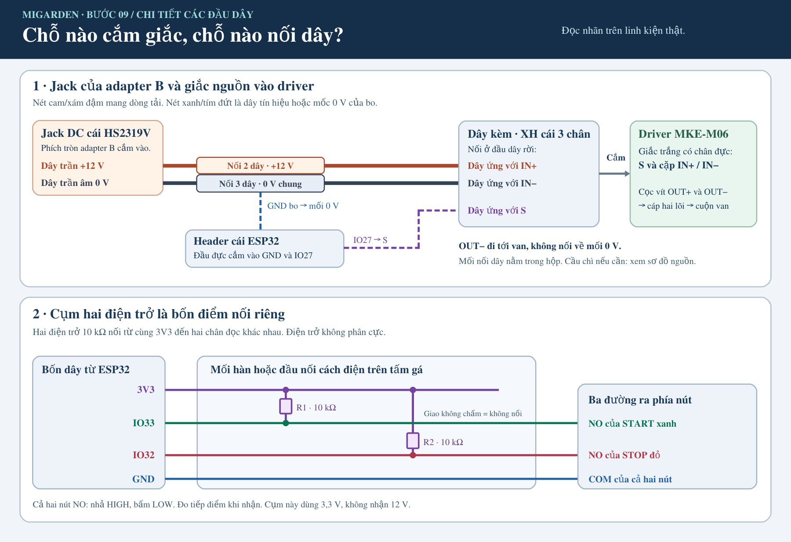
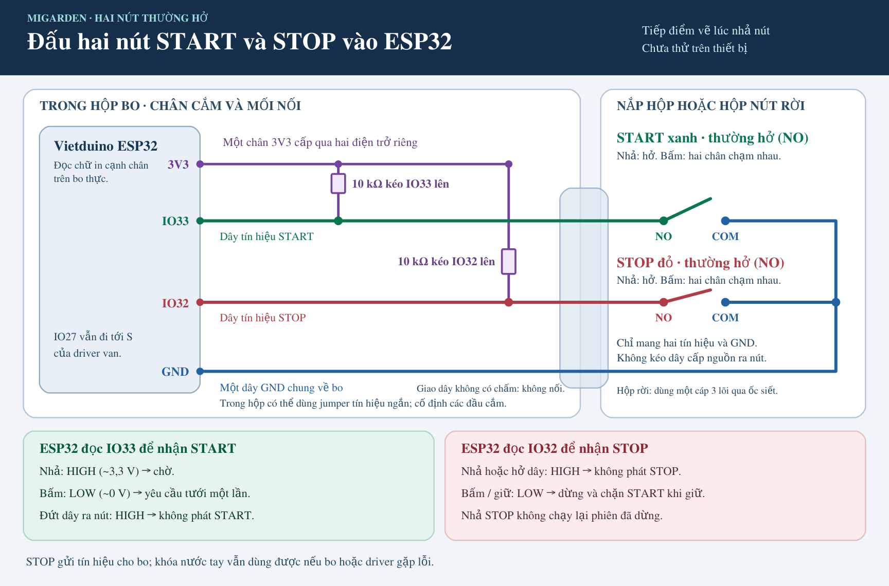
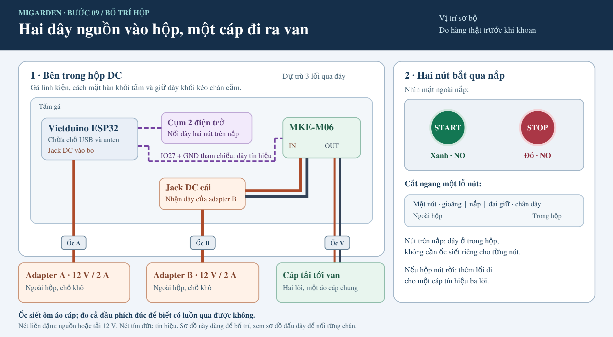
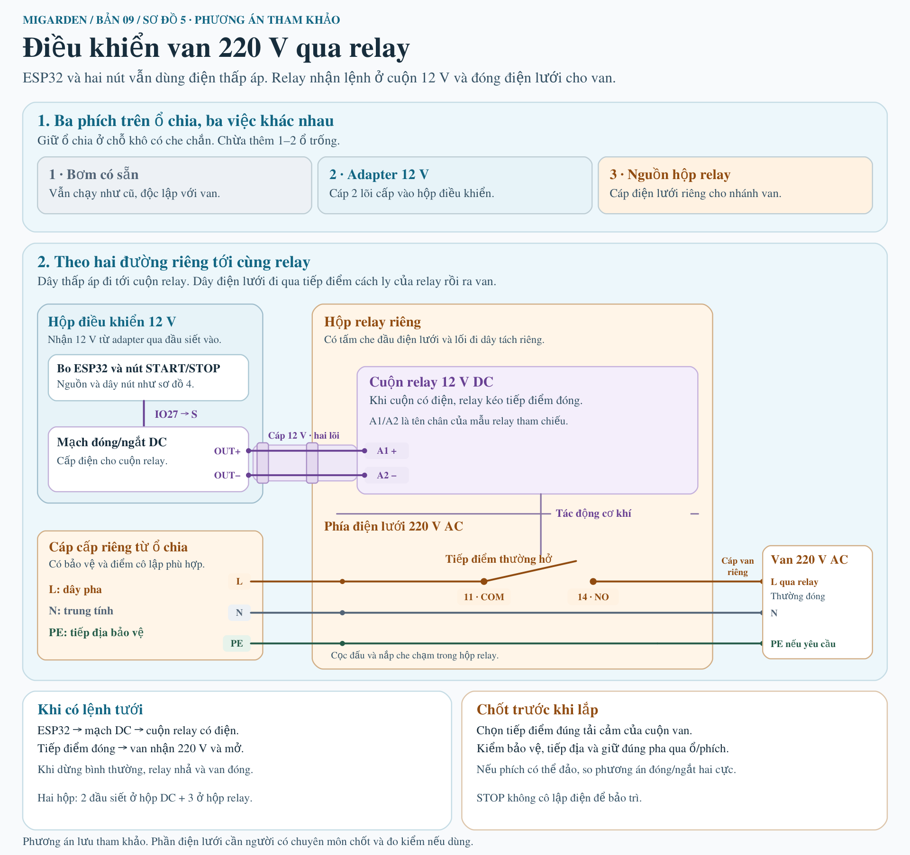

# 09 · Tích hợp thiết bị và đồ thị lắp đặt miGarden

**Cấu hình Zone A · cập nhật 12/11/2026.** Tài liệu này đi từ ổ điện và vòi nước đến ESP32, van, hai nút và điểm kết thúc đường ống. Đọc hình tổng thể trước, rồi mở cụm cần lắp. Các phần điện, nước và giao tiếp phần mềm phải khớp với nhau; danh sách linh kiện là tài liệu đối chiếu đi kèm.

Đây là **thiết kế để lắp và kiểm chứng**, chưa là kết quả chạy hệ thống. Một ESP32 điều khiển một van cho Zone A trong đợt đầu. Bộ chia Y, các nhánh mềm/béc sau Y, lọc và đèn báo riêng để sau.

[Đồ thị tổng thể](#installation-graph) · [Cụm nước và ren](#water-source) · [Ống xuống ban công](#water-route) · [Nguồn và driver](#power-path) · [Hai nút](#buttons) · [Hộp và đồ mua local](#enclosure) · [Giao tiếp với microSched](#integration-contracts) · [Lắp, thử và bảo trì](#installation-and-checks) · [Quy cách bước 09 theo tài liệu gốc](#methodology)

**Tra món cụ thể:** [Danh mục linh kiện đã chuẩn hóa](components-zone-a.vi.md) có tên, số lượng, cỡ và link sản phẩm cho từng thành phần. “Đã chọn” không thay cho việc so nhãn/cực, đầu nối và hàng thực khi nhận.

## 1. Đọc cả hệ thống trong một hình

[Mở ảnh lớn](figures/device-integration/09-installation-overview.png) · [SVG sửa được](figures/device-integration/09-installation-overview.svg).

**Đường điều khiển:** bạn đặt lịch hoặc START/STOP trên microSched; server giao cấu hình/lệnh tới ESP32 qua mạng nhà. ESP32 giữ lịch đã áp dụng, tự xét điều kiện thực thi và điều khiển driver. Nút tại hộp đi thẳng vào ESP32, không cần đi vòng qua Internet. Các nguồn START cùng dùng một bộ phân xử; STOP luôn ưu tiên.

**Đường điện:** ổ hiện hữu → ổ chia → ba phích dùng: bơm, adapter A và adapter B. A cấp riêng cho bo qua jack DC; B cấp điện cho cuộn van qua driver. miGarden không đóng/ngắt nguồn bơm trong cấu hình này; bơm tiếp tục hoạt động theo hệ có sẵn.

**Đường nước:** vòi đỏ → đầu đổi → DNV5 chia bốn. Hai cổng bịt; một cổng cho vòi rửa mở tay; một cổng qua dây mềm 1,2 m tới van A trên tường phải, rồi theo một tuyến uPVC xuống đầu chờ dưới rào cũ.

**Điểm kết thúc đợt một là đầu chờ có nắp chịu áp tháo được.** Khi thử nước cần bố trí đầu xả tới chỗ thu/thoát phù hợp. Chưa có bộ béc tưới cây tự động cho đến khi lắp phần sau Y.

## 2. Cụm nước ở vòi đỏ: nối đúng từng đầu

[Mở ảnh lớn](figures/device-integration/09-water-source.png) · [SVG sửa được](figures/device-integration/09-water-source.svg) · [Linh kiện nước và link sản phẩm](components-zone-a.vi.md#nuoc).

**Đầu vào bộ chia:** vòi đỏ dự kiến ren ngoài 27 → **một đầu nối hai ren trong 27–21** → đầu vào ren ngoài 21 của DNV5. Đây là cặp chuyển cỡ ở đầu nguồn.

**Đường rửa:** một đầu ra ren ngoài 21 của DNV5 → **một nối hai ren trong 21–21** → vòi đồng có đầu vào ren ngoài 21. Đầu 21–21 này có nhiệm vụ riêng, không thay đầu 27–21. Xoay thử cả cụm để miệng vòi hướng ra ngoài trước khi cố định; không cố vặn quá chặt chỉ để chỉnh hướng.

**Đường Zone A:** một đầu ra ren ngoài 21 của DNV5 → **dây cấp PVC 1,2 m, hai tán ren trong 21** → đầu vào ren ngoài 21 của van VAKS. Dây mềm uốn từ vòi tới tường phải; van được đặt tại đó, trước tuyến ống cứng.

**Hai cổng còn lại:** dùng hai nắp ren trong 21. Gói năm nắp còn ba chiếc dự phòng. Đầu chờ cuối tuyến cũng phải có nắp chịu áp tháo được; dùng một chiếc dư nếu đúng đầu đối ứng, mặt kín và định mức, nếu không thì dùng bộ bịt đúng hệ.

### Mặt kín, gioăng và cách tháo van

**Ren giữ hai món với nhau; mặt kín mới quyết định nước có rò hay không.** Với tán xoay của dây cấp, dùng gioăng đúng lòng tán và đầu ren có mặt tì phù hợp. Nắp có gioăng/O-ring dùng đúng phần đó. Mối thiết kế kín ngay trên ren dùng vật liệu làm kín theo loại phụ kiện; không nhét gioăng vào đầu nối không có mặt tì.

Gói gioăng **10 cỡ 21 + 10 cỡ 27** là đồ dự phòng để so với các mặt kín. Con số 21/27 không tự xác định đường kính ngoài, đường kính lỗ và bề dày gioăng. Keo PVC chỉ dùng ở ổ dán trơn của uPVC, không dán lên ren cần tháo. [ISO 228-1 về ren song song và mặt kín](https://www.iso.org/standard/33777.html).

**Không mặc định mua thêm hai rắc co.** Rắc co là khớp có đai giữa để tách hai phía mà không phải xoay cả tuyến ống. Trong cấu hình hiện tại, tán của dây mềm cho tháo phía vào van; phía ra cần thử có đủ chỗ xoay nhấc van sau khi tháo dây điện và đầu vào không. Chỉ bổ sung một khớp tháo phù hợp nếu không thể lấy van ra mà không cưa ống. Làm việc này trước khi dán tuyến.

DNV5 có **một khóa tổng**, không phải bốn khóa riêng. Khóa vòi đỏ hoặc DNV5 sẽ ngừng cấp cả đường rửa và nhánh A. Cụm chia, vòi rửa và van cần điểm đỡ khi chỗ lắp khiến chúng kéo hoặc xoắn đầu vòi; chọn gá theo chỗ thực.

Thông số van và mức bằng chứng cần giữ

Mẫu chọn là **VAKS V12-21 NC, 12 V DC**. Trang sản phẩm mô tả dòng kích 300 mA, ren ngoài 21 và áp 0,02–0,8 MPa, tương đương 0,2–8 bar. Ảnh và nhãn dùng cách gọi kích thước họng khác kích thước ren; không suy “1/4” trên nhãn thành cỡ ren nối bên ngoài. So hai đầu ren, chiều mũi tên và dòng/cuộn đúng hàng nhận.

Bơm hiện hữu SHIRAI JLm 200A có tem cột áp tối đa 30 m, quy đổi khoảng 2,94 bar chênh áp do bơm tạo. Đó không phải số đo tại van khi tưới. Cần kiểm áp và mở/đóng khi bơm đang chạy lẫn khi lưu lượng nhỏ chưa làm bơm kích; không thay bơm hay thêm điều áp chỉ từ các con số danh nghĩa.

Thời gian cuộn được phép giữ điện, nhiệt khi chạy và mức chịu áp của dây cấp còn cần đối chiếu hàng/đường thực. Có điện ở cuộn không tự chứng minh van đã mở hoặc nước đã đến đầu cuối.

## 3. Từ van trên tường phải xuống đầu chờ dưới rào cũ

[Mở ảnh lớn](figures/device-integration/09-route-and-future.png) · [SVG sửa được](figures/device-integration/09-route-and-future.svg) · [Ảnh nhà và tuyến 3D](../model-v0.md) · [Số đo và phần ước lượng](../site-model.md).

**Một dây mềm trước van là đủ cho tuyến đang chọn.** Số đo bố trí ban đầu từ vòi sang tường 55 cm, lên tường 26 cm và sang ngang 10 cm cho tổng khoảng 91 cm; dây 1,2 m có dư danh nghĩa để uốn. Chừa bán kính uốn và không để dây chịu sức nặng cụm van. Nếu van đã nằm đúng tuyến tường thì sau van đổi trực tiếp sang ống cứng, không thêm dây mềm thứ hai.

**Đầu ra van → đầu chuyển ren–dán → uPVC Ø21 cấp nước chịu áp.** Nếu van thực là 21 ngoài, đầu chuyển nhận van phải là ren trong đúng chuẩn; phía ống cần ổ dán nhận đầu ống trơn Ø21. Chỉ thêm măng xông nếu đầu chuyển thực có đuôi trơn phải ghép với một đầu trơn khác. Mang van để tiệm chọn đúng cặp.

Tuyến cứng đi chung từ tường phải sân thượng xuống **ngay dưới đỉnh rào cũ**, chưa chia sớm ở gần hộp. Gá đủ ở góc và chỗ đổi mềm–cứng; chừa khoảng tháo van. Đầu cuối là một bộ bịt ren chịu áp có thể tháo ra khi thử hoặc lắp Y.

**Dự trù mua local:** mốc đã đo từ S (điểm ống lên tường) tới đỉnh rào là khoảng 11,90 m. Cộng 0,8 m dự phòng cho đoạn từ van tới S, 0,1–0,2 m hạ đầu chờ và 1 m hao cắt, cần khoảng 13,8–13,9 m. **Bốn cây 4 m** là lượng dự trù để thợ đo/cắt. Tim ống vẽ trên [mô hình](../model-v0.md) khoảng 12,56 m theo vị trí minh họa; không lấy số vẽ thay số cắt ở hiện trường.

### Phần sau Y: chừa khả năng custom, chưa lắp đợt này

Khi mở rộng: từ đầu chờ uPVC dùng đầu **ổ dán Ø21 × ren ngoài 21** ghép vào Y có đầu vào ren trong 21 dự kiến. Hai đầu ra của Y phải có khớp đúng hệ ống mềm. Cấu hình tham khảo đang giữ là **Y kèm hai khớp 10 mm + bộ ống 10 mm, 20 m/20 béc uốn**; chưa tính là đã mua hoặc đã khớp thực.

Chỉ chia ở dưới đỉnh rào cũ: **một hướng về gần cửa, một hướng ra ban công mới rồi có thể vòng về tường trái**. Cả hai cùng van, lịch và lịch sử Zone A. Dùng ống mềm, cắt ghép tê để đặt béc theo **vùng cần phủ**, không cố định một chậu một béc. Mỗi hướng có nút bịt cuối tháo được; mua đủ ống, tê/co, béc và vật tư gá khi chốt gói.

Đường bám rào cần **thấp hơn đỉnh để có chỗ gá vào thanh đứng**, tránh cao độ bồn. Khoảng hạ 10–20 cm và phần nới khoảng 1,07 m là gợi ý/ước lượng; không phải số đo thi công rào mới. Lắp linh hoạt khi rào và chậu đã rõ. [Y tham khảo](https://shopee.vn/product/277633727/25434424492) · [Bộ 20 m/20 béc tham khảo](https://shopee.vn/product/277633727/24974529690).

## 4. Từ ổ điện qua hai adapter đến ESP32 và van

[Mở ảnh lớn](figures/device-integration/09-power-path.png) · [SVG sửa được](figures/device-integration/09-power-path.svg) · [Nguồn, driver và link sản phẩm](components-zone-a.vi.md#dien-va-dieu-khien).

**Ổ chia 5 cổng dùng ba phích:** bơm, nguồn A và nguồn B. Hai cổng còn dư. Kiểm ổ ở vị trí khô, ba phích cắm vừa và tải lúc bơm khởi động phù hợp định mức ổ/đường cấp thực. Chỉ dây DC đi vào hộp điều khiển.

**Nguồn A: Dahua 12 V/2 A → nguyên phích tròn → jack DC của Vietduino ESP32.** Bo nhận 6–24 V ở jack/VIN và hạ áp trên bo; USB-C nhận 5 V riêng. 2 A là khả năng cấp của adapter, không phải dòng bo buộc phải lấy. So đúng cỡ và cực jack trên bo thật; không đưa 12 V vào GPIO hoặc chân 3V3. [Nguồn vào của Vietduino](https://github.com/makereduvn/VIETDUINO-ESP32) · [Thông số adapter Dahua](https://www.dahuasecurity.com/products/Accessories/Power/DC-Power-Adapter/PFM320-020EN).

**Nguồn B: Dahua 12 V/2 A → jack cái 5,5×2,1 mm có dây → IN+ và IN− của MKE-M06.** Đây là nguồn cho tải. IO27 chỉ gửi tín hiệu 3,3 V vào chân S; MKE đóng/ngắt dòng qua cuộn. Hai cọc vít **OUT+ và OUT−** nối tới hai đầu cuộn qua cáp tải hai lõi.

MKE-M06 được chọn vì nhận mức logic 3,3 V, điều khiển tải DC và có diode bảo vệ. Hãng khuyến nghị tối đa 3 A với dây kèm khi không thêm tản nhiệt; van được mô tả 0,3 A, nên adapter B 2 A có dư **theo thông số**. Dòng/cuộn thật, khả năng chạy trong hộp và trạng thái ngõ ra lúc bo tắt vẫn cần kiểm. [Thông số và chân tín hiệu MKE-M06](https://github.com/makereduvn/MKE-M06-MOSFET-MODULE).

**Đọc màu/nét:** cam và xám liền đậm mang dòng nguồn/tải, kể cả dây âm 0 V. Tím/xanh nét đứt là tín hiệu hoặc nhánh GND tham chiếu, có thể dùng jumper ngắn trong hộp. Không chọn dây tải chỉ bằng câu “chịu được 12 V”; còn cần đủ tiết diện, đầu nối và cách giữ cho dòng cuộn.

### Giắc ba chân và mối nối 0 V thực sự nối thế nào?

[Mở ảnh lớn](figures/device-integration/09-junctions.png) · [SVG sửa được](figures/device-integration/09-junctions.svg).

- **Giắc trắng MKE có chân đực; dây XH cái kèm cắm nguyên cụm vào đó.** Đối chiếu ba chân chức năng **IN+, IN−, S** với nhãn trên module và [sơ đồ của MakerEDU](https://github.com/makereduvn/MKE-M06-MOSFET-MODULE#các-chân-tín-hiệu) để xác định từng dây đuôi. Không nhét dây trần của jack vào chân đực.
- **Mối +12 V gom hai dây:** dương jack B và dây đuôi IN+.
- **Mối 0 V gom ba dây:** âm jack B, dây đuôi IN− và dây từ GND bo. Chỉ nhánh từ bo là dây tham chiếu; âm jack tới IN− vẫn mang dòng tải. Hai cực dương A/B không nối nhau.
- **IO27 → S:** bo đang có header cái. Nếu dây đuôi S cũng là cái, dùng jumper đực–đực sẵn có; so đầu cắm thực trước khi nối. Hai bộ jumper mua bổ sung là đực–cái và cái–cái.
- **OUT− không nối tắt về GND** vì có thể bỏ qua phần đóng/ngắt của driver. Dòng qua cuộn phải đi qua đúng hai OUT.

**Dây tải:** dự trù cáp đồng mềm nhiều sợi **2×0,75 mm²**, khoảng 5 m mua dư cắt, có áo tròn chung. Thợ làm đầu nối đúng lá cắm hoặc dây đuôi của van, cách điện và chống kéo; cáp phơi ngoài trời cần áo phù hợp hoặc đường bảo vệ. Không dùng jumper cho đường IN nguồn hoặc OUT tải.

**Cầu chì chưa mua sẵn.** Thợ quyết bảo vệ nhánh B từ dòng cuộn, định mức jack/dây/giắc và cách nguồn giới hạn dòng. Nếu cần, cầu chì DC nối tiếp trên B+ sau jack cái, trước IN+. Cầu chì bảo vệ quá dòng; không hứa cắt được trường hợp van kẹt mở mà vẫn ăn dòng bình thường.

Khi bảo trì/nạp USB: ngắt cả A và B ngoài trước khi cắm máy tính. Nguồn, đầu AC và ổ chia ở chỗ khô; phần trong hộp điều khiển là DC.

## 5. Hai nút xanh/đỏ cùng NO, vai trò do phần mềm

[Mở ảnh lớn](figures/device-integration/09-button-inputs.png) · [SVG sửa được](figures/device-integration/09-button-inputs.svg) · Toàn mạch DC: [PNG](figures/device-integration/09-full-dc.png) · [SVG](figures/device-integration/09-full-dc.svg).

Chọn hai nút NG **nhấn nhả, thường hở (NO)**. Một dây của xanh vào IO33; một dây của đỏ vào IO32; dây còn lại của mỗi nút về GND. Mỗi IO có **một điện trở 10 kΩ, 5%, ¼ W từ 3V3 kéo lên**. Hai điện trở không phân cực.

| Trạng thái | START xanh — IO33 | STOP đỏ — IO32 |
|---|---|---|
| Nhả nút | HIGH, chờ | HIGH, không yêu cầu dừng |
| Bấm | LOW, xét một yêu cầu START | LOW, STOP ưu tiên |
| Giữ | Không lặp START chỉ vì giữ | Chặn START trong lúc giữ |
| Hở dây | Nút đó không phát START | Nút đó không phát STOP; lịch/remote vẫn bình thường |

Đây là đánh đổi đã chọn: **hở dây STOP không khóa cả hệ thống**. Nút không tự cấp điện; khi bấm, tiếp điểm kéo chân đọc về GND. Điện trở giữ mức HIGH lúc nhả và giới hạn dòng nhánh kín khoảng 0,33 mA. Hai IO phải cấu hình input, không cấu hình làm ngõ cấp nguồn cho nút.

“Cụm hai điện trở” chỉ là **hai con trở và bốn nhóm nối 3V3, IO33, IO32, GND** ở nửa dưới hình mối nối. Có thể làm trên PCB đục lỗ nhỏ hoặc mối bấm/hàn cách điện rồi gá giữ; không cần mua một module tên “carrier”.

**Nhả STOP không tự chạy lại.** Firmware cần chống dội tiếp điểm, nhận thao tác START mới và ưu tiên STOP khi hai nút cùng bấm. STOP local không chờ Internet. Khóa nước tay vẫn là cách dừng độc lập nếu bo hoặc driver không điều khiển được.

**Đèn báo riêng để sau.** Người tại chỗ dùng quan sát nước và tiếng bơm làm dấu hiệu; báo cáo trên web giữ mức thông tin thiết bị thực biết. Không có thông báo riêng tại nút cho mọi lý do từ chối/lỗi trong đợt đầu, cũng không có cảm biến tự đọc tiếng bơm hay lưu lượng.

## 6. Trong hộp có gì, ra ngoài qua đâu?

[Mở ảnh lớn](figures/device-integration/09-enclosure.png) · [SVG sửa được](figures/device-integration/09-enclosure.svg) · [Hộp, ốc siết và đồ gá](components-zone-a.vi.md#hop-va-ga).

**Trong hộp:** ESP32, MKE-M06, jack cái B, hai mối nguồn, cụm hai điện trở và các dây ngắn. **Ngoài hộp:** hai adapter ở nơi khô, van trên đường nước, đường ống và vòi rửa. Hộp chọn biến thể **185×245×125 mm**; mô tả không đảm bảo có đế, nên chuẩn bị tấm gá cách điện nếu hàng không kèm.

Giữ khoảng hở dưới mặt hàn, chừa chỗ USB/anten và neo dây để thao tác nắp không giật header. Dây rút 2,5 mm dùng giữ dây hoặc bo nhẹ với cữ cách điện; không siết lên linh kiện hay coi dây rút trắng là gá ngoài trời bền UV.

Chưa chọn quạt hoặc lỗ thông hơi. Ưu tiên vị trí có che; kiểm nhiệt và dấu ngưng tụ ở hộp lắp thực. Nếu cần thay hộp hoặc thêm thông khí, chọn cách phù hợp môi trường ẩm rồi mới khoan, vì lỗ cáp và lỗ nút ảnh hưởng khả năng kín.

**Ba lối cáp dự kiến:** dây adapter A vào bo, dây adapter B vào jack cái và cáp hai lõi ra van. Nếu gắn jack xuyên vỏ hoặc bố trí khác thì đếm lại. Ốc siết **M12×1,5**, biến thể có gioăng, ôm áo cáp 3–6,5 mm theo bảng; đo cả áo cáp và đầu phích đúc trước khi khoan. Chỉ khoan cỡ thực cần; một ốc thường không ôm kín hai sợi rời.

**Vị trí nút cần làm theo thân nút thực nhận.** Hình bố trí thể hiện cách bắt qua nắp nếu nút có cổ/đai/gioăng phù hợp. Nếu nút có dây sẵn nhưng không có chỗ bắt, cần giá đỡ hoặc hộp nút có che; không coi luồn dây qua ốc siết là đã giữ hoặc chống mưa được thân nút. Nếu đặt hộp nút rời, dùng một cáp ba lõi cho hai tín hiệu và GND; không kéo jumper rời ra mưa.

### Danh sách ngắn để tự mua hoặc nói với thợ

| Cần chuẩn bị local | Để nối/gá ở đâu |
|---|---|
| Một đầu ren trong đúng đầu van → ổ dán uPVC Ø21 | Mang van để so. Chừa cách tháo van trước khi dán. |
| uPVC Ø21 cấp nước chịu áp, co/kẹp cùng hệ, bộ đầu chờ bịt tháo được | Dự trù 4 cây 4 m; đo tuyến và bố trí cắt với thợ. Dùng nắp dư nếu vừa và chịu áp. |
| Khoảng 5 m cáp đồng mềm 2×0,75 mm², cos/đầu nối theo van | Từ hộp ra cuộn; đo áo cáp với ốc siết và bảo vệ đoạn ngoài trời. |
| Mối nối/cách điện, phần bảo vệ B+ nếu cần | Hai dây dương, ba dây âm chung; thợ chọn theo dòng tải và dây/giắc. |
| Tấm gá nếu hộp thiếu, cữ cách điện và chỗ giữ nút | Mang hộp/bo/nút để lấy vừa; làm hai mối điện trở và neo dây. |

Không mua trùng gioăng, nắp, keo hoặc cút đã có. **Dụng cụ tối thiểu** nếu tự làm là tua-vít phù hợp, kìm cắt/tuốt, đồng hồ vạn năng, thước và bút dấu. Khoan, cắt ống, bấm cos hoặc hàn mới cần dụng cụ tương ứng; phần thợ làm không bắt buộc bạn mua cả bộ.

## 7. Ghép phần cứng này với firmware và microSched

Phần cứng tạo đường tác động cho [tám service ở bước 05](05-service-specification.vi.md). Để thành hệ thống, cần triển khai các mô-đun và giao diện đã phân công ở [06](06-iot-level-specification.vi.md), [07](07-functional-view-specification.vi.md) và vận hành theo [08](08-operational-view-specification.vi.md).

| Giao diện cần khớp | Hợp đồng của cấu hình này |
|---|---|
| **Sensor / input tại thiết bị** | Chỉ có hai tiếp điểm nút NO trên IO33/IO32. Soil/Zigbee và cảm biến lưu lượng/vị trí van không thuộc đợt một. Nút phải được đọc đủ để STOP không bị mạng hoặc ghi log làm trễ. |
| **Bo và mô-đun firmware** | ESP32 giữ lịch local, bộ phân xử START/STOP, deadline, hạn mức, trạng thái phục hồi và hàng đợi report. MKE chỉ là tầng đóng/ngắt tải theo S; không tự giữ lịch hoặc nhận lệnh Internet. |
| **Mạng và credentials** | Dùng Wi-Fi nhà đã khảo sát. Định danh thiết bị, khóa và thông tin mạng được cấp riêng, không đưa vào repo. Chưa có lựa chọn giao thức/chu kỳ giao dịch hay quy trình provision cuối cùng; phải khóa ở hợp đồng triển khai trước nối đường thật. |
| **Gateway / broker / server** | Không thêm gateway hoặc server tại nhà. Đích ứng dụng là backend microSched. Host, transport và cách thiết bị xác thực là cấu hình triển khai cần chốt; browser không điều khiển thẳng GPIO. |
| **Cấu hình và command** | Lịch có identity/version và nội dung rõ; saved khác applied. START mang ID, nguồn, Zone, thời lượng/context và hiệu lực cần kiểm. Remote giữ nhận → cấp quyền → kiểm lần cuối local; STOP không đòi qua cửa OPEN. Gói nhận được không đồng nghĩa đã tưới. |
| **Telemetry / reports** | Chuyển bản ghi có ID, đích, nguồn, mốc thời gian, version liên quan, trạng thái/kết quả và lý do khi có. Giao lại cùng record để đối soát; không phát lại thao tác mở chỉ vì mất ACK. Lưu report đủ qua mất mạng. Tên field/schema/endpoint cụ thể phải thống nhất giữa hai repo khi triển khai. |
| **Dashboard và history** | Hiển thị lịch mong muốn/lịch đã applied, phiên/ngõ ra được báo, kết nối, lần cập nhật và unknown khi thiếu bằng chứng. History theo Zone, giữ nguồn/thời điểm/nội dung cũ và tự cập nhật khi đang mở. Không hiển thị GPIO hay ACK như lượng nước đo được. |
| **Actuator và giới hạn** | 12 V NC, S HIGH cấp cuộn/S LOW ngắt. Cần xác minh không tự mở khi boot/reset hoặc khi nguồn B vẫn có mà bo tắt. Hết thời lượng, STOP hoặc lỗi cần dừng đi đường đóng. Giới hạn phiên/tích lũy ở 08 còn cần chốt số; nguồn, dây và van thật phải được so trước vận hành. |

**Giờ và lưu bền:** dùng civil time có căn cứ để xét lịch và thời gian trôi để kết thúc phiên. Sau mất điện, không phục hồi OPEN hoặc tưới bù kỳ đã lỡ. Nếu giờ/trạng thái an toàn chưa đáng tin thì chưa phát START phụ thuộc chúng. Flash vật lý trên đúng bo đã được diagnostic xác nhận 16 MiB; vùng app/data/log và sức chứa firmware sản phẩm chưa được chọn chỉ bằng con số đó.

**Một lần tưới đi xuyên hệ thống:** bạn lưu lịch trên web → ESP32 nhận và ghi applied → đến kỳ local xét START → MKE cấp cuộn và van mở nếu điều kiện vật lý đạt → hết thời lượng hoặc bấm đỏ thì ngắt cuộn → ESP32 lưu/gửi kết quả → web cập nhật trạng thái/lịch sử. Khi Internet mất, lịch đã applied và nút vẫn có đường local; report chờ nối lại. Cần kiểm chuỗi thật này ở bước 10; diagnostic đo Wi-Fi không phải firmware tưới.

## 8. Lắp một đợt, kiểm theo từng mối rồi mới dùng

**Trong lúc chờ đồ**, có thể phát triển phần mềm không phụ thuộc đường ống sau khi có quyền triển khai tương ứng. Khi nhận đồ, so model/biến thể và thử điện thấp áp trước nếu van cho phép; nếu cần áp nước để kiểm hoạt động thì làm sau khi nối nước. Mục tiêu là phát hiện lỗi trước các mối dán cố định.

| Chặng | Cần thấy gì trước khi chuyển tiếp |
|---|---|
| **Nhận và so mẫu** | Ren/cực/đầu giắc đúng, van đúng NC 12 V, cả hai nút nhả hở/bấm thông, điện trở đúng, có cách gá và đủ phụ kiện local. |
| **Điện trước khi gắn cố định** | Cấp bo bằng jack đúng cực; nguồn B vào đúng IN, S là tín hiệu. Chưa START thì tải phải OFF; kiểm cả lúc bo khởi động, reset hoặc mất riêng nguồn A. Thử START, STOP, giữ STOP và cấp lại nguồn trên cấu hình thật. Ghi rõ phần chưa đo. |
| **Nước và cơ khí** | Đúng chiều van, mối kín không rò, khóa tay có tác dụng, không kéo xoắn vòi hoặc ren nhựa, thay van được. Kiểm cả nhánh rửa và A, đủ áp để van mở/đóng và đầu xả có chỗ thu/thoát. |
| **Tích hợp dịch vụ** | Web saved/applied đúng; local schedule và nút hoạt động; remote nhận/thực thi/STOP có kết quả; mất mạng rồi đồng bộ không tạo lần tưới thứ hai. |
| **Vận hành thử phù hợp** | Thời gian và dừng thực đáp ứng, nguồn/cuộn/driver/hộp không chạy ngoài điều kiện cho phép; history phản ánh mức biết được. Chỉ sau đó mới gọi cấu hình lắp đã đạt. |

**Bộ Y chưa phải điều kiện để thử cả chuỗi dịch vụ.** Sau khi khóa nước và xả áp, có thể thay nắp bằng đường xả có kiểm soát để kiểm van và dòng nước. Chỉ thấy nước chảy một lần chưa chứng minh lịch, remote, đồng bộ và phục hồi đều đúng; dùng các tình huống ở 07–08 để nghiệm thu.

**Bảo trì:** ngắt nguồn DC ngoài và khóa/xả áp trước khi tháo cụm. Kiểm lại rò, đầu cáp, gá và gioăng sau lắp hoặc sau mỗi lần can thiệp; kiểm định mức/nhiệt theo tài liệu hàng thật và điều kiện nơi đặt. Không có lọc trong đợt này nên chưa đặt lịch thay/rửa lõi. Khi thêm lọc hoặc đầu tưới phải ghi khả năng tháo rửa, phụ tùng và chu kỳ theo loại được chọn, không tự đặt một thời hạn chung.

Tham khảo: vì sao chưa dùng van 220 V?

Van 220 V cần một đường đóng cắt AC thích hợp, phần vỏ/cáp/bảo vệ và phân cách riêng với ESP32. Hình dưới giữ để giải thích phương án đó; **không phải sơ đồ lắp đợt một**, không cộng relay hoặc van AC vào cấu hình hiện tại.

[Ảnh lớn](figures/device-integration/09-ac-reference.png) · [SVG](figures/device-integration/09-ac-reference.svg).

## 9. Đối chiếu với quy cách gốc của bước 09

**Nguồn phương pháp:** bài giảng *Chapter 4 — Design and Development of IoT Solutions*, slide **26**, mục **4.2.13 Step 9: Device and Component Integration**. Slide yêu cầu chuẩn bị hợp đồng giao tiếp trước khi lắp: sensor/input, bo và firmware, mạng/credentials, gateway/broker, telemetry/command, dữ liệu dashboard, actuator và giới hạn vận hành. *IoT & Applications Digital Notes*, **UNIT III — Design and Development**, trang **74–75 của PDF** đặt tích hợp thiết bị ở bước 9, trước phát triển ứng dụng ở bước 10. Trang 75 nêu bước 9; danh sách hợp đồng chi tiết ở trên lấy từ slide 26.

Tài liệu này giữ đúng vai trò đó: **mục 1–6** chỉ ra thiết bị thực nối với nhau thế nào; **mục 7** khớp phần điện/nước với các giao diện mạng, dữ liệu và firmware; **mục 8** xác định điều phải thấy khi tích hợp. Không tự thêm sensor hay gateway chỉ để lấp ví dụ trong slide. Các cấu hình giao thức, schema và ngưỡng còn mở được ghi rõ để hoàn tất ở hợp đồng triển khai; không biến bản vẽ hoặc danh sách linh kiện thành bằng chứng chạy đạt.

Đọc tiếp [danh mục linh kiện](components-zone-a.vi.md) khi cần tên món/link, và [07](07-functional-view-specification.vi.md#catalogue), [08](08-operational-view-specification.vi.md) khi cần hành vi hoặc nhánh lỗi chi tiết.
