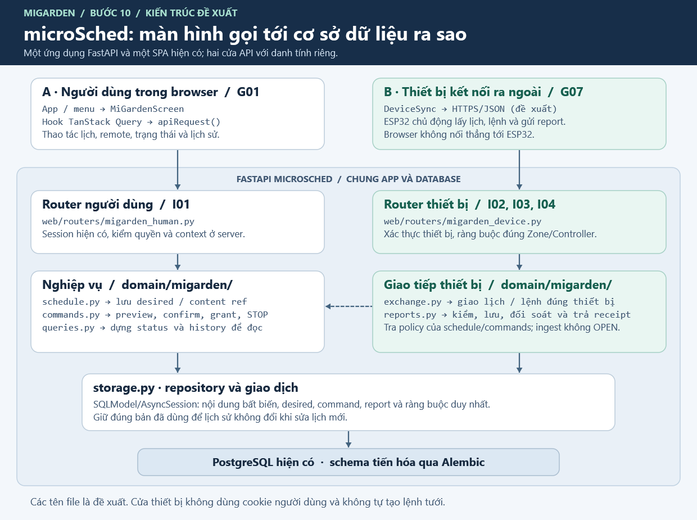
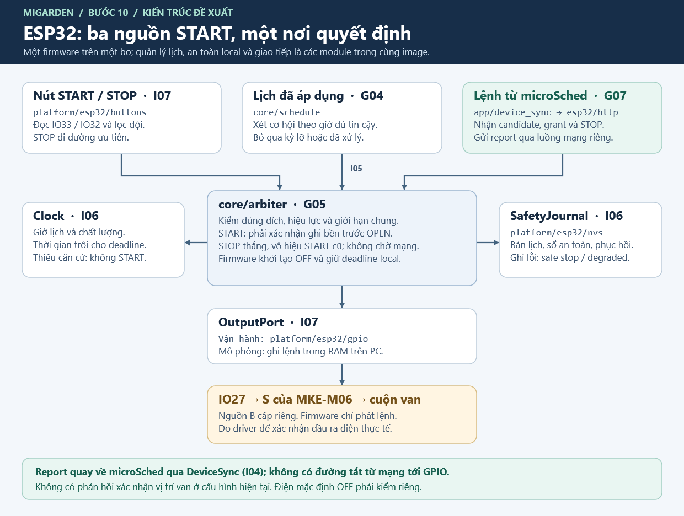
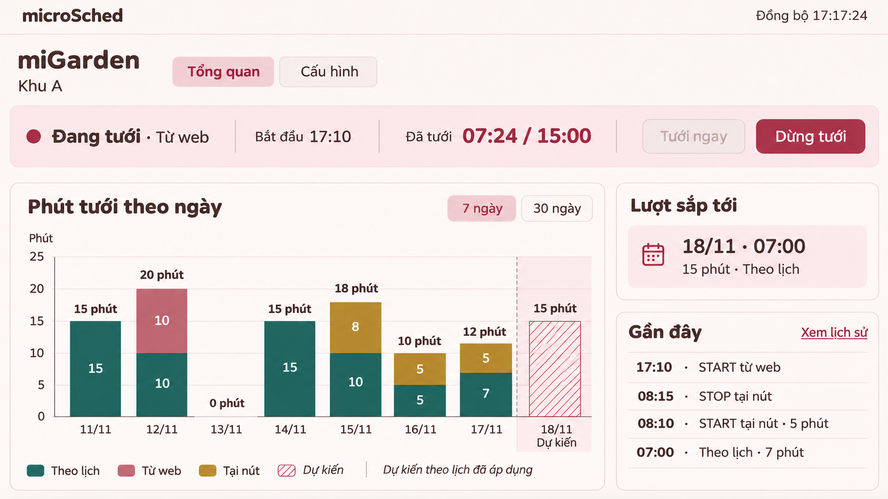

# miGarden — Bước 10: Triển khai firmware và module microSched

17/11/2026 · Asia/Saigon. **Thiết kế để triển khai, chưa phải kết quả đã build hoặc nghiệm thu.** Đích bàn giao là firmware nạp được vào ESP32 và miGarden dùng được trong microSched cho **đủ 5 use case** của [02](02-process-specification.vi.md). Hai phần dùng chung một phiên bản hợp đồng giao tiếp, được phát triển song song sau khi khóa hợp đồng, rồi nghiệm thu qua từng luồng hoàn chỉnh.

**N01 · 18/11:** [Wire v1 Zone A](../../contracts/zone-a/v1/README.md) ghi hợp đồng đã khóa cho batch và [gói firmware](../../code/controller/README.vi.md) ghi cách build, chạy host và kiểm trên bo. Các mô tả “đề xuất” dưới đây giữ ngữ cảnh thiết kế; kết quả phần mềm, board, tủ và nước vẫn được xác nhận riêng.

## 1. Phần đã quyết và cách tổ chức công việc

| Quyết định | Hành vi cần có |
|---|---|
| Một firmware C++ / Arduino-ESP32, một module trong microSched | ESP32 giữ lịch, giới hạn, STOP và quyền tác động đầu ra. Web lưu cấu hình, phối hợp lệnh và hiển thị kết quả. |
| Nút START 15 phút; trần 30 phút/lượt; tổng 120 phút trong bất kỳ 3 giờ | Cả lịch, nút và web dùng chung sổ. Ba giá trị chỉnh được; độ dài cửa sổ cố định ở bản đầu. [08 §1.1](08-operational-view-specification.vi.md#budget-d186) là nguồn chính sách. |
| Lịch đã áp dụng chạy local; clock không hết hiệu lực chỉ vì mất mạng | Đồng bộ giờ định kỳ khi có mạng. Sau mất điện vẫn phải khôi phục được giờ/sổ trước khi mở; STOP luôn có đường tại chỗ. |
| UI C, hai tab Tổng quan và Cấu hình | Thấy phiên hiện tại, lượt kế tiếp, vài lượt/thao tác gần đây và biểu đồ ngày; cấu hình hiển thị riêng đã lưu/chờ và đã áp dụng. |
| Tủ điện hoàn chỉnh là mục tiêu tích hợp phần cứng | Thử USB trên bo giúp kiểm firmware/giao tiếp. OFF ở driver khi bo mất nguồn, nút thật và việc dừng nước kiểm riêng trên tủ. |

Đi theo các mốc dưới đây; **không chia thành làm xong toàn bộ backend rồi mới tới firmware**. Mỗi lead sở hữu một phần xuyên các mốc để giữ logic nhất quán.

| Mốc | Người dùng làm được khi nghiệm thu đạt | Phần việc đi cùng nhau |
|---|---|---|
| **M0 · Khóa nền** | Chưa bàn giao tính năng; có base sạch, cấu hình, hợp đồng và gói kiểm để hai bên cùng xây | Source/SDK/partition, schema giao tiếp, auth thiết bị, môi trường thử, cách nạp/khôi phục và bộ ca. |
| **M1 · Điều khiển local** | **UC03**: START có thời lượng, STOP ưu tiên; dừng không cần Internet | Arbiter, bộ đếm deadline, sổ bền và phục hồi; adapter GPIO/nút; host tests và kiểm phần chạy được trên bo. |
| **M2 · Lịch, cấu hình và quan sát** | **UC01–02**, phần đọc **UC05**: lưu/applied lịch và policy, lịch local, Tổng quan C, biểu đồ và Gần đây | API/DB/UI, áp dụng cấu hình ở ESP32, schedule, reports và truy vấn. |
| **M3 · Remote và đồng bộ hoàn chỉnh** | **UC04** và đủ **UC05**: xác nhận START, STOP, báo trạng thái/đồng bộ kể cả mất kết nối | Candidate/received/grant, expiry, vô hiệu lệnh cũ, ACK và đối soát; local vẫn tự dừng. |
| **M4 · Tích hợp và bàn giao** | Có hai bản source/build khớp nhau, hướng dẫn nạp, QA độc lập và gói phát hành | Kiểm catalogue đầy đủ, hồi quy, mock sạch, migration thử và hướng dẫn nghiệm thu tủ/5 UC có nước. |

M1–M3 là thứ tự tích hợp, không phải ba đợt cắt giảm sản phẩm. Đích vẫn đủ 5 UC. Bằng chứng trên mô phỏng, bo USB, tủ điện, production và nước được ghi riêng.

## 2. Stack, module và source

Firmware dùng **C++**, lõi portable theo tập C++17 và adapter **Arduino-ESP32 3.3.12 / Arduino CLI** đã được chọn làm nền đầu. Chỉ đổi SDK nếu có bằng chứng không đáp ứng yêu cầu, không tự đổi trong lúc hai bên đang tích hợp. Build khóa đúng board/partition; không suy flash 16 MiB thành partition mới tự động. microSched giữ **TypeScript + React/Vite/TanStack Query** và **Python + FastAPI/SQLModel/Alembic/PostgreSQL**. Backend là **modular monolith**: các service có trách nhiệm riêng nhưng chạy trong app microSched, không tách thành tám dịch vụ mạng.





[SVG web](figures/10-application/01-component-call-map.svg) · [SVG firmware](figures/10-application/02-firmware-call-map.svg) · [Nguồn hình](figures/10-application/build-diagrams.py) · [Render](figures/10-application/render-diagrams.ps1). Hình là tổ chức source để xây, chưa là code đã có.

<details>
<summary>Cây source và chiều phụ thuộc</summary>

```text
miGarden/
  code/controller/
    MiGardenController/MiGardenController.ino
    MiGardenController/src/
      core/              schedule, arbiter, budget, recovery, record
      ports/             Clock, Journal, InputPort, OutputPort
      platform/esp32/    GPIO, buttons, clock, NVS, HTTP/TLS
      app/               boot, control_loop, device_sync, diagnostics
    tests/               host tests, fixtures, simulator riêng
  contracts/zone-a/       wire contract có version + vectors chung

microSched/
  frontend/src/features/migarden/
                         MiGardenScreen, hooks, client, types
  backend/app/web/routers/
                         migarden_human.py, migarden_device.py
  backend/app/domain/migarden/
                         schedule, policy, commands, reports,
                         exchange, queries, storage, models
  backend/alembic/versions/
  backend/tests/ | frontend/e2e/
```

Router mỏng gọi service; `storage` làm giao dịch/constraint như lớp DAO. Chỉ adapter ESP32 biết Arduino; lõi gọi các `Port` (hợp đồng nhỏ với clock/sổ/input/output). **Một nơi sở hữu việc ghi đầu ra.** Network không gọi GPIO; chờ mạng và gửi report không chặn STOP/deadline. Fake clock/input/output và simulator đứng ngoài source được link vào firmware release.

</details>

## 3. Hợp tác ESP32 — microSched

MiGarden sở hữu wire contract có version và vectors; cả hai repo pin cùng bản. Phân biệt `content_ref`/`policy_ref` nội dung bất biến, `binding_ref` đích, build, boot và ID yêu cầu/báo cáo. Không dùng ngày nhận ở server làm ngày thực thi. Nội dung cùng ID khác nhau là conflict; cùng ID giống nhau không chạy/cộng lại.

| Đường | Nơi xử lý và kết quả |
|---|---|
| **I01 · UI → microSched** | Router người dùng dùng session/quyền hiện có. Đọc/lưu cấu hình, preview/confirm START, STOP và đọc status/history. Không đưa START vào offline outbox của web. |
| **I02 · Cấu hình → ESP32** | Ghi desired trên web; tủ kiểm, ghi bền và áp dụng đúng bản rồi báo lại. Trong lúc chờ dùng bản hợp lệ gần nhất. Thay đổi policy áp dụng khi rảnh, không đổi lượt đang chạy hoặc xóa sổ. |
| **I03 · Lệnh remote** | Dùng cùng ID qua candidate → received → grant → kiểm cuối tại tủ. `received` không phải đã tưới. STOP vô hiệu START cũ ở phạm vi tương ứng; thiếu ACK không chứng minh đã hủy. |
| **I04 · Báo cáo** | ESP32 gửi records đã ghi; server validate/dedup/commit mới ACK. Retry record không phát lại action. |
| **I05–I07 · Local** | Nút, lịch và remote cùng một arbiter; kiểm clock/cấu hình/sổ/budget và STOP trước tác động; deadline chạy bằng elapsed time tại tủ. |

Đề xuất cho batch: **HTTPS/JSON outbound**, ESP32 chủ động exchange; TLS kiểm máy chủ. Token ngẫu nhiên riêng từng controller, thu hồi riêng, server chỉ giữ bản băm; giới hạn quyền theo binding, không cho thiết bị tự tạo ý định Owner. UI vẫn dùng quyền/session microSched. Thực hiện cấp credential production là một bước vận hành riêng; không đóng token hoặc Wi-Fi vào source/ảnh public.

### 3.1 Vì sao cần hạn hiệu lực dù không có hàng đợi tưới?

**Không có FIFO tưới chờ tủ rảnh. Có bản ghi ngắn hạn cho lần bàn giao đang diễn ra.** Ví dụ web xác nhận lúc 07:00:00; ESP32 chưa tới nhịp hỏi tiếp, gói phản hồi bị chậm hoặc bước received→grant đứt kết nối. Thiết bị có thể nhận được một gói hợp lệ về cú pháp sau khi ý định đã cũ. Giới hạn này chặn việc bắt đầu quá muộn; nó không phải thời gian cho một phiên chạy.

**Đề xuất 45 giây tính từ xác nhận tại server**, không gia hạn khi retry. Server kiểm trước khi giao candidate/grant; ESP32 kiểm quyền/thời gian/boot/trạng thái ngay trước OPEN, kể cả đã nhận candidate trước đó. Chưa xác định được hiệu lực thì từ chối. START tới lúc bận bị từ chối ngay. Web không có trạng thái mới để preview/confirm thì không nhận START chờ ngày thiết bị online lại.

Đã bắt đầu hợp lệ lúc 07:00:05 với 15 phút thì mất mạng lúc 07:02 vẫn tự dừng theo deadline local, không bị cắt khi hết 45 giây. STOP hoặc lỗi cần đóng vẫn thắng. Gói tới sau STOP, đổi boot hoặc đổi bối cảnh cấu hình không tự dùng lại confirmation cũ. Con số 45 giây là đề xuất của batch, chưa phải kết quả đo latency.

### 3.2 Gửi báo cáo theo nhịp nào?

**Hỗn hợp: sự kiện quan trọng gửi sớm, snapshot theo nhịp, lỗi mạng thì back-off.** Đây là đề xuất cho một controller để xây và đo trong môi trường thử:

| Khi nào | Cách làm |
|---|---|
| START/reject/STOP/kết thúc/apply cấu hình có kết quả | Ghi local theo yêu cầu an toàn; đánh thức sync để gửi sớm. Output STOP không đợi gửi mạng hoặc ACK. |
| Tủ rảnh | Exchange mỗi **15 giây** để lấy cấu hình/lệnh và cập nhật last-seen. Snapshot không biến thành hàng loạt history record. |
| Có phiên đang chạy | Snapshot trạng thái mỗi **5 giây**; web nội suy số đếm từng giây từ snapshot mới nhất. Dữ liệu cũ trên **45 giây** phải hiện stale; không giả đang live. |
| Có candidate/receipt/grant cần trả lời tiếp | Tiếp bước ngay trong lần giao tiếp, không đợi thêm nhịp 15 giây chỉ để ACK/grant. |
| Lỗi tạm thời | Thử sau **5 → 15 → 30 → 60 giây**, thêm jitter nhỏ; mạng lên lại thử sớm, ACK hợp lệ thì trở về nhịp thường. Lỗi quyền/cấu hình dừng thử sai lặp lại; 429 tôn trọng thời gian server yêu cầu. |
| Mạng trở lại, có backlog | Gửi tối đa **16 records/lượt**, dùng lại ID; nhận ACK theo record đã commit. Snapshot cũ có thể gộp; không bỏ kết quả chưa giao hoặc sổ an toàn để làm trống queue. |

Đề xuất trần backlog **512 records**; dành chỗ terminal và sổ an toàn trước nhận phiên mới. Thiếu chỗ ghi critical thì chặn START; lỗi critical khi đang chạy yêu cầu safe stop. Đo kích thước/endurance thật trước khi gọi dung lượng là đủ. Idle 15 giây là **5.760 exchange/ngày/controller**, nhịp active còn cao hơn; phải đo tải/DB và ghi footprint, không coi các nhịp này đã tối ưu chi phí production.

### 3.3 Hạn mức được tính lại lúc nào?

Nguồn là **các khoảng output đã ghi bền + phần giữ chỗ + policy đã áp dụng tại tủ**. Cửa sổ 3 giờ không có “lần hết hạn” để reset hết ngân sách: nó luôn nhìn lùi từ thời điểm đang xét. Trước **mỗi START**, tính lại phần giao của các khoảng và kiểm cả phiên dự kiến như [08](08-operational-view-specification.vi.md#budget-d186). Giữ deadline local sau khi nhận; không cần quét sổ đầy đủ mỗi tick.

Ví dụ còn nguyên 110 phút trong cửa sổ, yêu cầu 30 phút mới bị từ chối ở trần 120. Bạn sửa **trần tổng lên 150** trên web. Khi ESP32 báo **Đã áp dụng**, tạo START mới: dùng bản mới và sổ cũ, tính 140/150 nên nhận nếu các điều kiện khác đạt. Lệnh trước đã từ chối không tự chạy lại. Chỉ đã lưu trên web nhưng chưa applied thì tủ vẫn dùng 120. Nâng chiều dài cửa sổ không có ở v1; cùng trần mà kéo dài cửa sổ còn có thể làm tính thêm tưới cũ, không tự tạo thêm chỗ.

Cache phục vụ màn hình chỉ là projection. Admission không tin số dư cache cũ: đọc snapshot nhất quán của sổ và policy hiện hành, kiểm lại revision/STOP ngay trước tác động. Đổi policy không xóa unknown hay phần hạn mức đã dùng. Kiểm tổ hợp dương, bước 15 giây, duration của nút/lịch không vượt trần/lượt; trần/lượt ≤ trần tổng ≤ 180 phút. Đây là validation đề xuất cho batch.

## 4. Tổng quan C và cấu hình



Tổng quan có trạng thái và mốc bắt đầu, số phút đã chạy/đã kết thúc, Tưới ngay/Dừng, lượt kế tiếp, Gần đây mặc định mở và biểu đồ 7/30 ngày. Mỗi ngày một cột chồng theo nguồn lịch/web/nút từ các phiên đã kết thúc có evidence; phiên qua nửa đêm chia đúng ngày Hà Nội. Ngày thiếu dữ liệu không gán 0. Thêm một cột gạch chéo cho ngày có kỳ tiếp theo từ lịch đã applied; đó là dự kiến, không cam kết sẽ mở bất chấp budget.

Cấu hình giữ bật/tạm dừng lịch, mốc hiệu lực và quy tắc một lần/hằng ngày/theo thứ/chu kỳ, thời lượng mỗi lần; nhóm nút/giới hạn dùng mặc định của 08. Không tự kích hoạt lịch mẫu. Web cho biết bản đã lưu và bản ESP32 đang dùng, lý do chờ/từ chối. Biểu đồ và log là thời gian đầu ra do controller báo; không có cảm biến thì không ghi lít nước hoặc khẳng định van thực sự đóng.

## 5. Kiểm thử, phát hành và điều còn chờ thiết bị

| Lớp | Công cụ và phạm vi |
|---|---|
| Lõi firmware | **C++ host tests** build chính `core/`, fake clock/journal/input/output riêng; kiểm deadline, sổ/giữ chỗ, clock jumps, power-loss recovery, bận, STOP và mọi nguồn. |
| Backend và DB | **Python/pytest**, disposable PostgreSQL; contract, quyền đích, idempotency/conflict, immutable refs, migration, transaction và quy tắc projection. |
| UI | **TypeScript/Vitest và Playwright** trên full app với dữ liệu synthetic; form C, live/stale, confirm/STOP, biểu đồ, mobile viewport và accessibility. |
| ESP32 thật qua USB | Build/boot/config và network với backend thử; không LED/driver/van thì không kiểm voltage/click nút/dòng nước. Nạp→chạy tự động phải có bằng chứng trên đúng unit hoặc một cơ chế cập nhật lab đã được chấp thuận. |
| Tủ thật và nước | [09 §8](09-device-and-component-integration.vi.md#installation-and-checks) và [operations](../operations.md): đúng nguồn/dây, mất A còn B, nút thật, driver/van, STOP và đường ngắt độc lập. Có người phối hợp; không suy từ log. |

QA dùng **toàn bộ catalogue của [07](07-functional-view-specification.vi.md#catalogue)**, LC01–03, các ca mạng và FR/NFR/SAFE của 01–02, không chỉ bảng ví dụ trên. Mỗi dòng được map tới case/module/revision và receipt hoặc NOT_RUN/BLOCKED có lý do. Hai revision + contract + config/policy + firmware build/partition phải resolve được. Người build tự kiểm trước; QA độc lập chạy batch đã freeze, PM hòa giải kết quả rồi sửa/retest theo nhóm.

Mock/simulator/seed/credential QA không vào firmware release hoặc app/container/PWA production. Tách namespace local/DB/identity thử; manifest cuối kiểm không còn fake adapters/seed/test commands. Kiểm guard bằng canary sai có chủ đích trong môi trường cô lập, phục hồi rồi kiểm đạt. Không “dọn sạch” bằng cách xóa sổ an toàn hoặc dữ liệu production.

Đầu ra là artifact firmware + ELF/map/manifest, hai source revisions, migration và rollback tương thích, reports QA, package cấu hình/provision local và hướng dẫn nạp/commissioning. Merged/deployed, schema đã áp dụng, firmware đã boot, tủ đạt và nước đạt là các mốc riêng. Deploy không tự chạy Alembic; không downgrade DB thật hoặc merge để bỏ qua check. Bản Step 10 này không tự cấp quyền thực thi, thiết bị, phát hành hoặc mở nước.
