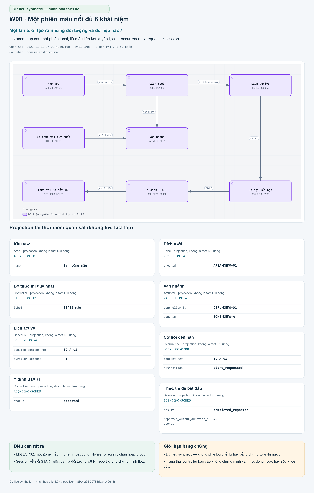
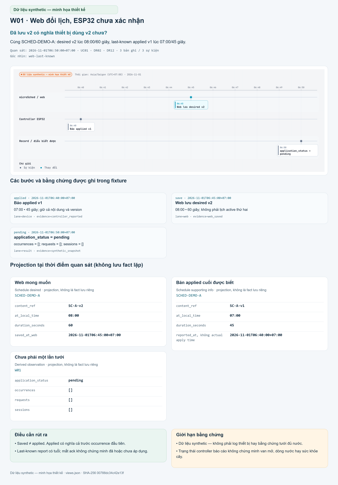
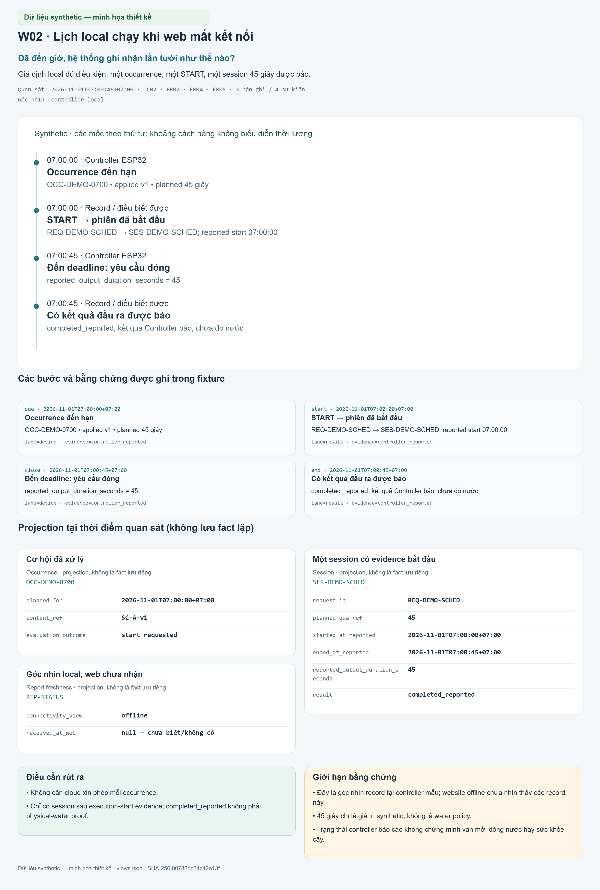
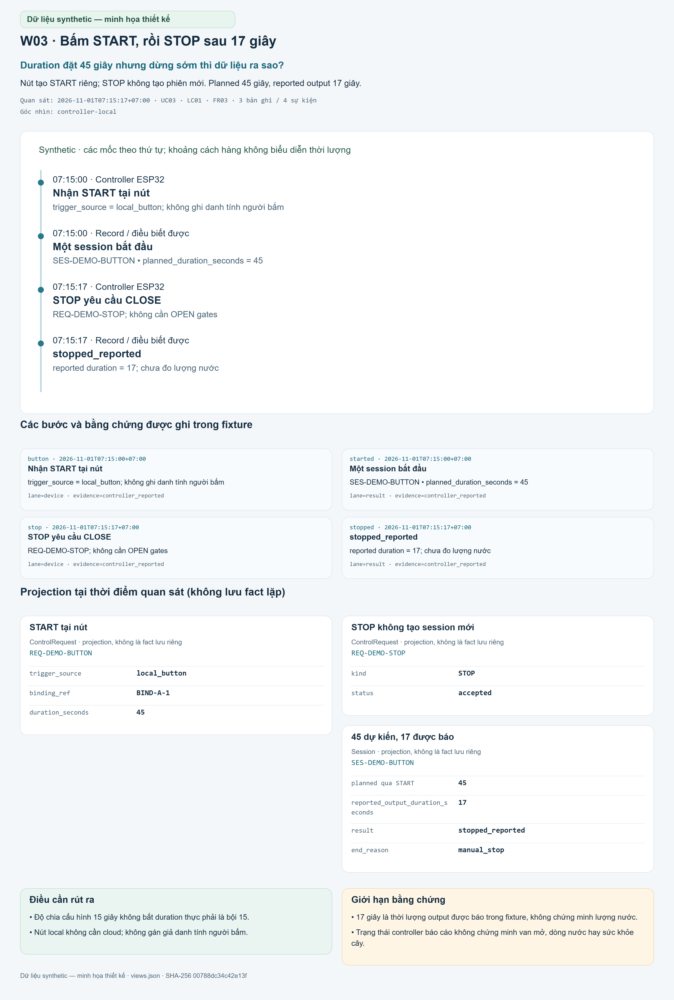
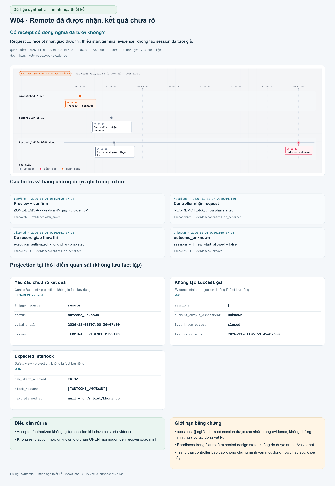
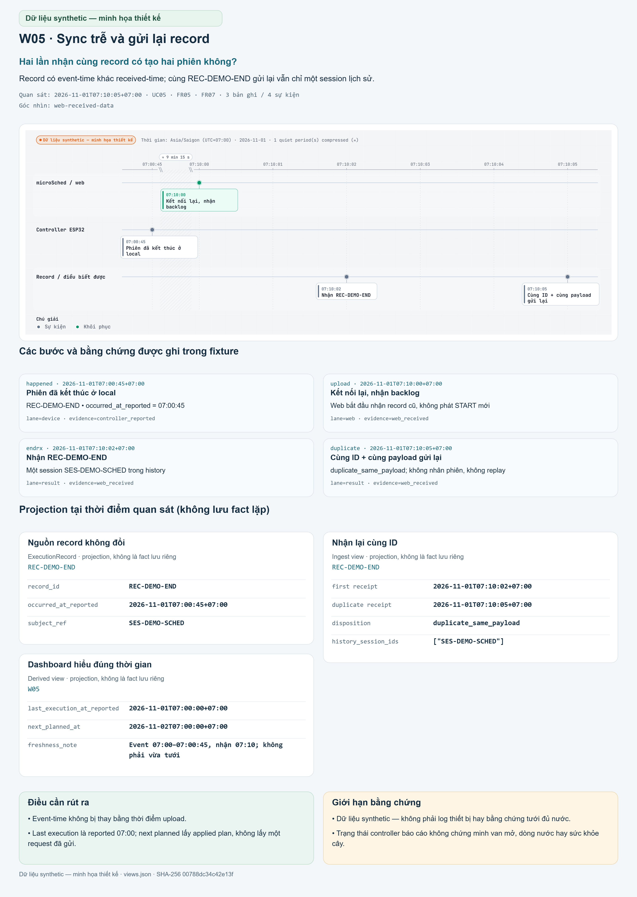
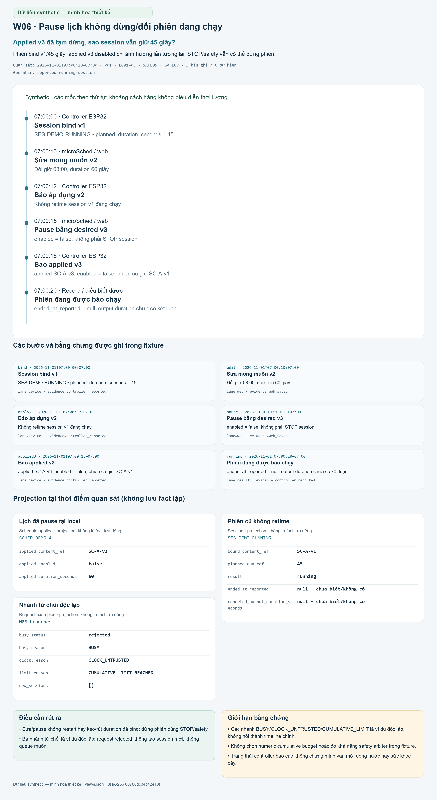

# miGarden — kịch bản và dữ liệu 03/04

public-01-04-v1 · synthetic · UTC+7. Bảy cảnh độc lập, không phải runtime/device/water evidence.

Nguồn: prepare_data.py → synthetic-data.json → views.json → SVG/PNG/index. Các card là projection, không là fact lưu độc lập. Nội dung/binding bất biến chỉ resolve qua ref; kết quả hiện tại Controller-reported, chưa đo nước.

## W00 — Một phiên mẫu nối đủ 8 khái niệm

Một lần tưới tạo ra những đối tượng và dữ liệu nào?

Instance map sau một phiên local; ID mẫu liên kết xuyên lịch → occurrence → request → session.

Góc nhìn domain-instance-map; quan sát 2026-11-01T07:00:46+07:00.

### Khu vực — projection

| Thông tin | Giá trị mẫu |
|---|---|
| name | "Ban công mẫu" |

### Đích tưới — projection

| Thông tin | Giá trị mẫu |
|---|---|
| area_id | "AREA-DEMO-01" |

### Bộ thực thi duy nhất — projection

| Thông tin | Giá trị mẫu |
|---|---|
| label | "ESP32 mẫu" |

### Van nhánh — projection

| Thông tin | Giá trị mẫu |
|---|---|
| controller_id | "CTRL-DEMO-01" |
| zone_id | "ZONE-DEMO-A" |

### Lịch active — projection

| Thông tin | Giá trị mẫu |
|---|---|
| applied content_ref | "SC-A-v1" |
| duration_seconds | 45 |

### Cơ hội đến hạn — projection

| Thông tin | Giá trị mẫu |
|---|---|
| content_ref | "SC-A-v1" |
| disposition | "start_requested" |

### Ý định START — projection

| Thông tin | Giá trị mẫu |
|---|---|
| status | "accepted" |

### Thực thi đã bắt đầu — projection

| Thông tin | Giá trị mẫu |
|---|---|
| result | "completed_reported" |
| reported_output_duration_seconds | 45 |

Điều cần thấy: Một ESP32, một Zone mẫu, một lịch hoạt động; không có registry chậu hoặc group. Session kết nối START gốc; van là đối tượng vật lý, report không chứng minh flow.

Giới hạn: Dữ liệu synthetic — không phải log thiết bị hay bằng chứng tưới đủ nước.
## W01 — Web đổi lịch, ESP32 chưa xác nhận

Đã lưu v2 có nghĩa thiết bị dùng v2 chưa?

Cùng SCHED-DEMO-A: desired v2 lúc 08:00/60 giây, last-known applied v1 lúc 07:00/45 giây.

Góc nhìn web-last-known; quan sát 2026-11-01T06:50:00+07:00.

| Mốc +07:00 | Bên | Sự kiện |
|---|---|---|
| 2026-11-01T06:40:00+07:00 | device | Báo applied v1: 07:00 • 45 giây; giữ cả nội dung và version |
| 2026-11-01T06:45:00+07:00 | web | Web lưu desired v2: 08:00 • 60 giây; không phải lịch active thứ hai |
| 2026-11-01T06:50:00+07:00 | result | application_status = pending: occurrences = []; requests = []; sessions = [] |

### Web mong muốn — projection

| Thông tin | Giá trị mẫu |
|---|---|
| content_ref | "SC-A-v2" |
| at_local_time | "08:00" |
| duration_seconds | 60 |
| saved_at_web | "2026-11-01T06:45:00+07:00" |

### Bản applied cuối được biết — projection

| Thông tin | Giá trị mẫu |
|---|---|
| content_ref | "SC-A-v1" |
| at_local_time | "07:00" |
| duration_seconds | 45 |
| reported_at, không actual apply time | "2026-11-01T06:40:00+07:00" |

### Chưa phải một lần tưới — projection

| Thông tin | Giá trị mẫu |
|---|---|
| application_status | "pending" |
| occurrences | [] |
| requests | [] |
| sessions | [] |

Điều cần thấy: Saved ≠ applied. Applied có nghĩa cả trước occurrence đầu tiên. Last-known report có tuổi; mất ack không chứng minh đã hoặc chưa áp dụng.

Giới hạn: Dữ liệu synthetic — không phải log thiết bị hay bằng chứng tưới đủ nước.
## W02 — Lịch local chạy khi web mất kết nối

Đã đến giờ, hệ thống ghi nhận lần tưới như thế nào?

Giả định local đủ điều kiện: một occurrence, một START, một session 45 giây được báo.

Góc nhìn controller-local; quan sát 2026-11-01T07:00:46+07:00.

| Mốc +07:00 | Bên | Sự kiện |
|---|---|---|
| 2026-11-01T07:00:00+07:00 | device | Occurrence đến hạn: OCC-DEMO-0700 • applied v1 • planned 45 giây |
| 2026-11-01T07:00:00+07:00 | result | START → phiên đã bắt đầu: REQ-DEMO-SCHED → SES-DEMO-SCHED; reported start 07:00:00 |
| 2026-11-01T07:00:45+07:00 | device | Đến deadline: yêu cầu đóng: reported_output_duration_seconds = 45 |
| 2026-11-01T07:00:45+07:00 | result | Có kết quả đầu ra được báo: completed_reported; kết quả Controller báo, chưa đo nước |

### Cơ hội đã xử lý — projection

| Thông tin | Giá trị mẫu |
|---|---|
| planned_for | "2026-11-01T07:00:00+07:00" |
| content_ref | "SC-A-v1" |
| evaluation_outcome | "start_requested" |

### Một session có evidence bắt đầu — projection

| Thông tin | Giá trị mẫu |
|---|---|
| request_id | "REQ-DEMO-SCHED" |
| planned qua ref | 45 |
| started_at_reported | "2026-11-01T07:00:00+07:00" |
| ended_at_reported | "2026-11-01T07:00:45+07:00" |
| reported_output_duration_seconds | 45 |
| result | "completed_reported" |

### Góc nhìn local, web chưa nhận — projection

| Thông tin | Giá trị mẫu |
|---|---|
| connectivity_view | "offline" |
| received_at_web | null |

Điều cần thấy: Không cần cloud xin phép mỗi occurrence. Chỉ có session sau execution-start evidence; completed_reported không phải physical-water proof.

Giới hạn: Đây là góc nhìn record tại controller mẫu; website offline chưa nhìn thấy các record này. 45 giây chỉ là giá trị synthetic, không là water policy.
## W03 — Bấm START, rồi STOP sau 17 giây

Duration đặt 45 giây nhưng dừng sớm thì dữ liệu ra sao?

Nút tạo START riêng; STOP không tạo phiên mới. Planned 45 giây, reported output 17 giây.

Góc nhìn controller-local; quan sát 2026-11-01T07:15:17+07:00.

| Mốc +07:00 | Bên | Sự kiện |
|---|---|---|
| 2026-11-01T07:15:00+07:00 | device | Nhận START tại nút: trigger_source = local_button; không ghi danh tính người bấm |
| 2026-11-01T07:15:00+07:00 | result | Một session bắt đầu: SES-DEMO-BUTTON • planned_duration_seconds = 45 |
| 2026-11-01T07:15:17+07:00 | device | STOP yêu cầu CLOSE: REQ-DEMO-STOP; không cần OPEN gates |
| 2026-11-01T07:15:17+07:00 | result | stopped_reported: reported duration = 17; chưa đo lượng nước |

### START tại nút — projection

| Thông tin | Giá trị mẫu |
|---|---|
| trigger_source | "local_button" |
| binding_ref | "BIND-A-1" |
| duration_seconds | 45 |

### STOP không tạo session mới — projection

| Thông tin | Giá trị mẫu |
|---|---|
| kind | "STOP" |
| status | "accepted" |

### 45 dự kiến, 17 được báo — projection

| Thông tin | Giá trị mẫu |
|---|---|
| planned qua START | 45 |
| reported_output_duration_seconds | 17 |
| result | "stopped_reported" |
| end_reason | "manual_stop" |

Điều cần thấy: Độ chia cấu hình 15 giây không bắt duration thực phải là bội 15. Nút local không cần cloud; không gán giả danh tính người bấm.

Giới hạn: 17 giây là thời lượng output được báo trong fixture, không chứng minh lượng nước.
## W04 — Remote đã được nhận, kết quả chưa rõ

Có receipt có đồng nghĩa đã tưới không?

Request có receipt nhận/giao thực thi, thiếu start/terminal evidence: không tạo session đã tưới giả.

Góc nhìn web-received-evidence; quan sát 2026-11-01T07:01:00+07:00.

| Mốc +07:00 | Bên | Sự kiện |
|---|---|---|
| 2026-11-01T06:59:50+07:00 | web | Preview + confirm: ZONE-DEMO-A • duration 45 giây • cfg-demo-1 |
| 2026-11-01T07:00:00+07:00 | device | Controller nhận request: REC-REMOTE-RX; chưa phải started |
| 2026-11-01T07:00:01+07:00 | result | Có record giao thực thi: execution_authorized; không phải completed |
| 2026-11-01T07:01:00+07:00 | result | outcome_unknown: sessions = []; new_start_allowed = false |

### Yêu cầu chưa rõ kết quả — projection

| Thông tin | Giá trị mẫu |
|---|---|
| trigger_source | "remote" |
| status | "outcome_unknown" |
| valid_until | "2026-11-01T07:00:30+07:00" |
| reason | "TERMINAL_EVIDENCE_MISSING" |

### Không tạo success giả — projection

| Thông tin | Giá trị mẫu |
|---|---|
| sessions | [] |
| current_output_assessment | "unknown" |
| last_known_output | "closed" |
| last_reported_at | "2026-11-01T06:59:45+07:00" |

### Expected interlock — projection

| Thông tin | Giá trị mẫu |
|---|---|
| new_start_allowed | false |
| block_reasons | ["OUTCOME_UNKNOWN"] |
| next_planned_at | null |

Điều cần thấy: Accepted/authorized không tự tạo session khi chưa có start evidence. Không retry action mới; unknown giữ chặn OPEN mọi nguồn đến recovery/xác minh.

Giới hạn: sessions=[] nghĩa chưa có session được xác nhận trong evidence, không chứng minh chưa có tác động vật lý. Readiness trong fixture là expected design state, không đo được arbiter/valve thật.
## W05 — Sync trễ và gửi lại record

Hai lần nhận cùng record có tạo hai phiên không?

Record có event-time khác received-time; cùng REC-DEMO-END gửi lại vẫn chỉ một session lịch sử.

Góc nhìn web-received-data; quan sát 2026-11-01T07:10:05+07:00.

| Mốc +07:00 | Bên | Sự kiện |
|---|---|---|
| 2026-11-01T07:00:45+07:00 | device | Phiên đã kết thúc ở local: REC-DEMO-END • occurred_at_reported = 07:00:45 |
| 2026-11-01T07:10:00+07:00 | web | Kết nối lại, nhận backlog: Web bắt đầu nhận record cũ, không phát START mới |
| 2026-11-01T07:10:02+07:00 | result | Nhận REC-DEMO-END: Một session SES-DEMO-SCHED trong history |
| 2026-11-01T07:10:05+07:00 | result | Cùng ID + cùng payload gửi lại: duplicate_same_payload; không nhân phiên, không replay |

### Nguồn record không đổi — projection

| Thông tin | Giá trị mẫu |
|---|---|
| record_id | "REC-DEMO-END" |
| occurred_at_reported | "2026-11-01T07:00:45+07:00" |
| subject_ref | "SES-DEMO-SCHED" |

### Nhận lại cùng ID — projection

| Thông tin | Giá trị mẫu |
|---|---|
| first receipt | "2026-11-01T07:10:02+07:00" |
| duplicate receipt | "2026-11-01T07:10:05+07:00" |
| disposition | "duplicate_same_payload" |
| history_session_ids | ["SES-DEMO-SCHED"] |

### Dashboard hiểu đúng thời gian — projection

| Thông tin | Giá trị mẫu |
|---|---|
| last_execution_at_reported | "2026-11-01T07:00:00+07:00" |
| next_planned_at | "2026-11-02T07:00:00+07:00" |
| freshness_note | "Event 07:00–07:00:45, nhận 07:10; không phải vừa tưới" |

Điều cần thấy: Event-time không bị thay bằng thời điểm upload. Last execution là reported 07:00; next planned lấy applied plan, không lấy một request đã gửi.

Giới hạn: Dữ liệu synthetic — không phải log thiết bị hay bằng chứng tưới đủ nước.
## W06 — Pause lịch không dừng/đổi phiên đang chạy

Applied v3 đã tạm dừng, sao session vẫn giữ 45 giây?

Phiên bind v1/45 giây; applied v3 disabled chỉ ảnh hưởng lần tương lai. STOP/safety vẫn có thể dừng phiên.

Góc nhìn reported-running-session; quan sát 2026-11-01T07:00:20+07:00.

| Mốc +07:00 | Bên | Sự kiện |
|---|---|---|
| 2026-11-01T07:00:00+07:00 | device | Session bind v1: SES-DEMO-RUNNING • planned_duration_seconds = 45 |
| 2026-11-01T07:00:10+07:00 | web | Sửa mong muốn v2: Đổi giờ 08:00, duration 60 giây |
| 2026-11-01T07:00:12+07:00 | device | Báo áp dụng v2: Không retime session v1 đang chạy |
| 2026-11-01T07:00:15+07:00 | web | Pause bằng desired v3: enabled = false; không phải STOP session |
| 2026-11-01T07:00:16+07:00 | device | Báo applied v3: applied SC-A-v3: enabled = false; phiên cũ giữ SC-A-v1 |
| 2026-11-01T07:00:20+07:00 | result | Phiên đang được báo chạy: ended_at_reported = null; output duration chưa có kết luận |

### Lịch đã pause tại local — projection

| Thông tin | Giá trị mẫu |
|---|---|
| applied content_ref | "SC-A-v3" |
| applied enabled | false |
| applied duration_seconds | 60 |

### Phiên cũ không retime — projection

| Thông tin | Giá trị mẫu |
|---|---|
| bound content_ref | "SC-A-v1" |
| planned qua ref | 45 |
| result | "running" |
| ended_at_reported | null |
| reported_output_duration_seconds | null |

### Nhánh từ chối độc lập — projection

| Thông tin | Giá trị mẫu |
|---|---|
| busy.status | "rejected" |
| busy.reason | "BUSY" |
| clock.reason | "CLOCK_UNTRUSTED" |
| limit.reason | "CUMULATIVE_LIMIT_REACHED" |
| new_sessions | [] |

Điều cần thấy: Sửa/pause không restart hay kéo/rút duration đã bind; dừng phiên dùng STOP/safety. Ba nhánh từ chối là ví dụ độc lập: request rejected không tạo session mới, không queue muộn.

Giới hạn: Các nhánh BUSY/CLOCK_UNTRUSTED/CUMULATIVE_LIMIT là ví dụ độc lập, không nối thành timeline chính. Không chọn numeric cumulative budget hoặc đo khả năng safety arbiter trong fixture.

## Kiểm tra và giới hạn

validate_data.py kiểm immutable refs/target/disposition/duration/reports/dedup/expiry và card provenance, với mutation trong bộ nhớ. python -B imports không ghi nguồn. Kiểm tra fixture không phải independent review hoặc chứng nhận renderer/thiết bị. Safety/clock/budget là expected design, không thực thi firmware hoặc chọn policy số.
