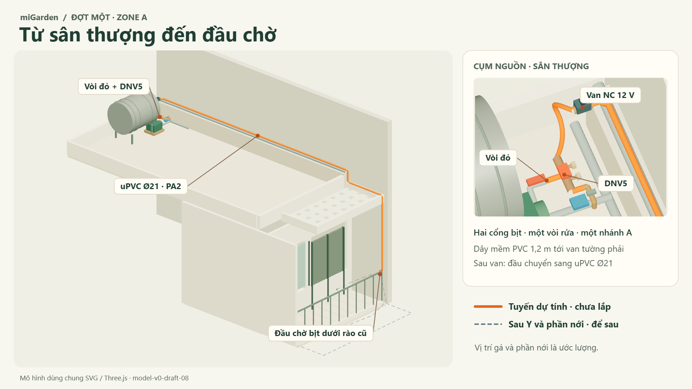

# Model-v0 — từ sân thượng đến đầu chờ

**Model `model-v0-draft-08` · schema `prototype-0.3` · thiết kế 12/11/2026.** [Mốc hiện trường và vị trí](site-model.md) · [Chạy viewer](../viewer/README.md) · [Bước 09: lắp đặt](design/09-device-and-component-integration.vi.md#water-source).

Cam là tuyến dự tính, kết thúc ở **đầu chờ bịt dưới đỉnh rào cũ**. Xám đứt là hai hướng sau Y và đường viền phần nới ước lượng. Hình xuất từ Three.js, dùng cùng model với SVG. Cụm nguồn trong ô phóng to cũng là một góc nhìn của scene đó. [Nguồn và camera để xuất lại](assets/migarden-zone-a-hero.html).

## Đi theo nước trong đợt một

| Chặng | Thể hiện trong hai bản vẽ |
|---|---|
| Cụm nguồn sân thượng | Giữ vòi đỏ ren ngoài 27 → nối hai ren trong 27–21 → DNV5 (vào 21 ngoài, bốn cổng ra 21 ngoài, một khóa tổng). Hai cổng bịt; cổng rửa qua nối hai ren trong 21–21; cổng còn lại cấp Zone A. Bơm giữ hệ điều khiển hiện hữu. |
| Từ DNV5 tới tường phải | Một dây PVC mềm 1,2 m có hai tán ren trong 21 uốn tới van thường đóng VAKS V12-21, 12 V DC. Dây dài 1,2 m theo cấu hình; nét uốn và vị trí gá van chỉ minh họa. |
| Từ van xuống ban công | Từ ren ngoài 21 của van, đầu chuyển local ren trong 21 → ổ dán uPVC Ø21. Ống cứng theo PA2 men mini và hạ xuống đầu chờ có nắp ren chịu áp. Cao độ cụ thể chưa đo; 10–20 cm dưới đỉnh rào là gợi ý gá. |
| Để sau | Có thể thay nắp bằng Y, một nhánh mềm về gần cửa, một nhánh ra ban công mới rồi về tường trái. Cả hai thuộc Zone A. Các nét đứt chỉ hướng, không định vị béc/chậu. Phần nới ≈1,07 m là ước lượng; không thêm sàn, tường hay rào mới dạng khối. |

## Mốc giữ nguyên, lớp lắp đặt thay đổi

[`viewer/model.json`](../viewer/model.json) là nguồn duy nhất cho hai view. Mỗi đơn vị bằng 1 m; +Y lên, X trái→phải theo người nhìn vào cửa chính, +Z từ nguồn ra mép ngoài. SVG mặt bằng chiếu X/Z thành hai tầng, mặt cắt chiếu X/Y, Three.js đọc trực tiếp X/Y/Z. Baseline `2026-10-25-correction-02-r2` giữ nguyên 15 số đọc, mốc neo, vỏ nhà và hình học PA2.

**Mốc PA2 từ S đến đỉnh rào là 11,90 m:** 7,40 m → hạ 0,40 m → men mini 1,50 m → hạ 2,60 m. **8,90 m** là đoạn thẳng từ S tới mép cao; **2,60 m** bắt đầu ở mặt trên mép mini. Tim uPVC dựng hình ≈12,56 m, gồm đoạn nối đầu van và đoạn vào/hạ đến đầu chờ. UI tách 1,2 m dây mềm và phần dư cắt khỏi tim uPVC. Không lấy chiều dài dựng hình làm số cắt hoặc mua.

Bản 07 từng cộng đoạn từ nguồn và 4 m ngang rào thành ≈17,09 m danh nghĩa. PA2 bản 07 và PA1 bản 07 chỉ là lớp so sánh; không xuất hiện như tuyến đợt một. Các chậu mẫu có thể di chuyển/thêm để thảo luận không gian và không sinh nhánh tưới.

## Nháp và giới hạn

Editor sửa tim uPVC, giữ vòi đỏ và các mốc nhà. Chỉnh điểm cuối kéo theo vị trí đầu chờ trên cả hai view. Bản lưu đợt một có phiên bản riêng; chỉ nạp ghi chú bản cũ bằng thao tác chủ động, không nạp tọa độ tuyến cũ. Xem [chi tiết lưu feedback](../viewer/README.md#ảnh-và-feedback-riêng-tư).

Ảnh không dùng ảnh gốc. Các mã N11–N13 và FIELD-20261025-C2 giữ nguồn gốc hiệu chỉnh; mã thiết kế DESIGN-20261112-A91 không bổ sung số đo. Các kiểm tra model/render không xác nhận ren, gá, bán kính uốn, áp, lưu lượng hay trạng thái thiết bị.
