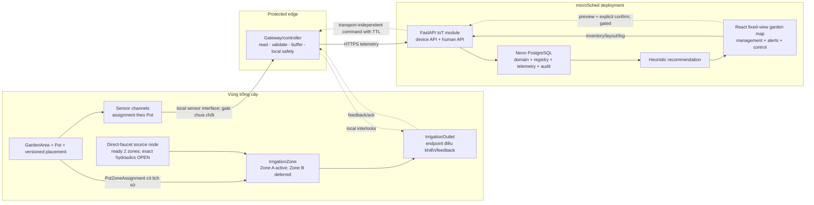
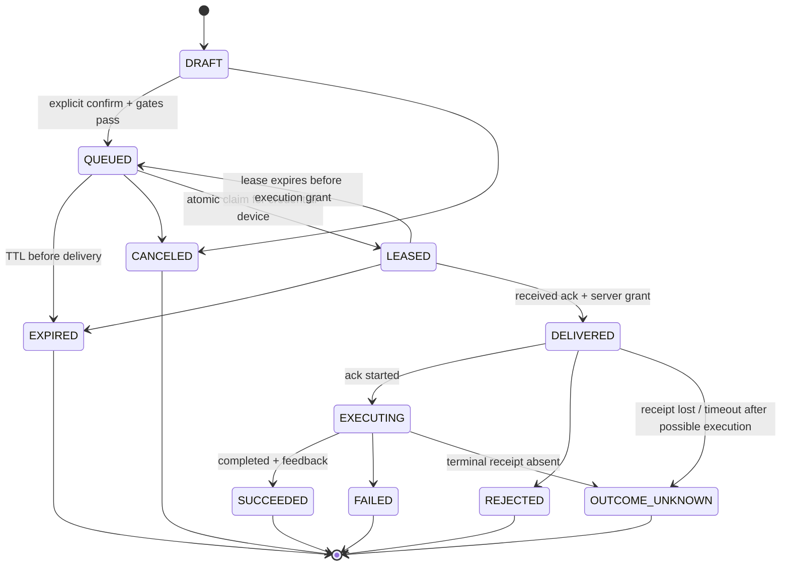

# miGarden — implementation specification

Public derivative, **2026-10-22, Asia/Saigon**, for the MG-H1 system project. Full detailed contract retained from the source spec; original bytes and hashes remain in private snapshots. This is an unimplemented design, not runtime/device acceptance or an implementation grant. [Current state](project-state.md), [architecture](architecture.md), [site baseline](site-baseline.md) and [provenance](provenance.md) explain its inputs.

Current reconciliations: system root miGarden + microSched web/API/DB adapter; P1A arrived per Owner report but identity/bench NOT_RUN; Zone A shared circuit, dynamic pots and optional per-pot extension; soil/Zigbee HOLD indefinitely; A/SVG+B/Three.js selected, scene build outside MG-H1. Local schedule/source START/STOP decisions and detailed safety/cost gates below remain in force. Sensing/calibration/recommendation material is a conditional design for a later reopened lane, never a current purchase or MVP blocker. Dry-profile semantics remain OPEN; do not bypass water flags with fabricated numeric policy.

Private canonical decisions supersede historical wording; this document is a derived technical specification, not a second grant ledger. Shared Owner authority is not copied into public documents. Finished actual-site geometry/drawings/3D/COLMAP may be public; raw capture/video/frames/sheets, credentials, transcripts, exact grants and private paths stay local. No measured reconstruction is claimed here. Previous PASS_FINAL_DOC applied to an earlier source revision only.

## 1. Cách đọc trạng thái quyết định

- **[CHỐT]**: owner đã xác nhận; executor không được tự mở lại.
- **[MỞ]**: chưa có Owner decision hoặc product/evidence đủ mạnh; spec nêu cách đo/default để code/simulate nhưng không nâng default thành quyết định hardware.
- **[LOẠI]**: không thuộc MVP hoặc đã bị loại vì tạo rủi ro/complexity không có evidence biện minh.
- **MUST / MUST NOT**: acceptance bắt buộc của implementation.
- **SHOULD**: mặc định kỹ thuật; muốn làm khác phải ghi trade-off và evidence.

Các con số sampling, timeout, retention và threshold được ghi là **baseline cấu hình được**, không phải đặc tính đã đo của board hay cây. Hardware acceptance chỉ có giá trị sau khi chạy probe bằng chính board/sensor dự kiến.

### 1.1 Quy ước staging sau review Lớp 1

- **Foundation lane** (tên cũ trong spec: `Phase 1`): inventory động, generic telemetry/device management, dashboard, watering history và optional sensing/recommendation capability.
- **Controlled-irrigation lane** (tên cũ trong spec: `Phase 2`): owner chủ động preview/confirm tưới từ xa, command/ack và local safety; lane này **thuộc product MVP**, nhưng field enable bị chặn tới khi `G0-WATER-SAFETY` PASS.
- **Automation lane**: Owner đã chọn deterministic owner-configured schedule thuộc product MVP; **enable vẫn bị chặn** tới khi water-safety evidence và schedule-specific fault tests PASS. Controller tại nhà được tiếp tục lịch hợp lệ khi mất Internet nhưng còn điện/nước. Adaptive soil/rule/AI watering nằm ngoài MVP hiện tại.

Các nhãn `Phase 1`/`Phase 2` còn lại ở phần chi tiết chỉ mô tả thứ tự rollout, không còn là ranh giới sản phẩm hay mốc trước/sau BTL. Exact hydraulic/electrical/connectivity design vẫn `[MỞ]`; không được suy từ việc controlled irrigation đã thuộc MVP thành một quyết định mua linh kiện.

## 2. Product outcome và course outcome

### 2.1 Product outcome

**[CHỐT] Tên hệ thống:** `miGarden`.

**[CHỐT] Kết quả người dùng cần có:** từ website microSched, owner quản lý inventory/layout và trạng thái chăm sóc/tưới của vườn động; đồng thời tưới từ xa đúng `IrrigationZone`/`IrrigationOutlet` qua preview + confirm bị giới hạn an toàn và liệt kê toàn bộ pot bị tác động. Mọi telemetry có mặt phải hiện freshness/quality/provenance; soil recommendation chỉ tồn tại khi sensing lane được chọn và dữ liệu đủ tin cậy.

**[CHỐT] Cardinality:** chín chậu là snapshot khảo sát. `Pot` là aggregate động; thêm, bỏ, thay, di chuyển hoặc đổi cây/giá thể không được đòi đổi identity contract hay rewrite lịch sử. Inventory/watering history giải thích ở cấp pot/affected-pot snapshot; optional sensing assignment có lịch sử riêng. Current MVP irrigation control theo zone/outlet; per-pot physical actuation là future option. Water pilot là một Zone A shared circuit; số soil probe chưa chốt.

**[CHỐT] MVP core:** inventory/map/history, device/telemetry foundation, **remote controlled irrigation và deterministic schedule do Owner duyệt**. “Controlled” nghĩa là mọi lần mở nước phải nằm trong safety envelope local, dù do Owner bấm hay do lịch hợp lệ kích hoạt. Soil sensing/recommendation là optional lane; lịch không đồng nghĩa soil-based automation. Schedule chỉ được field-enable sau controlled-irrigation safety gate và test mất mạng/thời gian/reboot.

**[CHỐT] Đường tiến hóa:** deterministic schedule đã được Owner chọn nhưng chỉ triển khai sau water-safety field evidence; adaptive soil/rule/AI watering cần thêm trusted data/eval. Exact actuator/hydraulic design vẫn phải qua network, flow/source behavior, fail-closed, manual shutoff, leak detection và residual-flow gates.

### 2.2 Course outcome có thể trình bày và chấm

| ID | Sau BTL, sinh viên phải chứng minh được | Artifact/receipt |
|---|---|---|
| `CO-01` | Phân rã một IoT system theo device - connectivity - edge/gateway - cloud/platform - application/user | sơ đồ public ở §4, mapping trách nhiệm |
| `CO-02` | Thu nhận sensor data, giữ raw value, unit, timestamp, identity, calibration và quality | firmware/simulator log + telemetry API + DB query |
| `CO-03` | Giải thích upstream telemetry và downstream command/ack, kể cả failure path | sequence/state machine ở §14 |
| `CO-04` | So sánh HTTPS request-response với MQTT publish-subscribe và chọn protocol theo constraint đo được | protocol decision record ở §10 |
| `CO-05` | Quản lý device identity, credential, config, firmware và lifecycle | registry/config/firmware screens + audit |
| `CO-06` | Xử lý intermittent connectivity bằng buffering, idempotency, staleness và recovery | failure-injection receipts |
| `CO-07` | Biến data thành dashboard, alert và recommendation giải thích được | UI + heuristic evaluation |
| `CO-08` | Chứng minh safety boundary khi digital decision có physical consequence | controlled actuator command/ack + fail-closed/invariant receipts; bench proof không thay field proof |

Course trace bám [Chapter 1](design-inputs.md) (IoT là system, device lifecycle, gateway/edge/cloud, smart irrigation), [Chapter 2](design-inputs.md) (metadata, buffering, data lifecycle, local safety) và [Chapter 3](design-inputs.md) (lossy network, protocol selection, MQTT QoS/ACL/lifecycle).

**Authority rule:** đề BTL/lab là nguồn trace và trao đổi với giảng viên, không là product architecture authority. Với từng criterion, Owner chọn `FOLLOW`, `ADAPT/EXTENSION`, `NEGOTIATE` hoặc `OMIT WITH RATIONALE`. Assignment yêu cầu ít nhất một physical sensor type; product có thể đáp ứng bằng flow/leak/valve-state/environment sensing có ích thật, hoặc Owner chủ động thương lượng/deviate. Không mua soil probe chỉ để tick rubric.

## 3. Scope và non-scope

### 3.1 Product MVP in scope

- Registry động cho `GardenArea`, `Pot`, placement, planting episode, gateway/device, sensor channel, irrigation outlet và các assignment có thời hạn.
- Logical contract hỗ trợ pot-level identity/history, optional sensing assignment và zone/outlet actuation từ đầu. Contract giữ extension point cho per-pot actuation tương lai nhưng không buộc MVP có soil probe hay valve cho mỗi pot.
- Firmware hoặc simulator gửi telemetry qua HTTPS; buffer và replay khi offline.
- FastAPI ingestion, PostgreSQL/Neon storage, config revision và audit.
- Dashboard/map trên microSched bám layout thật: current state, age/stale, history, device health, alert, recommendation, watering history và inventory/layout management.
- Nếu soil/recommendation lane được enable: heuristic có version, reason code và evaluation dataset; nếu không, UI/API không dựng empty/error workflow giả.
- Provision/rotate/revoke credential; ghi firmware/config version và lifecycle state.
- Controlled-irrigation command/ack với preview + explicit confirm, local fail-closed policy và physical feedback sau khi gate an toàn PASS.
- Deterministic schedule do Owner duyệt, cloud quản lý/version và local controller thực thi trong cùng safety envelope; test mất Internet/trusted clock/reboot trước khi field-enable.
- Test bằng simulator rồi bench trước; field acceptance chỉ chạy sau khi owner duyệt architecture và hardware tối thiểu.

### 3.2 Ngoài product MVP hiện tại

- **[LOẠI]** Adaptive rule/soil/model tự phát lệnh mở nước trước khi có field evidence và decision record mới. Deterministic schedule **đã thuộc MVP theo `D-L2-29`** nhưng field-enable còn gated; không được claim soil-driven.
- **[LOẠI]** Mua đồng loạt sensor/valve cho toàn inventory trước calibration, hydraulic và staged-pilot evidence.
- **[LOẠI]** MQTT broker chỉ để “đủ công nghệ” khi chưa có owner, ACL, QoS, retention và vận hành.
- **[LOẠI]** Microservices, Redis/Celery, một database IoT riêng hoặc một cloud dashboard song song với microSched.
- **[LOẠI]** Repository/runtime/release line riêng chỉ để mô phỏng cây thư mục môn học.
- **[LOẠI]** Công khai credential, token/private key hoặc dữ liệu người thứ ba chưa được phép. Ảnh/layout/topology nhà **không** nằm trong lệnh cấm chung này.
- **[LOẠI]** Kết luận board đạt SLA từ phone speed test.

### 3.3 Canonical repositories and submission package

- miGarden owns system source, firmware/local arbiter, simulator, spatial source and hardware lifecycle. microSched owns the human web/API/storage adapter under its existing modular-monolith/same-origin/one-Postgres boundary. The older all-components-in-microSched repository clause is superseded for MG-H1.
- Contracts and scene data have one canonical producer, explicit versions and exact system + adapter refs with a compatibility receipt; no competing editable scene copies or second DB/backend by default. Product surveys use microSched develop; main is release-tag history.
- A submission/release is an explicit allowlisted manifest from exact source refs/tags, with hashes/provenance, no symlink/junction escape or undeclared files. No new archive builder is implemented by MG-H1.
- Raw house source photos/video and private ledgers/transcripts/receipts remain ignored local data. Finished actual-site drawings/3D/COLMAP may be public, with provenance and secret/metadata/third-party review as applicable; no synthetic-only requirement. Original source bytes are preserved.
## 4. System architecture and microSched adapter



### 4.1 Trách nhiệm và trust boundary

| Thành phần | Trách nhiệm | Không được giả định |
|---|---|---|
| Sensor/channel | tạo raw measurement và channel health | một giá trị raw đã là “% ẩm đất thật” |
| Gateway/controller | sampling, validate cơ bản, timestamp/clock quality, buffer, retry, config apply; local button và lịch/remote cùng qua một local safety arbiter khi field actuation enabled | cloud luôn online; wall clock luôn đúng; một nút điện tử thay được van khóa tay |
| Device API | device authentication, schema validation, idempotent ingest, config delivery/ack | cookie đăng nhập website là device credential |
| Domain/storage | registry, calibration, telemetry, recommendation, alert, watering event, audit | JSONB không schema hóa thay toàn bộ relational model |
| Dashboard | hiển thị current/history/age/reason; nhận feedback và manual log | một chart đẹp đồng nghĩa data đáng tin |
| Recommendation | deterministic rule và reason code; không tự phát actuation intent trong MVP | foundation model là safety controller |

### 4.2 Seam tích hợp microSched

Implementation sau khi được duyệt MUST giữ kiến trúc hiện có của microSched: FastAPI modular monolith, SPA cùng origin, PostgreSQL/Neon duy nhất, SQLModel + Alembic, UUIDv7, `timestamptz`, enum bằng `TEXT + CHECK`, index tối thiểu và audit. Khi triển khai adapter, đọc current repository rules/architecture/schema tại microSched; cached refs không chứng minh current runtime. Xem [architecture](design-inputs.md).

Human routes tiếp tục nằm dưới `/api` và dùng session dependency hiện có. Device routes MUST dùng dependency `require_iot_device` riêng; không nhét sensor vào Google OAuth/session cookie. Router device phải được mount tường minh trước unknown-API catch-all.

## 5. Phase 0 - evidence gates trước hardware architecture

P1A đã về theo Owner report; exact unit/USB/flash/bench chưa được verify. Vì vậy software contract có thể code bằng simulator, nhưng mọi dòng “đã chạy trên thiết bị/ngoài trời” đều là **CHƯA VERIFY** cho tới khi có receipt thật.

### 5.1 Gate matrix

| Gate | Cần đo/biết | Cách đo tối thiểu | Pass để mở bước sau | Nếu fail |
|---|---|---|---|---|
| `G0-RUBRIC-DISPOSITION` | yêu cầu BTL + trao đổi giảng viên | trace mỗi criterion thành `FOLLOW|ADAPT|NEGOTIATE|OMIT`, rationale và extension path | Owner duyệt disposition; không mâu thuẫn safety/product lock | không tự sửa product để tick rubric; trình Owner điểm cần thương lượng |
| `G0-SITE-REFRESH` | source/vòi/bơm/ren/flow/drainage/power/route và pot context | chạy [home-field measurement plan](site-baseline.md); ảnh + bucket-flow repeat + tool inventory | dữ kiện đủ chọn category/BOM tiếp theo; uncertainty còn lại ghi rõ | không mua/cắt water hardware; không dùng ảnh tổng thể để đoán ren/pressure |
| `G0-SENSING-STRATEGY` | sensing có tạo product value đủ bù cost/time/maintenance không | Owner chọn `NONE`, `LOCAL_EXPLORATORY`, `NATIVE_1_THEN_SCALE` hoặc later fallback; ghi stop-loss | strategy + budget/learning bound được Owner duyệt | controller/water lane vẫn tiếp tục; không mua coordinator/probe theo basket cũ |
| `G0-SENSING-PILOT` (conditional) | inventory/placement và vị trí probe nếu strategy != `NONE` | inventory cây/giá thể/nắng/thoát nước; chọn 1 exploratory hoặc vị trí đại diện; không bắt manual log | stable identity/assignment; exact unit pass identity/pair/decode/semantic/rejoin trước scale | giữ pot độc lập; không bulk sensor/outlet; có thể quay về `NONE` |
| `G0-BOARD-BUY` | board class đủ cho probe | checklist USB debug, interface sensor, TLS/HTTPS, non-volatile buffer, power, Wi-Fi nếu thử direct Wi-Fi, support firmware | một board development + phụ kiện tối thiểu được owner duyệt | đổi category; không kéo theo actuator purchase |
| `G0-SENSOR-BENCH` | sensor có repeatability và calibration usable | đọc raw ở reference conditions; lặp tối thiểu 10 lần/condition; log noise, drift, disconnect | phân biệt được trạng thái mục tiêu với margin lớn hơn noise; raw/calibration reproducible | đổi sensor/placement/sampling; không “sửa” bằng threshold tùy ý |
| `G0-NET-24H` | board thật có truyền ổn ở vị trí dự kiến | heartbeat 60 s trong 24 h; log RSSI nếu có, expected/received, gap, disconnect, reconnect, AP-reboot test | baseline tạm: receipt >=98%, không gap liên tục >10 phút, tự reconnect <=5 phút sau reboot, buffer replay không nhân đôi | direct Wi-Fi chưa đạt; thử placement/antenna hợp lệ rồi chuyển wired/LoRa/mesh gate |
| `G0-NET-7D` | reliability qua biến động ngày/đêm | giữ workload foundation/controlled-irrigation tương ứng trong 7 ngày, không can thiệp tay | baseline tạm: receipt >=99%, không outage không giải thích >30 phút, recovery không mất sample ngoài capacity contract | không dùng direct Wi-Fi cho hop đó |
| `G0-NEON-COST` | cadence ingest/heartbeat có giữ DB compute hoạt động và vượt budget không; `measurement_period`, `cu_hours_cap_per_period`, `row_growth_cap_per_period`, `index_growth_cap_per_period` đều đang `OPEN - unset` | owner phải duyệt bốn trường cap/period trước; runner qua target guard §5.2; chạy workload simulator/pilot ít nhất 7 ngày trên `local|throwaway`; đọc CU-hours và row/index growth thực theo đúng period | mọi cap có value+unit+owner approval; số đo không vượt cap; cadence không tạo wakeup thừa; receipt chứng minh không dùng production target | gate không được PASS khi cap còn unset; coalesce heartbeat/telemetry, đổi cadence+jitter hoặc retention rồi đo lại trước khi production ingest |
| `G0-POWER-ENV` | nguồn, weather exposure, cable/connector | đo nguồn và duty cycle; inspection điểm đặt; thử enclosure/cable route không cần public topology | nguồn ổn định; low-voltage boundary; enclosure/cable plan có serviceability | đưa gateway vào vùng bảo vệ/đổi power hoặc topology |
| `G0-DATA-PILOT` | threshold/heuristic có ý nghĩa | ít nhất 4 chu kỳ khô - tưới - ổn định trên mỗi pot pilot + owner label | có calibration version, no-data/stale behavior và confusion table baseline | chỉ hiển thị monitoring; recommendation giữ `INSUFFICIENT_DATA` |
| `G0-WATER-SAFETY` | trước mọi field irrigation: source states, flow/pressure, valve fail state, manual shutoff, leak detection, hydraulic inertia và cumulative water limits | đo direct faucet ở các mức mở/trạng thái bơm; bench fail-power/reboot/stuck command; đo residual/siphon/drain-down; lập numeric safety envelope §15.3 | owner phê duyệt mọi field §15.3; receipt chứng minh edge enforce; Zone A contained/field circuit có valve/flow/leak feedback và affected-pot snapshot | field actuation bị chặn; chỉ simulator/bench dry hoặc contained-water test được tiếp tục |

Các tỷ lệ trên là acceptance baseline của workload telemetry nhỏ, không phải tuyên bố chuẩn công nghiệp. Sau pilot, owner có thể siết/nới threshold theo consequence thực; thay đổi phải version trong decision record. Riêng các cost cap và water-safety value đang ghi `OPEN - unset` không phải threshold ngầm: executor không được tự điền hay tự PASS gate.

### 5.2 Cost-probe target guard

- Mỗi cost/probe receipt MUST có field máy đọc được đúng một trong hai giá trị: `target_env=local` hoặc `target_env=throwaway`. Missing, giá trị khác hoặc môi trường mơ hồ làm runner fail trước network/DB operation đầu tiên.
- Trước probe, runner MUST parse DSN mà không log secret, resolve host/database target và so với production DSN/host/database fingerprint trong denylist cấu hình riêng. Match production, không resolve được hoặc không chứng minh được isolation => reject trước khi gửi request/query; public receipt chỉ ghi fingerprint đã redact, không ghi private hostname/DSN.
- Lane heartbeat 60 giây chỉ được dùng với local collector hoặc throwaway environment đã qua guard trên; **MUST NOT** trỏ vào production DSN/host/Neon. Receipt ghi ít nhất `target_env`, redacted target fingerprint, `production_match=false`, interval, command, literal output và artifact hash.
- `measurement_period`, `cu_hours_cap_per_period`, `row_growth_cap_per_period`, `index_growth_cap_per_period` là owner-approved `OPEN` prerequisites. `G0-NEON-COST` không được PASS khi field còn null/unset, thiếu unit/period hoặc chỉ có estimate chưa được owner duyệt; spec này không cung cấp cap số mặc định.

### 5.3 Phone speed test boundary

- Phone speed test chỉ chứng minh điện thoại có một lần kết nối ở thời điểm đo.
- Nó không đo antenna/sensitivity, firmware reconnect, power mode, TLS memory, packet loss, buffered replay hay uptime của board.
- Vì vậy **MUST NOT** dùng phone Mbps/ping làm `G0-NET-*` receipt hoặc board SLA.

## 6. Dynamic garden domain và spatial model

### 6.1 Identity và lifecycle

- `GardenArea` định danh khu vật lý, trước mắt có ban công chính và ban công mini; area có geometry/layout version chứ không bị hardcode vào firmware.
- `Pot` là aggregate nghiệp vụ ổn định. Chín chậu hiện tại chỉ là snapshot; API/DB/UI MUST hỗ trợ create, move, pause và retire pot mà không rewrite history.
- `PotPlacement` lưu area + geometry/toạ độ + `valid_from`/`valid_to`. Di chuyển chậu tạo placement mới.
- `PlantingEpisode` lưu cây/giá thể/profile đang sống trong pot theo giai đoạn; thay cây không tạo device giả và không xóa telemetry cũ.
- `Device`, sensor channel, `IrrigationZone` và `IrrigationOutlet` có identity/lifecycle riêng. Sensor assignment nối channel với pot theo thời gian; `PotZoneAssignment` nối pot với zone theo `valid_from`/`valid_to`. Thêm/bỏ pot không tự động đồng nghĩa onboarding/retire device hoặc thêm/bớt valve.

### 6.2 Grouping không thay identity

`CareGroup` nhóm pot có policy chăm sóc tương tự; `HydraulicCircuit` mô tả shared source/master/manifold; `IrrigationZone` là đơn vị điều khiển/isolation có membership theo thời gian. Ba khái niệm có mục đích và version riêng, không được gộp thành một `zone` mơ hồ. Recommendation cuối cùng vẫn phải giải thích được ở cấp pot; zone/circuit mô tả shared physical blast radius.

Nếu evidence chưa đủ để group, pot giữ `UNCLASSIFIED`. Sensor đại diện cho nhiều pot phải có provenance/validity và UI label `representative`; không nhân bản raw measurement thành measurement của mọi pot. Zone membership chỉ mô tả pot bị tác động chung, không chứng minh mỗi pot nhận cùng volume.

### 6.3 Pilot và scale

- **[CHỐT]** Logical model hỗ trợ pot-level identity/sensing/history, `PotZoneAssignment`, và current actuation target theo zone/outlet. Per-pot actuation là future extension, không là current MVP constraint.
- **[CHỐT HƯỚNG]** Sensing pilot dùng ba battery wireless probes ở ba pot đại diện sau `G0-SENSING-PILOT`; Zone A field pilot là shared-circuit run, không phải ba irrigation channels.
- Mở rộng hardware theo evidence calibration, hydraulic capacity, maintenance và blast radius; không mua theo cardinality snapshot.
- Ban công mini là area mở rộng thật, nhưng geometry/elevation/drainage/exposure/load route còn phải đo ở Lớp 2.

## 7. Device identity, registry, credential và lifecycle

### 7.1 Identity model

- `device_id`: UUIDv7 do server cấp, identity chính trong mọi API/DB/audit.
- `device_alias`: tên hiển thị private-safe; không dùng vị trí nhà trong artifact shareable.
- `device_kind`: `gateway`, `sensor_node`, `actuator_node`, `simulator` (`TEXT + CHECK`).
- `hardware_fingerprint`: optional salted hash phục vụ phát hiện thay board; không dùng MAC làm public identity và không trả MAC qua human API.
- `boot_id`: UUID mới mỗi boot; tách sequence/monotonic clock giữa các boot.
- `channel_key`: stable trong một device, ví dụ `soil_1`, không gắn GPIO vào API public.

### 7.2 Device lifecycle state machine

```text
PROVISIONING -> ACTIVE -> DEGRADED -> ACTIVE
                    |         |
                    v         v
               MAINTENANCE -> RETIRED
                    |
                    v
                  REVOKED
```

- `PROVISIONING`: token mới, chưa có heartbeat + config ack đầu tiên.
- `ACTIVE`: telemetry/heartbeat trong freshness contract và config hợp lệ.
- `DEGRADED`: stale, channel lỗi, calibration hết hiệu lực hoặc firmware/config mismatch; vẫn nhận telemetry.
- `MAINTENANCE`: owner chủ động ngừng alert/recommendation cho device.
- `RETIRED`: giữ history, không nhận credential mới.
- `REVOKED`: credential bị chặn ngay; mọi request trả `401` và audit không chứa token.
- Chuyển state thủ công hoặc tự động MUST có actor/reason/time trong audit.

### 7.3 Provisioning và credential

Foundation HTTPS dùng per-device high-entropy bearer token:

1. Human session tạo registry record.
2. Server sinh token cryptographically random, trả plaintext **đúng một lần**.
3. DB chỉ giữ `key_id`, SHA-256 token hash, `created_at`, `expires_at`, `last_used_at`, `revoked_at`; token entropy đủ lớn nên hash trực tiếp là lookup-safe.
4. Firmware nhận token qua local provisioning/USB hoặc kênh owner kiểm soát; không commit vào source, screenshot, serial log hay config shareable.
5. Rotation cho phép tối đa hai credential active trong grace window; revoke key cũ sau receipt key mới đã dùng.

`Authorization: Bearer <token>` xác thực device. `device_id` trong payload MUST khớp credential owner; mismatch trả `403`. Human session và device token không thay thế cho nhau.

### 7.4 Config desired/reported

Mỗi config revision bất biến gồm:

- `config_version` tăng đơn điệu trong phạm vi device;
- `schema_version`, `created_at`, `created_by`, `reason`;
- sampling/report/heartbeat interval;
- enabled channel và channel mapping;
- stale threshold, quality bounds, calibration version;
- buffer/retry policy;
- Khi controlled irrigation được enable: local safety maxima không cho cloud nới vượt firmware hard limit;
- canonical JSON checksum.

Gateway báo `reported_config_version`, checksum, `applied_at`, `status=applied|rejected|rolled_back`, error code. Unknown field không được silently ignored nếu ảnh hưởng sampling/safety; reject revision và giữ last-known-good. Config secret không nằm trong revision JSON.

### 7.5 Firmware lifecycle

Registry firmware gồm `firmware_version`, `build_id`, `git_commit` nếu có, target board class, build time, SHA-256 artifact, signature status, minimum bootloader/config schema, release state và rollback notes.

- Foundation lane cho phép update qua USB/serial và ghi receipt version sau boot.
- **[MỞ - SAU R1, xem lại trước R4]** OTA không phải điều kiện R1 hay yêu cầu bắt buộc trong đề bài môn học. Owner muốn đường cập nhật thường xuyên khi hệ còn thay đổi: giữ firmware metadata và xác minh flash/partition của board 16MB khi hàng về; USB/serial update là đường R1–R3. OTA chỉ được enable nếu image integrity/authenticity, TLS, device eligibility, safe-idle/valve closed, power-loss/reboot/rollback và báo kết quả đã được bench trên exact board. Không tự động update khi tưới; không mở route firmware deployment chỉ vì registry đã có metadata. Multi-device rollout chưa thuộc MVP.
- **[LOẠI]** OTA unsigned, update all-at-once hoặc xóa bản rollback trước health receipt.
- Rollout post-BTL sau này theo `simulator -> bench device -> one field device -> remaining devices`; mỗi bước cần heartbeat, config ack và telemetry sanity.
- Retired/revoked device không nhận firmware/config mới.

## 8. Telemetry contract, time, staleness và calibration

### 8.1 Foundation defaults cấu hình được

| Tham số | Default để implement/simulate | Ý nghĩa |
|---|---:|---|
| local sample interval | 5 phút | đủ quan sát trend chậm; thay sau sensor/power evidence |
| cloud report interval | `[MỞ - baseline thử nghiệm]` 15 phút + bounded jitter `0..120 s` | candidate để simulator/probe đo cost; chưa phải production cadence đã CHỐT |
| normal heartbeat | `[CHỐT invariant]` coalesce với report cadence đang active; chỉ gửi riêng khi không có telemetry | tránh request/DB write riêng chỉ để health |
| network probe heartbeat | 60 giây | lane time-boxed chỉ `local|throwaway`; không phải production default và không được chạm production target |
| batch limit | 100 sample và 64 KiB request | bounded memory/body; phải test trên board thật |
| stale threshold | `max(3 x report_interval, 30 phút)` | không đánh stale vì trễ một batch |
| offline threshold | `max(3 x effective heartbeat/report interval, 45 phút)` | tách channel stale khỏi whole-device offline |

Hai invariant đã **CHỐT** là: (1) normal heartbeat coalesce vào telemetry report đang đến hạn và không tạo request/DB write riêng khi đã có telemetry; (2) lane 60 giây chỉ chạy time-boxed trên target `local|throwaway` đã qua §5.2 và không bao giờ chạm production DSN/host/Neon. Cadence `15 phút + jitter 0..120 s` chỉ là baseline **MỞ** để simulator/probe đo; với baseline này firmware có thể tính jitter ổn định bằng `hash(device_id, interval_start) mod 121 s`. Chỉ sau khi `G0-NEON-COST` PASS theo cap/period owner duyệt, owner mới chốt cadence production trong versioned decision/config; heartbeat riêng khi không có telemetry dùng chính cadence đã được duyệt đó.

### 8.2 Canonical ingest envelope

```json
{
  "schema_version": 1,
  "batch_id": "019...uuidv7",
  "device_id": "019...uuidv7",
  "boot_id": "019...uuidv7",
  "firmware_version": "0.1.0",
  "applied_config_version": 3,
  "applied_config_checksum": "sha256:config-placeholder",
  "batch_checksum": "sha256:batch-placeholder",
  "sent_at": "2026-08-22T10:15:00Z",
  "clock_quality": "synced",
  "samples": [
    {
      "sample_id": "019...uuidv7",
      "sample_checksum": "sha256:sample-placeholder",
      "channel_key": "soil_1",
      "sequence": 42,
      "applied_config_version": 3,
      "applied_config_checksum": "sha256:config-placeholder",
      "observed_at": "2026-08-22T10:10:00Z",
      "monotonic_ms": 812340,
      "metric": "soil_moisture_raw",
      "value_raw": 2381,
      "value_engineering": null,
      "unit": "adc_count",
      "calibration_version": 2,
      "quality_flags": []
    }
  ]
}
```

Contract rules:

- UUID/string trong ví dụ chỉ là placeholder hợp lệ về shape, không phải ID thật.
- Mọi `*_checksum` là lowercase SHA-256 của UTF-8 JSON Canonicalization Scheme (RFC 8785), loại chính field checksum đang tính và mọi server-owned field. Batch checksum phủ metadata + ordered samples; sample checksum phủ sample capture payload. Cùng input phải cho cùng hash ở firmware/simulator/server fixture.
- `schema_version` bắt buộc; unsupported version trả `422` với machine-readable code.
- `sample_id` là idempotency key end-to-end. Cùng `sample_id` + cùng canonical `sample_checksum` là duplicate-success; cùng `sample_id` nhưng checksum khác trả `409 IDEMPOTENCY_CONFLICT`, giữ row đầu, quarantine payload xung đột và audit - tuyệt đối không overwrite. Unique phụ `(device_id, boot_id, channel_key, sequence)` chặn firmware tạo lại ID khác cho cùng sample.
- `sequence` tăng đơn điệu trong một `boot_id` và channel; out-of-order được lưu nhưng gắn flag, không rewrite history.
- `received_at` do server tạo bằng UTC và luôn được lưu; device không được gửi field này.
- Mỗi batch MUST đồng nhất một config revision; batch và **từng sample** đều mang `applied_config_version` + canonical checksum tại lúc capture. Config đổi giữa backlog thì gateway tách batch, không relabel sample cũ. Sample khác batch revision/checksum là malformed `422`. Revision/checksum không tồn tại hoặc không khớp registry làm cả batch `QUARANTINED_CONFIG`: raw vẫn được giữ nhưng không cập nhật latest/recommendation; server trả `409 CONFIG_REVISION_UNKNOWN`, `quarantined=N`, `retryable=false`. Gateway fetch/reconcile config và không resend poison sample IDs vô hạn.
- `value_raw` MUST được giữ. Device-supplied `value_engineering` chỉ là advisory; server là authority theo §8.5.
- `quality_flags` thuộc tập versioned: `clock_unsynced`, `timestamp_future_outlier`, `timestamp_old_outlier`, `out_of_order`, `out_of_range`, `sensor_error`, `flatline_suspected`, `calibration_missing`, `calibration_unknown`, `calibration_expired`, `engineering_mismatch`, `config_unknown`, `replayed`.
- Password/token, SSID, MAC, local IP và topology MUST NOT xuất hiện trong payload/log.

### 8.3 Timestamp và clock quality

- Timestamp chuẩn API/DB là UTC RFC 3339 có timezone; DB dùng `timestamptz`.
- `clock_quality=synced`: NTP/gateway time đã sync; `observed_at` bắt buộc.
- `clock_quality=estimated`: device suy ra từ anchor gần nhất; giữ `observed_at` và gắn quality.
- `clock_quality=unsynced`: `observed_at=null`; `monotonic_ms` bắt buộc. Gateway/server giữ `received_at`, không bịa precision cho thời điểm đo.
- Sau reboot, sequence/monotonic reset nhưng `boot_id` đổi. Clock chưa sync không được làm mất raw sample.
- UI ưu tiên `observed_at` khi synced/estimated, nếu không hiển thị theo `received_at` kèm badge “thời gian thiết bị chưa đồng bộ”.
- Server kiểm time trước calibration/freshness. `observed_at > received_at + 5 phút` là `timestamp_future_outlier`. `observed_at` trước `device.provisioned_at - 5 phút` hoặc cũ hơn retention/replay horizon active là `timestamp_old_outlier`. Cả hai vẫn giữ raw/provenance nhưng `value_engineering=null`, không cập nhật latest/recommendation và không làm channel fresh. Replay hợp lệ trong horizon (ví dụ offline 2 giờ) không phải timestamp-old outlier, nhưng vẫn không được coi là live freshness.

### 8.4 Staleness semantics

Stale là property của từng channel, offline là property của device. Phải tách tuổi phép đo khỏi tuổi ingest:

```text
observed_age = now_utc - latest_live_valid_observed_at
ingest_age = now_utc - latest_authenticated_received_at
channel_stale = observed_age > channel.stale_after
device_offline = now_utc - device.last_seen_at > device.offline_after
```

- Nếu chưa có `latest_live_valid_observed_at`, `observed_age=null`, channel được coi là stale/insufficient - không fallback sang `received_at` để recommendation.
- Server xác định live bằng `received_at - observed_at <= live_delivery_window`, với baseline `live_delivery_window = max(2 x report_interval, 30 phút)`, đồng thời time/config/calibration/quality phải hợp lệ. Device flag `replayed` có thể làm sample non-live nhưng không thể tự nâng sample cũ thành live. `latest_live_valid_observed_at` chỉ nhận sample đạt rule này. Backlog replay cập nhật `ingest_age`/connectivity nhưng **không** cập nhật `observed_age` hoặc clear channel stale.
- Sau offline 2 giờ, ingest backlog cũ vẫn phải giữ recommendation `INSUFFICIENT_DATA`; chỉ một live valid sample mới có thể mở lại freshness, và minimum window của rule vẫn phải đủ.
- Sample `sensor_error` hoặc quarantined không làm channel fresh về mặt recommendation nhưng authenticated request vẫn có thể làm device `last_seen_at` fresh.
- UI MUST hiển thị cả “đo cách đây” (`observed_age`) và “server nhận cách đây” (`ingest_age`), kèm badge replay/clock uncertainty; không chỉ màu xanh/đỏ.
- Recommendation MUST trả `INSUFFICIENT_DATA` khi input stale, clock/calibration không dùng được hoặc thiếu minimum window.
- Alert stale/offline dùng dedupe/cooldown; `channel_stale` chỉ clear bằng live valid sample, không bởi replay; không tạo một row mới mỗi lần dashboard refresh.

### 8.5 Calibration contract

Mỗi `iot_calibration` là revision bất biến: device/channel, sensor category, method, reference conditions, coefficients/range, raw observations, environment note public-safe, `effective_from`, `effective_to`/`expires_at`, author và checksum.

Server resolve calibration bằng khóa `(channel_id, calibration_version)` và bắt buộc `effective_from <= observed_at < effective_to` (hoặc chưa có `effective_to`) tại **thời điểm capture**. Sample không được tự chọn revision khác bằng payload. Nếu clock không đủ tin cậy, revision unknown/mismatch/expired, raw out of calibrated range hoặc timestamp outlier thì raw + provenance vẫn lưu, nhưng `value_engineering=null`, quality flag tương ứng và sample không vào latest/recommendation.

Khi calibration hợp lệ, server compute `value_engineering` từ `value_raw` bằng revision đã resolve. Nếu device gửi advisory engineering value, server so với tolerance trong calibration: mismatch gắn `engineering_mismatch`; giá trị persisted/được dùng vẫn là server-computed. Không có đường cho device-supplied engineering value bypass calibration authority.

Soil moisture foundation lane MUST:

1. giữ raw ADC/capacitance output;
2. đo lặp trong ít nhất hai trạng thái reference liên quan đến giá thể thật, SHOULD có dry, field-capacity-after-drain và intermediate;
3. ghi temperature/supply context nếu nó ảnh hưởng đáng kể;
4. không gọi normalized value là volumetric water content nếu chưa có phương pháp chứng minh;
5. version calibration khi đổi sensor, cable, ADC attenuation, supply, placement hoặc giá thể;
6. chạy side-by-side/manual label trong `G0-DATA-PILOT`.

[Bài 1 - Cảm biến — archived](design-inputs.md) cung cấp seam học tập lịch sử về raw acquisition, interface, sampling và calibration. DHT11 đo nhiệt độ/độ ẩm **không khí**; MUST NOT dùng humidity của DHT11 như soil moisture.

## 9. Edge buffering và offline behavior

### 9.1 Queue classes

Gateway giữ hai queue tách biệt:

1. `telemetry_queue`: append-only, cho phép drop oldest theo policy khi đầy;
2. `critical_queue`: device health transition, config result và controlled-irrigation command terminal result; MUST NOT bị telemetry overwrite.

Mỗi record giữ `sample_id`/`event_id`, `boot_id`, sequence, payload checksum và retry metadata. Credential không nằm trong record. Queue format có version và CRC/checksum để phát hiện record hỏng sau power loss.

### 9.2 Capacity và overflow

- Requirement ban đầu: MUST buffer tối thiểu 24 giờ theo cấu hình pilot; target 72 giờ chỉ chốt sau khi đo flash/RAM/endurance của board.
- Capacity phải được tính từ `sample size x channels x sample rate`, không ghi một số sample tùy ý.
- Khi telemetry queue đầy: drop oldest telemetry chưa gửi, tăng `dropped_sample_count`, tạo một critical event duy nhất cho incident và tiếp tục sampling.
- Khi critical queue đầy: chuyển device `DEGRADED`, giữ terminal command result gần nhất theo command ID và cấm controlled actuation mới.
- Không block sensor sampling vì một HTTP request treo.

### 9.3 Retry/replay

- Retry exponential có jitter: baseline `5 s, 15 s, 45 s, 2 min, 5 min`, cap 15 phút; network success reset backoff.
- `401/403`: không retry dày; chuyển `credential_error`, chỉ heartbeat local/log redacted và chờ reprovision.
- `409` config/channel mismatch: giữ data, fetch config, không drop lặng.
- `413`: chia batch nhỏ hơn; nếu một record riêng lẻ vẫn quá lớn, quarantine record và report critical error.
- `422`: quarantine batch/schema-invalid; không poison toàn queue vô hạn.
- `429/5xx/timeout`: retry; tôn trọng `Retry-After` nếu có.
- Replay oldest-first, giữ original `sample_id` và `observed_at`; server trả duplicate như success.
- Live sample không được starve vô hạn sau reconnect: uploader xen kẽ bounded backlog batches với current batch.

### 9.4 Offline semantics

- Mất Internet/cloud: sampling, local validation và buffering vẫn chạy; dashboard chuyển stale/offline theo thời gian.
- AP/router reboot: gateway tự reconnect; không cần bấm reset.
- Mất nguồn/reboot: recover queue có checksum; tạo `boot_id` mới; không restore actuator `OPEN`.
- Server downtime: device không thay đổi threshold/config chỉ vì không gọi được cloud.
- MVP không có rule/model tự phát watering command. Khi controlled irrigation được enable, local emergency close/interlock vẫn chạy khi cloud mất.

## 10. Protocol decision gates

Protocol được quyết **theo từng hop**, không chọn một từ “MQTT/Wi-Fi/LoRa” cho toàn hệ thống.

### 10.1 Hop matrix

| Hop | MVP baseline | Decision gate | Receipt cần có |
|---|---|---|---|
| Sensor -> gateway | interface phù hợp sensor thật; ưu tiên wiring ngắn, bảo trì được | `G0-SENSOR-BENCH`, số channel, cable noise/drop, ADC/interface | raw repeatability + disconnect/error detection |
| Gateway -> microSched | **HTTPS request-response** | TLS memory, batch size, retry, device auth, ingest latency | simulator + board POST/replay receipts |
| Gateway -> remote node (nếu có) | **[MỞ]** direct Wi-Fi / wired / LoRa / mesh | `G0-NET-*`, power, thi công, downlink need, rubric | decision record §10.2 |
| Cloud -> gateway command | transport-independent contract; disabled trong foundation-only mode, gated trong controlled-irrigation mode | latency, broker/long-poll cost, delivery semantics | command/ack failure tests |

### 10.2 Decision record bắt buộc cho remote connectivity

Mỗi candidate được chấm bằng số/evidence, không bằng cảm giác:

| Dimension | Direct Wi-Fi | Wired | LoRa/LoRaWAN | Mesh/extender |
|---|---|---|---|---|
| Practical range/reliability | `G0-NET-24H/7D` bằng board thật | cable length, voltage drop/noise, protection | RSSI/SNR/PDR, duty-cycle, gateway placement | probe với hạ tầng thật |
| Power | association/reconnect cost | cấp nguồn/signal isolation | TX power + receive-window/class | thêm thiết bị luôn vận hành |
| Payload/downlink | IP hai chiều thuận lợi | dự đoán được | payload nhỏ; downlink/latency phụ thuộc mode | IP hai chiều |
| Failure/recovery | RF/interference/AP reboot | cable damage/water/grounding | radio/gateway/server, regional config | extender power/backhaul |
| Operations | firmware TLS/IP đơn giản | thi công/conduit/connector | thêm radio stack/key/network server nếu LoRaWAN | thêm hạ tầng phải update/reset |
| Go/no-go | chỉ pass khi `G0-NET-*` đạt | ưu tiên nếu RF fail và route thi công an toàn | chỉ khi Wi-Fi fail, wired không khả thi và small-payload trade-off chấp nhận | chỉ khi vị trí/power vận hành được |

`LoRa` physical radio và `LoRaWAN` network architecture không được dùng thay nhau trong tài liệu. Nếu chọn point-to-point LoRa, phải tự spec addressing, encryption, replay protection, ack/retry và gateway. Nếu chọn LoRaWAN, phải spec activation, key lifecycle, gateway/network-server ownership, class/downlink và regional parameters.

### 10.3 HTTPS vs MQTT gate

**HTTPS là baseline foundation được giữ** vì microSched đã là HTTP service, request-response phù hợp batch telemetry/config, một gateway pilot chưa cần broker và idempotency nằm rõ ở API/DB.

MQTT chỉ được mở khi một trong các trigger sau có evidence:

- nhiều publisher/subscriber cần fan-out thực;
- command/state latency hoặc intermittent session cần broker semantics;
- rubric bắt buộc publish-subscribe;
- HTTPS benchmark không đạt energy/latency/reliability dù đã batch/retry đúng.

Trước khi chọn MQTT MUST chốt:

- broker owner/hosting/cost/backup/monitoring;
- TLS, per-device auth và topic ACL;
- topic tree dùng stable device/outlet identity, không encode topology nhà vốn có thể đổi;
- QoS theo loss tolerance và idempotency (QoS 1 vẫn có duplicate);
- retained message nào được phép, expiry/retention, Last Will semantics;
- reconnect/session persistence, duplicate/out-of-order behavior;
- bridge vào FastAPI/domain và failure khi broker down.

[Bài 2 - Giao thức — archived](design-inputs.md) là course seam lịch sử để so sánh HTTP request-response với MQTT publish-subscribe; bài lab không tự động biến HiveMQ/ThingSpeak thành production choice của miGarden.

### 10.4 Repeated-interval resource guardrail

- Device heartbeat/report interval phải inventory trong config và cost model.
- Normal heartbeat MUST coalesce với report cadence đã được duyệt theo §8.1; baseline `15 phút + jitter` vẫn `MỞ`. Lane 60 giây chỉ `local|throwaway` qua §5.2 và không được chạm production DSN/host/Neon.
- Không trỏ platform health check dày vào DB readiness. microSched giữ `/api/healthz` là liveness không query DB; `/api/readyz` mới kiểm dependency.
- Controlled-irrigation command MUST NOT dùng DB polling mỗi vài giây. Candidate được phép: connection/session giữ trong memory với một DB reconciliation khi connect/startup, hoặc broker đã qua gate. Mọi phương án phải đo query rate và Neon compute impact.
- Owner chấp nhận remote command latency **nhiều phút, có thể trên 5 phút**, nhưng chưa duyệt hard SLA. Chọn transport theo khả năng giao lệnh/ack trung thực và reconnect; không đổi command `QUEUED` thành `DELIVERED` chỉ vì Fly đã nhận request hoặc đã đẩy vào memory. Neon active-time mục tiêu **dưới 50% mỗi ngày cho toàn microSched**, phải đo từ Neon usage với baseline các module khác; Fly always-on (nếu đúng runtime) không chứng minh Neon ngủ. Một long-poll/WebSocket chỉ hỏi Fly memory vẫn cần durable DB reconciliation trên startup/reconnect và kiểm tra multi-instance routing; transport cuối chưa chốt.
- Alert/recommendation jobs batch theo data arrival hoặc lịch thưa; không refresh dashboard mà tạo thêm DB writes.

### 10.5 HTTPS/TLS contract

- Production device API chỉ dùng HTTPS với certificate-chain và hostname verification bật. Firmware MUST NOT có `insecure`, `verify=false`, trust-all callback, plaintext HTTP fallback hoặc compile-time bypass trong production build.
- Per-device bearer token trên TLS hợp lệ là baseline hiện tại; **không yêu cầu mTLS**. mTLS chỉ được mở lại nếu threat model/evidence sau này biện minh chi phí provisioning/rotation.
- Negative acceptance bắt buộc: trusted CA + đúng hostname thành công; bad/untrusted CA thất bại trước khi gửi Authorization/body; hostname mismatch thất bại; nếu test fixture hỗ trợ, expired/not-yet-valid certificate cũng thất bại.
- Log TLS failure chỉ ghi reason category và device ID public-safe; không log token, certificate private key hay raw Authorization.

## 11. Cloud API và data model

### 11.1 Module boundary dự kiến

Đây là planned layout, không phải claim rằng file đã tồn tại:

```text
backend/app/domain/models.py           SQLModel additions, consistent with current repo
backend/app/domain/iot.py              registry, telemetry, config, recommendation, alert
backend/app/web/routers/iot.py         human/session API
backend/app/web/routers/iot_device.py  device-token API
frontend/src/features/iot/             dashboard and data hooks
firmware/migarden_gateway/             firmware or simulator contract client
```

Nếu repo convention tại thời điểm implement yêu cầu layout khác, giữ domain/API boundary và cập nhật spec task trước khi viết; không tạo web service/database thứ hai chỉ để khớp cây trên; system repo miGarden giữ ownership riêng.

### 11.2 Physical data model baseline

Tất cả table nằm trong schema `microsched`, dùng UUIDv7 PK, `created_at`/`updated_at` `timestamptz`, `TEXT + CHECK` cho state và Alembic migration được review. Không partition telemetry trong MVP; chỉ thêm sau row-size/query evidence.

Tên table dưới đây là **candidate baseline sau Lớp 1**, chưa phải schema được duyệt để migrate. Lớp data/API sẽ chốt naming và aggregate boundary sau khi Lớp 2 xác định hydraulic topology; implementer không được giữ `iot_position` chín row từ baseline cũ.

| Table | Lane | Field/constraint chính |
|---|---|---|
| `iot_garden_area` | foundation | stable area ID, name, active/retired state; ban công chính/mini là data, không phải enum hardcode |
| `iot_layout_version` | foundation | area, version, geometry/background asset ref, coordinate system, effective time, checksum |
| `iot_pot` | foundation | stable pot ID/code, lifecycle state, owner label; không có fixed cardinality |
| `iot_pot_placement` | foundation | pot, area/layout version, geometry/coordinates, `valid_from`, `valid_to`; no overlapping active placement |
| `iot_planting_episode` | foundation | pot, plant/profile/substrate/drainage metadata, `valid_from`, `valid_to` |
| `iot_care_group` + membership | foundation | purpose/versioned policy grouping; membership theo thời gian, không thay pot identity |
| `iot_hydraulic_circuit` | controlled irrigation | source/master/manifold shared boundary; exact fields chờ Lớp 2 |
| `iot_irrigation_zone` | controlled irrigation | stable zone identity, circuit/source relation, isolation/safety state và lifecycle; Zone A current, Zone B deferred |
| `iot_pot_zone_assignment` | controlled irrigation | zone, pot, `valid_from`, `valid_to`; membership history dùng để resolve affected-pot snapshot, không thay pot identity |
| `iot_irrigation_outlet` | controlled irrigation | outlet identity, device/channel, fail state/feedback capability, zone/circuit relation, lifecycle; một outlet có thể phục vụ Zone A shared circuit |
| `iot_device` | foundation | `device_id`, alias, kind, lifecycle state, hardware class nullable, firmware/config reported, last_seen, offline_after |
| `iot_device_credential` | foundation | device, key_id unique, token_hash unique, expiry/last_used/revoked; plaintext never stored |
| `iot_sensor_channel` | foundation | device, channel_key, metric, raw unit, expected interval, stale_after, active; unique `(device_id, channel_key)` |
| `iot_sensor_channel_assignment` | foundation | channel, pot, `valid_from`, `valid_to`; nối telemetry với pot/planting episode đúng thời điểm, không rewrite history |
| `iot_calibration` | foundation | channel, version, method, coefficients/reference JSON, effective/expiry, checksum; unique `(channel_id, version)` |
| `iot_config_revision` | foundation | device, version, desired JSON, checksum, created_by/reason; unique `(device_id, version)` |
| `iot_config_ack` | foundation | revision, device, boot_id, applied time/status/error/reported checksum; unique `(device_id, revision_id, boot_id)` |
| `iot_firmware_release` | foundation | version/build/hash/signature/target/compatibility/release state |
| `iot_firmware_deployment` | POST-BTL | release, device, desired/reported state, started/completed/failed time, rollback release/reason |
| `iot_telemetry` | foundation | sample_id/checksum, device/channel/boot/sequence, observed/received/monotonic, applied config version/checksum, ingest state, raw/server engineering value, calibration, clock quality, quality JSON |
| `iot_ingest_quarantine` | foundation | authenticated device, batch/sample ID + conflicting/unknown checksum, bounded canonical payload, reason, received/resolved time; không vào latest/recommendation |
| `iot_watering_event` | cả hai | client-generated `event_id` unique + payload checksum, target zone/outlet, assignment revision + affected-pot snapshot, occurred_at, source=`manual|local_button|remote_control|automatic`, circuit-level amount/duration/feedback, actor; `local_button` dùng actor loại `local_physical_operator` nếu không xác thực được người bấm, không tự gán Owner; optional `pot_id` chỉ là context, không giả per-pot delivered volume. Trong MVP, `automatic` chỉ là deterministic local schedule Owner duyệt sau safety gate, không phải soil/adaptive rule. |
| `iot_recommendation` | foundation | pot, optional care-group context, evaluated window, status, score nullable, rule version, reason codes/evidence JSON, expires_at; immutable evidence |
| `iot_recommendation_feedback` | foundation | recommendation, owner label/action/outcome, recorded_at; tách label khỏi immutable recommendation |
| `iot_alert` | cả hai | dedupe_key, type, severity, entity ref, first/last seen, occurrence count, state, acknowledged/resolved times |
| `iot_command` | controlled irrigation | credential-bound executor device + XOR target zone/outlet, affected-pot snapshot, type, payload, idempotency key, issued/expires, safety policy version, delivery lease/attempt, state/outcome; pot target chỉ có trong future gated extension |
| `iot_command_ack` | controlled irrigation | command, ack type/sequence, boot, timestamps, result/reason/physical feedback; immutable events |

Type rules:

- identity/FK dùng PostgreSQL `uuid`; `sample_id` là PK UUIDv7 của telemetry row;
- mọi thời điểm absolute dùng `timestamptz`; `monotonic_ms`, sequence và duration dùng non-negative `bigint`;
- `value_raw`/`value_engineering` dùng `double precision`; unit/metric/state là bounded `TEXT`, state có `CHECK`;
- config/calibration reference, quality flags, recommendation evidence và command payload dùng `JSONB` nhưng MUST validate bằng versioned Pydantic schema trước DB;
- checksum/hash dùng fixed-format `TEXT` hoặc `BYTEA` nhất quán; không lưu token plaintext;
- nullable chỉ dành cho giá trị thật sự unknown/not-applicable; `received_at`, identity, metric, raw unit, schema version và quality state không nullable. `value_raw` normally non-null, nhưng được null khi và chỉ khi quality có `sensor_error`; `value_engineering` được null khi chưa calibration.

Required indexes/constraints:

- unique `iot_telemetry.sample_id`;
- unique `(device_id, boot_id, channel_id, sequence)`;
- same telemetry/watering id + different canonical checksum là `409 IDEMPOTENCY_CONFLICT`; first committed row không đổi;
- unique `iot_config_ack(device_id, revision_id, boot_id)` và unique `iot_watering_event.event_id`;
- index `(channel_id, received_at DESC)` cho current/history;
- partial unique active placement/planting episode theo pot, active sensor assignment theo channel và active pot-zone membership theo constraint đã duyệt; API đóng record cũ rồi tạo record mới trong cùng transaction;
- index `(device_id, last_seen_at)` only if query plan justifies; PK/FK indexes theo schema policy;
- unique active alert `dedupe_key` bằng constraint/index phù hợp;
- unique command idempotency key trong target/device scope;
- check `valid_to > valid_from`, config/calibration version positive, durations non-negative;
- no index trên flexible quality/evidence JSONB trước query evidence.

### 11.3 Device API v1

Base path: `/api/iot/device/v1`. Mọi route yêu cầu `require_iot_device`, TLS và bounded body/rate.

| Method/path | Contract |
|---|---|
| `POST /heartbeat` | chỉ gửi riêng khi tới report cadence đã được owner duyệt và request không mang telemetry; boot, firmware/config version, uptime, queue depth, channel health; cập nhật last_seen idempotently |
| `POST /telemetry` | envelope §8; first ingest `202`, full duplicate `200`, conflicting ID `409`; trả accepted/duplicate/quarantined count và server time |
| `GET /config?reported_version=N` | `204` nếu current, `200` với next immutable revision nếu có |
| `POST /config/{version}/ack` | applied/rejected/rolled_back + checksum/error; idempotent |
| `GET /commands/next` | controlled-irrigation lane; route chỉ mount khi gates/flags hợp lệ; target derive từ credential + atomic delivery lease/attempt §14.3 |
| `POST /commands/{id}/acks` | controlled-irrigation lane; immutable ack bind credential/target/lease/attempt, idempotent |

Telemetry success response:

```json
{
  "status": "accepted",
  "accepted": 3,
  "duplicates": 0,
  "quarantined": 0,
  "server_time": "2026-08-22T10:15:01Z",
  "desired_config_version": 3
}
```

API error body MUST có `code`, `detail` redacted và `retryable`. `IDEMPOTENCY_CONFLICT` và `CONFIG_REVISION_UNKNOWN` là non-retryable cho cùng payload tới khi operator/firmware/config reconciliation xử lý. Không trả stack trace, token hash hoặc private config.

### 11.4 Human/session API

Base path: `/api/iot`; dùng auth/session hiện có.

| Method/path | Mục đích |
|---|---|
| `GET/POST/PATCH /areas` | quản lý `GardenArea` và lifecycle |
| `GET/POST /layouts` | tạo/xem layout version, geometry và curated background asset |
| `GET/POST/PATCH /pots` | inventory pot động; create/pause/retire, không hardcode chín row |
| `POST /pots/{id}/placements` | tạo placement mới, đóng placement cũ trong cùng transaction |
| `POST /pots/{id}/planting-episodes` | ghi cây/giá thể/profile theo giai đoạn |
| `GET/POST/PATCH /care-groups` | grouping policy chăm sóc có version; không thay pot identity |
| `GET/POST/PATCH /devices` | registry/lifecycle; create credential là action riêng |
| `POST /devices/{id}/credentials` | tạo/rotate token, plaintext chỉ trả một lần |
| `DELETE /devices/{id}/credentials/{key_id}` | revoke |
| `GET/POST /devices/{id}/config-revisions` | xem/tạo immutable desired config; không update in-place |
| `GET/POST /channels` và `POST /channels/{id}/assignments` | registry sensor channel và lịch sử gắn channel -> pot |
| `GET/POST /irrigation-zones` và `POST /irrigation-zones/{id}/pot-assignments` | registry zone + lịch sử pot membership; preview/event resolve affected-pot snapshot theo effective time |
| `GET/POST /irrigation-outlets` | registry outlet và topology outlet -> zone/circuit; field enable gated, không mặc định outlet -> pot |
| `GET/POST /firmware/releases` | registry artifact/hash/signature/compatibility; không chứa secret |
| `POST /devices/{id}/firmware-deployments` | POST-BTL only; absent tại M6; record staged rollout intent/outcome |
| `GET /telemetry/latest` | latest value + `observed_age`/`ingest_age` + stale/replay/quality theo pot/channel |
| `GET /telemetry/history?channel_id=&from=&to=&bucket=` | bounded time range, server-side aggregation |
| `POST /watering-events` | manual watering log; client-generated UUIDv7 cho retry idempotent |
| `GET /recommendations` | current + reason/evidence/expiry |
| `POST /recommendations/{id}/feedback` | accepted/rejected/incorrect/needs-water label |
| `GET/PATCH /alerts` | list, acknowledge, resolve |
| `POST /commands/preview` | controlled irrigation; chọn zone/outlet, resolve assignment revision + affected-pot list và không tạo side effect; absent khi flag/gate không hợp lệ |
| `POST /commands/{id}/confirm` | controlled irrigation; explicit human confirm + fresh local/cloud safety checks |

History API default tối đa 7 ngày, hard cap 90 ngày/request và có bucket `raw|15m|1h|1d`. Cursor/range validation trả `422`; không trả unbounded dataset.

### 11.5 Retention và volume gate

Baseline để code:

- normal mode lưu đủ sample theo sampling config và truyền theo report cadence đã được owner duyệt; `15 phút + jitter` chỉ là baseline thử nghiệm `MỞ` trước `G0-NEON-COST` theo §8.1; calibration/network-probe mode có thể dùng nhịp dày hơn nhưng phải gắn mode và volume budget;
- raw/reported telemetry giữ 180 ngày;
- daily aggregate và watering/recommendation/audit giữ 24 tháng;
- credential/security audit theo policy microSched, không chứa secret;
- deletion job chạy daily/batched, không ping DB dày.

Trước production retention MUST đo row size + index size sau ít nhất 7 ngày pilot và dự báo theo ba kịch bản inventory (snapshot hiện tại N=9, near-term owner estimate, stress envelope được owner duyệt). Nếu budget vượt mức owner chấp nhận, thay report interval/aggregation/retention trước khi thêm partition/object storage. Không silently delete data dùng cho eval khi aggregate chưa hoàn thành.

## 12. Dashboard và alert behavior

### 12.1 Screens

1. **Fixed-view garden map:** render các `GardenArea`, layout version và pot active theo geometry thật; current state, latest value, `observed_age` + `ingest_age`, stale/replay badge, recommendation và alert count.
2. **Pot detail:** placement/planting history, trend 24 h/7 d/30 d, watering markers, calibration/version, rule explanation và feedback.
3. **Device health:** lifecycle, firmware/config desired-vs-reported, last seen, queue depth/drop count, channel error và credential age (không hiện token).
4. **Irrigation control:** nút **“Tưới ngay”** cho Owner yêu cầu Zone A từ xa khi cần, chọn đúng zone/outlet; preview hiển thị shared-circuit warning, bounded duration, assignment effective time và toàn bộ pot bị ảnh hưởng; explicit confirm, command/ack/physical-feedback history. Nút này không bypass local interlock/cooldown/safety; UI control absent khi actuation gate/flag chưa hợp lệ. Cùng surface có quản lý/version/tạm dừng lịch deterministic, status local-applied và lịch sử execution/unknown outcome; schedule field control cũng absent tới khi gate PASS.
5. **Inventory/layout:** thêm, move, pause, retire pot; assign/unassign sensor và zone membership; history không bị rewrite. Pot detail có thể link watering event nhưng không ghi giả circuit volume thành volume của riêng pot.
6. **Operations:** active/resolved alerts, audit-safe config/firmware history và command history.

Mọi screen MUST có loading, empty, stale, offline, partial-data và error states. Không dùng màu là tín hiệu duy nhất. Current value không hiển thị như fresh nếu latest sample quality invalid.

### 12.2 Recommendation/status vocabulary

- `WATER_RECOMMENDED`
- `WATCH`
- `NO_WATER`
- `INSUFFICIENT_DATA`
- `SENSOR_STALE`
- `CALIBRATION_REQUIRED`

UI dùng microcopy tiếng Việt nhưng giữ machine code trong API/audit. Mỗi recommendation hiển thị “vì sao”, sample window và expiry.

### 12.3 Alert rules và lifecycle

| Alert | Trigger baseline | Clear condition |
|---|---|---|
| `device_offline` | vượt `offline_after` | heartbeat/telemetry hợp lệ trở lại |
| `channel_stale` | `observed_age` vượt `stale_after` | live valid sample mới; replay không clear |
| `sensor_error` | 3 sample liên tiếp `sensor_error/out_of_range` | 3 valid sample liên tiếp |
| `flatline_suspected` | raw không đổi ngoài ADC noise trong window cấu hình | variance trở lại hoặc maintenance ack |
| `calibration_required` | missing/expired hoặc hardware/context đổi | calibration revision active |
| `queue_overflow` | dropped count tăng | owner ack + queue healthy; incident giữ history |
| `dry_recommendation` | heuristic §13, không stale | condition clear hoặc watering event |
| `command_*`/`leak_*` | controlled-irrigation lane | terminal/safe receipt |

Alert có `dedupe_key = type + entity_id + rule_version`, lifecycle `OPEN -> ACKNOWLEDGED -> RESOLVED`, occurrence count và cooldown. Một refresh/UI poll không được tạo alert mới. Notification channel dùng Web Push hiện có nếu owner bật; absence của push subscription không làm mất alert row/dashboard.

## 13. Heuristic recommendation baseline và evaluation

Toàn bộ §13 là **conditional capability**: chỉ active khi một trusted soil-sensing lane được chọn và `G0-SENSOR-BENCH/G0-DATA-PILOT` PASS. Với strategy `NONE`, module vẫn hợp lệ; endpoint/widget/job soil recommendation phải disabled/absent thay vì liên tục báo `INSUFFICIENT_DATA`. Schedule/open-loop watering, nếu Owner chọn, là policy riêng và không được giả là soil-driven.

### 13.1 Inputs và hard gates

Input tối thiểu theo pot, có thể thừa hưởng baseline từ `CareGroup` nhưng phải giải thích effective policy:

- latest **live** valid soil measurement, `observed_age` và trend window; replay-only data không đủ freshness;
- server-resolved active calibration version tại capture time;
- `dry_threshold`, `wet_threshold`, hysteresis;
- time từ manual watering event gần nhất;
- minimum watering interval theo pot/effective care policy;
- data age/quality và optional environmental data có provenance.

Hard gate trả `INSUFFICIENT_DATA` nếu stale theo `observed_age`, chỉ vừa replay backlog, config quarantined, timestamp outlier, calibration missing/unknown/expired, engineering null, không đủ minimum live window hoặc sensor error. Không dùng weather Internet nếu chưa có source/availability contract. Không cho LLM tự điền dữ liệu thiếu.

### 13.2 Rule v1

```text
IF hard_gate_failed:
    INSUFFICIENT_DATA
ELSE IF moisture <= dry_threshold
        for >= 2 consecutive valid reports spanning >= 15 minutes
        AND now - last_watering >= min_watering_interval:
    WATER_RECOMMENDED
ELSE IF moisture <= dry_threshold + hysteresis
        OR downward_slope crosses watch_slope:
    WATCH
ELSE:
    NO_WATER
```

- Threshold là pot/channel calibration output hoặc effective care-policy value có provenance, không hardcode chung cho mọi cây.
- Sau manual watering, suppress `WATER_RECOMMENDED` trong configurable settle window; vẫn lưu/hiển thị data.
- Recommendation row bất biến giữ `rule_version`, input sample IDs, thresholds, reason codes, generated/expires time.
- Reason code ví dụ: `BELOW_DRY_TWO_SAMPLES`, `RECENTLY_WATERED`, `DATA_STALE`, `CALIBRATION_MISSING`, `TREND_DOWN`.
- Recommendation engine trong MVP chỉ xuất recommendation; không tự phát command. Remote command là hành động riêng do owner preview + confirm.

### 13.3 Feedback và evaluation set

Owner có thể label mỗi decision window:

- `needs_water` / `does_not_need_water` theo quan sát;
- recommendation `accepted`, `rejected`, `incorrect`, `not_reviewed`;
- có/không có watering event và optional outcome note sau settle window.

Eval chỉ mở sau `G0-DATA-PILOT`, tối thiểu mỗi pot pilot có 4 wet-dry cycles và 30 labeled windows. Báo cáo:

- precision của `WATER_RECOMMENDED`;
- recall trên owner label `needs_water`;
- false recommendation/pot/week;
- missed-need duration và time outside target band;
- stale/offline share và percentage recommendation bị abstain;
- data coverage theo calibration version.

Không chọn model/ML nếu chưa có baseline/eval set. Model chỉ được thử nếu thắng rule v1 trên metric owner chốt, không tăng missed-need/safety risk và vẫn đi qua deterministic hard gates. Foundation model có thể diễn giải reason code, không được tạo actuation intent.

## 14. Controlled-irrigation command/ack contract - product MVP, field enable còn gated

### 14.1 Command record

Mỗi command có:

- `command_id` UUIDv7 và `idempotency_key` client-generated;
- executor device và đúng một target `irrigation_zone_id` hoặc `irrigation_outlet_id`, `command_type`, schema-versioned payload; target pot chỉ được thêm bằng future decision khi có independent physical actuation;
- `issued_at`, `expires_at`, `ttl_ms`;
- actor/session, preview hash, confirmation time;
- required device/config/safety-policy version;
- cloud state và terminal outcome;
- **không** chứa secret hoặc mutable home topology không cần cho execution; command chỉ mang stable IDs và bounded parameters.

`OPEN_ZONE`/`OPEN_OUTLET` payload bắt buộc có `duration_ms`; không có lệnh `OPEN` vô hạn. Edge resolve zone sang exact local outlet/topology version, lấy `min(command.duration_ms, local_max_open_ms)` và reject nếu command đòi vượt local policy. `CLOSE_ALL` là action fail-safe riêng.

### 14.2 Cloud state machine



Không đổi `OUTCOME_UNKNOWN` thành `FAILED`: command có thể đã tác động vật lý nhưng ack bị mất. UI phải yêu cầu inspect/close-safe trước command tiếp theo.

### 14.3 Credential binding và atomic delivery lease

- `/commands/next` không nhận trusted `device_id` từ query/body. Server derive device từ bearer credential, chỉ select command có `target_device_id` đúng device đó và không bao giờ trả command target khác.
- Claim chạy trong một DB transaction bằng row lock/`FOR UPDATE SKIP LOCKED` hoặc cơ chế tương đương: set `state=LEASED`, UUID `lease_id`, `leased_device_id`, `lease_expires_at`, tăng `delivery_attempt`, rồi mới trả payload. Hai request đồng thời không được lease hai command copy hay cùng command hai lần.
- Device persist command candidate rồi POST ack `received` kèm `lease_id`/attempt. Device MUST NOT actuate trước khi server atomically xác minh credential-device-target, current lease, TTL và safety precondition, chuyển state, rồi trả `execution_granted=true`.
- Lease hết hạn **trước** execution grant có thể đưa cùng `command_id` về queue và tăng attempt. Sau execution grant, command không được redeliver để actuation; thiếu terminal receipt trở thành `OUTCOME_UNKNOWN`.
- Ack sai credential, target, lease, attempt hoặc boot bị reject/audit; payload/path không thể đổi target đã bind.

### 14.4 Safe-confirmed gate trước mọi OPEN

`SAFE_CONFIRMED` là receipt từ đúng device/boot cho biết valve closed, pump off, không có active command và - khi hardware có feedback - flow nằm trong safe envelope. Receipt mang config/safety-policy version và expiry ngắn theo owner-approved controlled-irrigation design.

- `OPEN_OUTLET` chỉ được confirm/lease khi có fresh `SAFE_CONFIRMED` cùng boot, không có active lease/command và không có `OUTCOME_UNKNOWN`.
- Sau reboot, boot change, execution-grant timeout, `OUTCOME_UNKNOWN`, leak/interlock hoặc stale safety receipt, server chỉ cho `CLOSE_ALL`/status. Phải chạy `CLOSE_ALL` nếu cần và nhận **safe-confirmed mới** trước OPEN tiếp theo.
- `CLOSE_ALL` không cần safe-confirmed precondition nhưng vẫn cần đúng credential/target, TTL, idempotency và ack.

### 14.5 Ack event

Ack immutable có `ack_id`, `command_id`, `type=received|started|completed|failed|rejected`, `ack_sequence`, `device_id`, `boot_id`, device/server time, clock quality, result code, observed actuator state, flow feedback nếu có, active interlock và payload checksum.

Unique `(command_id, ack_sequence)` và terminal result cache ở edge làm idempotency boundary. Duplicate delivery của command:

- nếu chưa execute: tiếp tục cùng state, không tạo second action;
- nếu terminal đã có: trả lại terminal ack đã lưu;
- nếu reboot làm mất trustworthy result: reject/`OUTCOME_UNKNOWN`, không tự execute lại.

### 14.6 TTL và clock

- Cloud reject confirm nếu `expires_at <= now`.
- Edge có synced clock: kiểm `expires_at` và policy version.
- Edge chưa synced clock: `OPEN_OUTLET` bị reject, trừ khi protocol controlled-irrigation chứng minh fresh authenticated session và chuyển server TTL thành monotonic deadline trong cùng boot; không persist/replay lease sang boot mới.
- Command offline chỉ nằm cloud tới TTL; gateway không execute stale command sau reconnect.
- Reboot/power loss luôn đưa physical default về closed/off; queue không restore state `OPEN`.

[Bài 3 - Điều khiển thiết bị — archived](design-inputs.md) tạo course seam lịch sử cho bidirectional control, dashboard, device/firmware management. Bài lab bật/tắt thành công không thay thế command validity, TTL, feedback, idempotency hay water safety của miGarden.

### 14.7 Local schedule contract — Owner chọn offline-Internet continuation, field enable còn gated

- Local scheduled occurrence là **một execution path riêng**, không giả làm `/commands/next` cloud command và không cần online server lease/grant tại thời điểm chạy; §14.3 vẫn bắt buộc cho **remote/cloud commands**. Hai path hội tụ tại cùng local safety arbiter, nên không thể mở hai lần đồng thời hoặc bypass interlock. Mỗi occurrence có stable ID từ schedule version + thời điểm dự kiến và local immutable outcome để đồng bộ về cloud.
- Khi offline, controller tự xác minh local equivalent của `SAFE_CONFIRMED` ngay trước occurrence: valve/off state, boot/config/safety-policy version, không có command active/unknown, feedback/interlock theo hardware đã chọn. Không coi một server receipt cũ là đủ để mở nước offline.
- Cloud/microSched là nơi Owner tạo, sửa, tạm dừng và version lịch. Source controller chỉ nhận bản lịch/policy được xác thực, có version, phạm vi hiệu lực và giới hạn local; bản lịch cũ hết hạn hoặc chưa được xác nhận không được dùng để mở nước.
- Khi chỉ mất Internet nhưng vẫn còn điện, thời gian local còn đáng tin và bản lịch còn hiệu lực, controller có thể thực thi **đúng một lần cho mỗi scheduled occurrence** trong safety envelope §15, ghi event/ack bền vững tại local rồi đồng bộ lên cloud khi mạng trở lại. Cloud không phát thêm lệnh trùng cho occurrence đó.
- Sau reboot/mất nguồn mà chưa phục hồi trusted clock/config, không tự mở nước. Lần lịch bị lỡ không được tự catch-up sau reconnect. Exact cách giữ thời gian qua outage, giới hạn tuổi lịch, thứ tự ưu tiên manual/remote/schedule, cách chống double-run và nơi lưu event bền vững còn `[MỞ]` để thiết kế/bench với đúng board; không tự suy cần mua RTC từ yêu cầu này.
- Local schedule không được bypass manual shutoff, fail-closed, max-open, cumulative budget, cooldown, physical feedback/cutoff hoặc `OUTCOME_UNKNOWN` gate. Thử bản lịch giả lập và fault injection trước; field auto-run chỉ sau `G0-WATER-SAFETY` và Owner duyệt numeric envelope.

### 14.8 Local physical button — cùng safety arbiter, không cần Internet tại thời điểm bấm

- R1 dùng nút DIP và LED làm dry-run local start/stop; không gọi đó là nút outdoor. Field button chỉ được chọn sau khi Owner chốt vị trí và R2 khảo sát dây/nguồn/weather. Nút start tạo một local watering intent có ID/event riêng, duration bị chặn và cùng interlock/ledger/feedback với lịch và remote; không gửi vòng lên cloud để xin phép rồi mới tưới. Nút stop phải ưu tiên yêu cầu CLOSE, nhưng không thay manual water shutoff độc lập điện/phần mềm.
- **Placement đã chốt ở product level:** local START/STOP tại source/controller trên tầng thượng thuộc Zone A field baseline. START/STOP thứ hai ở ban công dưới là optional, không phải MVP gate; nếu được thêm, nó chỉ tạo cùng intent và không có quyền bypass. Exact outdoor switch/đèn báo, vị trí lắp, đường dây và cách ingress-protect còn phụ thuộc R2. Nút DIP R1 không được lắp trần ngoài trời.
- **Balcony option `[MỞ]`:** so dây low-voltage tách khỏi 220 V theo tuyến ngoài trời an toàn với remote pin/radio không phụ thuộc cloud. Dây tránh pin/pairing nhưng cần thi công, bảo vệ và kiểm đường; radio tránh kéo dây nhưng cần đo link tại hai điểm thật, tuổi pin, chống mưa, xác thực/ack/retry và chỉ báo bấm thành công. Một remote STOP không thay manual shutoff tại nguồn; không mặc định mua Zigbee coordinator hoặc edge server cho nút optional.
- **Delta 2026-09-30:** Owner chọn *chỉ* field button tại nguồn cho vòng triển khai đầu; đây là R3 development/test control khi web chưa hoàn chỉnh và là fallback ít dùng khi production. Ban công vẫn optional và hai hướng dây low-voltage/remote pin được đánh giá ngang hàng khi R3 khảo sát, không stage mua ngay. Nếu dây đi cùng hành lang ống nước, phải có route/bảo vệ riêng phù hợp; không coi việc quấn dây trực tiếp lên ống là phương án đã duyệt. Xem `D-L2-33`.
- Local button chỉ có hiệu lực khi field actuation gate đã PASS và local state/time/ledger đủ tin cậy theo §15. Sau reboot offline làm thời gian/ledger không đáng tin, default là từ chối OPEN; offline lâu **không đồng nghĩa** fail nếu controller vẫn có điện, monotonic time và policy/ledger hợp lệ. Thứ tự ưu tiên và recovery mode còn `[MỞ]` để bench.
- Ghi local event bền vững với `source=local_button`, `boot_id`, thời gian/chất lượng clock, outcome và feedback; khi reconnect đồng bộ idempotently. Khi offline, microSched hiển thị last-seen/stale/unknown, không khẳng định người nhà nào đã bấm hoặc lệnh đã thành công trước khi nhận receipt.

## 15. Safety invariants

### 15.1 Invariants luôn áp dụng

1. `IOT_ACTUATION_ENABLED=false` là default ở mọi environment; chỉ explicit owner-approved configuration sau gate mới được true.
2. Không mount route tạo/confirm command khi flag false; UI không render control mở nước.
3. Firmware foundation-only build không có actuation path; mọi build có actuator vẫn khởi động/reboot/watchdog về safe input/off.
4. Stale/invalid/calibration-missing data chỉ tạo abstain/alert, không tạo recommendation “tưới ngay”.
5. Secret/credential không vào telemetry, logs, screenshots hay artifact shareable. Ảnh/topology thật chỉ vào artifact owner đã duyệt và qua EXIF/visible-secret/third-party review.

### 15.2 Controlled-irrigation invariants bắt buộc trước enable

1. Valve normally-closed hoặc system equivalent fail-closed; pump default off khi mất nguồn/reboot/watchdog.
2. Edge, không phải cloud, enforce giới hạn mỗi lệnh, cumulative volume/window, duty-cycle, cooldown, interlock và emergency close trong §15.3.
3. Không restore `OPEN` từ disk, queue, retained MQTT message hoặc desired state sau reboot.
4. Mỗi command có ID, TTL, boot/session context, explicit confirm, immutable ack và idempotent terminal cache.
5. Stale/duplicate/unknown command bị reject; `OUTCOME_UNKNOWN` chặn open mới tới khi safe state được xác minh.
6. Có manual shutoff độc lập phần mềm, dễ tiếp cận và đã thử.
6a. Nếu lắp nút tưới vật lý, local start không bypass bất kỳ interlock/budget nào; local stop ưu tiên CLOSE nhưng không thay manual shutoff. Vị trí/loại nút ngoài trời và chống bấm nhầm phải được Owner duyệt sau khảo sát R2.
7. Có flow/leak cutoff đủ nhanh cho blast radius thật; alert sau leak không phải cutoff.
8. Sau action phải có physical feedback phù hợp (flow/position/pressure hoặc sensor outcome); “đã gửi lệnh” không phải “van đã đóng/mở”.
9. Thiết bị ngoài trời dùng low-voltage và enclosure/connector/cable gland/drip loop/UV protection phù hợp evidence vị trí.
10. Mains/bơm/relay công suất cần isolation, protection và người có chuyên môn kiểm tra; sinh viên không tự suy ra an toàn từ nhãn module.
11. Pressure/flow mạnh hay yếu đều là assumption tới khi đo; regulator/filter/check valve/pipe rating chỉ chốt sau measurement.
12. Cloud, heuristic, ML/LLM và dashboard không có đường bypass safety policy local.

### 15.3 Numeric safety envelope - [MỞ], owner phải duyệt

Spec hiện **không đặt số** cho các biến dưới đây vì chưa có actuator/hydraulic evidence. Không được lấy sample number, shop label hoặc estimate của executor làm production default.

| Parameter controlled irrigation | Trạng thái hiện tại | Evidence và approval bắt buộc |
|---|---|---|
| `max_water_volume_per_command` | `OPEN - unset` | flow/pressure đo thật qua operating range; owner duyệt numeric value + unit |
| `max_volume_per_window` | `OPEN - unset` | cumulative delivered volume đo thật; owner duyệt value+volume unit và bind với `window` |
| `window` | `OPEN - unset` | owner duyệt duration+unit và window semantics dùng để cộng dồn; không suy ra từ cadence telemetry |
| `max_duty_cycle_per_window` | `OPEN - unset` | đo thermal/hydraulic/electrical behavior trong window; owner duyệt ratio/percent semantics + unit |
| `cooldown` | `OPEN - unset` | đo recovery/inertia thật giữa hai lần mở; owner duyệt duration+unit và điểm bắt đầu tính |
| `local_max_open_ms` | `OPEN - unset` | suy ra từ flow envelope nhưng kiểm bench độc lập; owner duyệt |
| `leak_cutoff_latency_ms` | `OPEN - unset` | fault injection từ leak onset tới local cutoff; owner duyệt percentile/worst-case dùng làm gate |
| `hydraulic_inertia_ms` và residual volume sau close | `OPEN - unset` | đo drain-down/continued flow sau close ở relevant conditions; owner duyệt |

Approval của numeric policy MUST bind vào exact receipt `G0-WATER-SAFETY=PASS`, `policy_version`, owner actor/time và evidence hash. `IOT_ACTUATION_ENABLED=true` với gate không PASS hoặc bất kỳ field §15.3 nào missing, null, invalid, thiếu unit/window semantics/policy version hay chưa owner-approved MUST fail startup/route construction. Không có default số ẩn.

Edge giữ cumulative water ledger theo policy đã duyệt và dùng physical flow feedback/conservative delivered-volume bound tại chỗ. Trước mỗi `OPEN_OUTLET`, edge MUST reject nếu projected action có thể vượt `max_water_volume_per_command`, `max_volume_per_window`, `max_duty_cycle_per_window`, chưa hết `cooldown`, hoặc nếu volume/time/ledger không trustworthy. Cloud không được reset counter hay override local deny. Sau reboot/power loss, edge không restore `OPEN`; nếu không khôi phục và xác minh được cumulative ledger cùng elapsed time, edge giữ fail-closed cho tới khi đáp ứng đầy đủ window/cooldown đã duyệt và hoàn tất `SAFE_CONFIRMED`. Cloud config chỉ được siết nhỏ hơn, không được nới vượt firmware/local policy.

### 15.4 RED/GREEN receipt contract

Mỗi guardrail mới MUST có receipt tái lập được, gồm đủ:

1. **mutation** cố ý và file/setting/invariant bị phá;
2. **seed/fixture** cố định, gồm ID/clock/config/calibration cần tái hiện;
3. **exact command** chạy RED và GREEN;
4. **expected RED output** và actual literal output/exit code chứng minh fail đúng lý do;
5. restore mutation, exact GREEN command và actual literal pass output;
6. SHA-256 của fixture, log/output artifact và code/config artifact liên quan.

Thiếu một trường trên thì chỉ là test run, chưa phải guardrail receipt.

## 16. BOM theo category và buy/no-buy gates

Spec này không shopping product và không khóa SKU. Quantity là pilot envelope, không phải purchase order.

| Category | Pilot quantity | Requirement trước khi chọn exact | Buy gate | No-buy gate |
|---|---:|---|---|---|
| Development board/gateway class | 1 chính + optional 1 spare | USB debug, interface sensor, TLS/HTTPS, NVS/buffer, watchdog, power profile; Wi-Fi nếu chạy direct-Wi-Fi probe | `G0-BOARD-BUY` + owner duyệt minimal bench kit | không mua batch trước probe |
| Soil moisture sensor category | `0` hoặc `1` exploratory trước scale; `1–3` chỉ sau strategy/evidence | raw output, supply/interface, corrosion/weather behavior, calibration repeatability, RF/link | `G0-SENSING-STRATEGY`; generic tối đa một compatibility probe; pass identity/pair/decode/semantic/rejoin + `G0-SENSOR-BENCH` trước scale | strategy `NONE`, hoặc không mua theo toàn inventory trước proof |
| Environmental sensor | 0-1 | chỉ nếu temperature/humidity/light tạo decision value hoặc rubric yêu cầu | course/demo/eval need rõ | không dùng DHT humidity thay soil moisture |
| Prototyping/interface | theo bench | breadboard/terminal, resistor, ADC/interface/level compatibility, fuse low-voltage nếu cần | schematic + electrical limit review | không nối sai voltage chỉ vì connector vừa |
| Power low-voltage | 1 bench + field plan | measured current, cable drop, protected supply, reset/brownout test | `G0-POWER-ENV` | không kéo mains ra ngoài theo demo |
| Enclosure/connectors/cable protection | sau placement | ingress/UV/serviceability/cable gland/drip loop/conduit | placement + maintenance plan | không mua theo IP label shop đơn lẻ |
| Network alternative | 0 trước probe | wired cable/interface hoặc radio/gateway category | direct Wi-Fi fail + §10 decision record | không mua LoRa/mesh “phòng khi cần” |
| Measurement tools | dùng/mượn tối thiểu | timer + bình/xô có vạch; DMM low-voltage nếu thiếu; pressure tool chỉ khi exact design cần | cần để tạo receipt tương ứng | không mua professional toolbox hoặc pressure gauge theo checklist chung |
| Bench actuator/driver | 1 candidate tối thiểu sau electrical review | fail state, voltage/current, isolation, command/ack/feedback | owner duyệt bench scope; dry/contained test trước | bench receipt không được nâng thành field-water receipt |
| Field valve/pump/relay/driver | chưa chốt | fail state, voltage/current, pressure/flow rating, manual override, isolation, feedback | exact category/SKU sau Lớp 2 + owner approval; field enable chỉ sau `G0-WATER-SAFETY` | chưa đo safety -> không nối vào nguồn nước thật |
| Flow/leak/pressure protection | required cho field design | cutoff latency/range/compatibility | cùng controlled-irrigation safety design, trước open-water test | không xem optional chỉ vì lệnh do người bấm |
| Tubing/fitting/regulator/filter | 0 theo spec này | endpoint/route/diameter/pressure/UV đo thật + margin | field measurement + actuator/hydraulic choice | không cắt/mua theo số sơ bộ/private survey |

### 16.1 Purchase waves

- **Wave A1 — universal controller dry bench, Owner đã đặt 2026-09-25, đã về theo Owner report, chưa bench:** một ESP32 board + breadboard/jumper/LED/resistor/button + USB-C data cable. R1 thử local button/LED rồi vertical slice microSched command → simulated valve LED → received/started/terminal ack trong môi trường dev/test, không mount actuation production route hoặc nối nước trước safety gate. Không phụ thuộc soil strategy; exact actuator/field button chưa mua. Receipt `D-L2-31/32`.
- **Wave A2 — HOÃN theo `D-L2-29`, không nằm trong đợt mua hiện tại:** nếu Owner mở lại Zigbee sensing experiment thì một ZBDongle-P + USB 2 extension và tối đa một local TR002/generic compatibility probe là candidate lịch sử, phải refresh product/value/market/compatibility trước order. Không mua #2/#3 trước identity/pair/decode/semantic/rejoin/closed-door link PASS.
- **Wave B — conditional sensing scale:** sau `G0-SENSOR-BENCH`, `G0-NET-24H`, `G0-SENSING-PILOT`, mua thêm tối đa hai probe hoặc đổi sang một native fallback theo decision mới; không mặc định three-pack.
- **Wave C - sau Lớp 2 + `G0-WATER-SAFETY`:** source protection/master/Zone A outlet tối thiểu cho một Zone A shared-circuit contained/field pilot; Zone B chưa build; owner duyệt exact bill trước đặt hàng.
- **Wave D - scale có điều kiện:** thêm sensor/zone/outlet hoặc ban công mini chỉ theo calibration, hydraulic capacity, maintenance và blast-radius evidence; per-pot independent outlet cần decision riêng, không bulk theo số chậu snapshot.

Timeout của một lệnh install/flash không chứng minh board chưa thay đổi. Sau timeout phải kiểm firmware version, serial output, filesystem/flash state và device registry trước khi kết luận.

## 17. Deployment và operations

### 17.1 Software deployment

- Web/API adapter reuse microSched Docker/Fly deployment; system firmware/simulator có lifecycle riêng, không tạo web backend thứ hai.
- Backend IoT module và frontend bundle deploy cùng origin.
- Data ở Neon schema `microsched`; migration không tự chạy trên deploy.
- Schema PR MUST có Alembic revision, migration review, Postgres upgrade test, drift check và destructive-op guard.
- Apply migration bằng migrator credential theo repo policy; verify table/column/constraint/index bằng real query, không dừng ở `alembic current`.
- Device secrets qua local provisioning/Fly secrets phù hợp; `.env.example` chỉ placeholder.

### 17.2 Feature flags/config

Ba tên flag dưới đây là **normative exact names**, không phải placeholder:

| Config | Default | Guardrail |
|---|---|---|
| `IOT_ENABLED` | missing -> `false` | root gate; false thì không mount bất kỳ IoT route/OpenAPI operation nào |
| `IOT_DEVICE_INGEST_ENABLED` | missing -> `false` | chỉ được true khi `IOT_ENABLED=true`; false thì toàn bộ device API v1 absent |
| `IOT_ACTUATION_ENABLED` | missing -> `false` | chỉ được true khi hai parent true + controlled-irrigation approval/gates/numeric safety config đầy đủ |
| `IOT_MAX_BATCH_SAMPLES` | `100` | bounded 1-100, body cap 64 KiB baseline |
| `IOT_DEFAULT_STALE_MINUTES` | `45` | API/config override có validation |
| `IOT_RAW_RETENTION_DAYS` | `180` | daily cleanup + aggregate-before-delete |

Boolean parser chỉ chấp nhận literal ASCII lowercase `true` hoặc `false`; không nhận `1/0`, `yes/no`, `on/off`, case variant, whitespace-only hoặc empty. Missing được resolve thành `false`. Giá trị invalid, child `true` khi parent `false`, hoặc actuation thiếu bất kỳ gate/config §15.3 nào phải fail startup **trước route construction**; không silently coerce và không tiếp tục với route một phần.

Route hierarchy acceptance:

- `IOT_ENABLED=false`: không path `/api/iot...` trong `app.routes` **và** OpenAPI.
- `IOT_ENABLED=true`, ingest false: human/session IoT routes được phép; `/api/iot/device/v1...` absent trong cả hai bề mặt.
- actuation false: `/commands/preview`, `/commands/{id}/confirm`, device command delivery/ack routes absent trong `app.routes` và OpenAPI - không chỉ trả `403`.
- actuation true: chỉ mount sau validation toàn hierarchy + owner-approved numeric safety envelope.

Không thêm public bearer admin API.

### 17.3 Health/observability

- Liveness `/api/healthz` không query DB/device.
- **Future acceptance gap:** current deployed `/api/readyz` mới có `status` + `commit`; chưa có `db`. Desired future contract mới gồm `status`, exact `commit` và `db`. Cho tới khi gap đóng bằng code + deploy receipt, production acceptance phải dùng exact commit từ readyz và một DB reachability/schema query riêng; không được suy ra DB up từ HTTP 200/status. Đây là gap acceptance tương lai cần đóng, không phải mô tả incident; acceptance phải parse body quan sát được tại thời điểm chạy, không lấy câu này làm runtime receipt.
- IoT operational metrics: ingest accepted/duplicate/rejected, API latency, auth failure count, active/offline devices, stale channels, queue drop/replay, config mismatch, recommendation abstain, alert volume.
- Log structured dùng IDs/reason code; không log bearer token, raw Authorization, SSID/MAC/IP private hoặc full config có secret.
- Device serial log dùng redaction mode trong demo; credential chỉ hiển thị fingerprint ngắn không reversible nếu thật sự cần đối chiếu.
- Không tạo high-frequency DB poll để “monitor”; metric update theo request/event và scheduled aggregation thưa.

### 17.4 Backup/recovery

- IoT tables đi cùng backup/restore PostgreSQL hiện có.
- Restore test MUST kiểm row count và constraint của registry/telemetry/calibration/recommendation/alert; credential plaintext không thể xuất hiện vì không lưu.
- Sau restore, device credential hash vẫn hợp lệ hoặc được owner chủ động revoke/rotate theo incident policy.
- Pending controlled-irrigation `OPEN_OUTLET` sau restore/redeploy luôn expired/canceled; không replay physical intent từ backup.

## 18. Test, acceptance và traceability

### 18.1 Test pyramid trước hardware

#### Contract/unit

- Pydantic schema accept valid v1, reject unsupported/malformed/oversized payload.
- Timestamp/clock-quality combinations; future/old outlier; `live_delivery_window`; tách `observed_age`/`ingest_age`; stale/offline boundary.
- Server-authoritative calibration selection theo channel/version/effective window, engineering compute/mismatch/null-invalid và raw-value preservation.
- Batch/sample applied-config version+checksum; mixed revision bị tách; unknown/mismatch revision bị quarantine.
- Heuristic v1: dry, watch, wet, recently-watered, stale, sensor-error, missing calibration.
- Alert dedupe, cooldown, acknowledge/resolve.
- Command state transition, TTL và duplicate rules dù feature disabled.
- Strict boolean parser/hierarchy; missing -> false, invalid/child-without-parent fail startup.
- Controlled-irrigation safety-policy parser reject mọi field §15.3 unset/invalid, approval không bind `G0-WATER-SAFETY=PASS`, sai policy version/unit/window semantics hoặc cloud policy nới hơn local policy.

#### Postgres/integration

- Migration upgrade + schema/constraint/index assertions trên throwaway Postgres.
- Device token valid/invalid/revoked/expired, body device mismatch và secret redaction.
- Telemetry first ingest, exact duplicate-success, same `sample_id`/different checksum -> `409 IDEMPOTENCY_CONFLICT` + first row unchanged/quarantine, out-of-order sequence, cross-device collision.
- Config desired/reported, rejected revision, last-known-good và unique/idempotent ack `(device_id, revision_id, boot_id)`.
- Pot placement, planting episode và sensor/outlet reassignment giữ historical query đúng.
- Concurrent duplicate watering `event_id` cùng checksum là success; khác checksum là conflict; unique constraint giữ một event. Recommendation feedback vẫn idempotent.
- History range/cursor/aggregation cap.
- Retention aggregate-before-delete.
- Controlled-irrigation credential-derived target, atomic lease/attempt under concurrency, lease expiry/redelivery-before-grant, no-redelivery-after-grant và safe-confirmed/CLOSE_ALL gate.
- Controlled-irrigation edge cumulative ledger: projected per-command/window volume, duty-cycle và cooldown boundary; missing/untrusted flow/time/ledger hoặc reboot không recover được phải fail-closed.

#### Simulator/failure injection

- 72-hour synthetic run với 2-3 channels, drift/noise/error injection.
- Offline 2 giờ -> local queue -> reconnect -> replay oldest-first, no duplicate durable sample; backlog chỉ làm `ingest_age` mới, `observed_age` vẫn cũ và recommendation giữ `INSUFFICIENT_DATA` cho tới live valid sample + đủ window.
- Server `429`, `500`, timeout, `401`, `409`, `413`, `422` theo §9.
- Device reboot với unsynced clock/sequence reset/queue recovery.
- AP/cloud outage không làm sampler dừng.
- Dashboard states cho empty/partial/stale/offline/error và recommendation abstain.
- Release scan artifact/log không chứa secret/credential; curated image/video có EXIF và visible-secret/third-party review receipt.
- TLS negative lane: trusted CA/hostname pass; bad CA và hostname mismatch fail trước Authorization/body; production build không có insecure/plaintext fallback.
- Cost-probe runner accept đúng `target_env=local|throwaway`; reject missing/invalid target, production DSN/host/database match và unresolvable/ambiguous target **trước** request/query đầu tiên. Fixture 60 giây phải chứng minh zero request tới production target.

#### Guardrail RED/GREEN

- Tắt `require_iot_device` cố ý -> auth test phải đỏ; restore -> xanh.
- Bỏ unique idempotency constraint hoặc đổi sample ID -> duplicate test phải đỏ; restore -> xanh.
- Cho heuristic recommend trên stale sample -> safety test phải đỏ; restore -> xanh.
- Mount actuation route khi flag false -> route-absence test phải đỏ; restore -> xanh.
- Controlled irrigation: bỏ TTL/local max/duplicate cache hoặc từng cumulative volume/window, duty-cycle, cooldown, `G0-WATER-SAFETY=PASS` binding guardrail -> đúng test phải đỏ, restore -> xanh.
- Cost probe: đổi fixture từ throwaway sang production fingerprint -> runner phải đỏ trước I/O; restore `target_env=throwaway` + isolated fingerprint -> xanh và receipt giữ exact machine-readable target field.

Mọi dòng RED/GREEN trên phải xuất receipt đủ mutation, seed/fixture, exact command, expected + actual output/exit code, restore/GREEN command và SHA-256 theo §15.4.

#### Route/OpenAPI và release boundary

- Ma trận ba flag kiểm **cả** `app.routes` lẫn generated OpenAPI; route disabled phải absent, không chấp nhận chỉ 401/403/404 từ catch-all.
- MVP route/OpenAPI snapshot phải chứng minh cả hai mode: actuation flag/gate invalid thì command routes absent; configuration owner-approved sau gate thì chỉ đúng controlled-irrigation routes present. Firmware-deployment/FOTA vẫn absent nếu chưa được scope riêng duyệt.
- Release builder nhận manifest §3.3 từ exact system + microSched adapter refs/tags và xuất artifact sạch; test fail nếu output có file ngoài manifest hoặc symlink/junction thoát root.
- CI denylist bắt `.env`, database dump, raw credential/private key/Authorization và firmware secret. Ảnh/topology không bị cấm theo path; chúng phải có explicit owner selection và EXIF/visible-secret/third-party review receipt.
- RED/GREEN release receipt seed một forbidden credential và một out-of-manifest file -> scanner/builder fail đúng code; restore fixture hợp lệ -> pass, kèm hashes theo §15.4.

### 18.2 Hardware/field acceptance - chưa thể chạy hiện tại

| Receipt | Hiện tại | Điều kiện PASS |
|---|---|---|
| Board flash/boot/firmware identity | **CHƯA VERIFY - board đã đặt, đã về theo Owner report, chưa bench** | serial + heartbeat trùng release/build/config |
| Soil sensor bench/calibration | **HOÃN / CHƯA VERIFY**, không block irrigation MVP | chỉ mở lại theo Owner decision; `G0-SENSOR-BENCH` receipt raw + repeatability |
| 24 h network | **CHƯA VERIFY** | `G0-NET-24H` output thật |
| 7 d network | **CHƯA VERIFY** | `G0-NET-7D` output thật |
| Optional soil compatibility probe | **HOÃN / CHƯA VERIFY** | nếu mở lại: exact unit identity, pair/interview, payload decode, semantic response, rejoin và closed-door link |
| Optional sensing scale | **NOT AUTHORIZED** | first unit PASS + field value/maintenance evidence + Owner quyết số lượng |
| Outdoor power/enclosure | **CHƯA VERIFY** | `G0-POWER-ENV` inspection + fault test |
| Bench actuator command/ack | **CHƯA VERIFY - chưa chốt/mua hardware** | electrical review + fail-power/reboot/duplicate/stale-command receipts |
| Zone A field valve/leak/flow | **CHƯA VERIFY - product MVP nhưng gated** | toàn bộ `G0-WATER-SAFETY` + §15 receipts; một Zone A shared-circuit run trước scale, kèm affected-pot snapshot |

### 18.3 Product MVP acceptance criteria - provisional tới khi Lớp 2 chốt

Product MVP chỉ được gọi là DONE khi tất cả mục sau có receipt. Do hydraulic/electrical/connectivity design còn `[MỞ]`, danh sách này là acceptance frame chứ chưa phải lệnh implement:

1. Simulator và ít nhất một board thật đã provision bằng credential riêng; nếu board đã về theo Owner report, chưa bench/provision thì trạng thái tối đa là **software-ready, hardware-unverified**. Đã đặt hàng không phải acceptance.
2. Snapshot chín chậu khảo sát nhập bằng dynamic `Pot`; receipt chứng minh create/move/pause/retire pot và versioned placement/planting history mà không đổi device identity hoặc rewrite telemetry.
3. Ingest idempotent giữ raw, time/clock quality/calibration/received time; duplicate không tạo row thứ hai.
4. Offline replay vượt failure test, có drop/queue telemetry và dashboard stale behavior.
5. Fixed-view map bám layout thật và dashboard hiện inventory, affected-pot/watering history và device/physical-feedback state; optional sensor widget hiện age + quality + history chỉ khi lane tồn tại.
6. Nếu sensing/recommendation enabled, heuristic abstain trên stale/invalid data và eval không trộn unlabeled với labeled windows; nếu disabled, endpoint/widget/job tương ứng absent và không block MVP.
7. Registry cho thấy lifecycle, firmware build observed, config desired-reported và credential rotation/revoke; firmware-deployment route vẫn absent tại M6.
8. Alert dedupe/lifecycle hoạt động; notification absence không làm mất alert.
9. Bench command/ack chứng minh exact target, preview/confirm, TTL, duplicate/stale rejection, reboot fail-closed và terminal/physical feedback; bench result không được báo cáo là field irrigation.
10. Sau `G0-WATER-SAFETY=PASS`, ít nhất một controlled watering run của Zone A được thực hiện với bounded duration/volume ở circuit level, manual shutoff, leak/flow protection, assignment revision + affected-pot snapshot và post-action receipt. Không suy circuit volume thành delivered volume của từng pot. Nếu chưa có receipt này, trạng thái tối đa là **foundation-ready + controlled-irrigation-unverified**, không phải product MVP DONE.
10a. Lịch deterministic do Owner duyệt có simulation và field receipt: chạy đúng một occurrence khi online và khi mất Internet nhưng còn điện/trusted time; không chạy trùng hoặc catch-up sau reconnect; lịch hết hạn, clock không đáng tin, reboot và interlock chặn OPEN; đồng bộ event lên cloud không được biến `OUTCOME_UNKNOWN` thành `SUCCEEDED` bằng suy đoán. Nếu chưa có receipt, schedule lane chưa DONE và product MVP theo `D-L2-29` chưa DONE.
11. Strict flag hierarchy và `app.routes`/OpenAPI disabled/enabled matrix pass; HTTPS bad-CA/hostname negative tests pass.
12. `G0-NEON-COST` PASS với `measurement_period` và ba cap owner-approved, receipt `target_env=local|throwaway`, số đo CU-hours/row/index trong cap và cadence production được owner ghi vào versioned decision; invariant heartbeat coalesce và lane 60 giây không chạm production DSN/host/Neon vẫn giữ.
13. Migration/CI/security/release checks pass; submission artifact truy vết tới exact system + microSched adapter refs/tags, không chứa secret và mọi ảnh/topology được owner chọn + review metadata/nội dung.

### 18.4 Requirement traceability

| Requirement | Nguồn/rationale | Implementation | Acceptance |
|---|---|---|---|
| `REQ-PROD-01` dynamic `Pot`, placement/planting history | `D-L1-04` owner lock | §6 + domain tables/API | `G0-SENSING-PILOT`, lifecycle/history queries |
| `REQ-PROD-02` Zone A remote + owner-approved scheduled irrigation; optional pot/representative sensing | `D-L1-02/03/04`, `D-L2-08`, `D-L2-29` | §8, §11-15 | MVP criteria 3-10a; soil sensing deferred, per-pot actuation future-gated |
| `REQ-MAP-01` spatial model bám layout thật và versioned | `D-L1-05` owner lock | §6, §11-12 | map geometry + move/history tests |
| `REQ-SEC-01` secret/credential không phát hành | threat boundary | §3.3, log/API rules | secret scan + curated-media review |
| `REQ-REPO-01` system repo miGarden + microSched adapter, versioned compatibility | current MG-H1 topology | §3.3, §4.2, §17 | exact commit/tag + path trace receipt |
| `REQ-DEV-01` identity/lifecycle/config/firmware | note lớp + Chapters 1-3 | §7, tables/API | registry/config/rotation tests |
| `REQ-DATA-01` metadata/time/calibration | Chapter 2 slides 18, 22, 39, 65-73 | §8, §11 | schema/API/calibration tests |
| `REQ-DATA-02` freshness theo observed time, server authority | replay/calibration trust boundary | §8.2-8.5, §13 | offline-2h + outlier/config/calibration tests |
| `REQ-NET-01` protocol theo constraint | note lớp + Chapter 3 slide 78 | §10 | board probe + decision record |
| `REQ-NET-02` HTTPS fail closed | device credential threat boundary | §10.5 | bad-CA/hostname negative lane |
| `REQ-COST-01` cadence không giữ Neon wake thừa | repeated-interval cost boundary | `G0-NEON-COST`, §5.2, §8.1, §10.4 | owner-approved cap/period + 7-day CU/row/index receipt; target guard fail-before-I/O |
| `REQ-OFF-01` intermittent connectivity normal | Chapter 3 slides 9, 14 | §9 | offline/replay injection |
| `REQ-API-01` tích hợp microSched | owner lock + microSched architecture | §4.2, §11, §17 | same-origin deployment + route/auth tests |
| `REQ-FLAG-01` exact fail-closed feature hierarchy | no hidden disabled surface | §17.2 | strict parse + app.routes/OpenAPI matrix |
| `REQ-REC-01` baseline giải thích/eval được | product value + data lifecycle | §13 | labeled eval report |
| `REQ-SAFE-01` controlled irrigation không phải automation; local fail-closed | owner lock + physical consequence | §3, §14-15, flag | disabled/enabled route matrix + field safety receipts |
| `REQ-CMD-01` TTL/idempotency/ack/unknown outcome | physical consequence + course downstream flow | §14 | state-machine/RED-GREEN tests |
| `REQ-CMD-02` credential target/lease/safe-confirmed | cross-device/replay physical risk | §14.3-14.6, §15.3 | concurrent lease + CLOSE_ALL/safety tests |
| `REQ-BUY-01` chưa spec actuator exact | owner lock | §16 | purchase gate review |
| `REQ-EVID-01` phone test != board SLA | owner lock/field uncertainty | §5.3 | only board logs count |
| `REQ-FREEZE-01` BTL release truy vết exact canonical revision | course scope control | §3.3, §19.1 | manifest/hash + commit/tag; secret-free artifact |

### 18.5 Evidence reporting format

Mỗi milestone report tách:

- **ĐÃ CHẠY:** command/probe, environment, exact output/log/artifact.
- **CHƯA VERIFY:** hardware, CI, production hoặc field lane chưa có receipt.
- **SUY LUẬN:** design conclusion từ data, kèm assumption.
- **QUYẾT ĐỊNH CẦN OWNER:** gate/trade-off làm đổi product/architecture/purchase.

Local pass không chứng minh commit/CI/production. CI chứng minh revision; production proof cần exact deployed commit/readiness; field acceptance cần board/sensor/hydraulic receipt.

## 19. Milestones và implementation slices cho solo project

| Milestone | Deliverable | Exit gate |
|---|---|---|
| `M0 - Spec/rubric reconciliation` | owner review spec; trace rubric mới; no hidden decision conflict | `G0-RUBRIC`, CHỐT/MỞ/LOẠI cập nhật |
| `M1 - Domain contract + simulator` | dynamic pot/placement/assignment schemas, synthetic device, queue/retry, command state-machine fixtures | lifecycle + unit/failure tests + API examples |
| `M2 - Backend foundation` | migrations, registry/credential/config, ingest, latest/history, audit | Postgres integration + RED/GREEN idempotency/auth |
| `M3 - Map/dashboard/recommendation` | fixed-view real-layout map, pot detail, health/alerts/watering/feedback | UI state + move/history matrix + heuristic eval harness |
| `M4 - Minimal hardware + source bench` | one board, dry command/load bench; direct-faucet flow/site measurements; pressure/residual chỉ khi có đúng dụng cụ/topology. Soil bench hoãn và không block. | `G0-BOARD-BUY`; Lớp 2 evidence; `G0-SENSOR-BENCH` chỉ nếu Owner mở lại sensing |
| `M5 - Connectivity + controlled-irrigation pilot` | 24 h then 7 d network probe; command/ack bench; Zone A shared-circuit field pilot only after safety gate; schedule simulation/fault test rồi mới enable có giám sát | `G0-NET-24H/7D`, `G0-POWER-ENV`, `G0-WATER-SAFETY`; sensing gate chỉ nếu mở lại |
| `M6 - BTL acceptance + tagged release` | end-to-end remote + bounded scheduled watering, local/cloud history và physical feedback demo; soil sensing chỉ khi lane được Owner mở lại; course-sensor disposition tường minh, owner-curated report/media | product MVP acceptance §18.3 + canonical commit/tag manifest/hash §3.3 |

Solo sequencing: mỗi slice nhỏ, deployable/reviewable. Research/listing và minimal bench purchase có thể đi sớm để tạo evidence; exact field-water SKU và việc nối nguồn thật vẫn chờ owner duyệt Lớp 2 + safety gate. Simulator đi trước để board đến chỉ thay transport/client, không viết lại contract.

### 19.1 Hard freeze sau M6

Sau M6, BTL submission artifact, spec/report và acceptance receipt được freeze bằng manifest + SHA-256 gắn exact system + microSched adapter refs/tags. Product tiếp tục phát triển ở revision/release sau; không sửa âm thầm artifact đã nộp.

Ngoại lệ duy nhất: rubric chính thức bắt buộc một mục còn thiếu hoặc phát hiện privacy/safety defect. Khi đó owner phải approve change record nêu requirement, files/artifacts đổi, blast radius; rerun acceptance/privacy checks và phát hành manifest/hash mới. “Có thời gian làm thêm” không phải lý do phá freeze.

### 19.2 Roadmap sau baseline MVP/BTL

- FOTA/firmware rollout theo staged lifecycle §7.5.
- Scale sensing theo Pot/representative evidence; scale zone/outlet và thêm ban công mini theo hydraulic/maintenance/cost evidence. Per-pot independent outlet là optional future decision.
- Deterministic schedule đã được Owner chọn, chỉ field-enable sau water-safety evidence và fault tests; adaptive/soil/model automation cần thêm dataset/eval. Không lane nào bypass deterministic local policy.

## 20. Decision ledger

### 20.1 [CHỐT]

- Tên product/module và tên BTL theo header; cùng một implementation.
- Làm cá nhân; miGarden giải quyết việc quản lý vườn từ xa như bounded module lớn của microSched.
- `Pot` là aggregate động; chín chậu là snapshot, không phải cardinality. Device/channel/outlet và assignment có lifecycle riêng.
- Logical domain giữ pot-level identity/history và optional sensing/recommendation; current MVP irrigation control theo zone/outlet và preview toàn bộ affected pots. Per-pot physical actuation là future gated; water pilot dùng Zone A shared circuit.
- Product MVP core không phụ thuộc soil sensing: inventory/map/history, device/telemetry foundation và owner-confirmed remote controlled irrigation. Soil sensing là optional lane; rule/model soil-driven nằm sau evidence.
- Product/course authority: giải quyết miGarden thật trước; từng rubric criterion được disposition, không tự trở thành architecture requirement.
- Map/layout bám hình thái, ảnh và topology nhà thật; owner cho phép dùng curated media cho app/BTL/giới thiệu.
- System source/release ở miGarden; web/API/DB adapter ở microSched modular monolith với runtime/database hiện có; bind exact refs và version compatibility.
- Hardware/network probe là gate; P1A đã về theo Owner report nhưng chưa identity/bench; field water hardware chưa chốt/mua.
- Phone speed test không phải board SLA.
- Ưu tiên nghiên cứu lấy nước trực tiếp từ vòi sẵn có; exact hydraulic architecture vẫn mở.
- Edge giữ local safety; cloud/model không là safety controller duy nhất.
- Secret/credential thật không commit/phát hành; curated media phải review EXIF/visible secret/người thứ ba.
- Normal heartbeat coalesce với report cadence đã được duyệt; lane 60 giây chỉ `local|throwaway` và không chạm production DSN/host/Neon; `G0-NEON-COST` bắt buộc trước production ingest.
- Exact flags `IOT_ENABLED -> IOT_DEVICE_INGEST_ENABLED -> IOT_ACTUATION_ENABLED` parse strict/fail-closed và disabled routes absent khỏi app/OpenAPI.
- Freshness tách `observed_age`/`ingest_age`; server là authority cho config/time/calibration/engineering value.

### 20.2 [MỞ] - có gate cụ thể

- Exact controller board, interface, enclosure, power và firmware framework: `G0-BOARD-BUY`, `G0-POWER-ENV`.
- Soil strategy, exact sensor và quantity: `G0-SENSING-STRATEGY`; nếu chọn thì `G0-SENSOR-BENCH/G0-SENSING-PILOT/G0-DATA-PILOT`. Exact Zone A source/outlet hardware vẫn `OPEN`; Zone B deferred.
- Direct Wi-Fi/wired/LoRa/LoRaWAN/mesh cho remote hop: `G0-NET-24H/7D` + §10 decision record.
- Local sampling, stale threshold và retention exact: benchmark board, data quality, row-size/cost và pilot.
- Report/heartbeat cadence `15 phút + jitter 0..120 s` chỉ là baseline `MỞ`; cadence production chỉ được owner chốt bằng versioned decision sau `G0-NEON-COST`.
- Cost prerequisites `measurement_period`, `cu_hours_cap_per_period`, `row_growth_cap_per_period`, `index_growth_cap_per_period`: `OPEN - unset` tới khi owner duyệt; không có cap mặc định trong spec.
- MQTT: chỉ sau trigger/gate §10.3; HTTPS là foundation baseline.
- FOTA/firmware rollout: post-BTL, signed/rollback/power-loss evidence.
- Threshold/soil heuristic exact và có dùng ML hay không: chỉ mở nếu sensing selected + calibration/labeled eval.
- Exact direct-faucet design: source/master, Zone A/Zone B provision, outlet topology, regulator/filter/check valve, flow/leak/pressure protection, power và command transport - Lớp 2 + safety review. Per-pot branch/emitter có thể điều chỉnh/bảo trì riêng nhưng không mặc định là independently controlled outlet.
- Exact DB table/API naming và 2D/2.5D/3D rendering choice: chốt ở lớp tương ứng sau khi physical model đủ.
- Toàn bộ numeric water policy, gồm `max_water_volume_per_command`, `max_volume_per_window`, `window`, `max_duty_cycle_per_window`, `cooldown`, `local_max_open_ms`, `leak_cutoff_latency_ms` và hydraulic inertia: `OPEN - unset` tới khi owner duyệt evidence và `G0-WATER-SAFETY=PASS` theo §15.3.
- Disposition từng criterion của đề BTL và mọi clarification mới của giảng viên: `G0-RUBRIC-DISPOSITION`; rubric không có architecture authority.

### 20.3 [LOẠI]

- Fixed nine-position registry, `zone` làm pot identity, hoặc 9 sensor + 9 actuator mua mặc định.
- Adaptive rule/soil/LLM tự phát watering command trong MVP; cloud-only cutoff hoặc model bypass local policy. Deterministic schedule vẫn là option mở sau safety evidence.
- Unsigned OTA, stale command replay, retained `OPEN`, reopen sau reboot.
- Cấm chung việc dùng ảnh/layout/topology nhà sau khi owner đã cho phép; chỉ secret và privacy của người thứ ba còn là hard boundary.
- Dùng DHT11 humidity thay soil moisture.
- Dùng phone Mbps/ping để pass network gate.
- MQTT broker, LoRa hoặc mesh không có requirement/evidence.
- Repository, runtime, DB/service/cloud dashboard thứ hai hoặc microservices/Redis/Celery không có evidence biện minh.
- DB polling dày cho command/health; health check chạm DB mỗi vài chục giây.
- Shopping exact actuator/pipe/power hardware từ assumption.
- Insecure TLS/trust-all/plaintext fallback hoặc yêu cầu mTLS không có threat-model evidence.
- Recursive submission/copy cả `btl/`, export theo denylist-only hoặc silently coerce feature flag boolean.

## 21. Source map and provenance

See [provenance](provenance.md) for selected source hashes and [design inputs](design-inputs.md) for course concepts/disposition. Original spec, survey, architecture/hardware drafts, Owner decisions and research receipts remain immutable private snapshots. Public pages reconcile current topology, arrival, sensing HOLD and chosen A+B without copying private grants or transcripts. [Site baseline](site-baseline.md) preserves readings/uncertainty; actual raw captures remain local. File presence/document approval is not implementation, CI, production or physical acceptance.